# API接口文档

<cite>
**本文档引用的文件**
- [src/index.ts](file://src/index.ts)
- [src/routes/index.ts](file://src/routes/index.ts)
- [src/db/index.ts](file://src/db/index.ts)
- [api-doc.md](file://api-doc.md)
- [migrations/0001_init_schema.sql](file://migrations/0001_init_schema.sql)
- [wrangler.jsonc](file://wrangler.jsonc)
- [package.json](file://package.json)
- [test/index.spec.ts](file://test/index.spec.ts)
</cite>

## 目录

1. [简介](#简介)
2. [项目结构](#项目结构)
3. [核心组件](#核心组件)
4. [架构概览](#架构概览)
5. [详细组件分析](#详细组件分析)
6. [依赖关系分析](#依赖关系分析)
7. [性能考虑](#性能考虑)
8. [故障排除指南](#故障排除指南)
9. [结论](#结论)
10. [附录](#附录)

## 简介

Notes Server是一个基于Cloudflare Workers的RESTful API服务，专门用于管理笔记数据。该服务使用Hono框架构建，支持笔记的创建、读取、更新、删除、批量操作、数据同步和数据导出等功能。所有笔记数据均存储在Cloudflare D1数据库中，并采用Base64编码存储加密内容。

## 项目结构

该项目采用模块化架构设计，主要包含以下核心目录和文件：

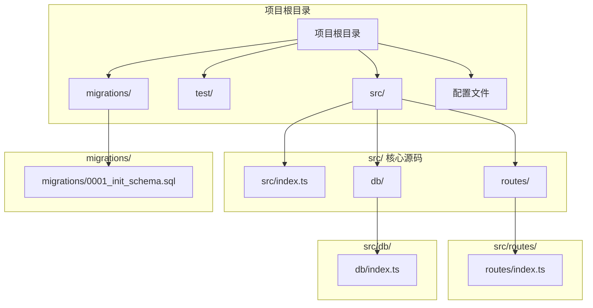

**图表来源**

- [src/index.ts](file://src/index.ts#L1-L105)
- [src/routes/index.ts](file://src/routes/index.ts#L1-L234)
- [src/db/index.ts](file://src/db/index.ts#L1-L251)

**章节来源**

- [src/index.ts](file://src/index.ts#L1-L105)
- [package.json](file://package.json#L1-L41)

## 核心组件

### 应用入口与环境配置

应用入口位于`src/index.ts`，负责初始化Hono应用、设置CORS中间件、路由注册和全局错误处理。

**核心特性：**

- 使用Hono框架构建轻量级Web应用
- 配置CORS跨域资源共享
- 定义环境绑定接口（D1数据库和API密钥）
- 实现统一的错误处理机制
- 提供定时任务支持（清理过期数据）

### 数据模型定义

系统定义了标准的笔记数据结构，支持加密存储和版本控制：

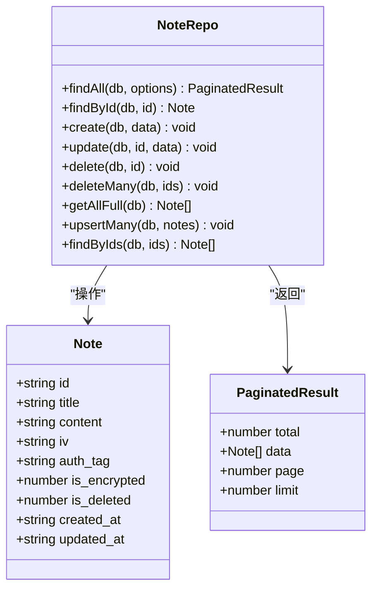

**图表来源**

- [src/index.ts](file://src/index.ts#L16-L36)
- [src/db/index.ts](file://src/db/index.ts#L43-L250)

**章节来源**

- [src/index.ts](file://src/index.ts#L8-L36)

## 架构概览

Notes Server采用分层架构设计，实现了清晰的关注点分离：

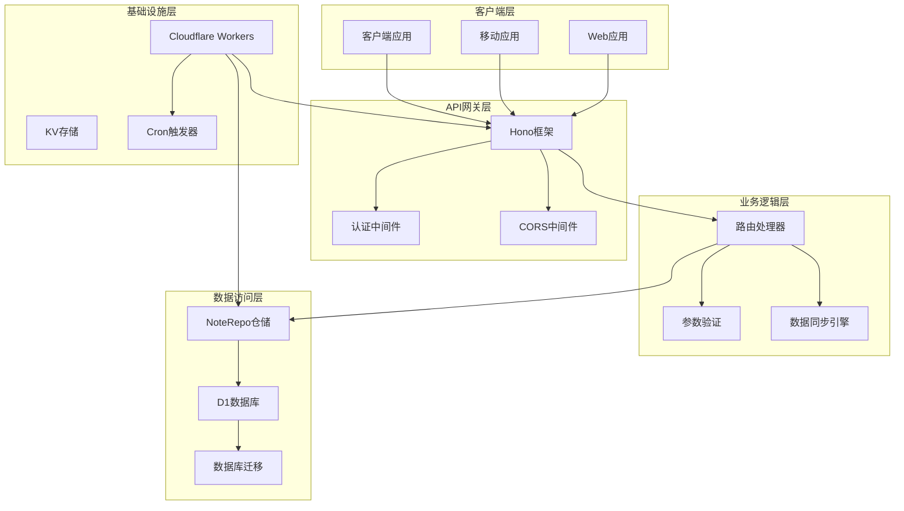

**图表来源**

- [src/index.ts](file://src/index.ts#L38-L75)
- [src/routes/index.ts](file://src/routes/index.ts#L5-L15)
- [src/db/index.ts](file://src/db/index.ts#L43-L250)

## 详细组件分析

### 认证机制

系统采用简单的Bearer Token认证机制，确保API调用的安全性：

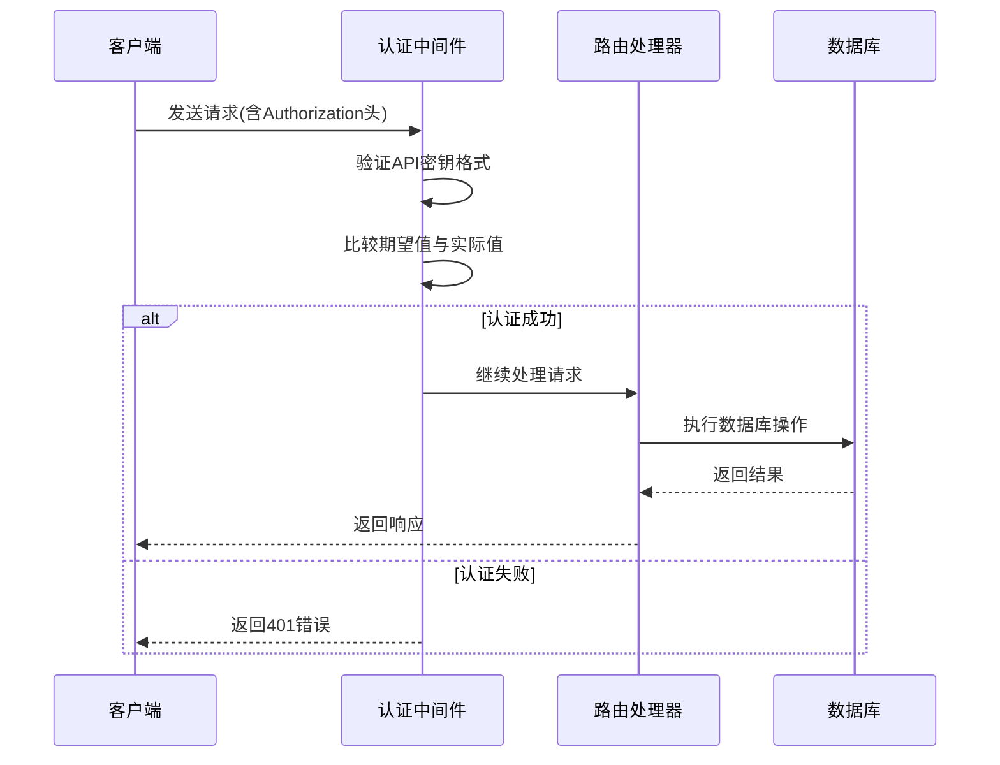

**图表来源**

- [src/routes/index.ts](file://src/routes/index.ts#L8-L15)

认证流程特点：

- 使用`Authorization: Bearer {API_KEY}`头部
- 支持动态API密钥配置
- 全局中间件保护所有路由
- 自动拒绝未认证请求

**章节来源**

- [src/routes/index.ts](file://src/routes/index.ts#L8-L15)

### 笔记CRUD操作

#### 列表查询接口

**GET** `/api/notes`

支持分页查询和搜索功能：

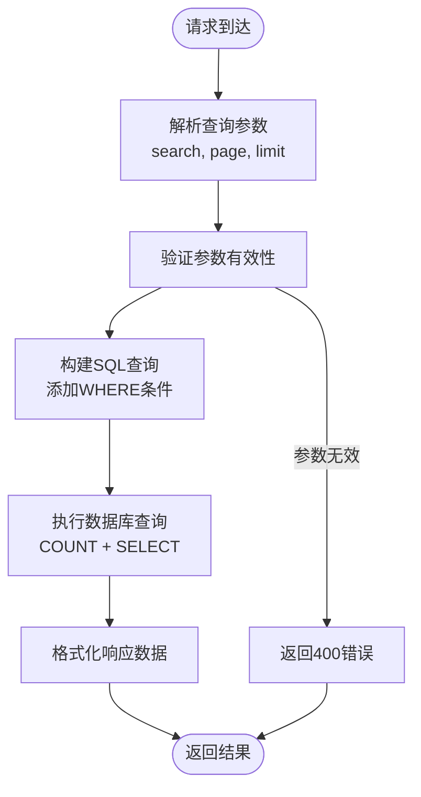

**图表来源**

- [src/routes/index.ts](file://src/routes/index.ts#L31-L37)
- [src/db/index.ts](file://src/db/index.ts#L45-L91)

**请求参数：**

- `search`: 可选，按标题或内容搜索
- `page`: 可选，默认1，最小1
- `limit`: 可选，默认20，最大100

**响应格式：**

```json
{
  "total": 25,
  "data": [...],
  "page": 1,
  "limit": 20
}
```

#### 详情查询接口

**GET** `/api/notes/:id`

根据ID获取单个笔记的完整信息，自动进行Base64解码处理。

**章节来源**

- [src/routes/index.ts](file://src/routes/index.ts#L40-L44)
- [src/db/index.ts](file://src/db/index.ts#L94-L97)

#### 创建笔记接口

**POST** `/api/notes`

支持客户端指定创建时间和自动时间验证：

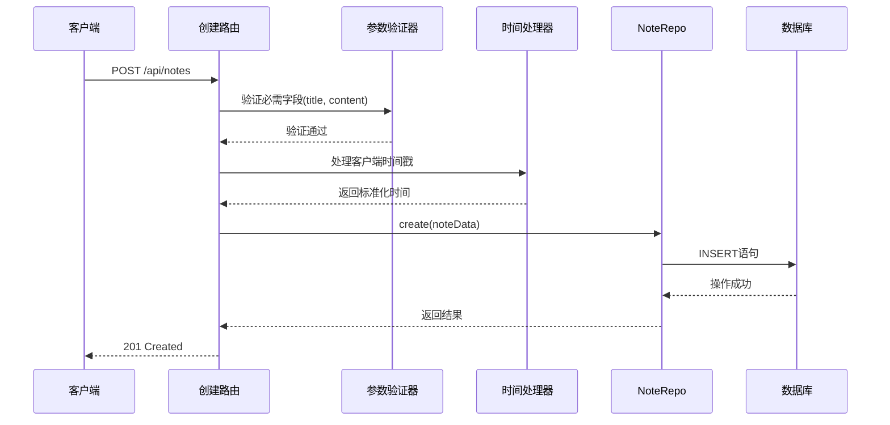

**图表来源**

- [src/routes/index.ts](file://src/routes/index.ts#L47-L82)
- [src/db/index.ts](file://src/db/index.ts#L100-L123)

**请求体字段：**

- `id`: 必需，UUID格式
- `title`: 必需，笔记标题
- `content`: 必需，Base64编码的加密内容
- `iv`: 可选，Base64编码的初始化向量
- `auth_tag`: 可选，Base64编码的认证标签
- `is_encrypted`: 可选，默认1（已加密）
- `created_at`: 可选，客户端创建时间
- `updated_at`: 可选，客户端更新时间

**章节来源**

- [src/routes/index.ts](file://src/routes/index.ts#L47-L82)

#### 更新笔记接口

**PATCH** `/api/notes/:id`

支持部分字段更新和时间戳管理：

**章节来源**

- [src/routes/index.ts](file://src/routes/index.ts#L85-L106)
- [src/db/index.ts](file://src/db/index.ts#L125-L176)

#### 删除笔记接口

**DELETE** `/api/notes/:id`

实现软删除机制，保留数据历史：

**章节来源**

- [src/routes/index.ts](file://src/routes/index.ts#L109-L113)
- [src/db/index.ts](file://src/db/index.ts#L179-L183)

### 批量操作接口

#### 批量删除接口

**DELETE** `/api/notes/batch`

支持一次性删除多个笔记：

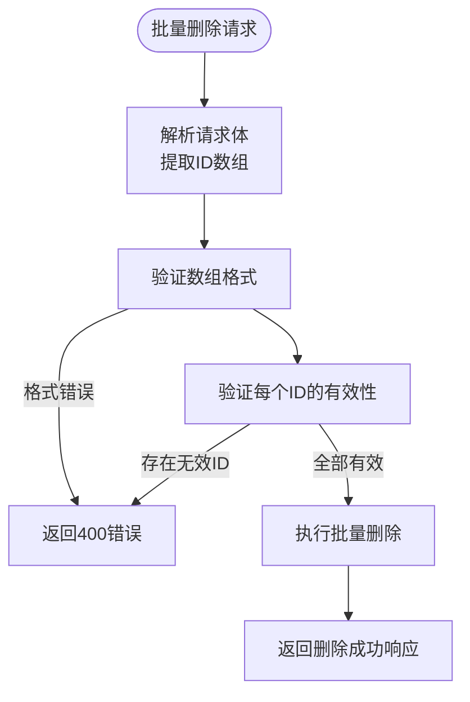

**图表来源**

- [src/routes/index.ts](file://src/routes/index.ts#L116-L136)

**请求体格式：**

```json
{
	"ids": ["id1", "id2", "id3"]
}
```

**响应格式：**

```json
{
	"success": true,
	"deletedCount": 3
}
```

#### 批量插入/更新接口

**POST** `/api/notes/batch`

支持批量数据导入和更新：

**章节来源**

- [src/routes/index.ts](file://src/routes/index.ts#L199-L231)
- [src/db/index.ts](file://src/db/index.ts#L202-L237)

### 数据同步接口

**POST** `/api/notes/sync`

实现双向数据同步，处理冲突解决：

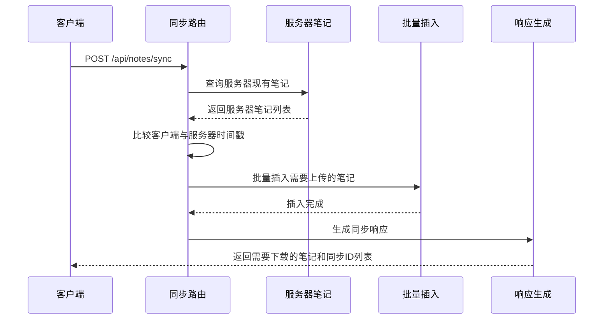

**图表来源**

- [src/routes/index.ts](file://src/routes/index.ts#L139-L197)

**同步算法：**

1. 获取客户端提交的笔记列表
2. 查询服务器上对应的笔记
3. 比较每个笔记的更新时间
4. 将需要上传的笔记批量插入
5. 返回需要下载到客户端的笔记

**响应格式：**

```json
{
  "success": true,
  "updates": [...],  // 需要下载的笔记
  "syncedIds": [...] // 同步成功的笔记ID
}
```

**章节来源**

- [src/routes/index.ts](file://src/routes/index.ts#L139-L197)

### 数据导出接口

**GET** `/api/notes/export/all`

提供完整的数据导出功能：

**章节来源**

- [src/routes/index.ts](file://src/routes/index.ts#L18-L28)
- [src/db/index.ts](file://src/db/index.ts#L194-L200)

## 依赖关系分析

### 外部依赖

项目使用以下关键依赖：

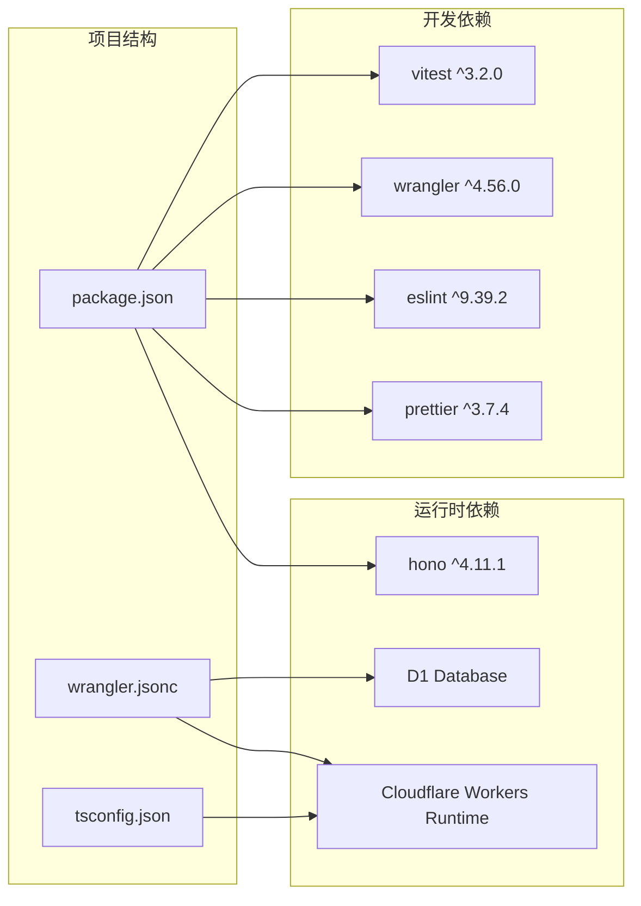

**图表来源**

- [package.json](file://package.json#L32-L34)
- [wrangler.jsonc](file://wrangler.jsonc#L13-L19)

### 内部模块依赖

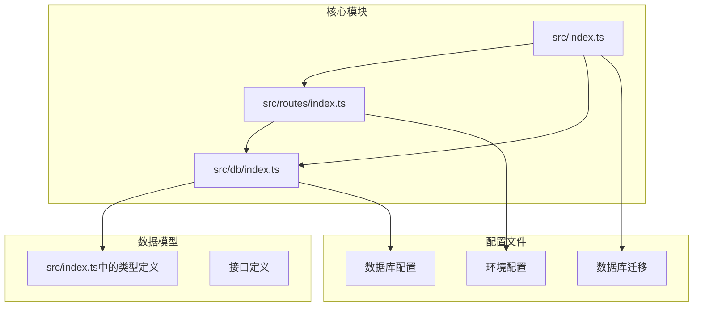

**图表来源**

- [src/index.ts](file://src/index.ts#L3-L40)
- [src/routes/index.ts](file://src/routes/index.ts#L1-L5)
- [src/db/index.ts](file://src/db/index.ts#L1-L6)

**章节来源**

- [package.json](file://package.json#L18-L34)

## 性能考虑

### 数据库优化

系统针对D1数据库进行了专门优化：

1. **索引策略**：
   - 标题索引：支持快速搜索
   - 软删除索引：快速过滤已删除笔记
   - 复合索引：按删除状态和更新时间排序

2. **查询优化**：
   - 使用批量查询减少网络往返
   - 分页查询避免大量数据传输
   - 条件查询精确匹配

3. **内存管理**：
   - Base64编码减少存储空间
   - 软删除避免物理删除开销
   - 定时清理过期数据

### 缓存策略

虽然当前实现未使用缓存，但建议考虑：

1. **读缓存**：热门笔记内容缓存
2. **查询缓存**：常用查询结果缓存
3. **元数据缓存**：统计信息缓存

### 并发处理

系统支持高并发请求处理：

1. **异步处理**：所有数据库操作都是异步的
2. **批处理**：批量操作减少事务开销
3. **连接池**：D1自动管理连接池

## 故障排除指南

### 常见错误类型

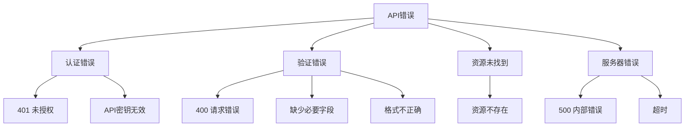

### 错误响应格式

所有错误响应遵循统一格式：

```json
{
	"success": false,
	"error": "错误代码",
	"message": "错误描述",
	"timestamp": "ISO 8601时间戳"
}
```

### 调试技巧

1. **启用日志**：检查Cloudflare Workers日志
2. **参数验证**：确保所有必需字段都已提供
3. **时间戳格式**：使用ISO 8601格式的时间戳
4. **Base64编码**：确保加密内容正确编码

**章节来源**

- [src/index.ts](file://src/index.ts#L41-L63)
- [test/index.spec.ts](file://test/index.spec.ts#L35-L46)

## 结论

Notes Server提供了一个完整、高效且安全的笔记管理API解决方案。其设计特点包括：

1. **安全性**：基于Bearer Token的认证机制
2. **可靠性**：软删除机制和数据备份功能
3. **性能**：针对D1数据库优化的查询和索引
4. **可扩展性**：模块化架构支持功能扩展
5. **易用性**：简洁的RESTful API设计

该系统特别适合构建去中心化的笔记应用，支持多设备同步和数据备份需求。

## 附录

### 数据库表结构

```sql
CREATE TABLE notes (
  id           TEXT PRIMARY KEY NOT NULL,
  title        TEXT             NOT NULL,
  content      BLOB             NOT NULL,
  iv           BLOB,
  auth_tag     BLOB,
  is_encrypted INTEGER          NOT NULL DEFAULT 1,
  is_deleted   INTEGER          NOT NULL DEFAULT 0,
  created_at   TEXT             NOT NULL,
  updated_at   TEXT             NOT NULL
);

CREATE INDEX IF NOT EXISTS idx_notes_title ON notes (title);
CREATE INDEX IF NOT EXISTS idx_notes_is_deleted ON notes (is_deleted);
CREATE INDEX IF NOT EXISTS idx_notes_is_deleted_updated_at ON notes (is_deleted, updated_at DESC);
```

### 部署配置

系统使用Cloudflare Workers部署，支持以下配置：

- **运行时**：Node.js 18+兼容
- **数据库**：Cloudflare D1
- **触发器**：定时清理任务
- **可观测性**：内置监控和日志

### 开发工具链

- **测试**：Vitest + Cloudflare Test
- **格式化**：Prettier
- **代码检查**：ESLint
- **构建**：Wrangler CLI
