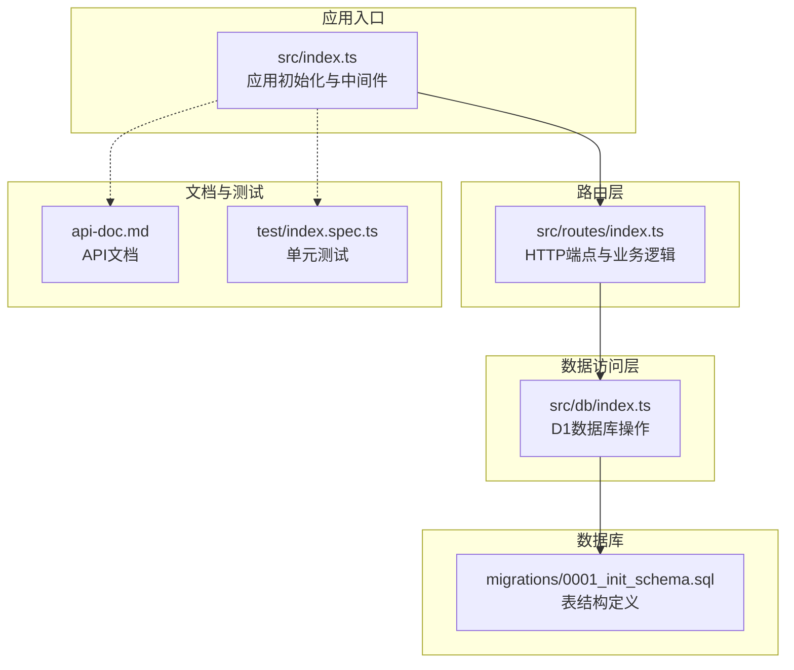
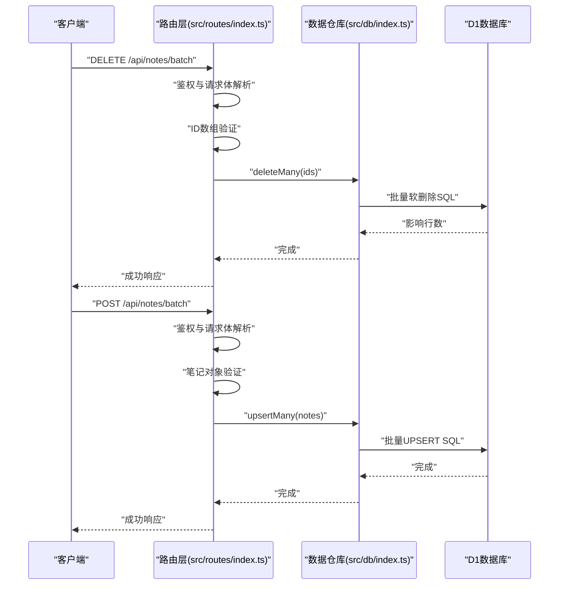
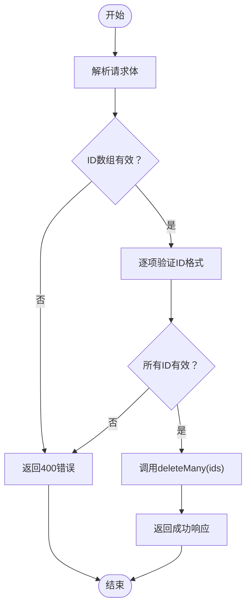
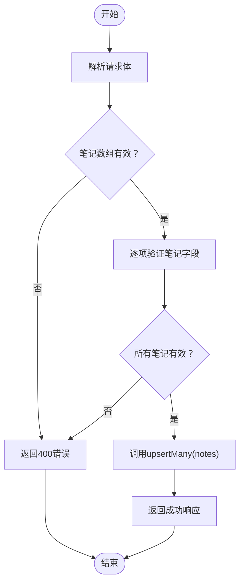
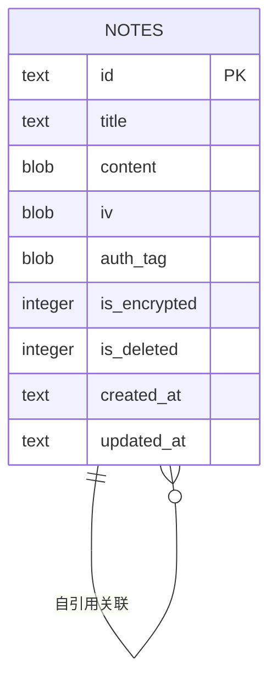
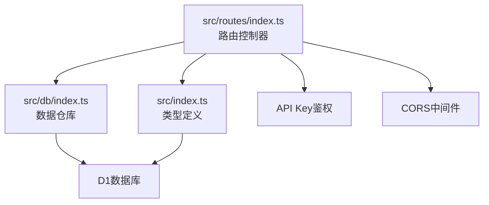

# 批量操作API

<cite>
**本文档引用的文件**
- [src/routes/index.ts](file://src/routes/index.ts)
- [src/db/index.ts](file://src/db/index.ts)
- [src/index.ts](file://src/index.ts)
- [api-doc.md](file://api-doc.md)
- [migrations/0001_init_schema.sql](file://migrations/0001_init_schema.sql)
- [test/index.spec.ts](file://test/index.spec.ts)
</cite>

## 目录

1. [简介](#简介)
2. [项目结构](#项目结构)
3. [核心组件](#核心组件)
4. [架构概览](#架构概览)
5. [详细组件分析](#详细组件分析)
6. [依赖关系分析](#依赖关系分析)
7. [性能考量](#性能考量)
8. [故障排除指南](#故障排除指南)
9. [结论](#结论)
10. [附录](#附录)

## 简介

本文件专注于批量操作API的详细接口文档，重点覆盖两个核心端点：

- 批量删除：DELETE /api/notes/batch
- 批量插入/更新：POST /api/notes/batch

文档将详细说明请求格式、数据验证规则、错误处理机制，并提供性能优化建议与最佳实践指导。

## 项目结构

该项目采用基于功能模块的分层组织方式：

- 路由层：定义HTTP端点与请求处理逻辑
- 数据访问层：封装D1数据库操作与批量事务
- 应用入口：配置中间件、CORS与全局错误处理
- 文档与测试：提供API文档与单元测试



图表来源

- [src/index.ts](file://src/index.ts#L38-L51)
- [src/routes/index.ts](file://src/routes/index.ts#L1-L234)
- [src/db/index.ts](file://src/db/index.ts#L43-L250)
- [migrations/0001_init_schema.sql](file://migrations/0001_init_schema.sql#L1-L17)

章节来源

- [src/index.ts](file://src/index.ts#L38-L51)
- [src/routes/index.ts](file://src/routes/index.ts#L1-L234)
- [src/db/index.ts](file://src/db/index.ts#L43-L250)
- [migrations/0001_init_schema.sql](file://migrations/0001_init_schema.sql#L1-L17)

## 核心组件

- 路由控制器：负责鉴权、请求解析、数据验证与响应生成
- 数据仓库：封装批量删除与批量插入/更新的数据库操作
- 应用入口：统一处理CORS、错误与未匹配路由

章节来源

- [src/routes/index.ts](file://src/routes/index.ts#L7-L15)
- [src/db/index.ts](file://src/db/index.ts#L185-L237)
- [src/index.ts](file://src/index.ts#L38-L51)

## 架构概览

批量操作API的调用流程如下：



图表来源

- [src/routes/index.ts](file://src/routes/index.ts#L115-L136)
- [src/routes/index.ts](file://src/routes/index.ts#L199-L231)
- [src/db/index.ts](file://src/db/index.ts#L185-L237)

## 详细组件分析

### 批量删除接口（DELETE /api/notes/batch）

#### 接口定义

- 方法：DELETE
- 路径：/api/notes/batch
- 认证：需要在请求头中提供有效的Bearer Token

#### 请求体格式

- 结构：包含一个名为ids的数组
- 数据类型：string[]
- 必填字段：ids
- 约束：
  - 数组长度必须大于0
  - 每个元素必须是非空字符串

#### 请求示例

```json
{
	"ids": ["550e8400-e29b-41d4-a716-446655440000", "550e8400-e29b-41d4-a716-446655440001"]
}
```

#### 响应格式

- 成功响应：
  - 结构：包含success标志与deletedCount计数
  - deletedCount：被删除的笔记数量
- 错误响应：
  - BAD_REQUEST：当请求体格式不正确或ID验证失败时
  - UNAUTHORIZED：当API Key无效时

#### 数据验证规则

- ID数组验证：
  - 必须为数组且长度大于0
  - 每个ID必须为字符串且非空
- 错误处理：
  - 非法请求体：返回400错误
  - 异常情况：捕获异常并返回400错误

#### 处理流程图



图表来源

- [src/routes/index.ts](file://src/routes/index.ts#L115-L136)
- [src/db/index.ts](file://src/db/index.ts#L185-L191)

#### 实现细节

- 使用NoteRepo.deleteMany进行批量软删除
- 软删除策略：更新is_deleted标志并清空内容
- 批量操作通过D1的IN子句实现

章节来源

- [src/routes/index.ts](file://src/routes/index.ts#L115-L136)
- [src/db/index.ts](file://src/db/index.ts#L185-L191)

### 批量插入/更新接口（POST /api/notes/batch）

#### 接口定义

- 方法：POST
- 路径：/api/notes/batch
- 认证：需要在请求头中提供有效的Bearer Token

#### 请求体格式

- 结构：包含一个名为notes的数组
- 数据类型：Note[]
- 必填字段：notes
- 约束：
  - 数组长度必须大于0
  - 每个笔记对象必须包含：
    - id：非空字符串
    - title：非空字符串
    - content：字符串（Base64编码的二进制数据）

#### 笔记对象字段规范

- id：字符串，作为主键
- title：字符串，笔记标题
- content：字符串，Base64编码的加密内容
- iv：可选，Base64编码的初始化向量
- auth_tag：可选，Base64编码的认证标签
- is_encrypted：数字，0表示未加密，1表示已加密
- created_at：字符串，ISO 8601格式的时间戳
- updated_at：字符串，ISO 8601格式的时间戳

#### 请求示例

```json
{
	"notes": [
		{
			"id": "550e8400-e29b-41d4-a716-446655440000",
			"title": "笔记标题",
			"content": "YmluYXJ5Q29udGVudEJhc2U2NEVuY29kZWQ=",
			"iv": "aXZCYXNlNjRCbG9i",
			"auth_tag": "YXV0aFRhZ0Jhc2U2NEJsb2I=",
			"is_encrypted": 1,
			"created_at": "2025-12-24T05:43:29.724Z",
			"updated_at": "2025-12-24T05:43:29.724Z"
		}
	]
}
```

#### 响应格式

- 成功响应：
  - 结构：包含success标志与insertedUpdatedCount计数
  - insertedUpdatedCount：被插入或更新的笔记数量
- 错误响应：
  - BAD_REQUEST：当请求体格式不正确或数据验证失败时
  - UNAUTHORIZED：当API Key无效时

#### 数据验证规则

- 笔记数组验证：
  - 必须为数组且长度大于0
- 单个笔记对象验证：
  - 必须包含id、title、content字段
  - id必须为非空字符串
  - title和content必须为字符串
- 错误处理：
  - 非法请求体：返回400错误
  - 异常情况：捕获异常并返回400错误

#### 处理流程图



图表来源

- [src/routes/index.ts](file://src/routes/index.ts#L199-L231)
- [src/db/index.ts](file://src/db/index.ts#L202-L237)

#### 实现细节

- 使用NoteRepo.upsertMany进行批量插入/更新
- UPSERT策略：根据id冲突自动更新现有记录
- 数据转换：Base64字符串与二进制数据的相互转换
- 批量操作通过D1的ON CONFLICT子句实现

章节来源

- [src/routes/index.ts](file://src/routes/index.ts#L199-L231)
- [src/db/index.ts](file://src/db/index.ts#L202-L237)

### 数据模型与数据库结构



图表来源

- [migrations/0001_init_schema.sql](file://migrations/0001_init_schema.sql#L1-L17)

数据库索引设计：

- 主键：id
- 名称索引：title
- 软删除索引：is_deleted
- 组合索引：(is_deleted, updated_at DESC)

章节来源

- [migrations/0001_init_schema.sql](file://migrations/0001_init_schema.sql#L1-L17)

## 依赖关系分析



图表来源

- [src/routes/index.ts](file://src/routes/index.ts#L1-L234)
- [src/db/index.ts](file://src/db/index.ts#L43-L250)
- [src/index.ts](file://src/index.ts#L8-L36)

依赖关系特点：

- 路由层与数据层松耦合，通过接口契约通信
- 数据仓库封装了数据库操作细节
- 应用入口集中处理中间件与错误处理

章节来源

- [src/routes/index.ts](file://src/routes/index.ts#L1-L234)
- [src/db/index.ts](file://src/db/index.ts#L43-L250)
- [src/index.ts](file://src/index.ts#L38-L51)

## 性能考量

### 批量操作优化策略

1. **批量事务处理**
   - 使用D1的批量操作API减少网络往返
   - 单次请求处理多个操作，降低协议开销

2. **内存管理**
   - 控制批量大小，避免单次请求过大
   - 建议每次批量操作不超过100条记录

3. **数据库优化**
   - 利用现有索引提高查询效率
   - 软删除策略避免物理删除带来的索引重建

4. **数据转换优化**
   - Base64与二进制数据转换在服务端完成
   - 减少客户端预处理负担

### 性能基准建议

- 单次批量操作建议：
  - 删除：50-100个ID
  - 插入/更新：50-200个笔记对象
- 超大数据集处理：
  - 分批发送，每批独立确认
  - 实施重试机制与幂等性保证

## 故障排除指南

### 常见错误与解决方案

#### 认证失败（401 Unauthorized）

- 症状：返回"API Key 无效"
- 解决方案：
  - 检查Authorization头格式：Bearer {API_KEY}
  - 验证API_KEY配置正确
  - 确认请求头大小写正确

#### 请求格式错误（400 Bad Request）

- 症状：批量删除返回"ID列表不能为空"或"所有ID必须为非空字符串"
- 症状：批量插入返回"笔记列表不能为空"或"每条笔记必须包含ID、标题和内容"
- 解决方案：
  - 确保请求体为有效的JSON格式
  - 验证数组不为空且元素类型正确
  - 检查必填字段完整性

#### 数据验证失败

- 症状：ID或笔记对象字段类型不正确
- 解决方案：
  - 确保id为非空字符串
  - 确保title和content为字符串类型
  - 验证Base64编码的有效性

#### 数据库操作异常

- 症状：批量操作超时或失败
- 解决方案：
  - 检查网络连接稳定性
  - 减少单次批量大小
  - 实施重试策略

### 调试技巧

1. **启用日志**
   - 查看服务端控制台输出
   - 监控批量操作的执行时间

2. **分步调试**
   - 先测试小批量数据
   - 逐步增加批量大小
   - 验证每一步的结果

3. **单元测试**
   - 运行现有测试用例
   - 添加边界条件测试

章节来源

- [src/routes/index.ts](file://src/routes/index.ts#L115-L136)
- [src/routes/index.ts](file://src/routes/index.ts#L199-L231)
- [test/index.spec.ts](file://test/index.spec.ts#L48-L102)

## 结论

批量操作API提供了高效的笔记数据管理能力，通过合理的数据验证、批量事务处理和性能优化策略，能够满足大规模笔记数据的处理需求。建议在生产环境中实施适当的批量大小控制、重试机制和监控告警，以确保系统的稳定性和可靠性。

## 附录

### API端点对照表

| 端点             | 方法   | 功能描述          | 认证要求 |
| ---------------- | ------ | ----------------- | -------- |
| /api/notes/batch | DELETE | 批量删除笔记      | 是       |
| /api/notes/batch | POST   | 批量插入/更新笔记 | 是       |

### 最佳实践建议

1. **数据准备**
   - 在客户端进行基础数据校验
   - 确保Base64编码的正确性
   - 验证UUID格式的合法性

2. **批量策略**
   - 根据网络环境调整批量大小
   - 实施幂等性设计避免重复操作
   - 添加操作结果确认机制

3. **错误处理**
   - 实现指数退避重试
   - 区分可重试与不可重试错误
   - 记录详细的错误日志

4. **监控与告警**
   - 监控批量操作成功率
   - 设置延迟告警阈值
   - 跟踪批量操作耗时分布
