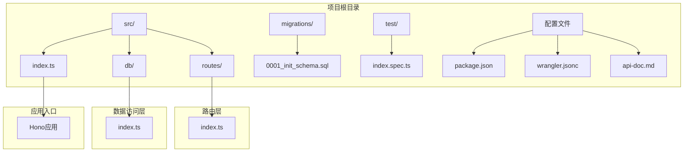
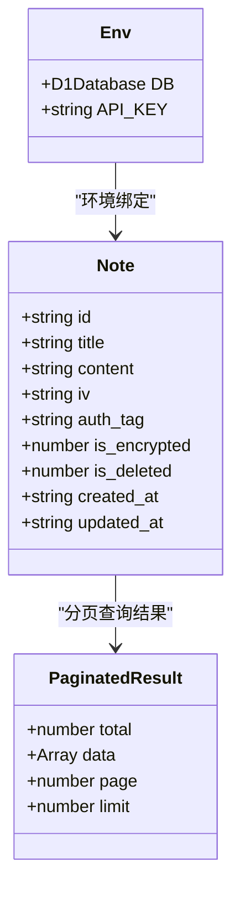
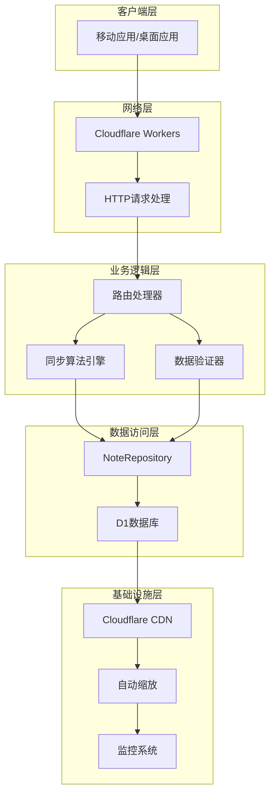
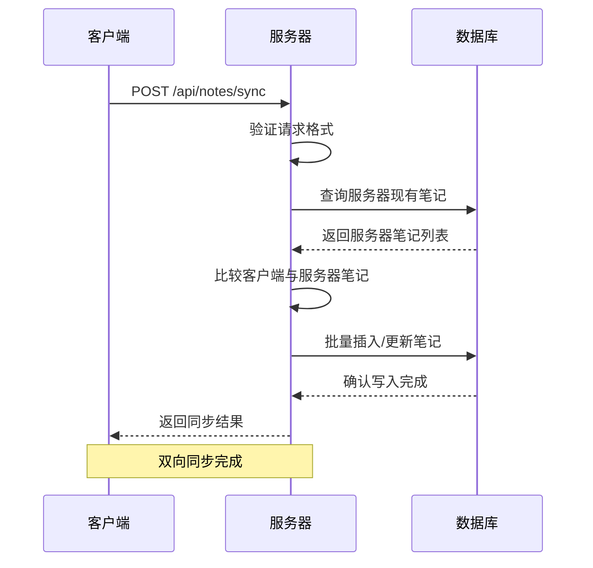
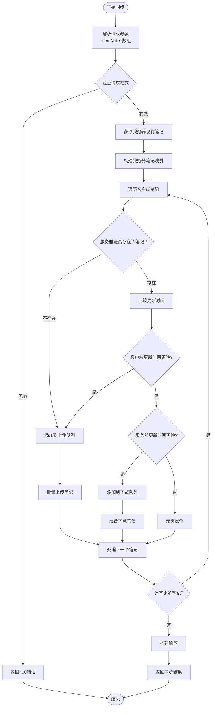
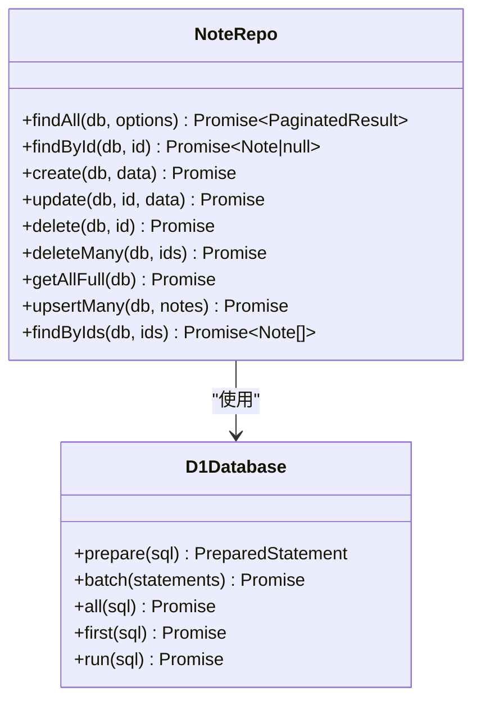
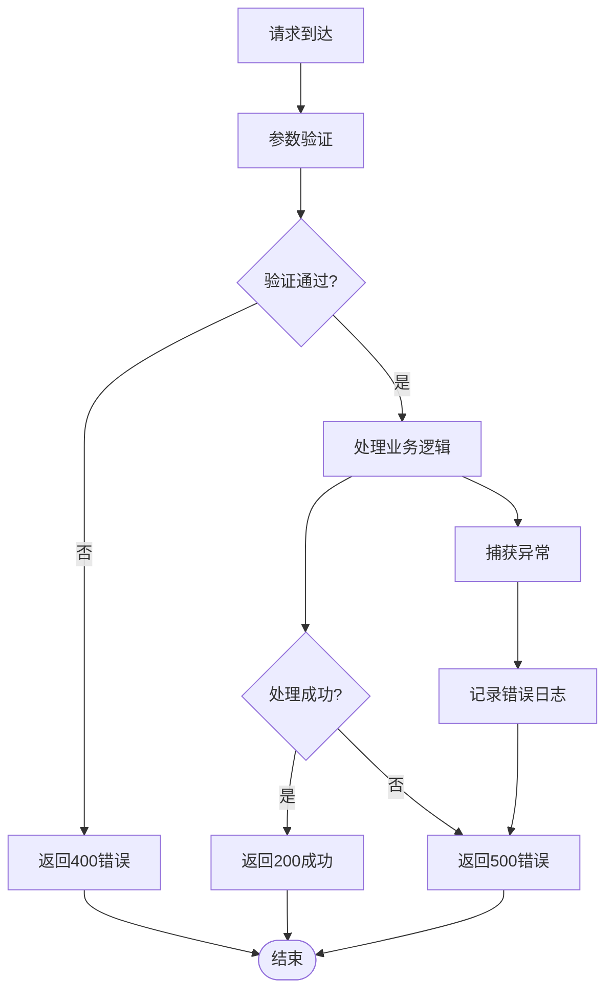
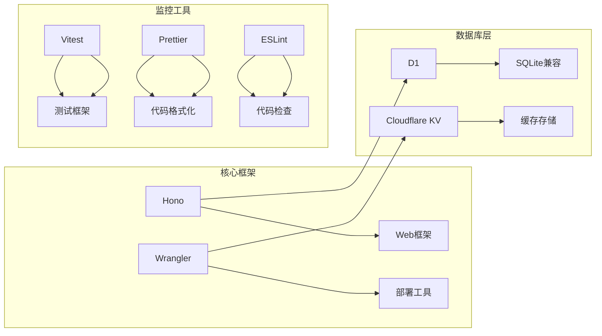
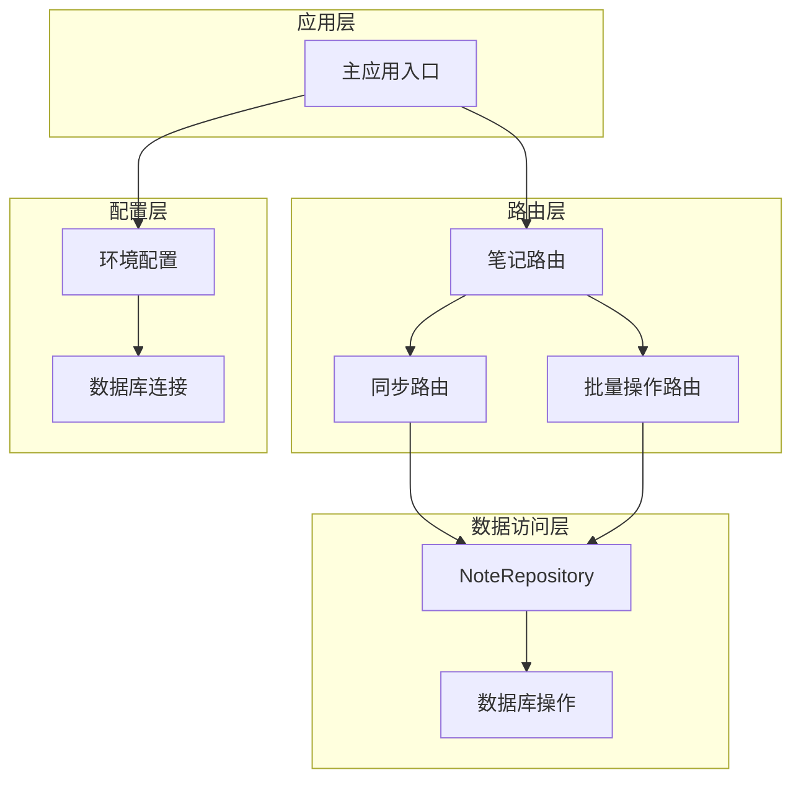
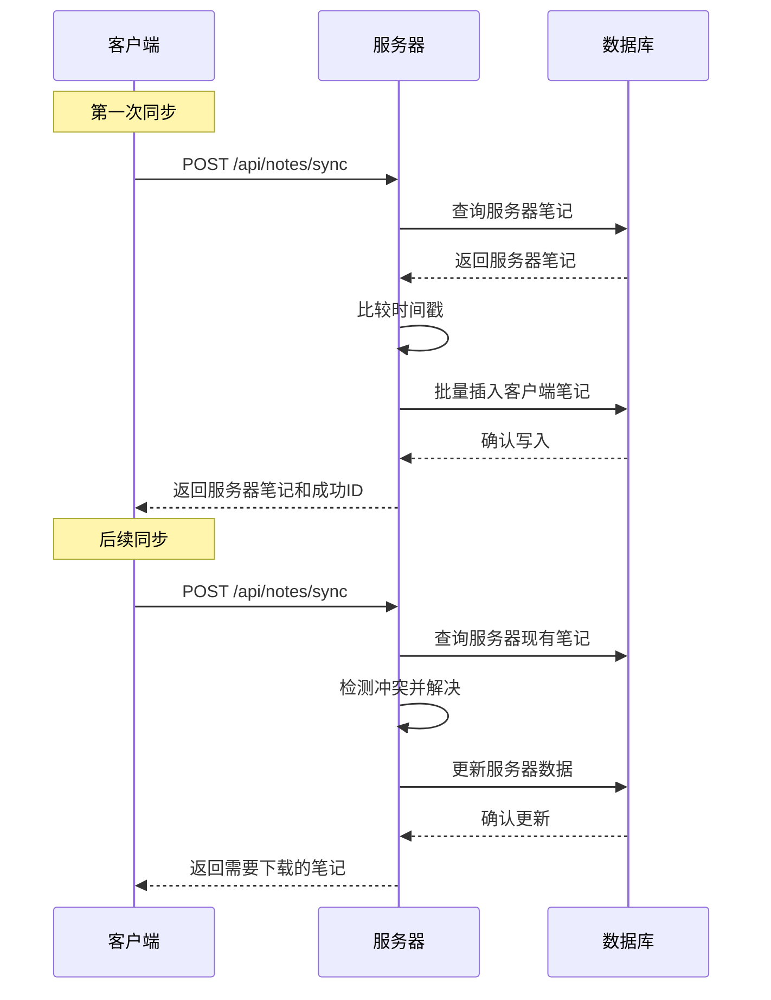

# 数据同步API

<cite>
**本文档引用的文件**
- [src/routes/index.ts](file://src/routes/index.ts)
- [src/db/index.ts](file://src/db/index.ts)
- [src/index.ts](file://src/index.ts)
- [api-doc.md](file://api-doc.md)
- [migrations/0001_init_schema.sql](file://migrations/0001_init_schema.sql)
- [package.json](file://package.json)
- [wrangler.jsonc](file://wrangler.jsonc)
</cite>

## 目录

1. [简介](#简介)
2. [项目结构](#项目结构)
3. [核心组件](#核心组件)
4. [架构概览](#架构概览)
5. [详细组件分析](#详细组件分析)
6. [依赖关系分析](#依赖关系分析)
7. [性能考虑](#性能考虑)
8. [故障排除指南](#故障排除指南)
9. [结论](#结论)
10. [附录](#附录)

## 简介

数据同步API是基于Cloudflare Workers构建的RESTful API服务，专门用于实现客户端与服务器之间的双向笔记同步。该系统采用Hono框架开发，使用D1数据库进行数据持久化，支持实时双向同步、冲突检测和自动解决机制。

本API的核心功能是通过单一的同步端点实现客户端与服务器之间的数据一致性保证，确保在多设备环境下用户的笔记数据能够保持最新状态。

## 项目结构

该项目采用模块化的文件组织结构，主要分为以下几个核心目录：



**图表来源**

- [src/index.ts](file://src/index.ts#L1-L105)
- [src/routes/index.ts](file://src/routes/index.ts#L1-L234)
- [src/db/index.ts](file://src/db/index.ts#L1-L251)

**章节来源**

- [src/index.ts](file://src/index.ts#L1-L105)
- [package.json](file://package.json#L1-L41)

## 核心组件

### 数据模型定义

系统的核心数据结构是Note对象，采用TypeScript接口定义：



**图表来源**

- [src/index.ts](file://src/index.ts#L14-L36)

### 数据库架构

系统使用Cloudflare D1作为后端数据库，采用SQLite兼容的存储引擎：

```mermaid
erDiagram
NOTES {
TEXT id PK
TEXT title
BLOB content
BLOB iv
BLOB auth_tag
INTEGER is_encrypted
INTEGER is_deleted
TEXT created_at
TEXT updated_at
}
INDEXES {
idx_notes_title
idx_notes_is_deleted
idx_notes_is_deleted_updated_at
}
NOTES ||--o{ INDEXES : "has"
```

**图表来源**

- [migrations/0001_init_schema.sql](file://migrations/0001_init_schema.sql#L1-L17)

**章节来源**

- [src/index.ts](file://src/index.ts#L14-L36)
- [migrations/0001_init_schema.sql](file://migrations/0001_init_schema.sql#L1-L17)

## 架构概览

数据同步API采用分层架构设计，确保关注点分离和代码可维护性：



**图表来源**

- [src/routes/index.ts](file://src/routes/index.ts#L1-L234)
- [src/db/index.ts](file://src/db/index.ts#L43-L251)

## 详细组件分析

### 同步接口实现

#### 接口规范

POST `/api/notes/sync` 是系统的核心同步端点，负责处理客户端与服务器之间的双向数据同步。

**请求格式要求**：



**图表来源**

- [src/routes/index.ts](file://src/routes/index.ts#L138-L197)

#### 同步算法工作原理

系统实现了基于时间戳的冲突检测和解决机制：



**图表来源**

- [src/routes/index.ts](file://src/routes/index.ts#L138-L197)

#### 数据验证规则

系统对请求数据实施严格验证：

| 字段名称     | 必填 | 数据类型 | 验证规则           | 错误处理       |
| ------------ | ---- | -------- | ------------------ | -------------- |
| clientNotes  | 是   | 数组     | 必须为数组且不为空 | 返回400错误    |
| id           | 是   | 字符串   | UUID格式，非空     | 返回400错误    |
| title        | 是   | 字符串   | 非空，长度限制     | 返回400错误    |
| content      | 是   | 字符串   | Base64编码，非空   | 返回400错误    |
| is_encrypted | 否   | 数字     | 0或1，默认1        | 使用默认值     |
| created_at   | 否   | ISO 8601 | 有效日期格式       | 使用服务器时间 |
| updated_at   | 否   | ISO 8601 | 有效日期格式       | 使用服务器时间 |

**章节来源**

- [src/routes/index.ts](file://src/routes/index.ts#L138-L197)

### 数据库操作实现

#### 批量操作优化

系统使用D1的批量操作功能来提高性能：



**图表来源**

- [src/db/index.ts](file://src/db/index.ts#L43-L251)

#### 加密数据处理

系统支持端到端加密的数据存储：

| 加密组件   | 编码格式 | 存储方式 | 验证机制      |
| ---------- | -------- | -------- | ------------- |
| 内容数据   | Base64   | BLOB     | 自动解码/编码 |
| 初始化向量 | Base64   | BLOB     | 可选字段      |
| 认证标签   | Base64   | BLOB     | 可选字段      |
| 加密状态   | 数字     | 整数     | 0/1标志位     |

**章节来源**

- [src/db/index.ts](file://src/db/index.ts#L1-L29)
- [src/db/index.ts](file://src/db/index.ts#L202-L237)

### 错误处理机制

系统实现了多层次的错误处理策略：



**图表来源**

- [src/routes/index.ts](file://src/routes/index.ts#L138-L197)
- [src/index.ts](file://src/index.ts#L41-L51)

**章节来源**

- [src/index.ts](file://src/index.ts#L41-L51)

## 依赖关系分析

### 外部依赖

项目使用Cloudflare Workers生态系统的关键组件：



**图表来源**

- [package.json](file://package.json#L18-L34)

### 内部模块依赖



**图表来源**

- [src/index.ts](file://src/index.ts#L38-L40)
- [src/routes/index.ts](file://src/routes/index.ts#L1-L234)
- [src/db/index.ts](file://src/db/index.ts#L43-L251)

**章节来源**

- [package.json](file://package.json#L18-L34)

## 性能考虑

### 数据库优化策略

1. **索引优化**
   - 标题字段索引：支持快速搜索
   - 软删除状态索引：加速查询过滤
   - 组合索引：按删除状态和更新时间排序

2. **批量操作**
   - 使用D1的batch API减少网络往返
   - upsertMany操作避免重复查询
   - 批量插入提升吞吐量

3. **内存管理**
   - 使用Map数据结构进行O(1)查找
   - 及时释放临时数组和对象
   - 控制单次同步的笔记数量

### 网络优化

1. **请求大小控制**
   - 单次同步建议不超过100个笔记
   - Base64编码会增加约33%的数据体积
   - 合理设置客户端同步频率

2. **缓存策略**
   - 利用Cloudflare CDN缓存静态资源
   - 服务器端自动清理过期数据
   - 智能重试机制避免网络抖动

## 故障排除指南

### 常见问题诊断

#### 同步失败问题

**症状**：客户端收到500错误或同步超时

**可能原因**：

1. 数据库连接异常
2. 请求格式不符合规范
3. 服务器负载过高
4. 网络连接不稳定

**解决方案**：

1. 检查API密钥配置
2. 验证请求JSON格式
3. 减少单次同步的笔记数量
4. 实现指数退避重试

#### 数据不一致问题

**症状**：客户端显示过期数据或重复数据

**可能原因**：

1. 时间戳比较逻辑错误
2. 并发写入冲突
3. 网络中断导致部分同步

**解决方案**：

1. 确保客户端使用UTC时间
2. 实现幂等性设计
3. 添加数据版本号机制

#### 性能问题

**症状**：同步响应时间过长

**可能原因**：

1. 数据库查询性能不足
2. 客户端一次性提交过多数据
3. 网络延迟过高

**解决方案**：

1. 优化数据库索引
2. 分批处理大数据集
3. 实现增量同步

**章节来源**

- [src/routes/index.ts](file://src/routes/index.ts#L193-L196)
- [src/index.ts](file://src/index.ts#L41-L51)

### 调试工具和技巧

1. **启用详细日志**

   ```bash
   # 设置环境变量
   export LOG_LEVEL=debug
   ```

2. **本地开发调试**

   ```bash
   # 启动本地开发服务器
   npm run dev

   # 运行单元测试
   npm test
   ```

3. **监控指标**
   - 请求成功率
   - 平均响应时间
   - 数据库查询次数
   - 同步失败率

## 结论

数据同步API提供了完整的双向同步解决方案，具有以下优势：

1. **可靠性**：基于时间戳的冲突检测机制确保数据一致性
2. **性能**：批量操作和索引优化提供高效的数据处理能力
3. **安全性**：端到端加密支持保护用户隐私数据
4. **可扩展性**：Cloudflare Workers架构支持自动扩缩容
5. **易用性**：简洁的API设计降低集成复杂度

该系统适合需要跨设备同步笔记数据的应用场景，特别是对数据安全和实时性有较高要求的移动应用和桌面软件。

## 附录

### API使用示例

#### 基本同步流程



**图表来源**

- [src/routes/index.ts](file://src/routes/index.ts#L138-L197)

### 最佳实践建议

1. **客户端实现**
   - 实现增量同步，只传输变更数据
   - 使用本地缓存减少重复请求
   - 实现离线模式和冲突解决

2. **服务器配置**
   - 合理设置数据库索引
   - 监控API使用情况
   - 定期清理过期数据

3. **安全考虑**
   - 使用HTTPS传输
   - 定期轮换API密钥
   - 实施速率限制
