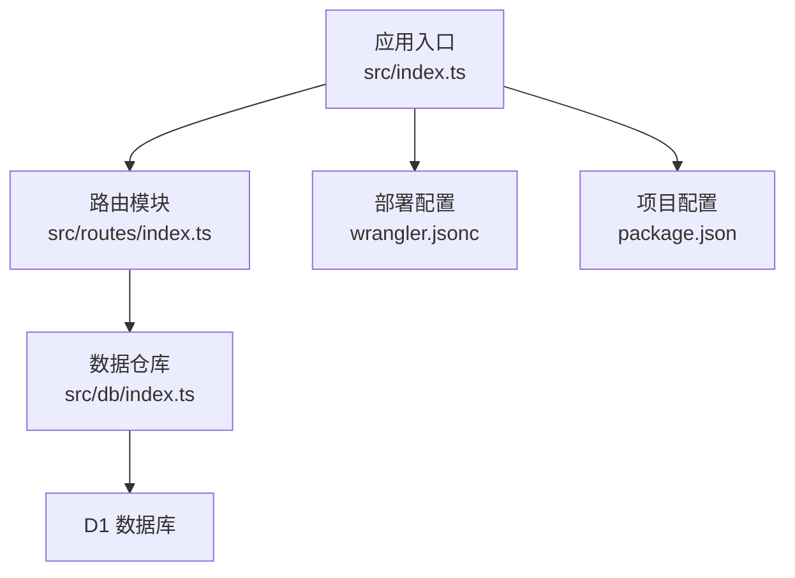
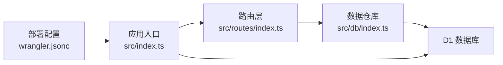

# 数据导出API

<cite>
**本文引用的文件**
- [src/routes/index.ts](file://src/routes/index.ts)
- [src/db/index.ts](file://src/db/index.ts)
- [src/index.ts](file://src/index.ts)
- [api-doc.md](file://api-doc.md)
- [migrations/0001_init_schema.sql](file://migrations/0001_init_schema.sql)
- [wrangler.jsonc](file://wrangler.jsonc)
- [package.json](file://package.json)
</cite>

## 目录

1. [简介](#简介)
2. [项目结构](#项目结构)
3. [核心组件](#核心组件)
4. [架构总览](#架构总览)
5. [详细组件分析](#详细组件分析)
6. [依赖关系分析](#依赖关系分析)
7. [性能考量](#性能考量)
8. [故障排查指南](#故障排查指南)
9. [结论](#结论)
10. [附录](#附录)

## 简介

本文件面向“数据导出API”的使用者与维护者，聚焦于导出所有笔记的接口（GET /api/notes/export/all）。文档涵盖接口功能、请求与响应规范、响应结构说明（成功响应的结构、时间戳信息、笔记数量统计、数据内容）、导出文件格式与命名规则（含 Content-Disposition 头部设置）、使用示例、性能与大文件处理建议、以及数据恢复与导入指引。目标是帮助读者在不深入源码的情况下，也能正确、安全地使用该接口完成完整的笔记备份与恢复工作。

## 项目结构

该项目基于 Hono 框架构建，采用分层设计：

- 入口与路由：应用入口负责注册中间件与路由，路由模块集中定义各端点。
- 数据访问层：封装对 D1 数据库的读写操作，统一进行数据类型转换与批量操作。
- 数据模型：定义 Note 与分页结果等核心数据结构。
- 迁移脚本：定义数据库表结构与索引。
- 部署配置：使用 Wrangler 在 Cloudflare Workers 上运行。



图表来源

- [src/index.ts](file://src/index.ts#L38-L40)
- [src/routes/index.ts](file://src/routes/index.ts#L1-L5)
- [src/db/index.ts](file://src/db/index.ts#L43-L250)
- [wrangler.jsonc](file://wrangler.jsonc#L5-L19)
- [package.json](file://package.json#L1-L41)

章节来源

- [src/index.ts](file://src/index.ts#L38-L40)
- [src/routes/index.ts](file://src/routes/index.ts#L1-L5)
- [src/db/index.ts](file://src/db/index.ts#L43-L250)
- [migrations/0001_init_schema.sql](file://migrations/0001_init_schema.sql#L1-L17)
- [wrangler.jsonc](file://wrangler.jsonc#L5-L19)
- [package.json](file://package.json#L1-L41)

## 核心组件

- 路由层：负责鉴权、导出接口的实现与响应格式化。
- 数据仓库层：负责与 D1 数据库交互，提供全量笔记查询、批量插入/更新、按 ID 查询等能力，并在读取时将二进制字段转换为 Base64 编码。
- 应用入口：注册 CORS、全局错误处理、404 处理，并暴露定时任务清理逻辑。
- 数据模型：Note 对象包含 id、title、content（Base64 编码的二进制数据）、iv、auth_tag、is_encrypted、created_at、updated_at；分页结果包含 total、data、page、limit。

章节来源

- [src/routes/index.ts](file://src/routes/index.ts#L7-L28)
- [src/db/index.ts](file://src/db/index.ts#L34-L41)
- [src/index.ts](file://src/index.ts#L16-L36)

## 架构总览

下图展示了导出接口从请求到响应的关键流程，包括鉴权、数据库查询、数据转换与响应构造。

```mermaid
sequenceDiagram
participant Client as "客户端"
participant Route as "路由层<br/>/api/notes/export/all"
participant Repo as "数据仓库<br/>getAllFull"
participant DB as "D1 数据库"
participant App as "应用入口<br/>CORS/错误处理"
Client->>Route : "GET /api/notes/export/all<br/>Authorization : Bearer {API_KEY}"
Route->>App : "鉴权中间件校验"
App-->>Route : "通过"
Route->>Repo : "getAllFull(DB)"
Repo->>DB : "SELECT * FROM notes WHERE is_deleted=0 ORDER BY updated_at DESC"
DB-->>Repo : "原始结果集"
Repo->>Repo : "convertNoteFromDb(row)<br/>content/iv/auth_tag -> Base64"
Repo-->>Route : "{results : 转换后的笔记数组}"
Route->>Route : "设置 Content-Disposition : attachment; filename=\"notes_backup.json\""
Route-->>Client : "JSON 响应<br/>{success, timestamp, count, data}"
```

图表来源

- [src/routes/index.ts](file://src/routes/index.ts#L7-L28)
- [src/db/index.ts](file://src/db/index.ts#L194-L200)
- [src/db/index.ts](file://src/db/index.ts#L34-L41)
- [src/index.ts](file://src/index.ts#L38-L51)

## 详细组件分析

### 接口定义与鉴权

- 方法与路径：GET /api/notes/export/all
- 鉴权方式：请求头 Authorization 使用 Bearer Token，值为配置的 API_KEY。
- 成功响应：返回 JSON，包含 success、timestamp、count、data 字段；同时设置 Content-Disposition 头部以触发浏览器下载。

章节来源

- [src/routes/index.ts](file://src/routes/index.ts#L7-L28)
- [api-doc.md](file://api-doc.md#L333-L343)

### 响应结构详解

- success：布尔值，表示请求是否成功。
- timestamp：ISO 8601 格式的导出时间戳。
- count：本次导出的笔记数量（等于 data 数组长度）。
- data：笔记数组，每条笔记对象包含：
  - id：UUID 标识
  - title：标题
  - content：Base64 编码的二进制内容
  - iv：Base64 编码的初始化向量（可选）
  - auth_tag：Base64 编码的认证标签（可选）
  - is_encrypted：是否加密（0/1）
  - created_at：创建时间（ISO 8601）
  - updated_at：更新时间（ISO 8601）

章节来源

- [src/routes/index.ts](file://src/routes/index.ts#L18-L28)
- [src/db/index.ts](file://src/db/index.ts#L34-L41)
- [api-doc.md](file://api-doc.md#L345-L365)

### 数据库与数据模型

- 表结构：notes 表包含 id、title、content（BLOB）、iv（BLOB）、auth_tag（BLOB）、is_encrypted、is_deleted、created_at、updated_at 等字段；并建立若干索引以优化查询。
- 数据转换：读取时将 BLOB 字段转换为 Base64 字符串，写入时再将 Base64 解码为二进制。
- 全量查询：仅返回未删除的笔记，并按 updated_at 降序排列。

章节来源

- [migrations/0001_init_schema.sql](file://migrations/0001_init_schema.sql#L1-L17)
- [src/db/index.ts](file://src/db/index.ts#L34-L41)
- [src/db/index.ts](file://src/db/index.ts#L194-L200)

### Content-Disposition 与文件命名

- 响应头：Content-Disposition 设置为 attachment 并指定文件名为 notes_backup.json，确保浏览器下载而非内联显示。
- 文件格式：导出内容为 JSON，包含一个 data 数组，数组元素为完整的笔记对象（含 Base64 编码的 content、iv、auth_tag）。

章节来源

- [src/routes/index.ts](file://src/routes/index.ts#L20-L20)
- [api-doc.md](file://api-doc.md#L345-L365)

### 使用示例

- curl 示例：使用 Authorization 头携带 Bearer Token，请求 /api/notes/export/all，即可获得 JSON 格式的完整笔记备份。
- 注意事项：
  - 请确保 Authorization 头中的 API_KEY 与后端配置一致。
  - 响应会自动触发浏览器下载 notes_backup.json 文件。

章节来源

- [api-doc.md](file://api-doc.md#L337-L343)

### 错误处理与状态码

- 401 Unauthorized：API Key 无效或缺失。
- 404 Not Found：请求的资源不存在（通常不会出现在此接口）。
- 500 InternalError：服务器内部错误，响应结构包含 success=false、error、message、timestamp。

章节来源

- [src/routes/index.ts](file://src/routes/index.ts#L11-L13)
- [src/index.ts](file://src/index.ts#L41-L51)
- [api-doc.md](file://api-doc.md#L442-L463)

## 依赖关系分析

- 路由层依赖数据仓库层提供的 getAllFull 方法。
- 数据仓库层依赖 D1 数据库连接与 SQL 查询。
- 应用入口负责全局中间件（CORS）、错误处理与 404 处理。
- 部署配置定义了 D1 绑定、定时任务等运行时环境。



图表来源

- [src/routes/index.ts](file://src/routes/index.ts#L1-L5)
- [src/db/index.ts](file://src/db/index.ts#L43-L250)
- [src/index.ts](file://src/index.ts#L38-L51)
- [wrangler.jsonc](file://wrangler.jsonc#L13-L19)

章节来源

- [src/routes/index.ts](file://src/routes/index.ts#L1-L5)
- [src/db/index.ts](file://src/db/index.ts#L43-L250)
- [src/index.ts](file://src/index.ts#L38-L51)
- [wrangler.jsonc](file://wrangler.jsonc#L13-L19)

## 性能考量

- 导出全量笔记的复杂度与笔记总数成正比，查询为单表扫描并排序，适合中等规模数据。
- 大文件处理建议：
  - 客户端应具备处理大型 JSON 的能力，避免一次性加载到内存导致内存溢出。
  - 若笔记数量巨大，建议分批导出或压缩传输（例如 gzip），并在客户端解压后再解析。
  - 对于超大规模数据，可考虑将导出拆分为多个请求或使用流式处理（需扩展接口以支持分页导出）。
- 服务器端注意：
  - 保持数据库连接稳定，避免长时间阻塞。
  - 如需频繁导出，可在数据库侧增加合适的索引（当前已存在相关索引）。
  - 对于高并发场景，建议配合 CDN 或边缘缓存策略（视部署环境而定）。

[本节为通用性能建议，不直接分析具体文件，故无章节来源]

## 故障排查指南

- 401 未授权
  - 检查 Authorization 头是否为 Bearer Token，且与后端配置的 API_KEY 一致。
  - 确认请求头大小写与格式正确。
- 导出响应为空或数量异常
  - 确认数据库中 is_deleted=0 的笔记是否存在。
  - 检查数据库连接与权限。
- 浏览器未下载文件
  - 确认响应头 Content-Disposition 是否被正确设置为 attachment 且文件名为 notes_backup.json。
- 响应过大导致客户端崩溃
  - 采用分批导出或压缩传输方案。
  - 客户端使用流式解析或分块处理。

章节来源

- [src/routes/index.ts](file://src/routes/index.ts#L11-L13)
- [src/routes/index.ts](file://src/routes/index.ts#L20-L20)
- [src/db/index.ts](file://src/db/index.ts#L194-L200)

## 结论

GET /api/notes/export/all 提供了完整的笔记备份能力，响应结构清晰、时间戳与数量统计明确，并通过 Content-Disposition 强制下载。结合数据库的 BLOB 存储与 Base64 编码机制，导出文件可直接用于后续的数据恢复与导入。对于大规模数据，建议采用分批导出、压缩传输与流式处理等策略，以提升稳定性与性能。

[本节为总结性内容，不直接分析具体文件，故无章节来源]

## 附录

### API 定义与示例

- 端点：GET /api/notes/export/all
- 请求头：Authorization: Bearer {API_KEY}
- 成功响应：包含 success、timestamp、count、data 的 JSON 对象
- 下载文件：Content-Disposition: attachment; filename="notes_backup.json"

章节来源

- [api-doc.md](file://api-doc.md#L333-L343)
- [api-doc.md](file://api-doc.md#L345-L365)
- [src/routes/index.ts](file://src/routes/index.ts#L18-L28)

### 数据恢复与导入指引

- 恢复步骤（通用流程，不绑定具体实现）：
  1. 准备目标环境：确保数据库可用且具备相应权限。
  2. 准备数据：从 notes_backup.json 中读取 data 数组。
  3. 数据转换：如需，将 Base64 编码的 content、iv、auth_tag 解码为二进制（与读取时相反）。
  4. 写入数据库：使用批量插入/更新接口（如 /api/notes/batch）将笔记写回数据库。
  5. 校验一致性：核对 created_at、updated_at、is_encrypted 等字段，确保与导出时一致。
- 导入注意事项：
  - 若笔记内容为加密存储，需确保导入时保留 iv 与 auth_tag，以便后续解密。
  - 建议先在测试环境验证导入流程，确认无误后再在生产环境执行。
  - 对于超大规模数据，建议分批导入并监控数据库写入性能。

[本节为通用操作指引，不直接分析具体文件，故无章节来源]
