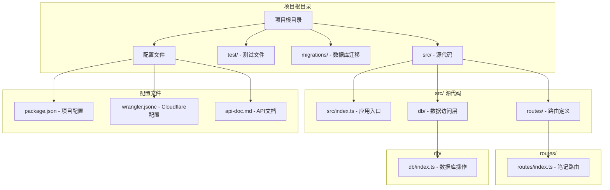
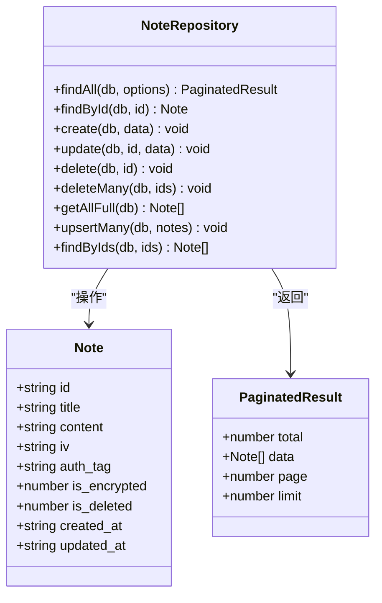
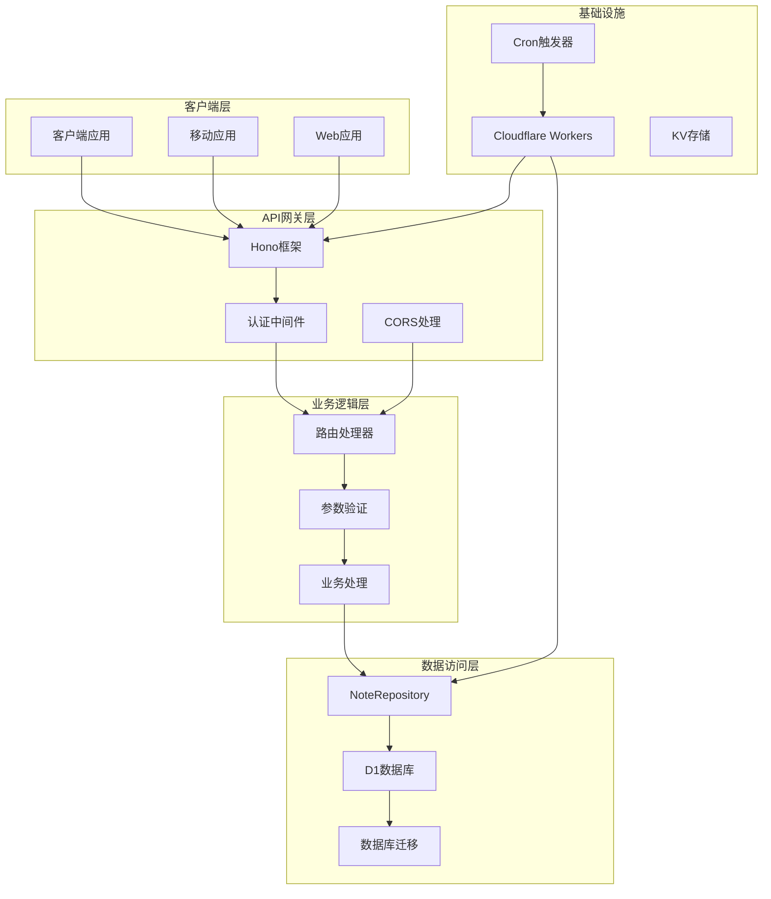
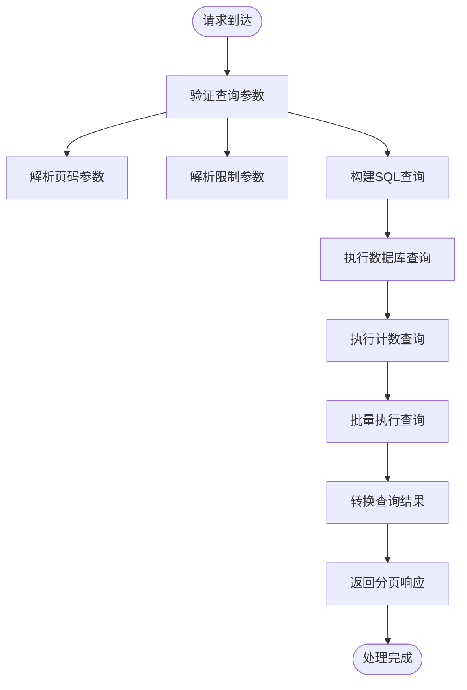
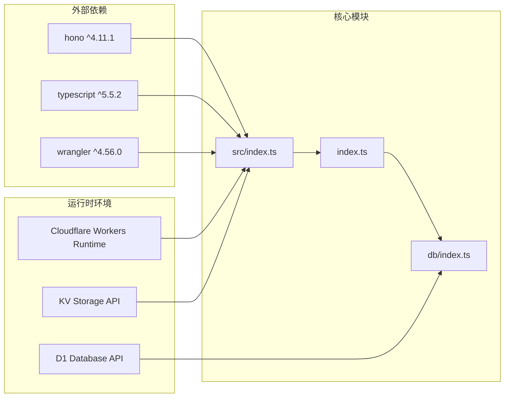

# 笔记CRUD操作

<cite>
**本文档引用的文件**
- [src/index.ts](file://src/index.ts)
- [src/routes/index.ts](file://src/routes/index.ts)
- [src/db/index.ts](file://src/db/index.ts)
- [migrations/0001_init_schema.sql](file://migrations/0001_init_schema.sql)
- [package.json](file://package.json)
- [wrangler.jsonc](file://wrangler.jsonc)
- [api-doc.md](file://api-doc.md)
- [test/index.spec.ts](file://test/index.spec.ts)
</cite>

## 目录

1. [简介](#简介)
2. [项目结构](#项目结构)
3. [核心组件](#核心组件)
4. [架构概览](#架构概览)
5. [详细组件分析](#详细组件分析)
6. [依赖关系分析](#依赖关系分析)
7. [性能考虑](#性能考虑)
8. [故障排除指南](#故障排除指南)
9. [结论](#结论)

## 简介

这是一个基于Cloudflare Workers构建的RESTful笔记管理API服务。该服务提供了完整的笔记CRUD操作，支持笔记的创建、读取、更新、删除以及同步功能。系统采用Hono框架构建，使用D1数据库进行数据持久化，并实现了基于Bearer Token的API认证机制。

## 项目结构

项目采用模块化的组织结构，主要包含以下核心目录和文件：



**图表来源**

- [src/index.ts](file://src/index.ts#L1-L105)
- [src/routes/index.ts](file://src/routes/index.ts#L1-L234)
- [src/db/index.ts](file://src/db/index.ts#L1-L251)

**章节来源**

- [src/index.ts](file://src/index.ts#L1-L105)
- [package.json](file://package.json#L1-L41)

## 核心组件

### 应用入口与环境配置

应用入口文件定义了核心的数据结构和环境绑定，为整个系统提供类型安全的基础。

**应用配置特性：**

- **环境绑定**：定义了DB和API_KEY的类型约束
- **数据模型**：标准化的Note接口定义
- **分页结果**：统一的分页响应格式
- **全局中间件**：CORS支持和错误处理

### 笔记数据模型

笔记系统的核心数据结构定义如下：



**图表来源**

- [src/index.ts](file://src/index.ts#L14-L36)
- [src/db/index.ts](file://src/db/index.ts#L43-L250)

**章节来源**

- [src/index.ts](file://src/index.ts#L14-L36)
- [src/db/index.ts](file://src/db/index.ts#L31-L41)

## 架构概览

系统采用分层架构设计，清晰分离了表示层、业务逻辑层和数据访问层：



**图表来源**

- [src/index.ts](file://src/index.ts#L38-L75)
- [src/routes/index.ts](file://src/routes/index.ts#L1-L234)
- [src/db/index.ts](file://src/db/index.ts#L1-L251)

## 详细组件分析

### 笔记CRUD API详解

#### 1. 获取笔记列表 (GET /api/notes)

**接口规范：**

- **HTTP方法**: GET
- **URL模式**: `/api/notes`
- **认证**: 必需
- **响应格式**: JSON

**查询参数：**
| 参数名 | 类型 | 必填 | 默认值 | 描述 |
|--------|------|------|--------|------|
| search | string | 否 | - | 按标题或内容搜索 |
| page | number | 否 | 1 | 页码，最小为1 |
| limit | number | 否 | 20 | 每页数量，最大为100 |

**请求示例：**

```bash
curl -X GET "https://your-domain.com/api/notes?page=1&limit=10&search=test" \
  -H "Authorization: Bearer YOUR_API_KEY"
```

**响应示例：**

```json
{
	"total": 25,
	"data": [
		{
			"id": "550e8400-e29b-41d4-a716-446655440000",
			"title": "测试笔记",
			"is_encrypted": 0,
			"created_at": "2025-12-24T05:43:29.724Z",
			"updated_at": "2025-12-24T05:43:29.724Z"
		}
	],
	"page": 1,
	"limit": 10
}
```

**处理流程：**



**图表来源**

- [src/routes/index.ts](file://src/routes/index.ts#L30-L37)
- [src/db/index.ts](file://src/db/index.ts#L44-L91)

**章节来源**

- [src/routes/index.ts](file://src/routes/index.ts#L30-L37)
- [src/db/index.ts](file://src/db/index.ts#L44-L91)

#### 2. 获取单个笔记 (GET /api/notes/:id)

**接口规范：**

- **HTTP方法**: GET
- **URL模式**: `/api/notes/:id`
- **认证**: 必需
- **路径参数**: id (UUID格式)

**请求示例：**

```bash
curl -X GET "https://your-domain.com/api/notes/550e8400-e29b-41d4-a716-446655440000" \
  -H "Authorization: Bearer YOUR_API_KEY"
```

**响应示例：**

```json
{
	"id": "550e8400-e29b-41d4-a716-446655440000",
	"title": "完整笔记",
	"content": "YmFzZTY0RW5jb2RlZEVuY3J5cHRlZENvbnRlbnQ9",
	"iv": "YmFzZTY0RW5jb2RlZElWPQ==",
	"auth_tag": "YmFzZTY0RW5jb2RlZEF1dGhUYWc9",
	"is_encrypted": 1,
	"created_at": "2025-12-24T05:43:29.724Z",
	"updated_at": "2025-12-24T06:00:00.000Z"
}
```

**错误处理：**

- **404 Not Found**: 当笔记不存在时返回错误响应

**章节来源**

- [src/routes/index.ts](file://src/routes/index.ts#L39-L44)
- [src/db/index.ts](file://src/db/index.ts#L93-L97)

#### 3. 创建笔记 (POST /api/notes)

**接口规范：**

- **HTTP方法**: POST
- **URL模式**: `/api/notes`
- **认证**: 必需
- **请求体**: JSON格式的笔记数据

**请求体字段：**
| 字段名 | 类型 | 必填 | 默认值 | 描述 |
|--------|------|------|--------|------|
| id | string | 是 | - | UUID格式的笔记ID |
| title | string | 是 | - | 笔记标题 |
| content | string | 是 | - | Base64编码的加密内容 |
| iv | string | 否 | - | Base64编码的初始化向量 |
| auth_tag | string | 否 | - | Base64编码的认证标签 |
| is_encrypted | number | 否 | 1 | 是否加密 (0/1) |
| created_at | string | 否 | 服务器时间 | ISO 8601格式 |
| updated_at | string | 否 | 服务器时间 | ISO 8601格式 |

**请求示例：**

```bash
curl -X POST "https://your-domain.com/api/notes" \
  -H "Authorization: Bearer YOUR_API_KEY" \
  -H "Content-Type: application/json" \
  -d '{
    "id": "550e8400-e29b-41d4-a716-446655440000",
    "title": "新笔记",
    "content": "YmFzZTY0RW5jb2RlZEVuY3J5cHRlZENvbnRlbnQ9",
    "iv": "YmFzZTY0RW5jb2RlZElWPQ==",
    "auth_tag": "YmFzZTY0RW5jb2RlZEF1dGhUYWc9",
    "is_encrypted": 1
  }'
```

**响应示例：**

```json
{
	"success": true
}
```

**验证规则：**

- **必需字段**: title和content必须存在且非空
- **时间处理**: 支持客户端传入的时间戳，若无效则使用服务器时间
- **默认值**: is_encrypted默认为1

**章节来源**

- [src/routes/index.ts](file://src/routes/index.ts#L46-L82)
- [src/db/index.ts](file://src/db/index.ts#L99-L123)

#### 4. 更新笔记 (PATCH /api/notes/:id)

**接口规范：**

- **HTTP方法**: PATCH
- **URL模式**: `/api/notes/:id`
- **认证**: 必需
- **路径参数**: id (UUID格式)
- **请求体**: 可选字段的更新数据

**请求体字段：**
支持Note对象中的任意字段，包括但不限于：

- title: 更新后的标题
- content: 更新后的Base64编码内容
- iv: 更新后的初始化向量
- auth_tag: 更新后的认证标签
- is_encrypted: 更新后的加密状态
- updated_at: 更新时间戳

**请求示例：**

```bash
curl -X PATCH "https://your-domain.com/api/notes/550e8400-e29b-41d4-a716-446655440000" \
  -H "Authorization: Bearer YOUR_API_KEY" \
  -H "Content-Type: application/json" \
  -d '{
    "title": "更新标题",
    "content": "更新内容"
  }'
```

**响应示例：**

```json
{
	"success": true
}
```

**错误处理：**

- **400 Bad Request**: 当没有可更新的字段时返回错误

**章节来源**

- [src/routes/index.ts](file://src/routes/index.ts#L84-L106)
- [src/db/index.ts](file://src/db/index.ts#L124-L176)

#### 5. 删除笔记 (DELETE /api/notes/:id)

**接口规范：**

- **HTTP方法**: DELETE
- **URL模式**: `/api/notes/:id`
- **认证**: 必需
- **路径参数**: id (UUID格式)

**请求示例：**

```bash
curl -X DELETE "https://your-domain.com/api/notes/550e8400-e29b-41d4-a716-446655440000" \
  -H "Authorization: Bearer YOUR_API_KEY"
```

**响应示例：**

```json
{
	"success": true
}
```

**实现细节：**

- 采用软删除机制，将is_deleted设置为1
- 同时清空content和title字段
- 更新updated_at时间为当前时间

**章节来源**

- [src/routes/index.ts](file://src/routes/index.ts#L108-L113)
- [src/db/index.ts](file://src/db/index.ts#L178-L183)

### 批量操作API

#### 批量删除笔记 (DELETE /api/notes/batch)

**请求体：**

```json
{
	"ids": ["550e8400-e29b-41d4-a716-446655440000", "550e8400-e29b-41d4-a716-446655440001"]
}
```

**响应示例：**

```json
{
	"success": true,
	"deletedCount": 2
}
```

**验证规则：**

- ids必须是非空字符串数组
- 每个ID必须为有效的UUID格式

**章节来源**

- [src/routes/index.ts](file://src/routes/index.ts#L115-L136)
- [src/db/index.ts](file://src/db/index.ts#L185-L191)

## 依赖关系分析

系统采用松耦合的设计，各组件之间的依赖关系清晰明确：



**图表来源**

- [package.json](file://package.json#L32-L34)
- [src/index.ts](file://src/index.ts#L1-L3)
- [src/routes/index.ts](file://src/routes/index.ts#L1-L3)

**章节来源**

- [package.json](file://package.json#L32-L34)
- [wrangler.jsonc](file://wrangler.jsonc#L13-L19)

## 性能考虑

### 数据库优化

系统在数据库层面实现了多项优化措施：

1. **索引策略**：
   - 主键索引：id (PRIMARY KEY)
   - 标题索引：title
   - 软删除索引：is_deleted
   - 复合索引：(is_deleted, updated_at DESC)

2. **查询优化**：
   - 使用LIMIT和OFFSET实现分页
   - 批量查询减少数据库往返
   - 条件查询优化搜索性能

3. **内存管理**：
   - Base64编码/解码的高效实现
   - ArrayBuffer与字符串的快速转换

### 缓存策略

虽然当前实现未实现应用级缓存，但系统具备良好的扩展性：

- **适合缓存的场景**：热门笔记的读取
- **缓存失效策略**：基于更新时间的失效机制
- **缓存键设计**：基于笔记ID和版本号

## 故障排除指南

### 常见错误及解决方案

| 错误代码 | 错误类型      | 可能原因       | 解决方案                |
| -------- | ------------- | -------------- | ----------------------- |
| 401      | Unauthorized  | API Key无效    | 检查Authorization头格式 |
| 400      | BAD_REQUEST   | 参数验证失败   | 确认必需字段和格式      |
| 404      | NOT_FOUND     | 资源不存在     | 验证笔记ID的有效性      |
| 500      | InternalError | 服务器内部错误 | 查看服务器日志          |

### 调试技巧

1. **启用调试模式**：在开发环境中添加详细的日志输出
2. **单元测试**：利用现有的测试套件验证API行为
3. **数据库检查**：确认D1数据库连接和迁移状态

**章节来源**

- [src/index.ts](file://src/index.ts#L41-L63)
- [test/index.spec.ts](file://test/index.spec.ts#L9-L23)

## 结论

本笔记CRUD操作API系统提供了完整、可靠的笔记管理功能。系统采用现代化的技术栈和最佳实践，具有以下优势：

1. **架构清晰**：分层设计使得代码易于维护和扩展
2. **类型安全**：完整的TypeScript类型定义确保开发质量
3. **性能优化**：合理的数据库设计和查询优化
4. **错误处理**：完善的错误处理和响应格式
5. **部署友好**：针对Cloudflare Workers的优化配置

该系统为笔记应用提供了坚实的技术基础，支持从个人使用到企业级部署的各种场景需求。
