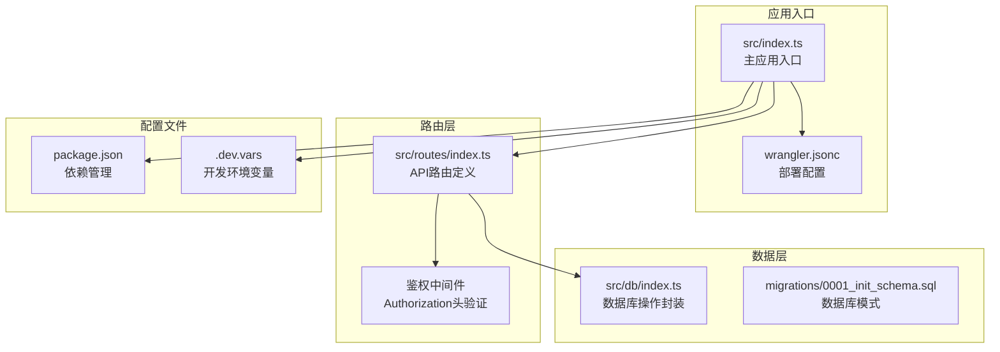
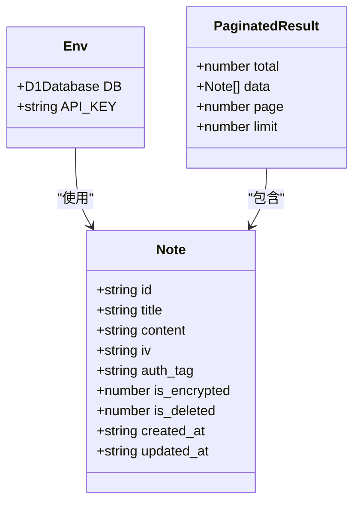
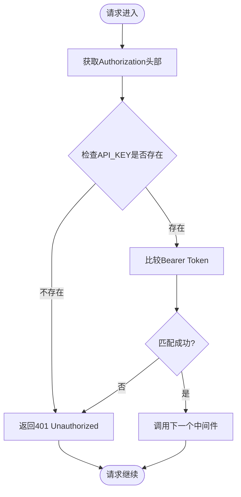
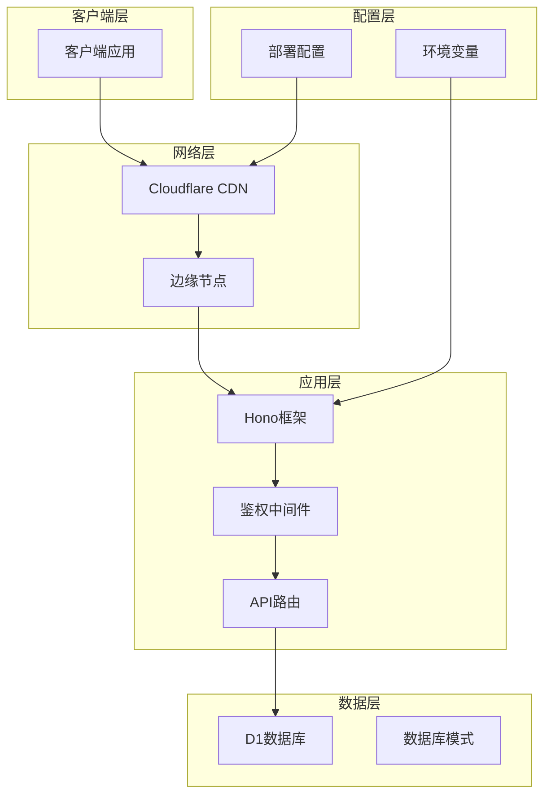
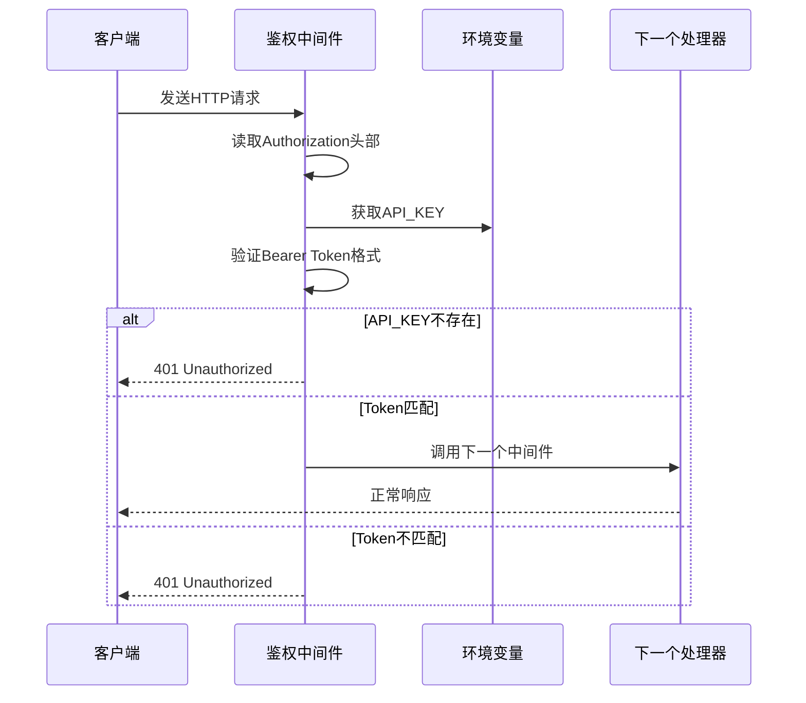
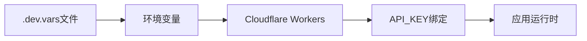
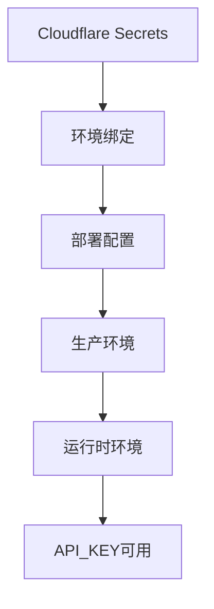
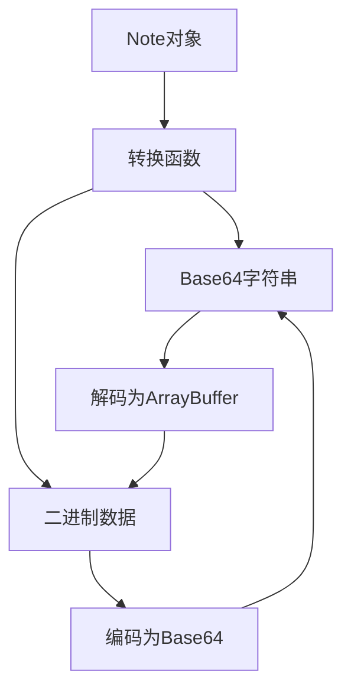
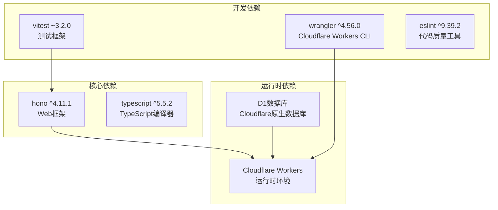
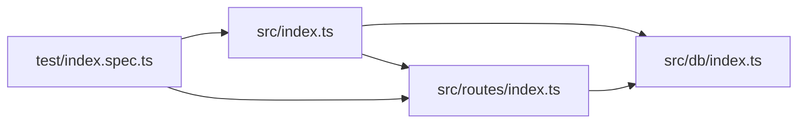

# 认证与鉴权

<cite>
**本文档引用的文件**
- [src/index.ts](file://src/index.ts)
- [src/routes/index.ts](file://src/routes/index.ts)
- [src/db/index.ts](file://src/db/index.ts)
- [wrangler.jsonc](file://wrangler.jsonc)
- [package.json](file://package.json)
- [test/index.spec.ts](file://test/index.spec.ts)
- [.dev.vars](file://.dev.vars)
- [migrations/0001_init_schema.sql](file://migrations/0001_init_schema.sql)
</cite>

## 目录

1. [简介](#简介)
2. [项目结构](#项目结构)
3. [核心组件](#核心组件)
4. [架构概览](#架构概览)
5. [详细组件分析](#详细组件分析)
6. [依赖关系分析](#依赖关系分析)
7. [性能考虑](#性能考虑)
8. [故障排除指南](#故障排除指南)
9. [结论](#结论)

## 简介

Notes Server采用基于Bearer Token的API认证机制，通过Cloudflare Workers平台的安全环境变量API_KEY实现访问控制。该系统为笔记管理提供了完整的RESTful API接口，支持笔记的创建、读取、更新、删除和同步功能。

本认证机制的核心特点：

- 基于Bearer Token的无状态认证
- 使用Cloudflare Workers环境变量存储API密钥
- 全局中间件拦截所有受保护的API端点
- 统一的错误响应格式
- 支持批量操作和笔记同步

## 项目结构

Notes Server采用模块化架构设计，主要目录结构如下：



**图表来源**

- [src/index.ts](file://src/index.ts#L1-L105)
- [src/routes/index.ts](file://src/routes/index.ts#L1-L234)
- [src/db/index.ts](file://src/db/index.ts#L1-L251)

**章节来源**

- [src/index.ts](file://src/index.ts#L1-L105)
- [wrangler.jsonc](file://wrangler.jsonc#L1-L54)
- [package.json](file://package.json#L1-L41)

## 核心组件

### 环境绑定定义

应用使用Cloudflare Workers的环境绑定机制来定义运行时环境：



**图表来源**

- [src/index.ts](file://src/index.ts#L8-L36)

### 鉴权中间件实现

鉴权中间件是整个认证系统的核心组件，位于路由层的全局中间件中：



**图表来源**

- [src/routes/index.ts](file://src/routes/index.ts#L7-L15)

**章节来源**

- [src/index.ts](file://src/index.ts#L8-L36)
- [src/routes/index.ts](file://src/routes/index.ts#L7-L15)

## 架构概览

Notes Server的认证架构采用分层设计，确保安全性与可维护性的平衡：



**图表来源**

- [src/index.ts](file://src/index.ts#L38-L75)
- [src/routes/index.ts](file://src/routes/index.ts#L1-L234)
- [wrangler.jsonc](file://wrangler.jsonc#L13-L24)

## 详细组件分析

### 鉴权中间件详细实现

鉴权中间件位于`src/routes/index.ts`文件中，实现了严格的API Key验证机制：

#### 中间件工作流程



**图表来源**

- [src/routes/index.ts](file://src/routes/index.ts#L8-L15)

#### 错误处理机制

系统实现了统一的错误处理策略：

| 错误类型      | HTTP状态码 | 错误消息         | 触发条件                         |
| ------------- | ---------- | ---------------- | -------------------------------- |
| Unauthorized  | 401        | API Key 无效     | 缺少Authorization头或Token不匹配 |
| InternalError | 500        | 服务器内部错误   | 未捕获的异常                     |
| NOT_FOUND     | 404        | 请求的资源不存在 | 路由不存在                       |

**章节来源**

- [src/routes/index.ts](file://src/routes/index.ts#L7-L15)
- [src/index.ts](file://src/index.ts#L41-L63)

### API Key配置与管理

#### 开发环境配置

开发环境使用`.dev.vars`文件进行配置：



**图表来源**

- [.dev.vars](file://.dev.vars#L1-L2)
- [wrangler.jsonc](file://wrangler.jsonc#L42-L42)

#### 生产环境配置

生产环境通过Cloudflare Workers的Secrets管理API Key：



**图表来源**

- [wrangler.jsonc](file://wrangler.jsonc#L37-L41)

**章节来源**

- [.dev.vars](file://.dev.vars#L1-L2)
- [wrangler.jsonc](file://wrangler.jsonc#L37-L41)

### 数据库集成

#### 数据模型设计

笔记数据模型采用JSON字段存储加密内容，支持Base64编码的二进制数据：

```mermaid
erDiagram
NOTES {
TEXT id PK
TEXT title
BLOB content
BLOB iv
BLOB auth_tag
INTEGER is_encrypted
INTEGER is_deleted
TEXT created_at
TEXT updated_at
}
INDEXES {
idx_notes_title
idx_notes_is_deleted
idx_notes_is_deleted_updated_at
}
NOTES ||--o{ INDEXES : "包含索引"
```

**图表来源**

- [migrations/0001_init_schema.sql](file://migrations/0001_init_schema.sql#L1-L17)

#### 数据转换机制

系统实现了Base64与ArrayBuffer之间的双向转换：



**图表来源**

- [src/db/index.ts](file://src/db/index.ts#L10-L29)

**章节来源**

- [src/db/index.ts](file://src/db/index.ts#L1-L251)
- [migrations/0001_init_schema.sql](file://migrations/0001_init_schema.sql#L1-L17)

## 依赖关系分析

### 外部依赖

Notes Server使用以下关键依赖：



**图表来源**

- [package.json](file://package.json#L18-L34)

### 内部模块依赖



**图表来源**

- [src/index.ts](file://src/index.ts#L1-L4)
- [src/routes/index.ts](file://src/routes/index.ts#L1-L3)

**章节来源**

- [package.json](file://package.json#L18-L34)

## 性能考虑

### 认证性能优化

1. **内存效率**: API Key存储在环境变量中，避免重复解析
2. **CPU优化**: 简单的字符串比较操作，O(1)时间复杂度
3. **网络延迟**: 鉴权中间件在Edge节点执行，减少网络往返

### 数据库性能

1. **索引优化**: 为常用查询字段建立索引
2. **批量操作**: 支持批量插入和更新操作
3. **连接池**: 使用Cloudflare Workers的高效连接管理

## 故障排除指南

### 常见认证错误

#### 401 Unauthorized错误

**症状**: 请求被拒绝，返回401状态码

**可能原因**:

1. 缺少Authorization头部
2. Authorization头部格式不正确
3. API Key不匹配
4. API Key未正确配置

**解决方案**:

1. 确保请求包含正确的Authorization头部
2. 验证Bearer Token格式：`Bearer YOUR_API_KEY`
3. 检查API Key是否正确配置
4. 确认API Key大小写和特殊字符

#### 404 Not Found错误

**症状**: 请求路径不存在

**可能原因**:

1. API端点URL错误
2. 路由未正确注册

**解决方案**:

1. 检查API端点URL拼写
2. 确认使用正确的HTTP方法
3. 验证请求路径格式

#### 500 Internal Server Error

**症状**: 服务器内部错误

**可能原因**:

1. 未捕获的异常
2. 数据库连接问题
3. 环境变量配置错误

**解决方案**:

1. 检查服务器日志
2. 验证数据库连接
3. 确认环境变量配置

### 调试技巧

#### 开发环境调试

1. 使用`wrangler dev`启动本地开发服务器
2. 在`.dev.vars`文件中设置API Key
3. 使用浏览器开发者工具检查网络请求

#### 生产环境监控

1. 启用Cloudflare Workers可观测性
2. 监控API调用统计
3. 设置适当的日志记录

**章节来源**

- [test/index.spec.ts](file://test/index.spec.ts#L35-L102)
- [src/index.ts](file://src/index.ts#L41-L63)

## 结论

Notes Server的认证机制设计简洁而高效，通过以下关键特性确保了系统的安全性和可靠性：

### 安全特性

- **强认证**: 基于Bearer Token的严格认证机制
- **环境隔离**: API Key存储在安全的环境变量中
- **中间件保护**: 全局中间件确保所有API端点都受到保护
- **统一错误处理**: 标准化的错误响应格式

### 可靠性特性

- **边缘部署**: 在Cloudflare Edge节点执行，降低延迟
- **自动扩展**: 基于Cloudflare Workers的无服务器架构
- **内置监控**: 集成Cloudflare的可观测性功能
- **版本控制**: 支持渐进式部署和回滚

### 最佳实践建议

1. **API Key管理**: 使用Cloudflare Secrets管理敏感信息
2. **定期轮换**: 定期更换API Key以提高安全性
3. **最小权限**: 为不同客户端分配不同的API Key
4. **监控告警**: 设置API使用量和错误率监控
5. **备份策略**: 定期备份数据库和配置信息

该认证系统为Notes Server提供了坚实的安全基础，同时保持了良好的性能和可维护性。
