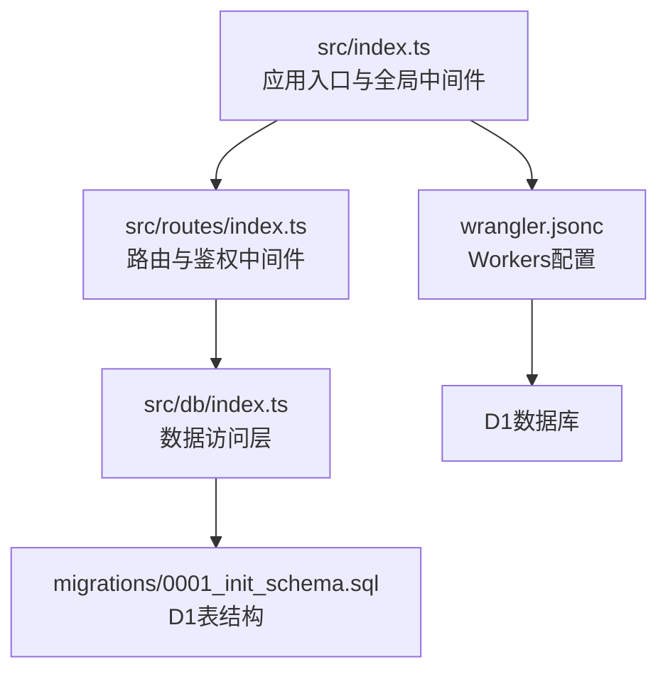
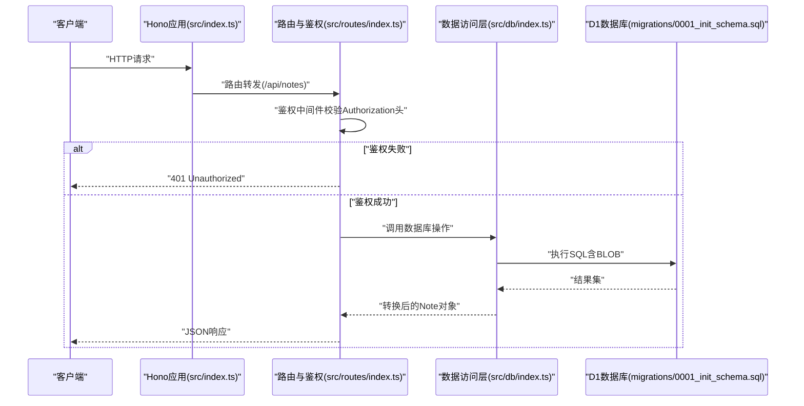
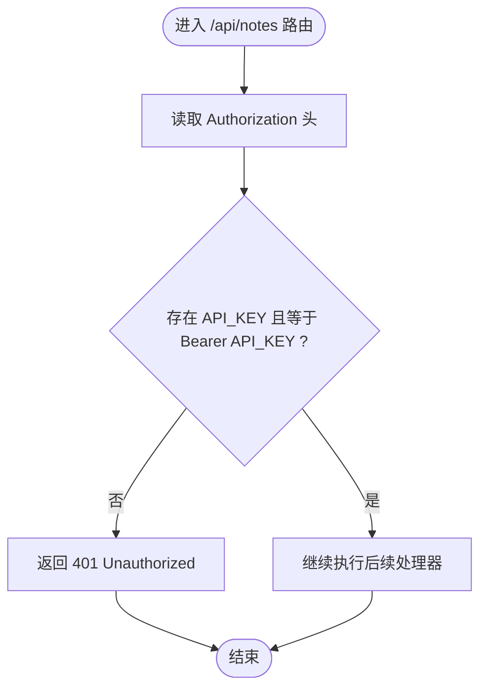
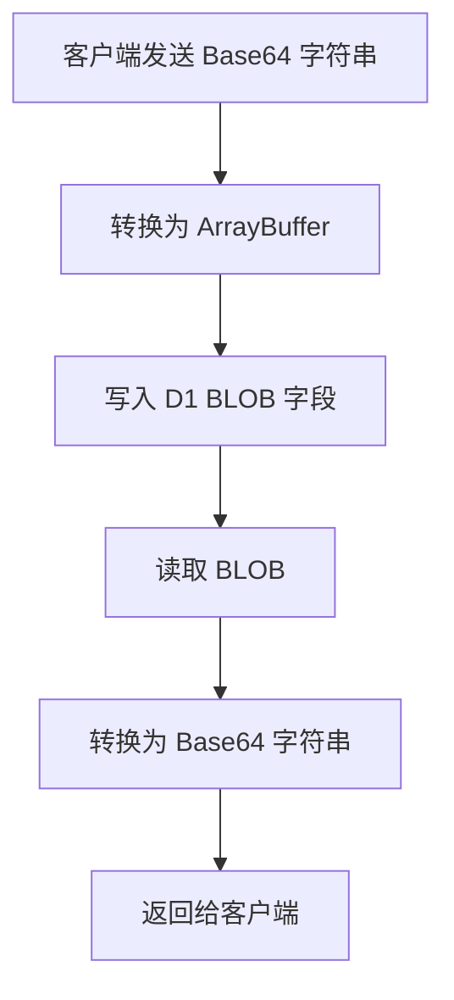
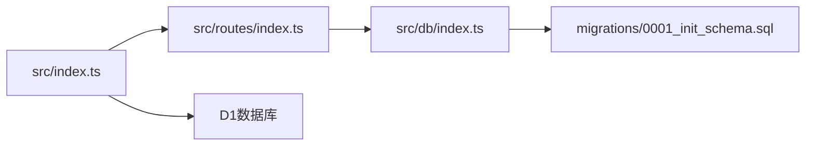

# 安全与认证

<cite>
**本文引用的文件**
- [src/index.ts](file://src/index.ts)
- [src/routes/index.ts](file://src/routes/index.ts)
- [src/db/index.ts](file://src/db/index.ts)
- [migrations/0001_init_schema.sql](file://migrations/0001_init_schema.sql)
- [wrangler.jsonc](file://wrangler.jsonc)
- [package.json](file://package.json)
- [api-doc.md](file://api-doc.md)
- [.dev.vars](file://.dev.vars)
- [test/index.spec.ts](file://test/index.spec.ts)
</cite>

## 目录

1. [简介](#简介)
2. [项目结构](#项目结构)
3. [核心组件](#核心组件)
4. [架构总览](#架构总览)
5. [详细组件分析](#详细组件分析)
6. [依赖关系分析](#依赖关系分析)
7. [性能考虑](#性能考虑)
8. [故障排查指南](#故障排查指南)
9. [结论](#结论)
10. [附录](#附录)

## 简介

本文件面向Notes Server项目的安全与认证设计，重点阐述以下方面：

- API鉴权机制：基于Bearer Token的认证流程、实现细节与安全最佳实践
- 数据保护：Base64编码与二进制存储、加密存储的潜在支持与建议
- 安全配置：环境变量、CORS、计划任务与可观测性
- 访问控制与权限管理：当前实现与扩展建议
- 威胁分析与防护策略：常见风险与缓解手段
- 常见安全问题的预防与应对
- 开发者安全编码指导与最佳实践

## 项目结构

项目采用Cloudflare Workers + Hono框架，核心目录与职责如下：

- src/index.ts：应用入口、全局中间件（CORS）、错误处理、404处理、定时任务调度
- src/routes/index.ts：笔记API路由与全局鉴权中间件（Bearer Token）
- src/db/index.ts：数据访问层，负责Base64与二进制互转、SQL执行与批量操作
- migrations/0001_init_schema.sql：D1数据库表结构定义（含BLOB字段）
- wrangler.jsonc：Workers配置（D1绑定、触发器、可观测性）
- package.json：依赖与脚本
- api-doc.md：API文档（含认证说明）
- .dev.vars：本地开发环境变量占位
- test/index.spec.ts：单元测试（含鉴权行为断言）

图表来源

- [src/index.ts](file://src/index.ts#L38-L63)
- [src/routes/index.ts](file://src/routes/index.ts#L5-L15)
- [src/db/index.ts](file://src/db/index.ts#L43-L250)
- [migrations/0001_init_schema.sql](file://migrations/0001_init_schema.sql#L1-L17)
- [wrangler.jsonc](file://wrangler.jsonc#L13-L19)

章节来源

- [src/index.ts](file://src/index.ts#L38-L63)
- [src/routes/index.ts](file://src/routes/index.ts#L5-L15)
- [src/db/index.ts](file://src/db/index.ts#L43-L250)
- [migrations/0001_init_schema.sql](file://migrations/0001_init_schema.sql#L1-L17)
- [wrangler.jsonc](file://wrangler.jsonc#L13-L19)

## 核心组件

- 应用入口与中间件
  - 全局CORS中间件启用
  - 统一错误处理与404处理
  - 定时任务（清理软删除笔记）
- 路由与鉴权
  - 全局鉴权中间件：校验Authorization头中的Bearer Token
  - 笔记API：列表、详情、创建、更新、删除、批量删除、同步、批量插入/更新
- 数据访问层
  - Base64与ArrayBuffer互转工具
  - D1 SQL封装：分页查询、按ID查询、创建、更新、软删除、批量软删除、全量导出、upsert、按ID集合查询
- 数据库模式
  - notes表：id、title、content（BLOB）、iv（BLOB，可选）、auth_tag（BLOB，可选）、is_encrypted、is_deleted、created_at、updated_at
  - 索引：title、is_deleted、(is_deleted, updated_at DESC)

章节来源

- [src/index.ts](file://src/index.ts#L38-L63)
- [src/routes/index.ts](file://src/routes/index.ts#L5-L15)
- [src/db/index.ts](file://src/db/index.ts#L43-L250)
- [migrations/0001_init_schema.sql](file://migrations/0001_init_schema.sql#L1-L17)

## 架构总览

下图展示从客户端到数据库的请求流，以及鉴权与数据保护的关键节点。

图表来源

- [src/index.ts](file://src/index.ts#L38-L63)
- [src/routes/index.ts](file://src/routes/index.ts#L7-L15)
- [src/db/index.ts](file://src/db/index.ts#L43-L250)
- [migrations/0001_init_schema.sql](file://migrations/0001_init_schema.sql#L1-L17)

## 详细组件分析

### 鉴权机制：Bearer Token

- 实现位置
  - 全局中间件在路由注册后对所有笔记API进行鉴权
  - 中间件从Authorization头读取值，并与环境变量中的API_KEY进行严格相等比较
- 请求格式
  - Authorization: Bearer {API_KEY}
- 错误处理
  - 鉴权失败返回401与错误消息
- 测试覆盖
  - 单元测试验证未携带认证头时返回401

图表来源

- [src/routes/index.ts](file://src/routes/index.ts#L7-L15)
- [test/index.spec.ts](file://test/index.spec.ts#L35-L46)

章节来源

- [src/routes/index.ts](file://src/routes/index.ts#L7-L15)
- [test/index.spec.ts](file://test/index.spec.ts#L35-L46)
- [api-doc.md](file://api-doc.md#L9-L12)

### 数据保护：Base64与二进制存储

- 存储模型
  - content、iv、auth_tag均以BLOB形式存储于D1
- 客户端数据格式
  - Note.content、iv、auth_tag为Base64字符串
- 转换逻辑
  - 写入：Base64 -> ArrayBuffer -> BLOB
  - 读取：BLOB -> ArrayBuffer -> Base64
- 加密语义
  - schema中包含iv与auth_tag字段，表明系统具备AES-GCM等AEAD加密的存储能力
  - is_encrypted字段用于标记是否加密（默认1）

图表来源

- [src/db/index.ts](file://src/db/index.ts#L10-L29)
- [src/db/index.ts](file://src/db/index.ts#L34-L41)
- [migrations/0001_init_schema.sql](file://migrations/0001_init_schema.sql#L5-L8)

章节来源

- [src/db/index.ts](file://src/db/index.ts#L10-L29)
- [src/db/index.ts](file://src/db/index.ts#L34-L41)
- [migrations/0001_init_schema.sql](file://migrations/0001_init_schema.sql#L5-L8)

### 访问控制与权限管理

- 当前实现
  - 全局API密钥鉴权，无细粒度权限控制
  - 仅支持“允许/拒绝”两种访问级别
- 可扩展方向
  - 引入角色/用户模型与资源级权限
  - 使用Hono内置bearerAuth中间件或自定义JWT鉴权
  - 增加IP白名单、速率限制、审计日志

章节来源

- [src/routes/index.ts](file://src/routes/index.ts#L7-L15)
- [wrangler.jsonc](file://wrangler.jsonc#L10-L12)

### 安全配置选项

- 环境变量与密钥
  - API_KEY通过环境变量注入（Wrangler配置中未显式声明，需通过Secrets管理）
  - 本地开发使用.dev.vars占位
- CORS
  - 全局启用CORS中间件
- 观测性
  - 启用可观测性（logs、metrics）
- 计划任务
  - 定时清理软删除超过保留期的笔记

章节来源

- [src/index.ts](file://src/index.ts#L8-L11)
- [wrangler.jsonc](file://wrangler.jsonc#L10-L12)
- [wrangler.jsonc](file://wrangler.jsonc#L20-L24)
- [src/index.ts](file://src/index.ts#L71-L104)
- [.dev.vars](file://.dev.vars#L1-L2)

### 错误处理与异常

- 全局错误处理：统一返回JSON错误体（包含success、error、message、timestamp）
- 404处理：未匹配路由返回统一结构
- 鉴权失败：返回401与明确错误信息

章节来源

- [src/index.ts](file://src/index.ts#L41-L63)
- [src/routes/index.ts](file://src/routes/index.ts#L11-L13)

## 依赖关系分析

- 组件耦合
  - routes依赖db层进行数据操作
  - db层依赖D1驱动与Schema定义
  - app入口依赖路由模块与全局中间件
- 外部依赖
  - Hono（Web框架与中间件）
  - Wrangler（Workers部署与配置）
  - Vitest（测试框架）
- 潜在循环依赖
  - 未发现循环导入；模块化清晰

图表来源

- [src/routes/index.ts](file://src/routes/index.ts#L1-L5)
- [src/db/index.ts](file://src/db/index.ts#L1-L5)
- [migrations/0001_init_schema.sql](file://migrations/0001_init_schema.sql#L1-L17)
- [src/index.ts](file://src/index.ts#L38-L40)

章节来源

- [src/routes/index.ts](file://src/routes/index.ts#L1-L5)
- [src/db/index.ts](file://src/db/index.ts#L1-L5)
- [migrations/0001_init_schema.sql](file://migrations/0001_init_schema.sql#L1-L17)
- [src/index.ts](file://src/index.ts#L38-L40)

## 性能考虑

- 数据库索引
  - 为title、is_deleted、(is_deleted, updated_at DESC)建立索引，有利于分页与筛选
- 批量操作
  - upsertMany使用D1 batch提升批量写入效率
- Base64转换
  - 大体量内容的Base64往返转换会带来CPU与内存开销，建议在客户端侧尽量减少不必要的重复转换
- CORS
  - 全局CORS启用会增加预检请求成本，生产环境建议限定来源与方法

章节来源

- [migrations/0001_init_schema.sql](file://migrations/0001_init_schema.sql#L14-L16)
- [src/db/index.ts](file://src/db/index.ts#L203-L237)

## 故障排查指南

- 401 Unauthorized
  - 检查Authorization头格式是否为Bearer {API_KEY}
  - 确认API_KEY与环境变量一致
  - 确保未在代理/网关中丢失或修改头部
- 404 Not Found
  - 确认请求路径为/api/notes下的具体端点
- 数据异常（Base64/二进制）
  - 检查客户端是否正确进行Base64编码/解码
  - 确认content、iv、auth_tag字段的Base64格式
- 定时任务未执行
  - 检查wrangler.jsonc中的触发器配置与计划表达式
  - 查看可观测性日志确认任务执行情况

章节来源

- [src/routes/index.ts](file://src/routes/index.ts#L7-L15)
- [src/index.ts](file://src/index.ts#L53-L63)
- [src/db/index.ts](file://src/db/index.ts#L10-L29)
- [wrangler.jsonc](file://wrangler.jsonc#L20-L24)

## 结论

Notes Server当前采用简单而有效的Bearer Token鉴权与D1 BLOB存储方案，满足基本的API安全与数据保护需求。建议在保持现有鉴权机制的基础上，逐步引入更细粒度的权限控制、速率限制与审计日志，并完善密钥管理与传输安全，以进一步提升整体安全性与可运维性。

## 附录

### 安全威胁分析与防护策略

- 威胁类型
  - 未授权访问：通过泄露API_KEY导致的越权
  - 中间人攻击：未使用HTTPS导致的凭证窃听
  - 注入攻击：SQL注入（当前使用参数化查询，风险较低）
  - 恶意批量操作：批量删除/插入滥用
  - 数据泄露：BLOB中存储的敏感内容
- 防护策略
  - 强制HTTPS与安全传输
  - 最小权限原则与密钥轮换
  - 引入速率限制与IP白名单
  - 审计日志与异常告警
  - 客户端侧加密与服务端密钥管理

### 常见安全问题与应对

- API密钥泄露
  - 使用Wrangler Secrets管理，避免硬编码
  - 定期轮换密钥并撤销旧密钥
- CORS滥用
  - 生产环境限制Allowed-Origin与Allowed-Headers
- 大量数据导出
  - 限制导出范围与频率，必要时增加二次鉴权
- 定时任务安全
  - 仅执行必要清理逻辑，避免暴露敏感数据

### 开发者安全编码指导与最佳实践

- 鉴权
  - 使用强随机API_KEY，定期轮换
  - 在路由层统一鉴权，避免遗漏
  - 对401场景返回明确错误信息，不泄露额外细节
- 数据处理
  - 客户端与服务端保持一致的Base64编码约定
  - 对大体量数据进行分块处理，避免内存峰值
- 数据库
  - 优先使用参数化查询与事务
  - 合理设置索引，避免全表扫描
- 部署与运维
  - 使用Secrets管理敏感变量
  - 启用可观测性与日志审计
  - 定期审查权限与访问日志
