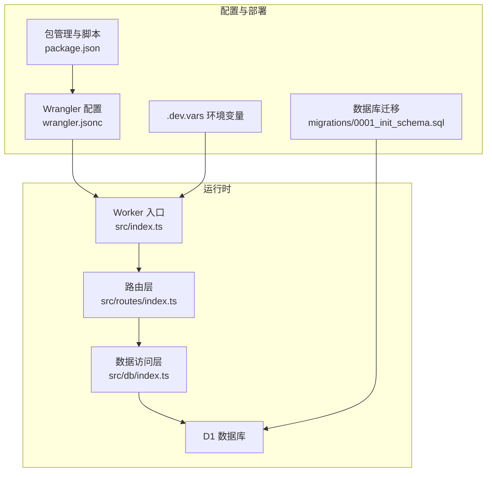
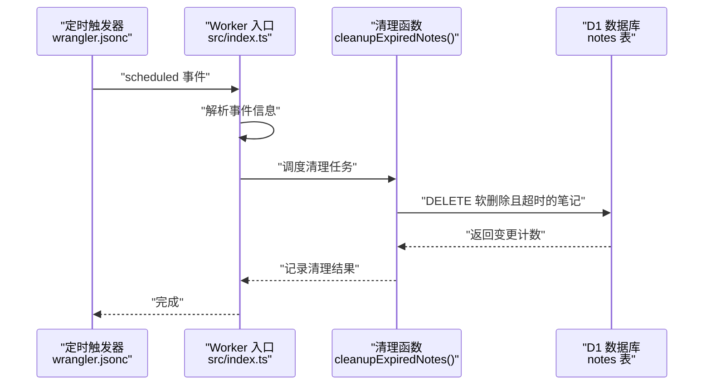
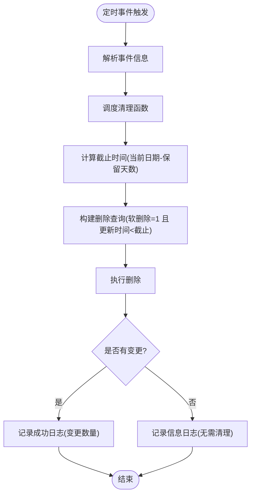
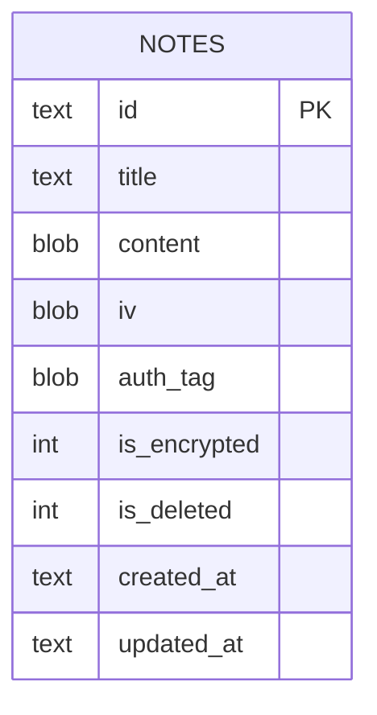
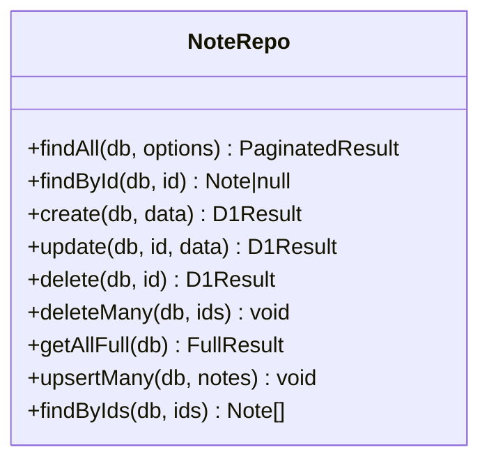
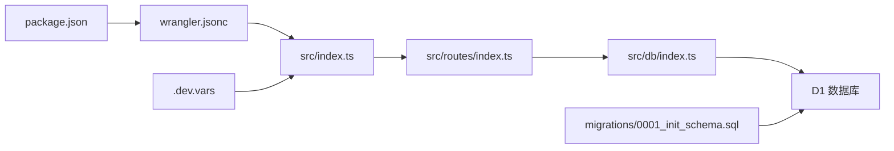

# 定时任务与维护

<cite>
**本文档引用的文件**
- [src/index.ts](file://src/index.ts)
- [src/db/index.ts](file://src/db/index.ts)
- [src/routes/index.ts](file://src/routes/index.ts)
- [migrations/0001_init_schema.sql](file://migrations/0001_init_schema.sql)
- [wrangler.jsonc](file://wrangler.jsonc)
- [package.json](file://package.json)
- [.dev.vars](file://.dev.vars)
- [test/index.spec.ts](file://test/index.spec.ts)
</cite>

## 目录

1. [简介](#简介)
2. [项目结构](#项目结构)
3. [核心组件](#核心组件)
4. [架构总览](#架构总览)
5. [详细组件分析](#详细组件分析)
6. [依赖关系分析](#依赖关系分析)
7. [性能考虑](#性能考虑)
8. [故障排除指南](#故障排除指南)
9. [结论](#结论)
10. [附录](#附录)

## 简介

本文件面向 Notes Server 的定时任务与维护功能，重点说明以下内容：

- 自动清理机制：过期软删除笔记的清理策略与实现细节
- 定时触发器配置：触发频率与时区规则
- 数据维护策略：软删除与硬删除的配合使用
- 性能优化措施：索引设计、批量操作与查询优化
- 系统监控方法：日志记录与可观测性配置
- 配置选项与最佳实践：环境变量、部署脚本与运维建议
- 故障排除与容量规划：常见问题定位与扩展指导

## 项目结构

该项目采用 Cloudflare Workers 架构，核心入口为 Worker 入口文件，数据库访问通过 D1 提供，定时任务由 Wrangler 的触发器配置驱动。

图表来源

- [src/index.ts](file://src/index.ts#L38-L75)
- [src/routes/index.ts](file://src/routes/index.ts#L1-L234)
- [src/db/index.ts](file://src/db/index.ts#L43-L250)
- [wrangler.jsonc](file://wrangler.jsonc#L1-L54)
- [migrations/0001_init_schema.sql](file://migrations/0001_init_schema.sql#L1-L17)
- [package.json](file://package.json#L6-L17)
- [.dev.vars](file://.dev.vars#L1-L2)

章节来源

- [src/index.ts](file://src/index.ts#L38-L75)
- [wrangler.jsonc](file://wrangler.jsonc#L1-L54)
- [migrations/0001_init_schema.sql](file://migrations/0001_init_schema.sql#L1-L17)
- [package.json](file://package.json#L6-L17)
- [.dev.vars](file://.dev.vars#L1-L2)

## 核心组件

- Worker 入口与定时任务处理：负责接收定时事件并调度清理逻辑
- 数据访问层：封装笔记的增删改查、软删除与批量操作
- 路由层：提供笔记的 CRUD、同步与导出等 API
- 数据库模式：定义表结构与索引，支撑清理与查询性能
- 部署配置：定时触发器、D1 绑定与可观测性开关

章节来源

- [src/index.ts](file://src/index.ts#L65-L104)
- [src/db/index.ts](file://src/db/index.ts#L43-L250)
- [src/routes/index.ts](file://src/routes/index.ts#L1-L234)
- [migrations/0001_init_schema.sql](file://migrations/0001_init_schema.sql#L1-L17)
- [wrangler.jsonc](file://wrangler.jsonc#L13-L24)

## 架构总览

定时任务在 Cloudflare Workers 中通过 Scheduled Event 触发，清理逻辑在 Worker 内部异步执行，并通过 D1 执行删除操作。清理策略基于软删除标记与时间阈值，避免误删仍在使用的笔记。

图表来源

- [src/index.ts](file://src/index.ts#L68-L75)
- [src/index.ts](file://src/index.ts#L80-L104)
- [wrangler.jsonc](file://wrangler.jsonc#L20-L24)

## 详细组件分析

### 定时任务与清理策略

- 触发器配置：使用 Cron 表达式定义执行周期
- 清理条件：仅清理标记为软删除且更新时间早于阈值的记录
- 时间阈值：默认保留 30 天，到期后进行清理
- 并发模型：通过 waitUntil 确保清理任务在响应返回后继续执行

图表来源

- [src/index.ts](file://src/index.ts#L68-L75)
- [src/index.ts](file://src/index.ts#L80-L104)

章节来源

- [src/index.ts](file://src/index.ts#L68-L75)
- [src/index.ts](file://src/index.ts#L80-L104)

### 数据库模式与索引

- 表结构：包含主键、标题、加密内容与元数据字段
- 索引策略：对标题、软删除标记及软删除+更新时间组合建立索引，提升查询与清理效率
- 软删除字段：is_deleted 用于逻辑删除，配合 is_deleted 索引与组合索引支持高效筛选

图表来源

- [migrations/0001_init_schema.sql](file://migrations/0001_init_schema.sql#L1-L17)

章节来源

- [migrations/0001_init_schema.sql](file://migrations/0001_init_schema.sql#L1-L17)

### 数据访问层（NoteRepo）

- 查询与分页：支持按标题/内容模糊搜索、分页与总数统计
- 软删除：提供单条与批量软删除接口，更新 is_deleted 标记并清空敏感内容
- 批量写入：upsertMany 支持批量插入或更新，减少往返次数
- 数据转换：Base64 与 ArrayBuffer 的互转，确保内容安全传输

图表来源

- [src/db/index.ts](file://src/db/index.ts#L43-L250)

章节来源

- [src/db/index.ts](file://src/db/index.ts#L43-L250)

### 路由层与鉴权

- 鉴权中间件：统一校验 Authorization 头中的 API Key
- 常用接口：分页查询、详情获取、创建、更新、软删除、批量删除、同步与导出
- 错误处理：统一的 404 与 500 错误响应结构

章节来源

- [src/routes/index.ts](file://src/routes/index.ts#L7-L15)
- [src/routes/index.ts](file://src/routes/index.ts#L30-L136)
- [src/routes/index.ts](file://src/routes/index.ts#L138-L231)

### 部署与触发器配置

- D1 绑定：将数据库实例绑定到 Worker 的 DB 变量
- 观测性：开启日志与追踪，便于监控定时任务执行情况
- 定时触发器：Cron 表达式定义每日固定时间点执行清理任务
- 环境变量：通过 .dev.vars 注入 API Key 等敏感配置

章节来源

- [wrangler.jsonc](file://wrangler.jsonc#L13-L24)
- [.dev.vars](file://.dev.vars#L1-L2)

## 依赖关系分析

- Worker 入口依赖路由层与数据访问层
- 路由层依赖数据访问层与环境变量
- 数据访问层依赖 D1 数据库
- 部署配置影响 Worker 的运行时行为与触发时机

图表来源

- [src/index.ts](file://src/index.ts#L3-L40)
- [src/routes/index.ts](file://src/routes/index.ts#L1-L5)
- [src/db/index.ts](file://src/db/index.ts#L1-L1)
- [wrangler.jsonc](file://wrangler.jsonc#L1-L54)
- [migrations/0001_init_schema.sql](file://migrations/0001_init_schema.sql#L1-L17)
- [package.json](file://package.json#L6-L17)
- [.dev.vars](file://.dev.vars#L1-L2)

章节来源

- [src/index.ts](file://src/index.ts#L3-L40)
- [src/routes/index.ts](file://src/routes/index.ts#L1-L5)
- [src/db/index.ts](file://src/db/index.ts#L1-L1)
- [wrangler.jsonc](file://wrangler.jsonc#L1-L54)
- [migrations/0001_init_schema.sql](file://migrations/0001_init_schema.sql#L1-L17)
- [package.json](file://package.json#L6-L17)
- [.dev.vars](file://.dev.vars#L1-L2)

## 性能考虑

- 索引优化
  - 单列索引：title、is_deleted
  - 组合索引：is_deleted + updated_at DESC，支持快速筛选软删除且按更新时间排序的记录
- 查询与清理
  - 清理查询使用软删除标记与截止时间过滤，避免全表扫描
  - 分页查询与总数统计通过一次 batch 执行两个语句，减少往返
- 批量操作
  - upsertMany 使用批量绑定与事务化批处理，降低网络开销
  - 批量软删除使用 IN 子句，减少多条更新语句的开销
- 编解码开销
  - Base64 与 ArrayBuffer 的互转仅在数据进入/离开数据库时发生，避免在业务逻辑中重复转换
- 观测性
  - 开启可观测性后，可通过日志与追踪查看定时任务执行耗时与变更计数

章节来源

- [migrations/0001_init_schema.sql](file://migrations/0001_init_schema.sql#L14-L17)
- [src/db/index.ts](file://src/db/index.ts#L65-L91)
- [src/db/index.ts](file://src/db/index.ts#L203-L237)
- [src/db/index.ts](file://src/db/index.ts#L178-L191)
- [wrangler.jsonc](file://wrangler.jsonc#L10-L12)

## 故障排除指南

- 定时任务未执行
  - 检查 Cron 表达式是否正确，确认时区与计划时间
  - 查看 Worker 日志，确认 scheduled 事件是否到达
- 清理无效果
  - 确认 is_deleted 字段是否正确设置为软删除
  - 检查 updated_at 是否早于截止时间
  - 核对 D1 查询权限与表名
- 日志与监控
  - 开启可观测性后，关注清理日志中的变更计数与错误信息
  - 利用 Wrangler 的日志与追踪功能定位异常
- 鉴权失败
  - 确认 Authorization 头格式与 API Key 设置
  - 在本地开发时检查 .dev.vars 中的 API Key

章节来源

- [src/index.ts](file://src/index.ts#L71-L75)
- [src/index.ts](file://src/index.ts#L96-L104)
- [wrangler.jsonc](file://wrangler.jsonc#L10-L12)
- [src/routes/index.ts](file://src/routes/index.ts#L8-L15)
- [.dev.vars](file://.dev.vars#L1-L2)

## 结论

本系统通过定时任务与软删除机制实现了稳定的数据清理能力，结合合理的索引设计与批量操作，能够在低延迟下完成定期维护。建议在生产环境中启用可观测性，持续监控清理任务的执行情况，并根据数据增长趋势调整保留策略与触发频率。

## 附录

### 定时任务配置与执行频率

- 触发器配置位置：wrangler.jsonc
- Cron 表达式：每日固定时间点执行
- 时区：遵循 Cloudflare Workers 的时区规则
- 执行频率：按配置的 Cron 表达式周期性触发

章节来源

- [wrangler.jsonc](file://wrangler.jsonc#L20-L24)

### 清理策略与保留期

- 清理对象：软删除标记为已删除且更新时间早于截止时间的笔记
- 默认保留期：30 天
- 变更计数：清理完成后记录受影响的行数

章节来源

- [src/index.ts](file://src/index.ts#L80-L104)

### 数据维护策略

- 软删除：删除时仅更新标记与敏感字段，不立即物理删除
- 硬删除：通过定时任务清理超期软删除记录
- 批量操作：支持批量软删除与批量 upsert，提高维护效率

章节来源

- [src/db/index.ts](file://src/db/index.ts#L178-L191)
- [src/db/index.ts](file://src/db/index.ts#L203-L237)

### 性能优化建议

- 索引：确保 is_deleted 与组合索引生效
- 查询：优先使用过滤条件减少扫描范围
- 批处理：合并多次写入为批量操作
- 观测：开启日志与追踪，定期评估清理耗时

章节来源

- [migrations/0001_init_schema.sql](file://migrations/0001_init_schema.sql#L14-L17)
- [src/db/index.ts](file://src/db/index.ts#L65-L91)
- [src/db/index.ts](file://src/db/index.ts#L203-L237)
- [wrangler.jsonc](file://wrangler.jsonc#L10-L12)

### 系统监控方法

- 日志记录：清理任务会输出成功/信息/错误级别的日志
- 观测性：开启后可查看执行耗时、变更计数与异常堆栈
- 追踪：利用 Wrangler 的追踪功能定位慢查询与异常

章节来源

- [src/index.ts](file://src/index.ts#L96-L104)
- [wrangler.jsonc](file://wrangler.jsonc#L10-L12)

### 配置选项与最佳实践

- 环境变量：通过 .dev.vars 注入 API Key
- 部署脚本：使用 Wrangler 提供的本地与远程部署命令
- 最佳实践：定期评估保留期与清理频率，结合业务增长趋势调整

章节来源

- [.dev.vars](file://.dev.vars#L1-L2)
- [package.json](file://package.json#L6-L17)

### 容量规划指导

- 数据量增长：根据笔记数量与大小估算 D1 存储与查询负载
- 清理频率：在保证数据可用性的前提下，适当缩短保留期以控制存储占用
- 索引与查询：随着数据增长，持续监控查询性能并优化索引

章节来源

- [migrations/0001_init_schema.sql](file://migrations/0001_init_schema.sql#L14-L17)
- [src/db/index.ts](file://src/db/index.ts#L65-L91)
