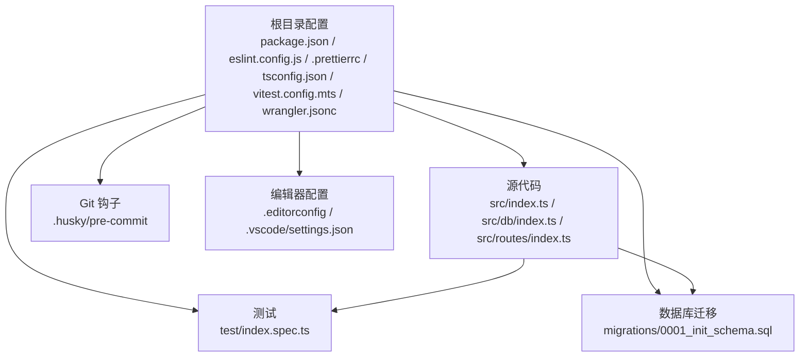
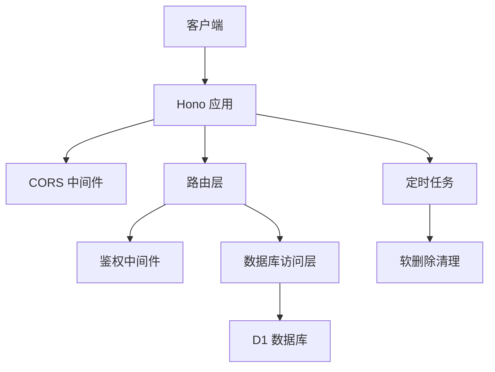
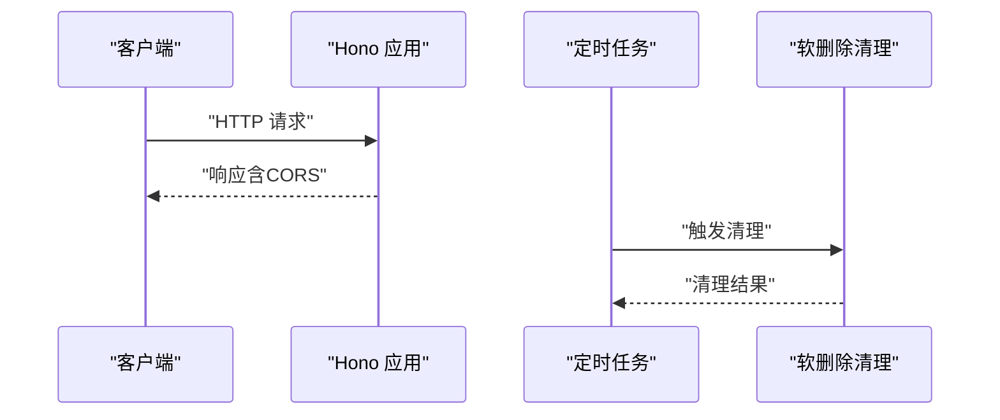
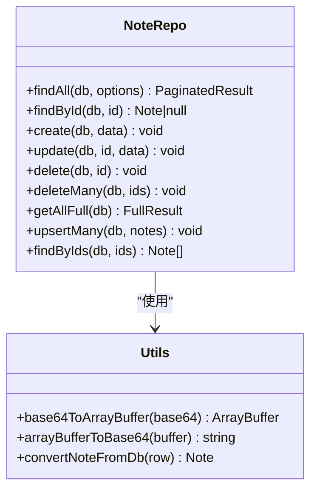
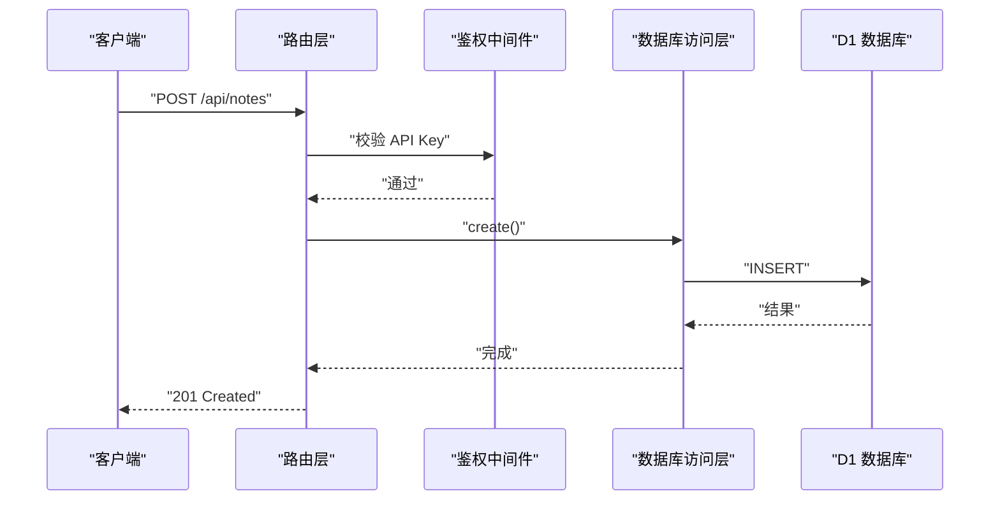
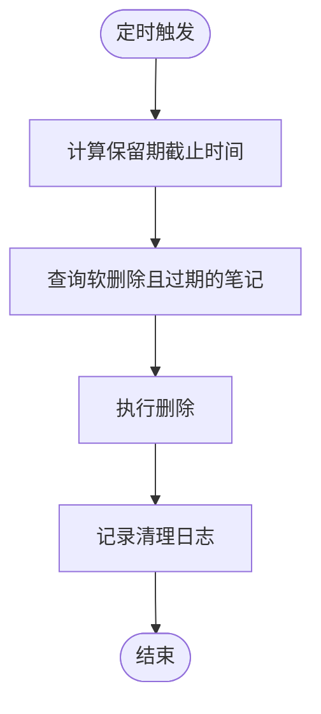
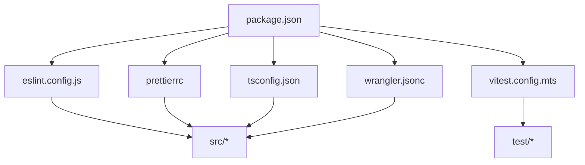

# 开发者指南

<cite>
**本文档引用的文件**
- [package.json](file://package.json)
- [eslint.config.js](file://eslint.config.js)
- [.prettierrc](file://.prettierrc)
- [tsconfig.json](file://tsconfig.json)
- [vitest.config.mts](file://vitest.config.mts)
- [wrangler.jsonc](file://wrangler.jsonc)
- [src/index.ts](file://src/index.ts)
- [src/db/index.ts](file://src/db/index.ts)
- [src/routes/index.ts](file://src/routes/index.ts)
- [.gitignore](file://.gitignore)
- [.husky/pre-commit](file://.husky/pre-commit)
- [.editorconfig](file://.editorconfig)
- [test/index.spec.ts](file://test/index.spec.ts)
- [migrations/0001_init_schema.sql](file://migrations/0001_init_schema.sql)
- [worker-configuration.d.ts](file://worker-configuration.d.ts)
- [.vscode/settings.json](file://.vscode/settings.json)
</cite>

## 目录

1. [简介](#简介)
2. [项目结构](#项目结构)
3. [核心组件](#核心组件)
4. [架构概览](#架构概览)
5. [详细组件分析](#详细组件分析)
6. [依赖关系分析](#依赖关系分析)
7. [性能考虑](#性能考虑)
8. [调试指南](#调试指南)
9. [代码贡献流程](#代码贡献流程)
10. [编码规范与工具配置](#编码规范与工具配置)
11. [Git 工作流程与分支管理](#git-工作流程与分支管理)
12. [代码审查标准](#代码审查标准)
13. [故障排除指南](#故障排除指南)
14. [结论](#结论)

## 简介

本指南面向新加入 Notes Server 项目的开发者，提供从环境搭建、开发工具配置、代码贡献流程到调试技巧与性能优化的完整指导。项目基于 Hono 框架构建在 Cloudflare Workers 上，使用 TypeScript、ESLint、Prettier、Vitest 进行开发与测试，并通过 Wrangler 进行本地开发与部署。

## 项目结构

项目采用按功能模块划分的组织方式，核心目录与职责如下：

- src：应用源代码，包含入口、数据库访问层与路由层
- test：单元与集成测试
- migrations：数据库迁移脚本
- .husky：Git 钩子配置
- .vscode：VS Code 编辑器配置
- 根目录配置文件：包管理、类型生成、ESLint、Prettier、TS 配置等

图表来源

- [package.json](file://package.json#L1-L41)
- [src/index.ts](file://src/index.ts#L1-L105)
- [src/db/index.ts](file://src/db/index.ts#L1-L251)
- [src/routes/index.ts](file://src/routes/index.ts#L1-L234)
- [test/index.spec.ts](file://test/index.spec.ts#L1-L104)
- [migrations/0001_init_schema.sql](file://migrations/0001_init_schema.sql#L1-L17)
- [.husky/pre-commit](file://.husky/pre-commit#L1-L2)
- [.editorconfig](file://.editorconfig#L1-L13)
- [.vscode/settings.json](file://.vscode/settings.json#L1-L5)

章节来源

- [package.json](file://package.json#L1-L41)
- [tsconfig.json](file://tsconfig.json#L1-L46)
- [wrangler.jsonc](file://wrangler.jsonc#L1-L54)

## 核心组件

- 应用入口与中间件：统一处理 CORS、全局错误与 404 响应，并暴露定时任务入口
- 数据库访问层：提供笔记的增删改查、批量操作与分页查询
- 路由层：实现鉴权中间件、笔记 CRUD、批量导入导出、同步接口与定时清理

章节来源

- [src/index.ts](file://src/index.ts#L1-L105)
- [src/db/index.ts](file://src/db/index.ts#L1-L251)
- [src/routes/index.ts](file://src/routes/index.ts#L1-L234)

## 架构概览

应用采用“入口 -> 中间件 -> 路由 -> 数据库访问层”的分层架构，结合 Cloudflare Workers 的事件模型与 D1 数据库存储。

图表来源

- [src/index.ts](file://src/index.ts#L38-L75)
- [src/routes/index.ts](file://src/routes/index.ts#L7-L15)
- [src/db/index.ts](file://src/db/index.ts#L43-L250)
- [wrangler.jsonc](file://wrangler.jsonc#L20-L24)

## 详细组件分析

### 入口与中间件

- 统一 CORS 处理
- 全局错误处理与 404 处理
- 定时任务入口，触发软删除清理逻辑

图表来源

- [src/index.ts](file://src/index.ts#L38-L75)

章节来源

- [src/index.ts](file://src/index.ts#L38-L75)

### 数据库访问层（NoteRepo）

- 提供 findAll、findById、create、update、delete、deleteMany、getAllFull、upsertMany、findByIds 等方法
- 支持 Base64 与 ArrayBuffer 的互转，适配 D1 BLOB 存储
- 使用批量执行与预编译语句提升性能

图表来源

- [src/db/index.ts](file://src/db/index.ts#L43-L250)

章节来源

- [src/db/index.ts](file://src/db/index.ts#L1-L251)

### 路由层（鉴权与业务接口）

- 鉴权中间件：校验 Authorization 头中的 Bearer Token
- 业务接口：分页查询、详情、创建、更新、删除、批量删除、批量导入、导出备份、同步接口
- 定时清理：软删除超过保留期的笔记

图表来源

- [src/routes/index.ts](file://src/routes/index.ts#L7-L15)
- [src/db/index.ts](file://src/db/index.ts#L99-L123)

章节来源

- [src/routes/index.ts](file://src/routes/index.ts#L1-L234)

### 定时任务与清理逻辑

- 触发频率：按配置的 cron 表达式
- 清理策略：删除软删除标记且更新时间早于保留期的笔记

图表来源

- [src/index.ts](file://src/index.ts#L71-L104)
- [wrangler.jsonc](file://wrangler.jsonc#L20-L24)

章节来源

- [src/index.ts](file://src/index.ts#L71-L104)
- [wrangler.jsonc](file://wrangler.jsonc#L20-L24)

## 依赖关系分析

- 包管理与脚本：通过 package.json 管理依赖与脚本命令
- 类型系统：tsconfig.json 配置严格模式与模块解析策略
- 测试运行：Vitest 配置使用 @cloudflare/vitest-pool-workers
- 部署与本地开发：Wrangler 配置 D1 绑定与触发器
- 代码质量：ESLint + Prettier + Husky + lint-staged

图表来源

- [package.json](file://package.json#L1-L41)
- [eslint.config.js](file://eslint.config.js#L1-L28)
- [.prettierrc](file://.prettierrc#L1-L7)
- [tsconfig.json](file://tsconfig.json#L1-L46)
- [vitest.config.mts](file://vitest.config.mts#L1-L12)
- [wrangler.jsonc](file://wrangler.jsonc#L1-L54)

章节来源

- [package.json](file://package.json#L1-L41)
- [tsconfig.json](file://tsconfig.json#L1-L46)
- [vitest.config.mts](file://vitest.config.mts#L1-L12)
- [wrangler.jsonc](file://wrangler.jsonc#L1-L54)

## 性能考虑

- 使用批量操作：批量插入/更新与批量删除减少网络往返
- 预编译语句：避免重复解析 SQL，降低开销
- 索引设计：为常用查询字段建立索引，如标题、软删除标记与组合索引
- 定时清理：定期清理软删除数据，保持表规模可控
- 严格类型：启用 TypeScript 严格模式，提前发现潜在性能问题

章节来源

- [src/db/index.ts](file://src/db/index.ts#L65-L80)
- [src/db/index.ts](file://src/db/index.ts#L178-L191)
- [migrations/0001_init_schema.sql](file://migrations/0001_init_schema.sql#L14-L16)
- [tsconfig.json](file://tsconfig.json#L34-L38)

## 调试指南

- 本地开发：使用 Wrangler 本地启动，结合浏览器或 curl 进行接口调试
- 日志输出：利用控制台输出关键信息，便于定位问题
- 单元测试：通过 Vitest 运行测试，结合云flare提供的测试工具进行 Worker 级别的验证
- 断点调试：在支持的编辑器中设置断点，配合本地开发环境进行逐步调试

章节来源

- [wrangler.jsonc](file://wrangler.jsonc#L8-L9)
- [test/index.spec.ts](file://test/index.spec.ts#L1-L104)

## 代码贡献流程

- Fork 并克隆仓库
- 创建功能分支，遵循命名规范（如 feature/xxx 或 fix/xxx）
- 在提交前运行格式化与静态检查
- 提交信息清晰描述变更内容
- 发起 Pull Request，等待代码审查与合并

章节来源

- [.husky/pre-commit](file://.husky/pre-commit#L1-L2)
- [package.json](file://package.json#L14-L16)

## 编码规范与工具配置

### ESLint 配置与使用

- 推荐规则集：基础推荐规则与 TypeScript 推荐规则
- 关闭与调整：关闭与格式化冲突的规则，启用严格规则
- 忽略路径：忽略 node_modules、.wrangler、dist、.husky、.idea、SQL 文件
- 语言选项：启用项目解析，确保类型检查生效

章节来源

- [eslint.config.js](file://eslint.config.js#L1-L28)

### Prettier 配置与使用

- 代码风格：最大行长、单引号、分号、Tab 缩进
- 自动格式化：通过脚本统一格式化 src 下的 TypeScript/JavaScript/JSON/Markdown

章节来源

- [.prettierrc](file://.prettierrc#L1-L7)
- [package.json](file://package.json#L15-L16)

### TypeScript 配置

- 目标与库：ES2024 目标与对应库
- 模块解析：Bundler 解析
- 严格模式：开启严格类型检查
- 类型声明：引入 worker-configuration.d.ts

章节来源

- [tsconfig.json](file://tsconfig.json#L1-L46)
- [worker-configuration.d.ts](file://worker-configuration.d.ts#L1-L10)

### Git 钩子与格式化

- pre-commit：自动运行 lint-staged，对暂存区文件进行格式化
- .husky：安装与准备脚本

章节来源

- [.husky/pre-commit](file://.husky/pre-commit#L1-L2)
- [package.json](file://package.json#L14-L16)
- [.gitignore](file://.gitignore#L161-L169)

### VS Code 配置

- 文件关联：wrangler.json 使用 JSONC 语法高亮

章节来源

- [.vscode/settings.json](file://.vscode/settings.json#L1-L5)

## Git 工作流程与分支管理

- 分支策略：采用功能分支与发布分支分离，主分支仅允许通过 PR 合并
- 提交规范：使用清晰的提交信息，描述变更目的与影响范围
- 合并与清理：合并后及时删除已合并的分支，保持仓库整洁

章节来源

- [.husky/pre-commit](file://.husky/pre-commit#L1-L2)
- [.gitignore](file://.gitignore#L1-L169)

## 代码审查标准

- 功能正确性：确保新增/修改逻辑满足需求，覆盖边界条件
- 代码质量：遵循 ESLint/Prettier 规范，保持一致的代码风格
- 性能与安全：避免性能瓶颈与安全风险，如 SQL 注入、敏感信息泄露
- 可维护性：注释清晰、模块职责单一、错误处理完备
- 测试覆盖：新增功能配套单元测试与集成测试

章节来源

- [eslint.config.js](file://eslint.config.js#L19-L26)
- [test/index.spec.ts](file://test/index.spec.ts#L1-L104)

## 故障排除指南

- 本地开发问题：确认 Wrangler 配置正确，D1 绑定可用
- 数据库连接：检查 D1 数据库 ID 与绑定名称一致性
- 路由与鉴权：核对 Authorization 头与 API Key 设置
- 定时任务：确认 cron 表达式与日志输出
- 测试失败：查看测试输出与断言信息，定位具体问题

章节来源

- [wrangler.jsonc](file://wrangler.jsonc#L13-L19)
- [src/routes/index.ts](file://src/routes/index.ts#L8-L15)
- [src/index.ts](file://src/index.ts#L71-L75)
- [test/index.spec.ts](file://test/index.spec.ts#L1-L104)

## 结论

本指南提供了 Notes Server 项目的完整开发指引，涵盖环境搭建、工具配置、编码规范、调试技巧、Git 工作流与代码审查标准。请新开发者按照指南完成本地配置与开发流程，确保代码质量与团队协作效率。
