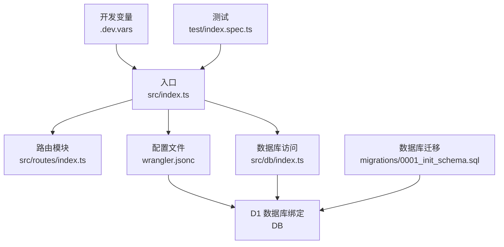
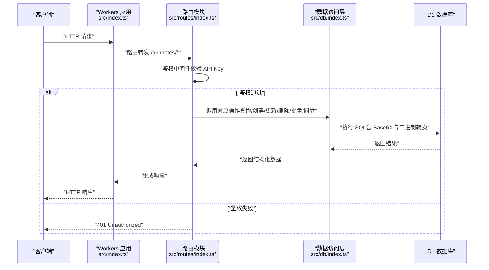
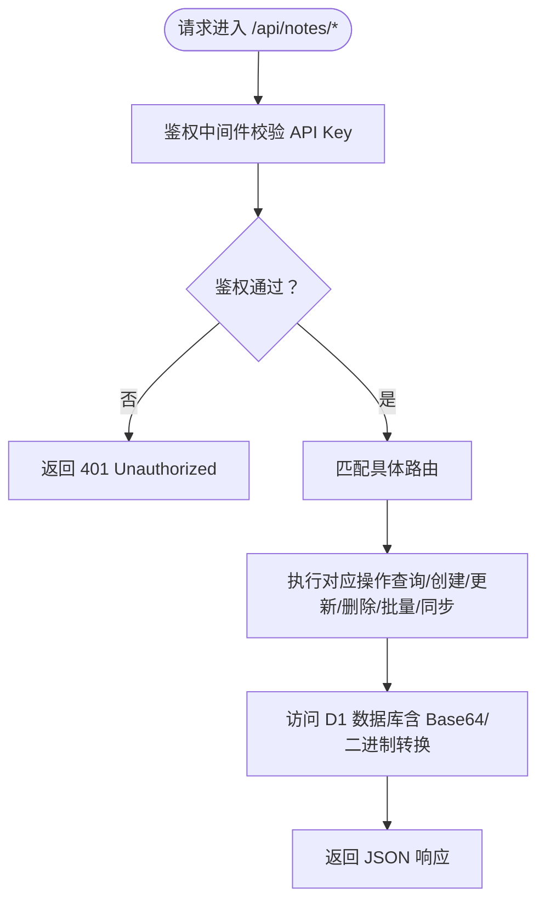
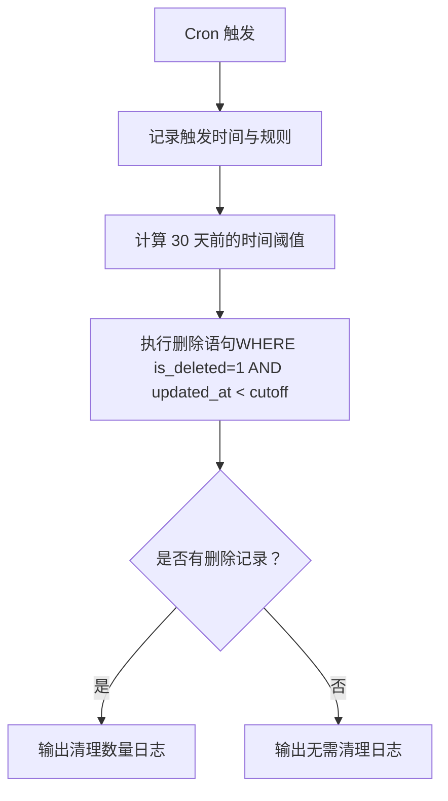
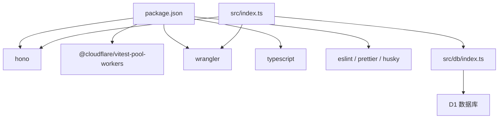

# 快速开始

<cite>
**本文引用的文件**
- [package.json](file://package.json)
- [wrangler.jsonc](file://wrangler.jsonc)
- [src/index.ts](file://src/index.ts)
- [src/routes/index.ts](file://src/routes/index.ts)
- [src/db/index.ts](file://src/db/index.ts)
- [migrations/0001_init_schema.sql](file://migrations/0001_init_schema.sql)
- [.dev.vars](file://.dev.vars)
- [test/index.spec.ts](file://test/index.spec.ts)
</cite>

## 目录

1. [简介](#简介)
2. [项目结构](#项目结构)
3. [核心组件](#核心组件)
4. [架构总览](#架构总览)
5. [详细组件分析](#详细组件分析)
6. [依赖关系分析](#依赖关系分析)
7. [性能注意事项](#性能注意事项)
8. [故障排除指南](#故障排除指南)
9. [结论](#结论)
10. [附录](#附录)

## 简介

本指南面向首次接触 Notes Server 的开发者，帮助你在最短时间内完成环境准备、Cloudflare 账户与 Wrangler 配置、依赖安装、本地开发环境设置、D1 数据库初始化与迁移，以及基本功能测试。你将学会如何：

- 准备 Node.js 与 Wrangler 开发环境
- 在 Cloudflare 上创建并配置 D1 数据库
- 初始化项目、应用数据库迁移
- 运行本地开发服务器与自动化测试
- 常见问题排查与解决

## 项目结构

该项目基于 Hono 框架构建的 Cloudflare Workers 应用，采用分层设计：

- 入口与路由：src/index.ts 定义应用与路由挂载；src/routes/index.ts 提供笔记相关 API
- 数据访问：src/db/index.ts 提供对 D1 的 CRUD、批量操作与数据转换
- 配置与脚本：wrangler.jsonc 为 Wrangler 配置；package.json 定义脚本与依赖
- 数据库迁移：migrations/0001_init_schema.sql 定义表结构与索引
- 测试：test/index.spec.ts 使用 @cloudflare/vitest-pool-workers 进行单元与集成测试

图表来源

- [src/index.ts](file://src/index.ts#L38-L75)
- [src/routes/index.ts](file://src/routes/index.ts#L1-L234)
- [src/db/index.ts](file://src/db/index.ts#L43-L250)
- [wrangler.jsonc](file://wrangler.jsonc#L13-L19)
- [migrations/0001_init_schema.sql](file://migrations/0001_init_schema.sql#L1-L17)
- [.dev.vars](file://.dev.vars#L1-L2)
- [test/index.spec.ts](file://test/index.spec.ts#L1-L104)

章节来源

- [src/index.ts](file://src/index.ts#L1-L105)
- [src/routes/index.ts](file://src/routes/index.ts#L1-L234)
- [src/db/index.ts](file://src/db/index.ts#L1-L251)
- [wrangler.jsonc](file://wrangler.jsonc#L1-L54)
- [migrations/0001_init_schema.sql](file://migrations/0001_init_schema.sql#L1-L17)
- [.dev.vars](file://.dev.vars#L1-L2)
- [test/index.spec.ts](file://test/index.spec.ts#L1-L104)

## 核心组件

- 应用入口与中间件
  - CORS 中间件启用跨域访问
  - 统一错误处理与 404 处理
  - 定时任务触发器（Cron）清理软删除笔记
- 路由与鉴权
  - 所有 /api/notes 路由均需携带 Authorization: Bearer <API_KEY> 的请求头
  - 支持导出全部笔记、分页查询、详情、创建、更新、删除、批量删除、同步、批量插入/更新等
- 数据库访问层
  - 提供分页查询、按 ID 查询、创建、更新、软删除、批量软删除、全量导出、批量 upsert、按 ID 列表查询
  - 自动处理 Base64 与二进制数据的转换
- 配置与脚本
  - package.json 中提供 dev、deploy、db:setup、test 等常用脚本
  - wrangler.jsonc 定义 D1 绑定、兼容日期、可观测性、定时任务等

章节来源

- [src/index.ts](file://src/index.ts#L38-L75)
- [src/routes/index.ts](file://src/routes/index.ts#L7-L15)
- [src/db/index.ts](file://src/db/index.ts#L43-L250)
- [package.json](file://package.json#L6-L16)
- [wrangler.jsonc](file://wrangler.jsonc#L13-L24)

## 架构总览

下图展示了从客户端请求到数据库访问的整体流程，以及定时任务的触发机制。

图表来源

- [src/index.ts](file://src/index.ts#L38-L75)
- [src/routes/index.ts](file://src/routes/index.ts#L7-L15)
- [src/db/index.ts](file://src/db/index.ts#L43-L250)

## 详细组件分析

### 1. 环境准备与 Cloudflare 账户配置

- 安装 Node.js（建议使用 Node.js 20+，具体以 Wrangler 要求为准）
- 安装 Wrangler CLI 并登录 Cloudflare 账户
- 在 Cloudflare Dashboard 创建 D1 数据库，记录数据库名称与数据库 ID
- 在 Wrangler 配置中绑定 D1 数据库（见下一节）

章节来源

- [wrangler.jsonc](file://wrangler.jsonc#L13-L19)

### 2. 依赖安装与本地开发环境设置

- 安装项目依赖
  - 命令：npm install
- 启动本地开发服务器
  - 命令：npm run dev 或 npm start
  - 预期输出：本地开发服务器启动成功，显示可用的本地地址与端口
- 应用默认监听路径
  - 默认路由为 /api/notes，根路径返回 404

章节来源

- [package.json](file://package.json#L6-L16)
- [src/index.ts](file://src/index.ts#L38-L75)

### 3. 配置 wrangler.jsonc 文件

- 关键配置项
  - 名称与主入口：name、main
  - 兼容日期：compatibility_date
  - D1 绑定：d1_databases（包含 binding、database_name、database_id）
  - 定时任务：triggers.crons（例如每日 16:00 触发）
  - 可观测性：observability.enabled
- 注意事项
  - database_id 需与 Cloudflare 控制台中的 D1 数据库 ID 一致
  - 如需环境变量，可在 .dev.vars 中设置（见“环境变量”小节）

章节来源

- [wrangler.jsonc](file://wrangler.jsonc#L5-L24)

### 4. 设置环境变量

- 开发环境变量
  - 在 .dev.vars 中设置 API_KEY（用于路由鉴权）
  - 示例：API_KEY=your-secret-key
- 生产环境变量
  - 通过 Wrangler 或 Cloudflare Dashboard 的“设置/密钥”页面添加
  - 建议使用密钥（Secrets）存储敏感信息

章节来源

- [.dev.vars](file://.dev.vars#L1-L2)
- [src/routes/index.ts](file://src/routes/index.ts#L8-L15)

### 5. 初始化 D1 数据库与迁移

- 本地初始化
  - 命令：npm run db:setup
  - 功能：应用 migrations/0001_init_schema.sql 到本地 D1 数据库
- 生产环境初始化
  - 命令：npm run db:setup:prod
  - 功能：应用迁移至远程 D1 数据库
- 迁移文件说明
  - 表结构：notes（包含 id、title、content、iv、auth_tag、is_encrypted、is_deleted、created_at、updated_at）
  - 索引：title、is_deleted、(is_deleted, updated_at DESC)

章节来源

- [package.json](file://package.json#L11-L12)
- [migrations/0001_init_schema.sql](file://migrations/0001_init_schema.sql#L1-L17)

### 6. 基本功能测试

- 运行测试
  - 命令：npm test
  - 测试覆盖：根路径返回 404、鉴权中间件、批量删除与批量插入/更新路由存在性
- 单元测试与集成测试
  - 使用 @cloudflare/vitest-pool-workers 提供的测试工具链
  - 测试中通过 SELF.fetch 或 worker.fetch 发起请求并断言响应

章节来源

- [package.json](file://package.json#L10-L16)
- [test/index.spec.ts](file://test/index.spec.ts#L1-L104)

### 7. API 路由与鉴权流程

- 鉴权中间件
  - 所有 /api/notes 路由在进入业务逻辑前检查 Authorization 头
  - 需要形如 Bearer <API_KEY> 的请求头，且 API_KEY 必须与环境变量一致
- 主要接口
  - GET /api/notes/export/all：导出全部笔记（作为 JSON 下载）
  - GET /api/notes：分页查询笔记（支持 search、page、limit 参数）
  - GET /api/notes/:id：获取笔记详情
  - POST /api/notes：创建笔记（校验 title 与 content）
  - PATCH /api/notes/:id：更新笔记（可选字段）
  - DELETE /api/notes/:id：软删除笔记
  - DELETE /api/notes/batch：批量软删除（传入 id 数组）
  - POST /api/notes/sync：双向同步（根据 updated_at 决策上传/下载）
  - POST /api/notes/batch：批量 upsert（传入笔记数组）

图表来源

- [src/routes/index.ts](file://src/routes/index.ts#L7-L15)
- [src/db/index.ts](file://src/db/index.ts#L43-L250)

章节来源

- [src/routes/index.ts](file://src/routes/index.ts#L7-L15)
- [src/db/index.ts](file://src/db/index.ts#L43-L250)

### 8. 定时任务（Cron）与清理逻辑

- 触发条件
  - triggers.crons 配置为每日 16:00
- 清理策略
  - 清理 is_deleted = 1 且 updated_at 早于 30 天的软删除笔记
  - 清理完成后输出日志（无变更时输出提示信息）

图表来源

- [src/index.ts](file://src/index.ts#L71-L104)

章节来源

- [src/index.ts](file://src/index.ts#L71-L104)
- [wrangler.jsonc](file://wrangler.jsonc#L20-L24)

## 依赖关系分析

- 应用层依赖
  - Hono：Web 框架与路由
  - @cloudflare/vitest-pool-workers：Workers 测试池
  - Vitest：测试框架
  - Wrangler：本地开发与部署
- 运行时依赖
  - D1：SQLite 兼容的关系型数据库
- 开发阶段依赖
  - ESLint、Prettier、TypeScript、husky、lint-staged

图表来源

- [package.json](file://package.json#L18-L34)
- [src/index.ts](file://src/index.ts#L1-L4)
- [src/db/index.ts](file://src/db/index.ts#L1-L2)

章节来源

- [package.json](file://package.json#L18-L34)
- [src/index.ts](file://src/index.ts#L1-L4)
- [src/db/index.ts](file://src/db/index.ts#L1-L2)

## 性能注意事项

- 数据库访问优化
  - 使用批量操作（db.batch、ON CONFLICT DO UPDATE）减少往返次数
  - 合理使用索引（title、is_deleted、(is_deleted, updated_at DESC)）
- 编解码开销
  - Base64 与二进制互转发生在数据层，注意大体量内容的传输与存储成本
- 定时任务
  - Cron 仅清理软删除数据，避免在高峰时段执行重负载操作

[本节为通用指导，不涉及具体文件分析]

## 故障排除指南

- 本地开发无法启动
  - 确认 Node.js 版本满足 Wrangler 要求
  - 确认已安装依赖：npm install
  - 确认 .dev.vars 中 API_KEY 已设置
- 数据库连接失败
  - 确认 wrangler.jsonc 中 database_id 与 Cloudflare 控制台一致
  - 确认已执行本地迁移：npm run db:setup
- 认证失败（401）
  - 确认请求头为 Authorization: Bearer <API_KEY>
  - 确认 API_KEY 与 .dev.vars 或生产密钥一致
- 路由 404
  - 确认访问的是 /api/notes 路径，根路径返回 404 属于预期行为
- 定时任务未执行
  - 确认 triggers.crons 配置正确
  - 本地开发模式下可通过 Wrangler 调试定时任务

章节来源

- [.dev.vars](file://.dev.vars#L1-L2)
- [wrangler.jsonc](file://wrangler.jsonc#L13-L19)
- [src/routes/index.ts](file://src/routes/index.ts#L8-L15)
- [src/index.ts](file://src/index.ts#L53-L63)
- [src/index.ts](file://src/index.ts#L71-L104)

## 结论

通过本指南，你已经完成了 Notes Server 的环境准备、Cloudflare 账户与 D1 配置、依赖安装、本地开发与数据库迁移，并了解了主要 API 与定时任务的工作方式。建议在本地完成基础功能验证后，再进行生产部署与密钥管理。

[本节为总结性内容，不涉及具体文件分析]

## 附录

### A. 常用命令清单

- 安装依赖：npm install
- 启动本地开发：npm run dev 或 npm start
- 应用本地迁移：npm run db:setup
- 应用生产迁移：npm run db:setup:prod
- 运行测试：npm test
- 生成类型声明：npm run cf-typegen
- 代码格式化：npm run format
- 代码检查：npm run lint

章节来源

- [package.json](file://package.json#L6-L16)

### B. 数据模型与索引

- 表：notes
  - 字段：id（主键）、title、content（BLOB）、iv（BLOB，可选）、auth_tag（BLOB，可选）、is_encrypted（整数，默认 1）、is_deleted（整数，默认 0）、created_at、updated_at
- 索引
  - idx_notes_title(title)
  - idx_notes_is_deleted(is_deleted)
  - idx_notes_is_deleted_updated_at(is_deleted, updated_at DESC)

章节来源

- [migrations/0001_init_schema.sql](file://migrations/0001_init_schema.sql#L1-L17)
