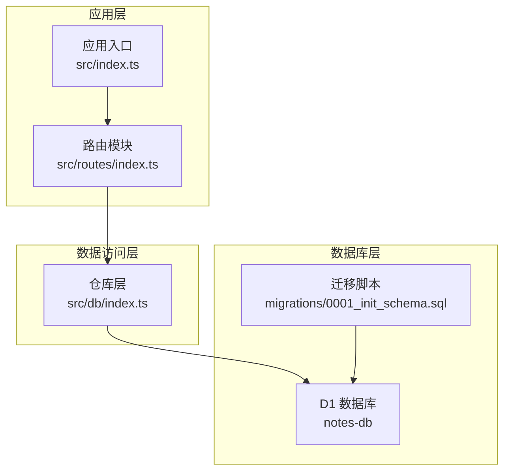
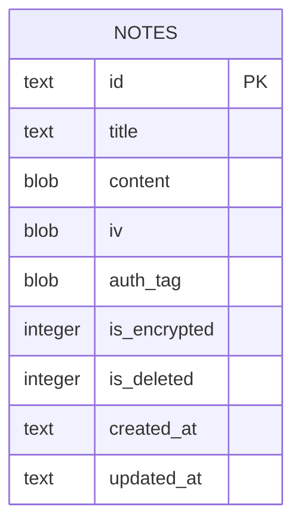
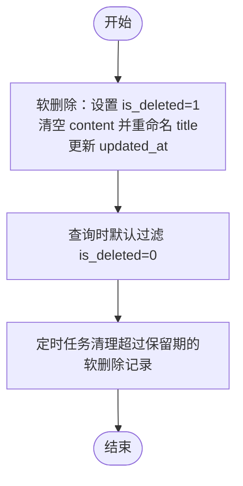
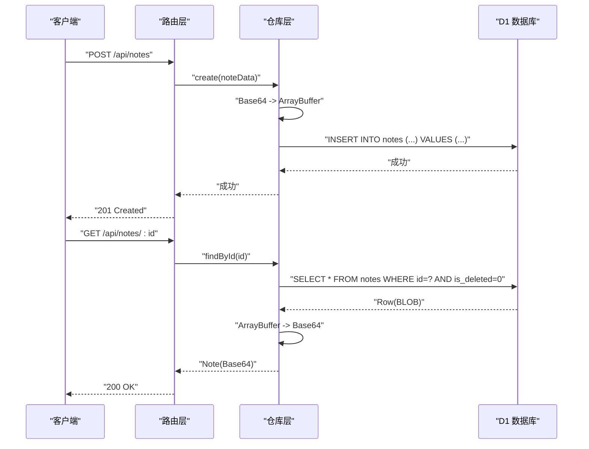

# 数据库设计

<cite>
**本文引用的文件**
- [migrations/0001_init_schema.sql](file://migrations/0001_init_schema.sql)
- [src/db/index.ts](file://src/db/index.ts)
- [src/index.ts](file://src/index.ts)
- [src/routes/index.ts](file://src/routes/index.ts)
- [wrangler.jsonc](file://wrangler.jsonc)
- [package.json](file://package.json)
- [api-doc.md](file://api-doc.md)
</cite>

## 目录

1. [简介](#简介)
2. [项目结构与数据库集成](#项目结构与数据库集成)
3. [核心数据模型](#核心数据模型)
4. [表结构与字段定义](#表结构与字段定义)
5. [索引与约束设计](#索引与约束设计)
6. [软删除机制](#软删除机制)
7. [Base64 编解码与数据完整性](#base64-编解码与数据完整性)
8. [数据访问模式与缓存策略](#数据访问模式与缓存策略)
9. [性能考量与优化建议](#性能考量与优化建议)
10. [数据生命周期与保留策略](#数据生命周期与保留策略)
11. [数据迁移与版本管理](#数据迁移与版本管理)
12. [样本数据与使用示例](#样本数据与使用示例)
13. [故障排查指南](#故障排查指南)
14. [结论](#结论)

## 简介

本文件为 Notes Server 的数据库设计文档，聚焦于数据模型、表结构、索引与约束、软删除机制、Base64 编解码处理、数据完整性保障、数据访问模式、缓存策略、性能考量、数据生命周期与保留策略、迁移路径与版本管理，并提供模式图与样本数据说明。Notes Server 使用 Cloudflare Workers 运行时与 D1 数据库存储笔记数据，采用 SQLite 兼容语法进行建模与迁移。

## 项目结构与数据库集成

- 数据库绑定与配置
  - 在运行时通过环境变量绑定 D1 数据库实例，名称为 DB，数据库名为 notes-db。
  - 配置文件中声明了 D1 绑定与数据库 ID，确保本地与生产环境一致。
- 数据库迁移
  - 初始迁移脚本创建 notes 表及若干索引，后续可通过迁移工具进行版本化演进。
- 应用层集成
  - 路由层在鉴权后调用仓库层（NoteRepo）执行数据库操作；仓库层负责 SQL 构造、参数绑定与结果转换。

图表来源

- [src/routes/index.ts](file://src/routes/index.ts#L1-L234)
- [src/db/index.ts](file://src/db/index.ts#L1-L251)
- [src/index.ts](file://src/index.ts#L1-L105)
- [migrations/0001_init_schema.sql](file://migrations/0001_init_schema.sql#L1-L17)
- [wrangler.jsonc](file://wrangler.jsonc#L13-L19)

章节来源

- [wrangler.jsonc](file://wrangler.jsonc#L13-L19)
- [package.json](file://package.json#L11-L12)
- [src/index.ts](file://src/index.ts#L8-L11)
- [src/routes/index.ts](file://src/routes/index.ts#L1-L234)
- [src/db/index.ts](file://src/db/index.ts#L1-L251)
- [migrations/0001_init_schema.sql](file://migrations/0001_init_schema.sql#L1-L17)

## 核心数据模型

- Note 对象
  - 字段包括：id、title、content（Base64 编码的二进制数据）、iv（Base64 编码的 IV，可选）、auth_tag（Base64 编码的认证标签，可选）、is_encrypted（是否加密，0/1）、is_deleted（软删除标记，0/1）、created_at、updated_at。
  - 数据类型与约束
    - id：TEXT 主键，唯一标识。
    - title：TEXT 非空。
    - content：BLOB 非空（存储加密后的二进制数据）。
    - iv、auth_tag：BLOB 可空（仅在加密场景下存在）。
    - is_encrypted：INTEGER 非空默认 1。
    - is_deleted：INTEGER 非空默认 0。
    - created_at、updated_at：TEXT 非空（ISO 8601 字符串）。
- 分页返回结构
  - total、data、page、limit，用于列表分页查询。

章节来源

- [src/index.ts](file://src/index.ts#L16-L36)
- [api-doc.md](file://api-doc.md#L14-L40)

## 表结构与字段定义

- 表名：notes
- 字段定义
  - id：TEXT PRIMARY KEY NOT NULL
  - title：TEXT NOT NULL
  - content：BLOB NOT NULL
  - iv：BLOB
  - auth_tag：BLOB
  - is_encrypted：INTEGER NOT NULL DEFAULT 1
  - is_deleted：INTEGER NOT NULL DEFAULT 0
  - created_at：TEXT NOT NULL
  - updated_at：TEXT NOT NULL

图表来源

- [migrations/0001_init_schema.sql](file://migrations/0001_init_schema.sql#L1-L12)

章节来源

- [migrations/0001_init_schema.sql](file://migrations/0001_init_schema.sql#L1-L12)

## 索引与约束设计

- 索引
  - idx_notes_title(title)：加速按标题检索。
  - idx_notes_is_deleted(is_deleted)：加速软删除过滤。
  - idx_notes_is_deleted_updated_at(is_deleted, updated_at DESC)：加速“未删除且按更新时间倒序”的查询。
- 约束
  - 主键：id。
  - 默认值：is_encrypted 默认 1，is_deleted 默认 0。
  - 非空：title、content、created_at、updated_at。
- 设计意图
  - 通过复合索引优化分页与搜索场景；通过 is_deleted 字段实现软删除，避免物理删除带来的不可逆风险。

章节来源

- [migrations/0001_init_schema.sql](file://migrations/0001_init_schema.sql#L14-L16)

## 软删除机制

- 实现方式
  - 删除操作将 is_deleted 置为 1，并清空 content、重命名 title，同时更新 updated_at。
  - 查询默认过滤 is_deleted = 0，确保软删除数据不参与常规业务查询。
  - 批量删除通过 IN 子句批量更新，提升效率。
- 生命周期
  - 定时任务定期清理超过保留期（默认 30 天）的软删除记录，释放存储空间。
- 优点
  - 支持恢复与审计；降低误删风险；保持历史一致性。

图表来源

- [src/db/index.ts](file://src/db/index.ts#L178-L191)
- [src/index.ts](file://src/index.ts#L78-L104)

章节来源

- [src/db/index.ts](file://src/db/index.ts#L178-L191)
- [src/index.ts](file://src/index.ts#L78-L104)

## Base64 编解码与数据完整性

- 编解码流程
  - 写入：前端传入 Base64 字符串，仓库层将其转换为 ArrayBuffer 后写入 BLOB 字段。
  - 读取：从数据库读取 BLOB 字段，转换为 Base64 字符串返回给前端。
- 数据完整性
  - 通过统一的转换函数保证前后端一致的编码格式；对 iv 与 auth_tag 提供可空处理，满足不同加密场景。
- 注意事项
  - 前端需确保 Base64 字符串合法；仓库层在转换失败时会抛出异常，应在外层捕获并返回错误。

图表来源

- [src/db/index.ts](file://src/db/index.ts#L10-L29)
- [src/db/index.ts](file://src/db/index.ts#L100-L123)
- [src/db/index.ts](file://src/db/index.ts#L94-L97)
- [src/routes/index.ts](file://src/routes/index.ts#L47-L82)
- [src/routes/index.ts](file://src/routes/index.ts#L39-L44)

章节来源

- [src/db/index.ts](file://src/db/index.ts#L10-L29)
- [src/db/index.ts](file://src/db/index.ts#L100-L123)
- [src/db/index.ts](file://src/db/index.ts#L94-L97)
- [src/routes/index.ts](file://src/routes/index.ts#L47-L82)
- [src/routes/index.ts](file://src/routes/index.ts#L39-L44)

## 数据访问模式与缓存策略

- 访问模式
  - 列表分页：先 COUNT 再 LIMIT/OFFSET，使用复合索引优化排序与过滤。
  - 单条查询：按 id 与 is_deleted 过滤。
  - 批量操作：批量插入/更新（UPSERT）与批量删除，减少往返次数。
  - 同步接口：基于 updated_at 比较决定上传或下载，减少冗余传输。
- 缓存策略
  - 当前实现未内置应用层缓存；建议在边缘层利用 Cloudflare Workers Cache 或上游 CDN 缓存热点列表与详情（需结合业务场景评估命中率与一致性）。
  - 对于高频读取的笔记，可在应用层引入 LRU 缓存（如内存缓存），注意与软删除、更新时间的失效策略配合。

章节来源

- [src/db/index.ts](file://src/db/index.ts#L45-L91)
- [src/db/index.ts](file://src/db/index.ts#L202-L237)
- [src/routes/index.ts](file://src/routes/index.ts#L138-L197)

## 性能考量与优化建议

- 查询性能
  - 列表分页使用复合索引 idx_notes_is_deleted_updated_at，优先按 updated_at 倒序展示最新笔记。
  - 搜索条件使用 LIKE(title OR content)，建议在高并发场景下限制搜索范围或增加全文索引（需评估 D1 支持情况）。
- 写入性能
  - 批量 UPSERT 使用 D1 的 ON CONFLICT 语法，减少单条写入开销。
  - 批量删除使用 IN 子句，避免循环逐条更新。
- 存储与清理
  - 定时清理软删除记录，控制表膨胀；保留期默认 30 天，可根据业务调整。
- 连接与事务
  - 使用 D1 的 prepare + bind 方式，避免 SQL 注入；批量操作使用 db.batch 提升吞吐。

章节来源

- [migrations/0001_init_schema.sql](file://migrations/0001_init_schema.sql#L14-L16)
- [src/db/index.ts](file://src/db/index.ts#L65-L80)
- [src/db/index.ts](file://src/db/index.ts#L202-L237)
- [src/index.ts](file://src/index.ts#L78-L104)

## 数据生命周期与保留策略

- 软删除
  - 删除时仅标记 is_deleted=1，不清除索引与元数据，便于后续审计与恢复。
- 清理策略
  - 定时任务按 updated_at 与保留期（默认 30 天）清理软删除记录，释放存储。
- 版本与演进
  - 通过迁移脚本管理 schema 变更，新增字段或索引时需在迁移脚本中声明，避免破坏现有数据。

章节来源

- [src/db/index.ts](file://src/db/index.ts#L178-L191)
- [src/index.ts](file://src/index.ts#L78-L104)
- [migrations/0001_init_schema.sql](file://migrations/0001_init_schema.sql#L1-L17)

## 数据迁移与版本管理

- 迁移工具
  - 使用 Wrangler 的 D1 迁移命令在本地与远程应用迁移。
- 迁移脚本
  - 初始脚本创建 notes 表与必要索引；后续演进通过新增脚本维护。
- 版本管理
  - 建议每次变更创建独立迁移文件，明确变更内容与回滚策略；在生产环境应用前进行预演与备份。

章节来源

- [package.json](file://package.json#L11-L12)
- [migrations/0001_init_schema.sql](file://migrations/0001_init_schema.sql#L1-L17)

## 样本数据与使用示例

- 示例字段值
  - id：UUID 字符串
  - title：非空字符串
  - content：Base64 编码的加密数据
  - iv：Base64 编码的初始化向量（可选）
  - auth_tag：Base64 编码的认证标签（可选）
  - is_encrypted：0 或 1
  - is_deleted：0 或 1
  - created_at、updated_at：ISO 8601 字符串
- 使用示例
  - 创建笔记：POST /api/notes，携带 title、content（以及可选的 iv、auth_tag、is_encrypted、created_at、updated_at）。
  - 列表分页：GET /api/notes?page=1&limit=20&search=关键词。
  - 同步接口：POST /api/notes/sync，提交 clientNotes 数组，服务端返回需要下载的笔记与同步成功的 ID 列表。
  - 批量导入：POST /api/notes/batch，提交 notes 数组，支持批量 UPSERT。

章节来源

- [api-doc.md](file://api-doc.md#L14-L40)
- [src/routes/index.ts](file://src/routes/index.ts#L30-L82)
- [src/routes/index.ts](file://src/routes/index.ts#L138-L197)
- [src/routes/index.ts](file://src/routes/index.ts#L199-L231)

## 故障排查指南

- 常见问题
  - Base64 解码失败：检查前端传入的 Base64 是否合法，仓库层转换异常需在外层捕获并返回错误。
  - 未找到笔记：确认 id 是否正确、是否已被软删除（is_deleted=1）。
  - 批量操作失败：检查请求体格式与字段校验，确保每条笔记包含 id、title、content。
  - 定时清理未生效：确认 Cron 触发器配置与保留期设置。
- 排查步骤
  - 查看日志输出（定时清理与错误处理均有日志）。
  - 使用导出接口导出全量笔记进行核对。
  - 在本地应用迁移脚本验证 schema 与索引。

章节来源

- [src/db/index.ts](file://src/db/index.ts#L10-L29)
- [src/routes/index.ts](file://src/routes/index.ts#L115-L136)
- [src/index.ts](file://src/index.ts#L78-L104)
- [src/routes/index.ts](file://src/routes/index.ts#L17-L28)

## 结论

本设计围绕 D1 的 SQLite 兼容能力，采用软删除、Base64 编解码与批量操作等策略，兼顾安全性、可恢复性与性能。通过合理的索引与定时清理机制，能够在高并发场景下维持良好的查询与写入体验。建议在后续演进中持续关注迁移脚本的版本化管理与缓存策略的落地实施，以进一步提升系统稳定性与用户体验。
