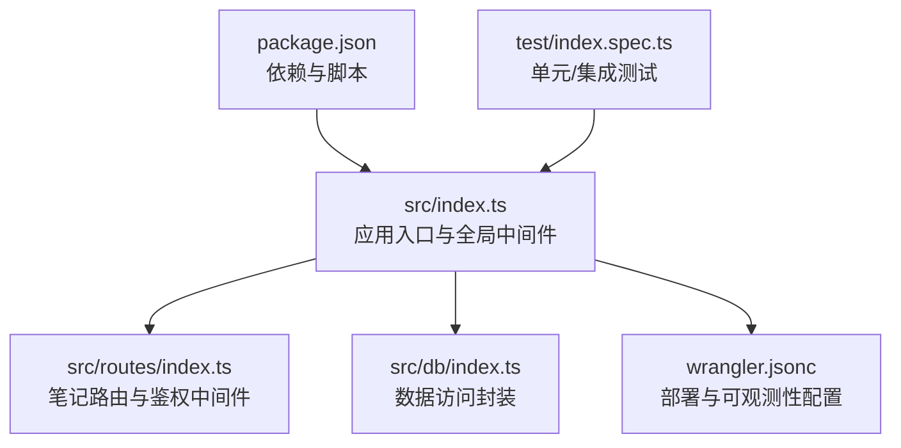
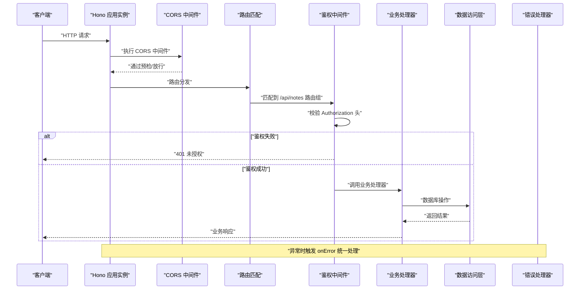
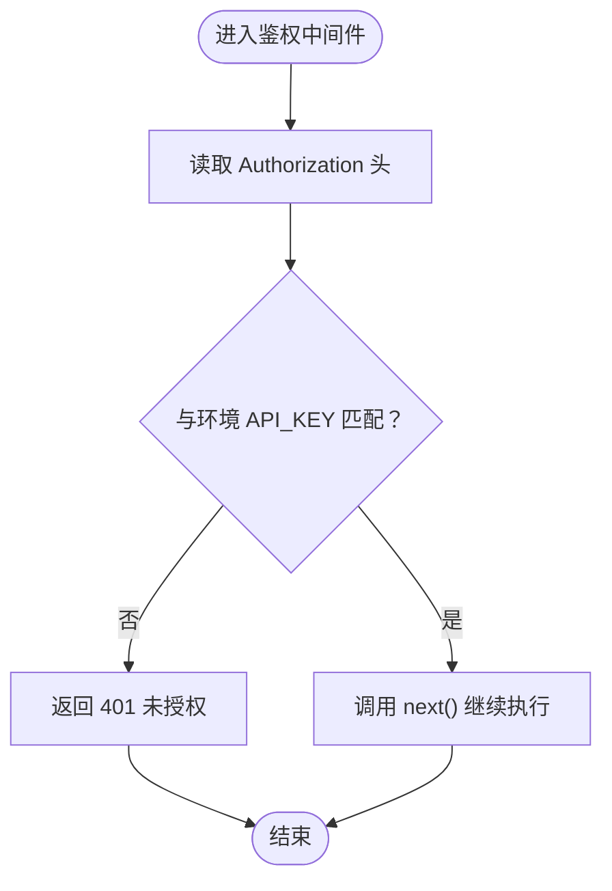
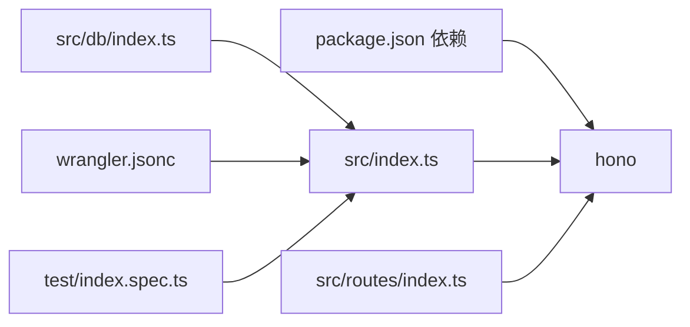

# 中间件模式

<cite>
**本文引用的文件**
- [src/index.ts](file://src/index.ts)
- [src/routes/index.ts](file://src/routes/index.ts)
- [src/db/index.ts](file://src/db/index.ts)
- [package.json](file://package.json)
- [wrangler.jsonc](file://wrangler.jsonc)
- [test/index.spec.ts](file://test/index.spec.ts)
</cite>

## 目录

1. [简介](#简介)
2. [项目结构](#项目结构)
3. [核心组件](#核心组件)
4. [架构总览](#架构总览)
5. [详细组件分析](#详细组件分析)
6. [依赖关系分析](#依赖关系分析)
7. [性能考量](#性能考量)
8. [故障排查指南](#故障排查指南)
9. [结论](#结论)
10. [附录](#附录)

## 简介

本文件围绕 Notes Server 的中间件模式进行系统化文档化，重点阐述基于 Hono 的中间件体系在本项目中的实现与应用，包括：

- CORS 中间件的全局启用
- 鉴权中间件在子路由上的应用
- 错误处理与 404 统一响应
- 中间件的执行顺序与链式调用机制
- 如何通过中间件实现横切关注点（日志、性能监控、安全控制）
- 自定义中间件的开发模式、参数传递与异步处理
- 中间件架构图与实际代码示例路径

## 项目结构

项目采用按层组织的结构，入口文件负责应用实例构建、全局中间件注册与错误处理；路由模块负责业务路由与局部中间件；数据库访问封装在独立仓库模块中。

图表来源

- [src/index.ts](file://src/index.ts#L38-L63)
- [src/routes/index.ts](file://src/routes/index.ts#L5-L15)
- [src/db/index.ts](file://src/db/index.ts#L43-L250)
- [wrangler.jsonc](file://wrangler.jsonc#L1-L54)
- [package.json](file://package.json#L1-L41)
- [test/index.spec.ts](file://test/index.spec.ts#L1-L65)

章节来源

- [src/index.ts](file://src/index.ts#L1-L105)
- [src/routes/index.ts](file://src/routes/index.ts#L1-L234)
- [src/db/index.ts](file://src/db/index.ts#L1-L251)
- [package.json](file://package.json#L1-L41)
- [wrangler.jsonc](file://wrangler.jsonc#L1-L54)
- [test/index.spec.ts](file://test/index.spec.ts#L1-L65)

## 核心组件

- 应用实例与全局中间件
  - 使用 Hono 构建应用实例，并在根路径注册 CORS 中间件，确保跨域请求被允许。
  - 注册统一错误处理器与 404 处理器，保证异常与未匹配路由的一致响应。
- 路由与局部中间件
  - 在笔记路由组上注册鉴权中间件，要求请求携带有效的 Bearer Token。
- 数据访问层
  - 提供统一的 CRUD 与批量操作封装，供路由处理函数调用。

章节来源

- [src/index.ts](file://src/index.ts#L38-L63)
- [src/routes/index.ts](file://src/routes/index.ts#L7-L15)
- [src/db/index.ts](file://src/db/index.ts#L43-L250)

## 架构总览

下图展示从请求进入应用到路由处理的整体流程，以及中间件的执行顺序与职责边界。

图表来源

- [src/index.ts](file://src/index.ts#L38-L63)
- [src/routes/index.ts](file://src/routes/index.ts#L7-L15)

## 详细组件分析

### CORS 中间件

- 全局启用：在应用根路径注册 CORS 中间件，使所有路由均具备跨域能力。
- 作用范围：对所有请求生效，无需在每个路由重复配置。
- 配置位置：应用实例初始化后立即注册。

章节来源

- [src/index.ts](file://src/index.ts#L38-L40)

### 鉴权中间件

- 注册位置：在笔记路由组上注册，仅影响 /api/notes 下的所有子路由。
- 校验逻辑：读取 Authorization 头，要求为 Bearer Token，且与环境变量中的 API_KEY 匹配。
- 失败处理：直接返回 401 响应，阻止后续处理器执行。
- 成功处理：调用 next() 进入下一个中间件或路由处理器。

图表来源

- [src/routes/index.ts](file://src/routes/index.ts#L7-L15)

章节来源

- [src/routes/index.ts](file://src/routes/index.ts#L7-L15)

### 错误处理与 404

- 统一错误处理：捕获运行时异常，返回标准化错误响应（包含错误类型、消息与时间戳）。
- 404 处理：当路由未匹配时，返回统一的 404 响应体。
- 适用范围：全局生效，覆盖所有路由与中间件。

章节来源

- [src/index.ts](file://src/index.ts#L41-L63)

### 数据访问层（Repository）

- 提供 findAll、findById、create、update、delete、deleteMany、getAllFull、upsertMany、findByIds 等方法。
- 内部完成 Base64 与 ArrayBuffer 的互转，屏蔽加密相关字段的序列化细节。
- 支持批量操作与条件查询，优化数据库交互效率。

章节来源

- [src/db/index.ts](file://src/db/index.ts#L43-L250)

### 中间件执行顺序与链式调用机制

- 全局中间件先于路由中间件执行；同一层级内按注册顺序依次执行。
- next() 是中间件链式调用的核心：只有调用 next() 才会继续执行后续中间件或最终处理器。
- 若中间件提前返回响应（如鉴权失败），后续中间件与处理器不会被执行。

章节来源

- [src/index.ts](file://src/index.ts#L38-L40)
- [src/routes/index.ts](file://src/routes/index.ts#L7-L15)

### 横切关注点的实现

- 日志记录：在定时任务与清理逻辑中使用 console.warn/console.error 输出关键信息，便于可观测性。
- 性能监控：可通过在中间件中埋点计时（例如使用 console.time/console.timeEnd）统计请求耗时。
- 安全控制：鉴权中间件集中校验 API Key，避免在各业务处理器中重复实现。

章节来源

- [src/index.ts](file://src/index.ts#L71-L104)
- [src/routes/index.ts](file://src/routes/index.ts#L7-L15)

### 自定义中间件开发模式

- 参数传递：通过 c.env 访问环境变量（如 API_KEY），通过 c.req.header 获取请求头，通过 c.req.query/c.req.param 获取查询与路径参数。
- 异步处理：中间件可返回 Promise 或使用 async/await；若需要等待后台任务，可使用 c.executionContext.waitUntil。
- 扩展建议：将通用逻辑抽象为独立中间件函数，复用在多个路由组；必要时引入上下文数据注入（如 c.set/c.get）以传递中间结果。

章节来源

- [src/routes/index.ts](file://src/routes/index.ts#L7-L15)
- [src/index.ts](file://src/index.ts#L71-L75)

### 实际代码示例路径

- 全局 CORS 中间件注册：[src/index.ts](file://src/index.ts#L38-L40)
- 鉴权中间件实现：[src/routes/index.ts](file://src/routes/index.ts#L7-L15)
- 统一错误处理：[src/index.ts](file://src/index.ts#L41-L51)
- 404 处理：[src/index.ts](file://src/index.ts#L53-L63)
- 数据库操作封装：[src/db/index.ts](file://src/db/index.ts#L43-L250)
- 测试用例（含鉴权与路由存在性验证）：[test/index.spec.ts](file://test/index.spec.ts#L35-L65)

## 依赖关系分析

- 依赖管理：Hono 作为核心框架，提供中间件、路由与上下文能力。
- 部署与可观测性：Wrangler 配置开启可观测性，便于中间件与业务日志的采集与分析。
- 测试：Vitest 配合 Cloudflare Test Harness 验证路由与鉴权行为。

图表来源

- [package.json](file://package.json#L32-L34)
- [src/index.ts](file://src/index.ts#L1-L3)
- [src/routes/index.ts](file://src/routes/index.ts#L1-L3)
- [src/db/index.ts](file://src/db/index.ts#L1-L2)
- [wrangler.jsonc](file://wrangler.jsonc#L10-L12)
- [test/index.spec.ts](file://test/index.spec.ts#L1-L3)

章节来源

- [package.json](file://package.json#L1-L41)
- [wrangler.jsonc](file://wrangler.jsonc#L1-L54)

## 性能考量

- 中间件链长度：尽量减少不必要的中间件层级，避免在全局中间件中执行重逻辑。
- 异步与等待：对于后台任务，使用 c.executionContext.waitUntil，避免阻塞主请求响应。
- 数据库批处理：在数据访问层使用批处理与条件查询，降低数据库往返次数。
- 日志频率：生产环境适当降低高频日志输出，避免影响吞吐。

## 故障排查指南

- 鉴权失败（401）
  - 检查请求头 Authorization 是否为 Bearer Token，且与环境变量 API_KEY 一致。
  - 参考测试用例中的鉴权断言路径：[test/index.spec.ts](file://test/index.spec.ts#L35-L46)
- 404 未找到
  - 确认请求路径是否正确，是否命中 /api/notes 路由组。
  - 参考测试用例中的 404 断言路径：[test/index.spec.ts](file://test/index.spec.ts#L10-L23)
- 统一错误处理
  - 查看 onError 回调返回的标准化错误体字段，定位异常来源。
  - 参考错误处理实现路径：[src/index.ts](file://src/index.ts#L41-L51)
- 定时任务与清理
  - 观察定时任务日志输出，确认清理逻辑执行状态。
  - 参考定时任务与清理实现路径：[src/index.ts](file://src/index.ts#L71-L104)

章节来源

- [test/index.spec.ts](file://test/index.spec.ts#L10-L46)
- [src/index.ts](file://src/index.ts#L41-L51)
- [src/index.ts](file://src/index.ts#L71-L104)

## 结论

本项目通过 Hono 的中间件体系实现了清晰的横切关注点分离：CORS、鉴权与错误处理分别在全局与路由组层面落地，既保证了安全性与可用性，又保持了代码的简洁与可维护性。结合 Wrangler 的可观测性配置与测试用例，能够有效支撑中间件的演进与扩展。

## 附录

- 部署与运行
  - 开发与本地调试：参考脚本配置：[package.json](file://package.json#L6-L16)
  - 部署配置：参考 Wrangler 配置：[wrangler.jsonc](file://wrangler.jsonc#L1-L54)
