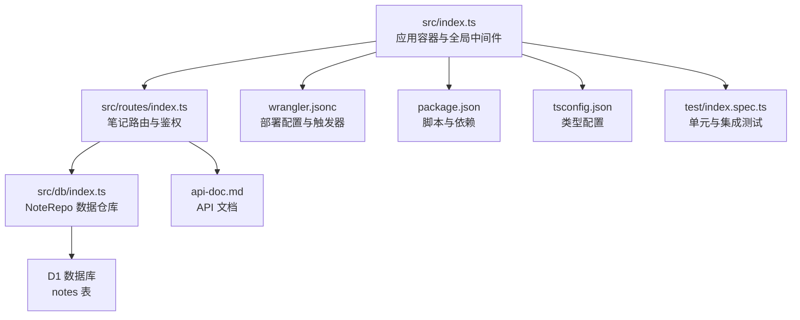
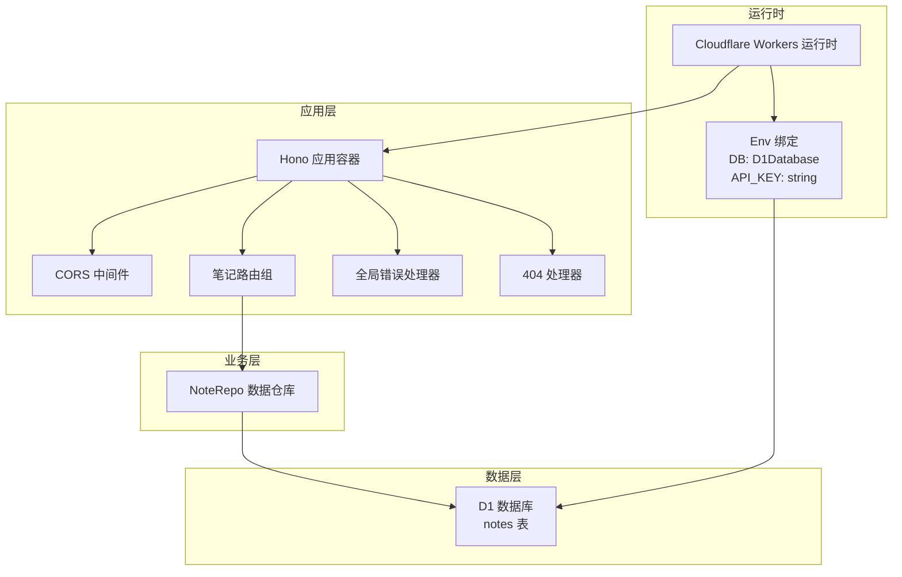
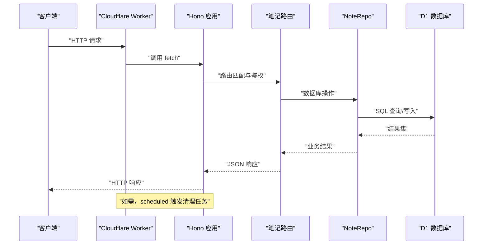
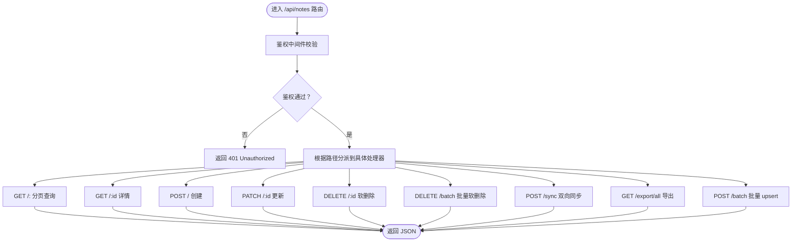
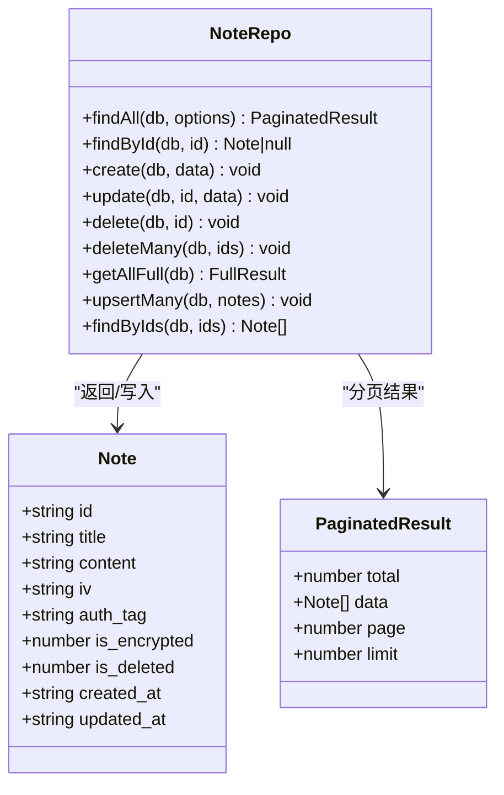
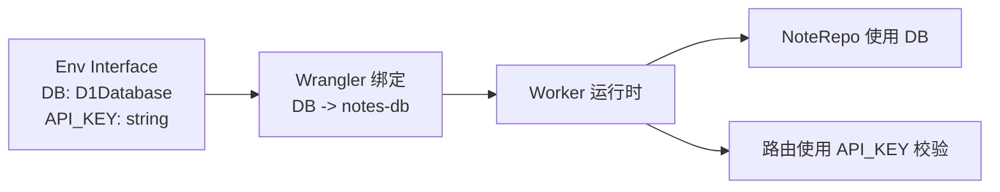
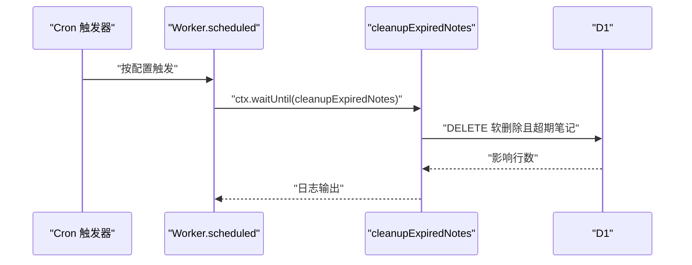
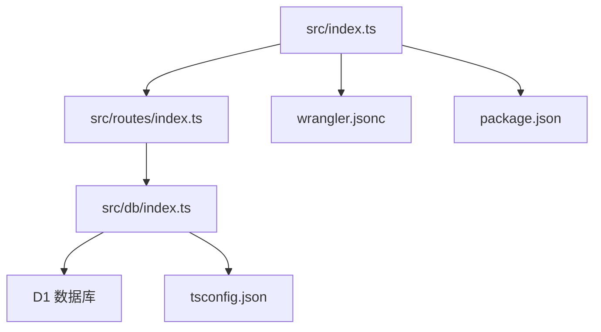

# 应用架构

<cite>
**本文引用的文件**
- [src/index.ts](file://src/index.ts)
- [src/routes/index.ts](file://src/routes/index.ts)
- [src/db/index.ts](file://src/db/index.ts)
- [migrations/0001_init_schema.sql](file://migrations/0001_init_schema.sql)
- [wrangler.jsonc](file://wrangler.jsonc)
- [package.json](file://package.json)
- [api-doc.md](file://api-doc.md)
- [.dev.vars](file://.dev.vars)
- [tsconfig.json](file://tsconfig.json)
- [vitest.config.mts](file://vitest.config.mts)
- [test/index.spec.ts](file://test/index.spec.ts)
</cite>

## 目录

1. [简介](#简介)
2. [项目结构](#项目结构)
3. [核心组件](#核心组件)
4. [架构总览](#架构总览)
5. [组件详细分析](#组件详细分析)
6. [依赖关系分析](#依赖关系分析)
7. [性能考量](#性能考量)
8. [故障排查指南](#故障排查指南)
9. [结论](#结论)
10. [附录](#附录)

## 简介

本项目是一个基于 Hono 框架的笔记服务，采用 Cloudflare Workers 的无服务器架构部署，使用 D1 作为持久化存储。应用通过环境绑定（Env Interface）注入 D1 数据库与 API 密钥，提供笔记的增删改查、批量操作、导出备份以及定时清理等能力。本文档从应用容器配置、中间件系统、错误处理机制、无服务器特性、环境绑定设计、生命周期与定时任务、错误恢复策略等方面进行深入解析，并提供架构图与流程图帮助理解。

## 项目结构

项目采用按职责分层的组织方式：

- 入口与应用容器：src/index.ts 构建 Hono 应用实例，注册中间件、路由与错误处理。
- 路由层：src/routes/index.ts 定义笔记相关的 REST 接口，包含鉴权中间件与业务逻辑。
- 数据访问层：src/db/index.ts 提供 NoteRepo 数据仓库，封装 SQL 查询、批量写入与数据转换。
- 数据库迁移：migrations/0001_init_schema.sql 定义 notes 表结构与索引。
- 配置与部署：wrangler.jsonc 定义 Worker 名称、入口、兼容日期、D1 绑定与定时触发器；package.json 提供脚本与依赖；tsconfig.json 与 vitest.config.mts 支持类型与测试。
- 文档与示例：api-doc.md 提供 API 使用说明；.dev.vars 提供本地开发变量占位。

**图表来源**

- [src/index.ts](file://src/index.ts#L1-L105)
- [src/routes/index.ts](file://src/routes/index.ts#L1-L234)
- [src/db/index.ts](file://src/db/index.ts#L1-L251)
- [migrations/0001_init_schema.sql](file://migrations/0001_init_schema.sql#L1-L17)
- [wrangler.jsonc](file://wrangler.jsonc#L1-L54)
- [package.json](file://package.json#L1-L41)
- [tsconfig.json](file://tsconfig.json#L1-L46)
- [api-doc.md](file://api-doc.md#L1-L483)
- [test/index.spec.ts](file://test/index.spec.ts#L1-L104)

**章节来源**

- [src/index.ts](file://src/index.ts#L1-L105)
- [src/routes/index.ts](file://src/routes/index.ts#L1-L234)
- [src/db/index.ts](file://src/db/index.ts#L1-L251)
- [migrations/0001_init_schema.sql](file://migrations/0001_init_schema.sql#L1-L17)
- [wrangler.jsonc](file://wrangler.jsonc#L1-L54)
- [package.json](file://package.json#L1-L41)
- [tsconfig.json](file://tsconfig.json#L1-L46)
- [api-doc.md](file://api-doc.md#L1-L483)
- [test/index.spec.ts](file://test/index.spec.ts#L1-L104)

## 核心组件

- 应用容器与中间件
  - 使用 Hono 构建应用实例，启用 CORS 中间件，统一挂载在根路径下。
  - 注册全局错误处理与 404 处理，确保异常与未匹配路由返回一致的 JSON 结构。
- 路由与鉴权
  - 在笔记路由组上统一校验 Authorization 头中的 Bearer Token，与环境变量中的 API_KEY 对比，不匹配则返回 401。
  - 提供笔记列表、详情、创建、更新、删除、批量删除、同步、导出、批量插入/更新等接口。
- 数据仓库（NoteRepo）
  - 封装分页查询、条件查询、单条查询、创建、更新、软删除、批量软删除、全量导出、批量 upsert、根据 ID 列表查询等方法。
  - 内部实现 Base64 与 ArrayBuffer 的互转，适配 D1 BLOB 字段存储加密数据。
- 环境绑定（Env Interface）
  - 定义 DB（D1Database）与 API_KEY（string）两个绑定，供路由与数据仓库使用。
- 定时任务
  - 通过 scheduled 生命周期钩子执行清理过期软删除笔记的任务，使用 ctx.waitUntil 确保任务在 Worker 退出前完成。

**章节来源**

- [src/index.ts](file://src/index.ts#L38-L105)
- [src/routes/index.ts](file://src/routes/index.ts#L5-L234)
- [src/db/index.ts](file://src/db/index.ts#L43-L251)

## 架构总览

应用采用“入口容器 + 路由层 + 数据仓库 + D1”的分层架构，结合 Cloudflare Workers 的无服务器特性，实现高扩展、低运维成本的服务。

**图表来源**

- [src/index.ts](file://src/index.ts#L38-L105)
- [src/routes/index.ts](file://src/routes/index.ts#L5-L234)
- [src/db/index.ts](file://src/db/index.ts#L43-L251)
- [wrangler.jsonc](file://wrangler.jsonc#L13-L24)

## 组件详细分析

### 应用容器与中间件系统

- 容器配置
  - 使用 Hono 构造应用实例，泛型绑定 Env Interface，确保类型安全。
  - 全局启用 CORS，允许跨域访问。
  - 路由挂载在 /api/notes 下，统一前缀便于扩展。
- 错误处理机制
  - 全局 onError：捕获未处理异常，返回统一的 JSON 错误结构（包含 success、error、message、timestamp）。
  - 404 处理：未匹配路由返回统一的 JSON 结构。
- 生命周期与定时任务
  - 导出对象包含 fetch 与 scheduled 方法。
  - scheduled 中使用 ctx.waitUntil 异步执行清理任务，避免因 Worker 退出导致任务中断。

**图表来源**

- [src/index.ts](file://src/index.ts#L38-L105)
- [src/routes/index.ts](file://src/routes/index.ts#L5-L234)
- [src/db/index.ts](file://src/db/index.ts#L43-L251)

**章节来源**

- [src/index.ts](file://src/index.ts#L38-L105)

### 路由与鉴权中间件

- 鉴权中间件
  - 从 Authorization 请求头提取 Bearer Token，并与环境变量 API_KEY 比较，不一致返回 401。
- 接口清单
  - GET /api/notes/export/all：导出全部笔记为 JSON 文件附件。
  - GET /api/notes：分页查询笔记列表，支持搜索、分页与限制。
  - GET /api/notes/:id：获取指定笔记详情。
  - POST /api/notes：创建笔记，自动填充创建/更新时间与默认加密标志。
  - PATCH /api/notes/:id：更新笔记，支持部分字段更新。
  - DELETE /api/notes/:id：软删除笔记（标记 is_deleted=1 并清空内容）。
  - DELETE /api/notes/batch：批量软删除，校验 ID 列表合法性。
  - POST /api/notes/sync：双向同步，比较客户端与服务器笔记更新时间，决定上传或下载。
  - POST /api/notes/batch：批量 upsert，校验数据完整性。

**图表来源**

- [src/routes/index.ts](file://src/routes/index.ts#L5-L234)

**章节来源**

- [src/routes/index.ts](file://src/routes/index.ts#L5-L234)

### 数据仓库（NoteRepo）与数据模型

- 数据模型
  - Note 对象包含 id、title、content（Base64 编码的二进制数据）、iv、auth_tag、is_encrypted、is_deleted、created_at、updated_at。
  - PaginatedResult 用于分页返回结构。
- 数据转换
  - 提供 base64ToArrayBuffer 与 arrayBufferToBase64，用于 D1 BLOB 字段与前端 Base64 字符串之间的互转。
  - convertNoteFromDb 将数据库行转换为 Note 对象，自动解码 BLOB 字段。
- 查询与写入
  - findAll：支持搜索、分页与计数，使用 db.batch 并行执行 COUNT 与 LIST 查询。
  - findById/findByIds：按 ID 查询单条或多条笔记。
  - create/update/delete/deleteMany/getAllFull/upsertMany：覆盖 D1 BLOB 字段的写入与批量 upsert。
- 索引设计
  - notes 表包含 title、is_deleted、复合索引，优化查询与排序性能。

**图表来源**

- [src/db/index.ts](file://src/db/index.ts#L34-L251)
- [migrations/0001_init_schema.sql](file://migrations/0001_init_schema.sql#L1-L17)

**章节来源**

- [src/db/index.ts](file://src/db/index.ts#L1-L251)
- [migrations/0001_init_schema.sql](file://migrations/0001_init_schema.sql#L1-L17)

### 环境绑定（Env Interface）与配置

- Env Interface
  - 定义 DB（D1Database）与 API_KEY（string），确保编译期类型安全。
- Wrangler 配置
  - main 指向 src/index.ts。
  - d1_databases 绑定 DB 到 notes-db 数据库。
  - triggers.crons 定义定时任务触发规则（例如每日 16:00）。
- 开发与测试
  - .dev.vars 提供本地开发的 API_KEY 占位。
  - tsconfig.json 引入 worker-configuration.d.ts 以获得运行时类型。
  - vitest.config.mts 使用 @cloudflare/vitest-pool-workers，通过 wrangler.jsonc 进行测试。

**图表来源**

- [src/index.ts](file://src/index.ts#L8-L11)
- [wrangler.jsonc](file://wrangler.jsonc#L13-L24)
- [tsconfig.json](file://tsconfig.json#L39-L41)

**章节来源**

- [src/index.ts](file://src/index.ts#L8-L11)
- [wrangler.jsonc](file://wrangler.jsonc#L13-L24)
- [.dev.vars](file://.dev.vars#L1-L2)
- [tsconfig.json](file://tsconfig.json#L39-L41)
- [vitest.config.mts](file://vitest.config.mts#L1-L12)

### 应用生命周期与定时任务调度

- 生命周期
  - fetch：处理 HTTP 请求。
  - scheduled：处理定时任务，使用 ctx.waitUntil 确保异步任务完成。
- 定时任务
  - 清理 30 天前的软删除笔记，避免垃圾数据占用空间。
  - 通过 wrangler.jsonc 的 triggers.crons 配置触发周期。

**图表来源**

- [src/index.ts](file://src/index.ts#L71-L104)
- [wrangler.jsonc](file://wrangler.jsonc#L20-L24)

**章节来源**

- [src/index.ts](file://src/index.ts#L71-L104)
- [wrangler.jsonc](file://wrangler.jsonc#L20-L24)

### 错误处理与恢复策略

- 全局错误处理
  - onError：统一捕获异常，返回 JSON 结构，包含错误类型与时间戳。
- 404 处理
  - notFound：未匹配路由统一返回 JSON 结构。
- 路由级错误
  - 鉴权失败返回 401；参数校验失败返回 400；同步/批量操作异常返回 500。
- 恢复策略
  - scheduled 任务使用 ctx.waitUntil，保证清理任务在 Worker 退出前完成。
  - 测试中使用 waitOnExecutionContext 等待异步任务完成，确保断言准确性。

**章节来源**

- [src/index.ts](file://src/index.ts#L41-L63)
- [src/routes/index.ts](file://src/routes/index.ts#L8-L15)
- [test/index.spec.ts](file://test/index.spec.ts#L10-L23)

## 依赖关系分析

- 模块耦合
  - src/index.ts 仅负责容器与全局中间件，路由与数据访问通过模块导入解耦。
  - src/routes/index.ts 依赖 Env 与 NoteRepo，保持路由与数据层分离。
  - src/db/index.ts 仅依赖 D1Database，避免引入外部依赖。
- 外部依赖
  - hono：Web 框架与路由工具。
  - wrangler：本地开发与部署工具。
  - @cloudflare/vitest-pool-workers：Workers 测试池。
- 配置依赖
  - wrangler.jsonc 决定运行时绑定与触发器。
  - tsconfig.json 与 worker-configuration.d.ts 提供类型支持。

**图表来源**

- [src/index.ts](file://src/index.ts#L1-L105)
- [src/routes/index.ts](file://src/routes/index.ts#L1-L234)
- [src/db/index.ts](file://src/db/index.ts#L1-L251)
- [wrangler.jsonc](file://wrangler.jsonc#L1-L54)
- [package.json](file://package.json#L1-L41)
- [tsconfig.json](file://tsconfig.json#L1-L46)

**章节来源**

- [src/index.ts](file://src/index.ts#L1-L105)
- [src/routes/index.ts](file://src/routes/index.ts#L1-L234)
- [src/db/index.ts](file://src/db/index.ts#L1-L251)
- [wrangler.jsonc](file://wrangler.jsonc#L1-L54)
- [package.json](file://package.json#L1-L41)
- [tsconfig.json](file://tsconfig.json#L1-L46)

## 性能考量

- 查询优化
  - findAll 使用 db.batch 并行执行 COUNT 与 LIST，减少往返次数。
  - notes 表建立索引（title、is_deleted、复合索引），提升查询与排序性能。
- 写入优化
  - upsertMany 使用 ON CONFLICT DO UPDATE，减少多次写入开销。
  - 批量软删除使用 IN 子句，避免逐条更新。
- 数据传输
  - 通过 Base64 编码二进制数据，适配前端传输与 D1 BLOB 存储。
- 无服务器特性
  - Workers 适合短请求与突发流量，注意冷启动与内存限制；可通过 Smart Placement 优化就近部署。

[本节为通用指导，不直接分析具体文件]

## 故障排查指南

- 常见问题定位
  - 401 未授权：检查 Authorization 头与 API_KEY 是否一致。
  - 404 未找到：确认请求路径是否以 /api/notes 开头。
  - 500 内部错误：查看全局错误处理器返回的错误类型与时间戳。
- 调试建议
  - 使用 wrangler dev 在本地调试，配合 .dev.vars 设置 API_KEY。
  - 使用 vitest 集成测试验证路由存在性与基本行为。
- 日志与可观测性
  - scheduled 任务会输出清理统计信息，便于监控数据清理效果。
  - wrangler.jsonc 启用 observability，可在控制台查看运行时指标。

**章节来源**

- [src/index.ts](file://src/index.ts#L41-L63)
- [src/routes/index.ts](file://src/routes/index.ts#L8-L15)
- [test/index.spec.ts](file://test/index.spec.ts#L1-L104)
- [wrangler.jsonc](file://wrangler.jsonc#L10-L12)

## 结论

本项目以 Hono 为核心，结合 Cloudflare Workers 的无服务器能力，实现了轻量、可扩展的笔记服务。通过明确的分层架构、严格的环境绑定与统一的错误处理，系统具备良好的可维护性与可观测性。定时任务与批处理能力进一步增强了数据治理与性能表现。建议在生产环境中配合 Smart Placement 与合理的索引策略，持续优化查询与写入性能。

[本节为总结性内容，不直接分析具体文件]

## 附录

- API 使用参考：参见 [api-doc.md](file://api-doc.md#L1-L483)
- 数据库表结构：参见 [migrations/0001_init_schema.sql](file://migrations/0001_init_schema.sql#L1-L17)
- 部署与开发脚本：参见 [package.json](file://package.json#L6-L16)
- 类型与测试配置：参见 [tsconfig.json](file://tsconfig.json#L39-L41)、[vitest.config.mts](file://vitest.config.mts#L1-L12)
