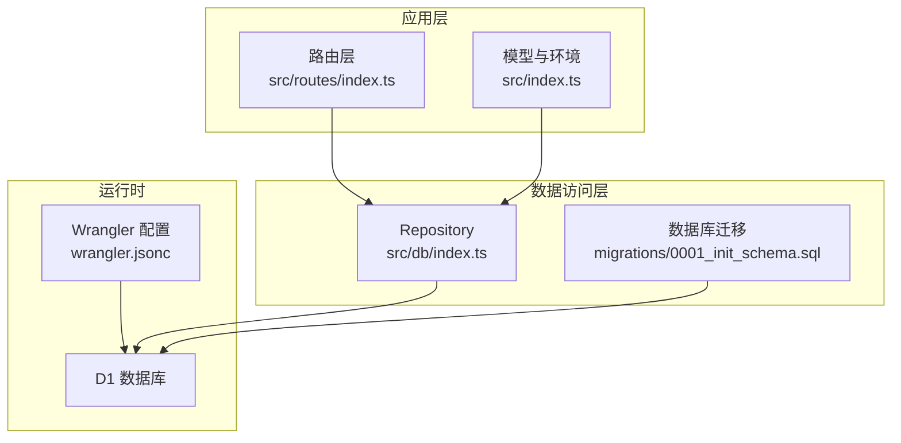
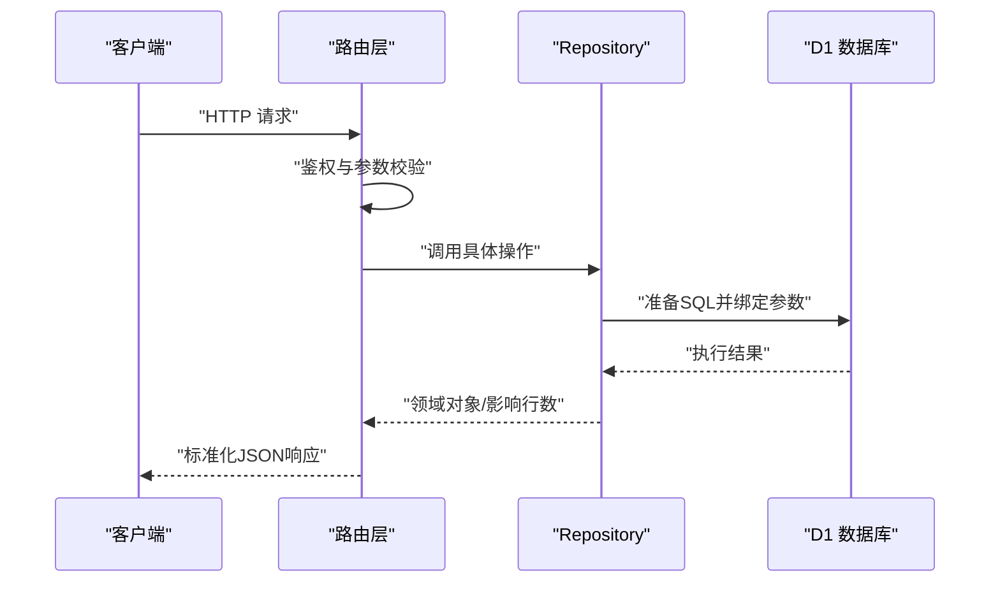
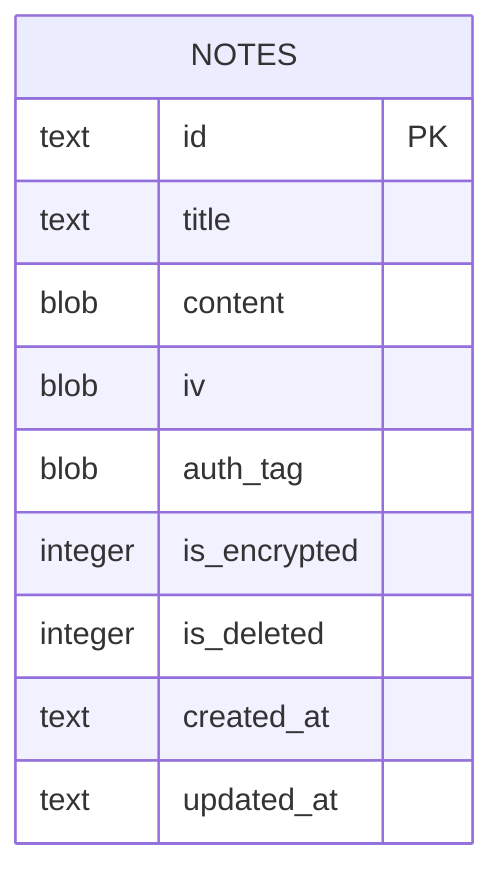
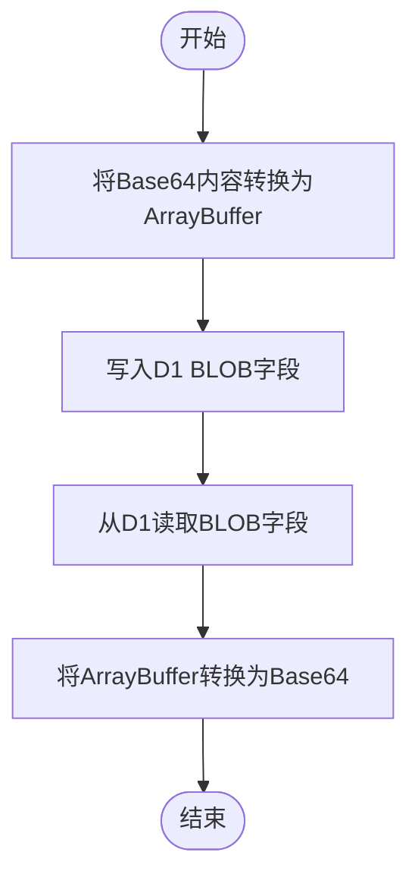
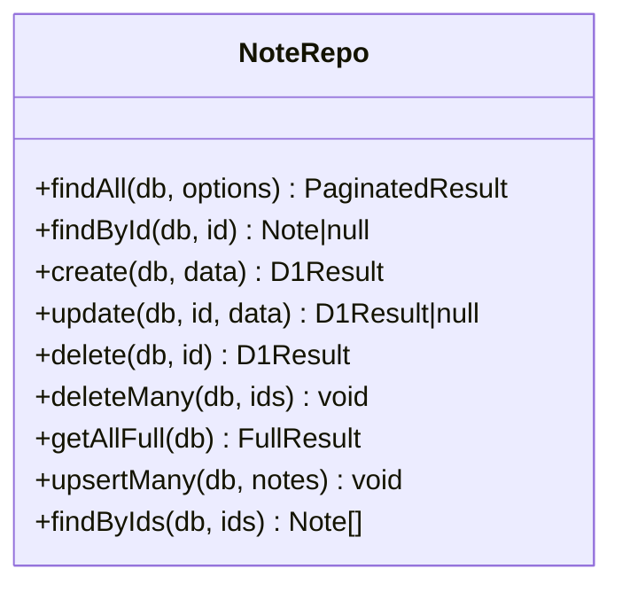
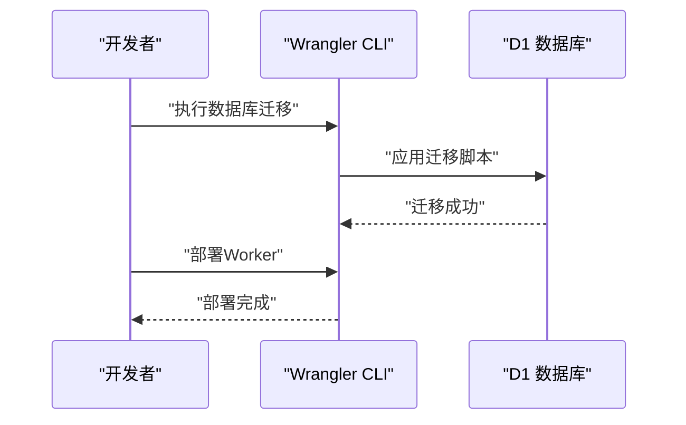
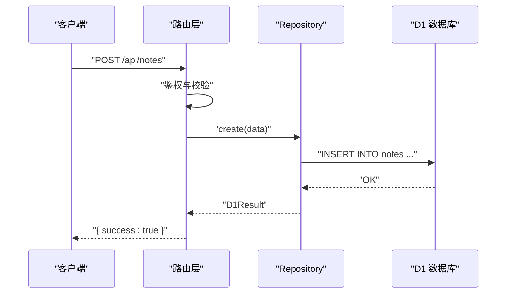
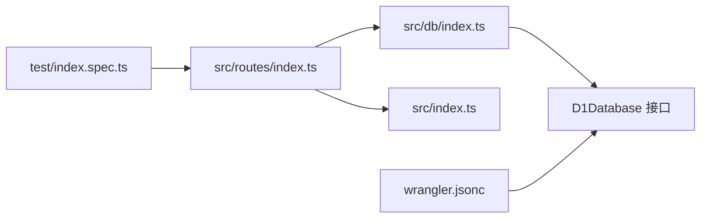

# 数据访问层

<cite>
**本文引用的文件**
- [src/db/index.ts](file://src/db/index.ts)
- [src/index.ts](file://src/index.ts)
- [src/routes/index.ts](file://src/routes/index.ts)
- [migrations/0001_init_schema.sql](file://migrations/0001_init_schema.sql)
- [wrangler.jsonc](file://wrangler.jsonc)
- [package.json](file://package.json)
- [api-doc.md](file://api-doc.md)
- [test/index.spec.ts](file://test/index.spec.ts)
</cite>

## 目录

1. [简介](#简介)
2. [项目结构](#项目结构)
3. [核心组件](#核心组件)
4. [架构总览](#架构总览)
5. [详细组件分析](#详细组件分析)
6. [依赖关系分析](#依赖关系分析)
7. [性能考量](#性能考量)
8. [故障排查指南](#故障排查指南)
9. [结论](#结论)
10. [附录](#附录)

## 简介

本文件聚焦于Notes Server的数据访问层，系统采用基于Cloudflare Workers与D1的关系型数据库，通过Repository模式封装数据访问逻辑。数据模型围绕“笔记”实体展开，采用BLOB字段存储二进制内容，并通过Base64进行序列化/反序列化；同时保留了AES-GCM加密相关的字段（iv与auth_tag），为后续可选的端到端加密提供扩展空间。数据访问层提供完整的CRUD能力，包括分页查询、全文检索、批量写入、软删除与定时清理等。

## 项目结构

数据访问层主要由以下模块组成：

- 数据模型与环境绑定：定义Note接口、分页结果接口以及Worker环境绑定（DB、API_KEY）。
- 数据库迁移：初始化notes表及必要索引。
- Repository层：统一的NoteRepo，封装D1数据库的所有读写操作。
- 路由层：对外暴露REST API，调用Repository完成业务操作。
- 部署配置：Wrangler将D1数据库绑定到DB变量，供运行时使用。

图表来源

- [src/routes/index.ts](file://src/routes/index.ts#L1-L234)
- [src/db/index.ts](file://src/db/index.ts#L43-L251)
- [src/index.ts](file://src/index.ts#L8-L36)
- [migrations/0001_init_schema.sql](file://migrations/0001_init_schema.sql#L1-L17)
- [wrangler.jsonc](file://wrangler.jsonc#L13-L19)

章节来源

- [src/index.ts](file://src/index.ts#L8-L36)
- [wrangler.jsonc](file://wrangler.jsonc#L13-L19)

## 核心组件

- Note接口：定义笔记实体字段，其中content、iv、auth_tag为Base64字符串，便于跨网络传输与存储；is_encrypted与is_deleted为数值型布尔标志。
- 分页结果接口：统一返回total、data、page、limit字段，便于前端分页展示。
- NoteRepo：Repository模式的核心，提供findAll、findById、create、update、delete、deleteMany、getAllFull、upsertMany、findByIds等方法，均接收D1Database实例作为依赖注入。
- 路由层：负责鉴权、参数校验、调用Repository并返回标准化JSON响应。
- 迁移脚本：初始化notes表与索引，确保查询性能与数据完整性。

章节来源

- [src/index.ts](file://src/index.ts#L14-L36)
- [src/db/index.ts](file://src/db/index.ts#L43-L251)
- [src/routes/index.ts](file://src/routes/index.ts#L1-L234)
- [migrations/0001_init_schema.sql](file://migrations/0001_init_schema.sql#L1-L17)

## 架构总览

数据访问层采用“路由 -> Repository -> D1”的清晰分层，Repository不感知HTTP细节，仅关注数据库交互；路由负责输入校验与输出格式化。D1通过Wrangler绑定至DB变量，Repository通过D1Database接口与之交互。

图表来源

- [src/routes/index.ts](file://src/routes/index.ts#L31-L113)
- [src/db/index.ts](file://src/db/index.ts#L45-L123)
- [wrangler.jsonc](file://wrangler.jsonc#L13-L19)

## 详细组件分析

### 数据模型与字段定义

- 主键：id（TEXT，PRIMARY KEY），UUID格式。
- 标题：title（TEXT，NOT NULL）。
- 内容：content（BLOB，NOT NULL），存储Base64编码的二进制数据。
- 加密相关：iv（BLOB，可选）、auth_tag（BLOB，可选），用于AES-GCM加密的附加数据与认证标签。
- 加密标志：is_encrypted（INTEGER，NOT NULL DEFAULT 1）。
- 软删除：is_deleted（INTEGER，NOT NULL DEFAULT 0）。
- 时间戳：created_at、updated_at（TEXT，NOT NULL）。
- 索引：title、is_deleted、(is_deleted, updated_at DESC)。

图表来源

- [migrations/0001_init_schema.sql](file://migrations/0001_init_schema.sql#L1-L12)

章节来源

- [migrations/0001_init_schema.sql](file://migrations/0001_init_schema.sql#L1-L17)
- [src/index.ts](file://src/index.ts#L16-L26)

### Base64 编码与二进制存储

- 存储策略：content、iv、auth_tag在进入数据库前被转换为ArrayBuffer，再以BLOB形式存储；从数据库读取时，通过convertNoteFromDb将BLOB还原为Base64字符串，便于前端/客户端处理。
- 转换工具：提供base64ToArrayBuffer与arrayBufferToBase64两个工具函数，分别用于从Base64到ArrayBuffer与从ArrayBuffer到Base64的双向转换。
- 使用场景：Repository在create、update、upsertMany中将Base64内容转换为二进制写入；在findAll、findById、getAllFull中将二进制读取后转回Base64返回给调用方。

图表来源

- [src/db/index.ts](file://src/db/index.ts#L10-L29)
- [src/db/index.ts](file://src/db/index.ts#L34-L41)

章节来源

- [src/db/index.ts](file://src/db/index.ts#L10-L29)
- [src/db/index.ts](file://src/db/index.ts#L34-L41)

### AES-GCM 加密的可选实现

- 字段预留：数据库表包含iv与auth_tag字段，为AES-GCM加密提供必要元数据。
- 实现建议：可在应用层（路由或中间件）对content进行加密，生成iv与auth_tag，再写入数据库；读取时根据is_encrypted判断是否解密。当前仓库未包含具体的加密/解密实现，但数据模型与字段已满足该需求。
- 注意事项：加密会增加CPU开销与存储体积，需结合业务安全需求评估启用与否。

章节来源

- [migrations/0001_init_schema.sql](file://migrations/0001_init_schema.sql#L5-L8)
- [src/index.ts](file://src/index.ts#L19-L22)

### Repository 模式与 CRUD 实现

- findAll：支持按标题或内容模糊搜索，分页查询并返回总数与列表；使用db.batch并行执行COUNT与LIMIT查询，减少往返次数。
- findById：按主键查询单条记录，过滤软删除。
- create：插入新笔记，将Base64内容转换为二进制写入。
- update：动态拼接SET子句，仅更新传入的字段；支持部分字段更新。
- delete：软删除，将is_deleted置1并清空title/content，同时更新updated_at。
- deleteMany：批量软删除，支持IN子句。
- getAllFull：导出全量笔记（不推荐生产环境频繁使用）。
- upsertMany：批量插入或更新，使用ON CONFLICT DO UPDATE，适合同步场景。
- findByIds：按ID集合查询，用于同步时比对服务器已有笔记。

图表来源

- [src/db/index.ts](file://src/db/index.ts#L43-L251)

章节来源

- [src/db/index.ts](file://src/db/index.ts#L45-L251)

### 查询优化与索引设计

- 索引策略：
  - idx_notes_title：加速按标题精确/前缀匹配。
  - idx_notes_is_deleted：加速软删除过滤。
  - idx_notes_is_deleted_updated_at：复合索引，支持按updated_at倒序查询且过滤is_deleted，提升分页查询效率。
- 查询优化建议：
  - 全文搜索使用LIKE时尽量配合索引列（如title）；若content搜索频繁，可考虑FTS5扩展（需额外迁移）。
  - 分页查询使用LIMIT+OFFSET，结合updated_at倒序索引，避免全表扫描。
  - 批量操作使用db.batch与ON CONFLICT，减少事务开销。

章节来源

- [migrations/0001_init_schema.sql](file://migrations/0001_init_schema.sql#L14-L17)

### 连接管理与部署绑定

- 运行时绑定：wrangler.jsonc将D1数据库绑定为DB变量，Worker运行时可通过env.DB访问D1Database实例。
- 环境接口：src/index.ts定义Env接口，包含DB与API_KEY，确保类型安全。
- 部署命令：通过package.json脚本执行数据库迁移与本地/远程部署。

图表来源

- [wrangler.jsonc](file://wrangler.jsonc#L13-L19)
- [package.json](file://package.json#L11-L12)

章节来源

- [wrangler.jsonc](file://wrangler.jsonc#L13-L19)
- [package.json](file://package.json#L11-L12)

### API 与 Repository 的协作流程

- 鉴权：路由层统一校验Authorization头，确保API Key正确。
- 参数校验：路由层对请求体与路径参数进行基础校验。
- Repository调用：路由层将校验后的数据交由NoteRepo执行数据库操作。
- 统一响应：路由层将Repository返回的结果转换为标准JSON响应。

图表来源

- [src/routes/index.ts](file://src/routes/index.ts#L47-L82)
- [src/db/index.ts](file://src/db/index.ts#L100-L123)

章节来源

- [src/routes/index.ts](file://src/routes/index.ts#L7-L15)
- [src/routes/index.ts](file://src/routes/index.ts#L47-L82)
- [src/db/index.ts](file://src/db/index.ts#L100-L123)

## 依赖关系分析

- 路由层依赖Repository与模型定义。
- Repository依赖D1Database接口与Base64转换工具。
- 运行时通过Wrangler将D1数据库绑定到DB变量，Repository通过env.DB使用D1。
- 测试文件通过SELF.fetch与cloudflare:test模拟请求，验证路由存在性与鉴权行为。

图表来源

- [src/routes/index.ts](file://src/routes/index.ts#L1-L234)
- [src/db/index.ts](file://src/db/index.ts#L43-L251)
- [src/index.ts](file://src/index.ts#L8-L36)
- [wrangler.jsonc](file://wrangler.jsonc#L13-L19)
- [test/index.spec.ts](file://test/index.spec.ts#L1-L104)

章节来源

- [src/routes/index.ts](file://src/routes/index.ts#L1-L234)
- [src/db/index.ts](file://src/db/index.ts#L43-L251)
- [src/index.ts](file://src/index.ts#L8-L36)
- [wrangler.jsonc](file://wrangler.jsonc#L13-L19)
- [test/index.spec.ts](file://test/index.spec.ts#L1-L104)

## 性能考量

- 查询性能
  - 使用复合索引(idx_notes_is_deleted_updated_at)支持高效分页与排序。
  - findAll使用db.batch并行COUNT与LIST查询，降低延迟。
- 写入性能
  - upsertMany使用ON CONFLICT DO UPDATE，减少重复INSERT开销。
  - 批量写入使用db.batch，提升吞吐量。
- 存储与网络
  - Base64编码使二进制数据在网络传输中更稳定，但会增加约33%体积；可根据业务需求评估压缩或直接存储二进制。
- 定时清理
  - Worker定时触发清理超过保留期的软删除笔记，释放存储空间。

章节来源

- [src/db/index.ts](file://src/db/index.ts#L65-L91)
- [src/db/index.ts](file://src/db/index.ts#L206-L237)
- [src/index.ts](file://src/index.ts#L78-L104)

## 故障排查指南

- 401 未授权
  - 症状：路由层返回401，提示API Key无效。
  - 排查：确认Authorization头格式为Bearer {API_KEY}，且API_KEY已在环境变量中设置。
- 400 请求错误
  - 症状：批量删除/批量写入/同步接口返回400。
  - 排查：检查请求体格式、ids数组有效性、notes数组与字段完整性。
- 404 资源不存在
  - 症状：根路径或不存在的路由返回404。
  - 排查：确认请求路径为/api/notes系列路由。
- 数据异常
  - 症状：Base64内容无法解析或二进制读取异常。
  - 排查：确认content、iv、auth_tag的Base64格式正确；检查convertNoteFromDb与base64ToArrayBuffer转换逻辑。
- 数据库迁移
  - 症状：表结构不一致或索引缺失。
  - 排查：使用package.json脚本执行迁移apply，确保notes表与索引存在。

章节来源

- [src/routes/index.ts](file://src/routes/index.ts#L8-L15)
- [src/routes/index.ts](file://src/routes/index.ts#L115-L136)
- [src/routes/index.ts](file://src/routes/index.ts#L199-L231)
- [test/index.spec.ts](file://test/index.spec.ts#L10-L46)
- [package.json](file://package.json#L11-L12)

## 结论

本数据访问层以Repository模式为核心，结合D1数据库与Base64二进制存储，提供了高内聚、低耦合的数据访问能力。通过合理的索引设计与批处理策略，兼顾了查询性能与写入吞吐。AES-GCM加密字段已预留，便于后续扩展端到端加密。建议在生产环境中：

- 明确加密策略与密钥管理；
- 对高频查询建立更细粒度的索引；
- 控制批量操作规模，避免单次超大事务；
- 定期清理软删除数据，保持数据库健康。

## 附录

### 数据库迁移与索引

- 初始迁移脚本创建notes表与三个索引，确保常见查询场景的性能。
- 建议在新增字段或查询模式变化时，评估是否需要新增索引或调整现有索引。

章节来源

- [migrations/0001_init_schema.sql](file://migrations/0001_init_schema.sql#L1-L17)

### API 参考与示例

- API文档详细描述了各端点的请求/响应格式、参数与示例，可作为集成参考。
- 示例中content、iv、auth_tag均为Base64编码字符串，符合当前实现约定。

章节来源

- [api-doc.md](file://api-doc.md#L16-L482)
