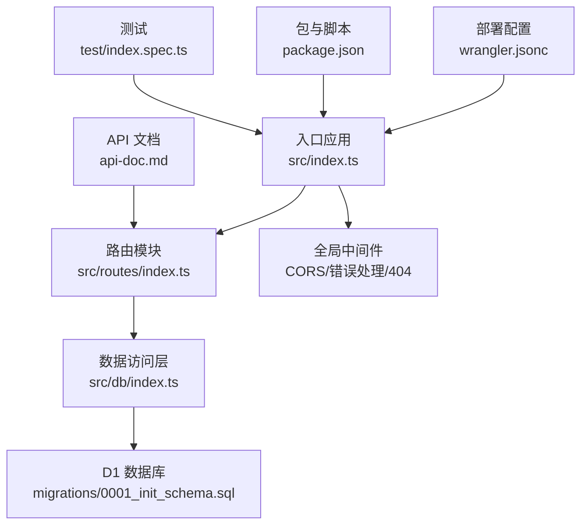
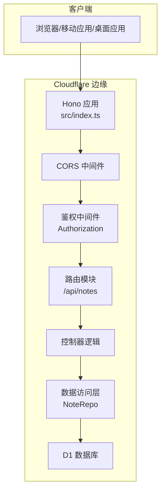
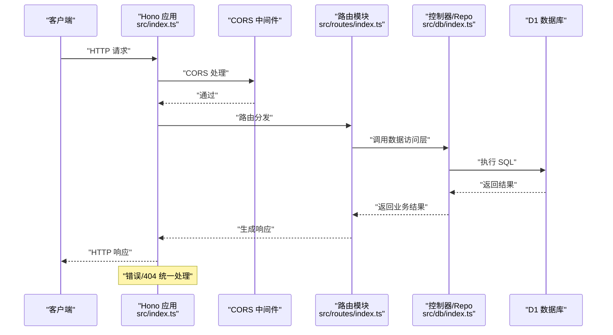
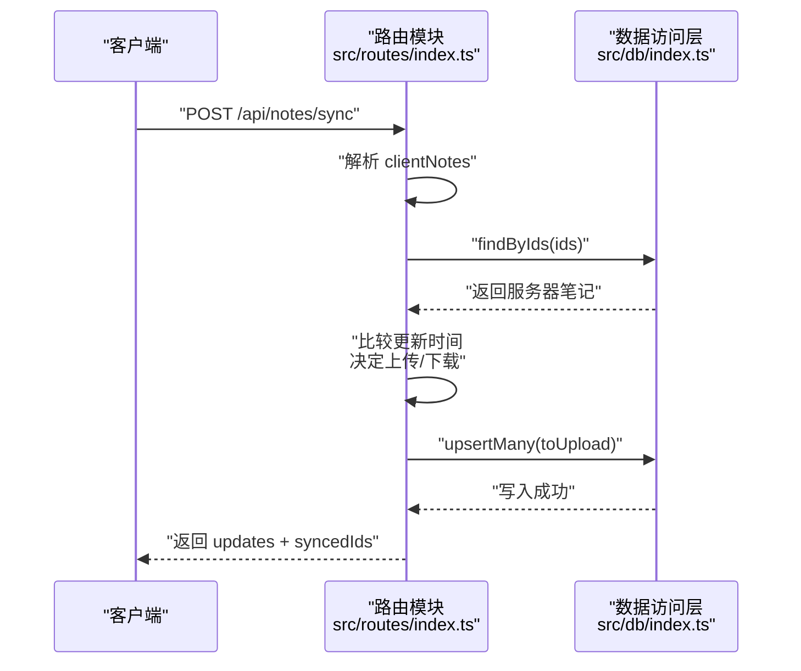
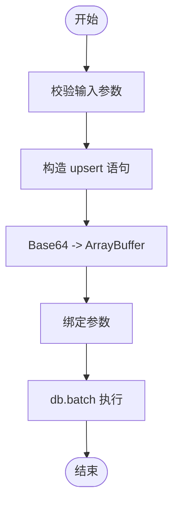
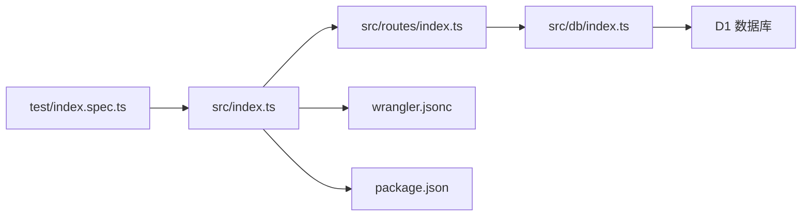

# 架构设计

<cite>
**本文引用的文件**
- [src/index.ts](file://src/index.ts)
- [src/routes/index.ts](file://src/routes/index.ts)
- [src/db/index.ts](file://src/db/index.ts)
- [migrations/0001_init_schema.sql](file://migrations/0001_init_schema.sql)
- [package.json](file://package.json)
- [wrangler.jsonc](file://wrangler.jsonc)
- [api-doc.md](file://api-doc.md)
- [test/index.spec.ts](file://test/index.spec.ts)
</cite>

## 目录

1. [引言](#引言)
2. [项目结构](#项目结构)
3. [核心组件](#核心组件)
4. [架构总览](#架构总览)
5. [详细组件分析](#详细组件分析)
6. [依赖关系分析](#依赖关系分析)
7. [性能考量](#性能考量)
8. [故障排查指南](#故障排查指南)
9. [结论](#结论)
10. [附录](#附录)

## 引言

本项目为基于 Cloudflare Workers 的无服务器笔记服务，采用 Hono 作为 Web 框架，结合 D1 数据库存储与 Cloudflare 的边缘网络能力，提供轻量、低延迟、可扩展的笔记管理 API。本文档从架构设计角度，系统阐述 MVC 模式、Repository 模式、中间件模式的设计决策与实现细节，梳理从 HTTP 请求进入 Hono 应用，经中间件处理、路由分发，到控制器与数据访问层的完整流程，并讨论无服务器架构的优势与约束，以及如何利用 Cloudflare Workers 特性进行部署与运维。

## 项目结构

项目采用按职责分层的组织方式：

- 入口与应用配置：src/index.ts
- 路由与控制器：src/routes/index.ts
- 数据访问层：src/db/index.ts
- 数据库迁移：migrations/0001_init_schema.sql
- 部署与运行时配置：wrangler.jsonc
- 包与脚本：package.json
- API 文档：api-doc.md
- 测试：test/index.spec.ts

图表来源

- [src/index.ts](file://src/index.ts#L38-L63)
- [src/routes/index.ts](file://src/routes/index.ts#L1-L234)
- [src/db/index.ts](file://src/db/index.ts#L43-L250)
- [migrations/0001_init_schema.sql](file://migrations/0001_init_schema.sql#L1-L17)
- [wrangler.jsonc](file://wrangler.jsonc#L5-L24)
- [package.json](file://package.json#L1-L41)
- [api-doc.md](file://api-doc.md#L1-L483)
- [test/index.spec.ts](file://test/index.spec.ts#L1-L104)

章节来源

- [src/index.ts](file://src/index.ts#L1-L105)
- [src/routes/index.ts](file://src/routes/index.ts#L1-L234)
- [src/db/index.ts](file://src/db/index.ts#L1-L251)
- [migrations/0001_init_schema.sql](file://migrations/0001_init_schema.sql#L1-L17)
- [wrangler.jsonc](file://wrangler.jsonc#L1-L54)
- [package.json](file://package.json#L1-L41)
- [api-doc.md](file://api-doc.md#L1-L483)
- [test/index.spec.ts](file://test/index.spec.ts#L1-L104)

## 核心组件

- 应用入口与环境绑定
  - 定义环境接口，包含 D1 数据库绑定与 API Key 变量，确保运行时类型安全与配置注入。
  - 注册全局中间件（CORS）、路由挂载、错误处理与 404 处理。
  - 提供定时任务入口，用于定期清理软删除笔记。
- 路由与控制器
  - 使用 Hono 子路由统一管理 /api/notes 下的所有端点。
  - 在路由级别实现鉴权中间件，校验 Authorization 头中的 Bearer Token。
  - 实现笔记 CRUD、批量操作、导出备份、同步等业务逻辑。
- 数据访问层（Repository）
  - 统一封装 D1 查询、插入、更新、批量 upsert、软删除等操作。
  - 提供 Base64 与 ArrayBuffer 的互转工具，适配 BLOB 字段的存储与读取。
  - 支持分页查询与条件过滤，使用 db.batch 并行执行计数与列表查询。
- 数据库与索引
  - 使用 D1 表 notes 存储笔记，字段包含 id、title、content（BLOB）、iv、auth_tag、is_encrypted、is_deleted、created_at、updated_at。
  - 为 title、is_deleted、复合索引建立索引，优化查询性能。
- 部署与运行时
  - Wrangler 配置声明 Worker 名称、兼容日期、D1 绑定、触发器（定时任务）与可观测性开关。
  - package.json 提供开发、测试、部署脚本与依赖。

章节来源

- [src/index.ts](file://src/index.ts#L8-L11)
- [src/index.ts](file://src/index.ts#L38-L63)
- [src/index.ts](file://src/index.ts#L65-L75)
- [src/routes/index.ts](file://src/routes/index.ts#L7-L15)
- [src/db/index.ts](file://src/db/index.ts#L43-L250)
- [migrations/0001_init_schema.sql](file://migrations/0001_init_schema.sql#L1-L17)
- [wrangler.jsonc](file://wrangler.jsonc#L5-L24)
- [package.json](file://package.json#L6-L16)

## 架构总览

本系统采用“无服务器 + 边缘网络”的架构模式，核心在于：

- 无服务器：Worker 运行在 Cloudflare 全球边缘节点，按需扩缩容，零运维成本。
- 边缘计算：靠近用户，降低网络延迟；结合 D1 本地数据库，减少跨区域往返。
- 分层清晰：路由层负责协议与鉴权，控制器层编排业务，数据访问层抽象存储。

图表来源

- [src/index.ts](file://src/index.ts#L38-L40)
- [src/routes/index.ts](file://src/routes/index.ts#L7-L15)
- [src/routes/index.ts](file://src/routes/index.ts#L31-L136)
- [src/db/index.ts](file://src/db/index.ts#L43-L250)
- [migrations/0001_init_schema.sql](file://migrations/0001_init_schema.sql#L1-L17)

## 详细组件分析

### 组件一：应用入口与中间件

- 设计要点
  - 使用 Hono 泛型绑定 Env，确保 DB 与 API_KEY 的类型安全。
  - 全局注册 CORS 中间件，允许跨域访问。
  - 注册统一错误处理与 404 处理，保证一致的错误响应格式。
  - 提供定时任务入口，使用 ctx.waitUntil 异步执行清理逻辑。
- 关键流程
  - 请求进入 -> CORS -> 鉴权 -> 路由分发 -> 控制器 -> 数据访问 -> 响应 -> 错误处理/404。

图表来源

- [src/index.ts](file://src/index.ts#L38-L63)
- [src/routes/index.ts](file://src/routes/index.ts#L1-L234)
- [src/db/index.ts](file://src/db/index.ts#L43-L250)

章节来源

- [src/index.ts](file://src/index.ts#L38-L63)

### 组件二：路由与控制器（MVC 模式）

- 设计要点
  - 路由层：集中管理 /api/notes 下的 CRUD、批量、导出、同步等端点。
  - 控制器层：在路由处理器中完成输入校验、时间戳规范化、调用数据访问层、组装响应。
  - 鉴权中间件：在路由层统一校验 Authorization 头，避免重复逻辑。
- 关键流程（以同步接口为例）
  - 客户端发送 clientNotes -> 解析请求体 -> 查询服务器已存在笔记 -> 比较更新时间 -> 决策上传/下载 -> upsert -> 返回 updates 与 syncedIds。

图表来源

- [src/routes/index.ts](file://src/routes/index.ts#L138-L197)
- [src/db/index.ts](file://src/db/index.ts#L202-L237)

章节来源

- [src/routes/index.ts](file://src/routes/index.ts#L18-L197)

### 组件三：数据访问层（Repository 模式）

- 设计要点
  - 封装 D1 操作，提供 findAll、findById、create、update、delete、deleteMany、getAllFull、upsertMany、findByIds 等方法。
  - 使用 Base64 与 ArrayBuffer 的互转，适配 BLOB 字段的存储与读取。
  - 分页查询使用 db.batch 并行执行 COUNT 与 LIST，提升查询效率。
  - 软删除策略：更新 is_deleted 标志位并清空内容，配合定时任务清理过期软删除记录。
- 关键流程（批量 upsert）
  - 输入 Note 数组 -> 逐条转换 Base64 为 ArrayBuffer -> 构造 INSERT ... ON CONFLICT DO UPDATE -> db.batch 批量执行。

图表来源

- [src/db/index.ts](file://src/db/index.ts#L202-L237)

章节来源

- [src/db/index.ts](file://src/db/index.ts#L43-L250)

### 组件四：数据库与索引

- 表结构
  - notes 表包含 id、title、content（BLOB）、iv（BLOB）、auth_tag（BLOB）、is_encrypted、is_deleted、created_at、updated_at。
- 索引
  - title、is_deleted、(is_deleted, updated_at DESC) 复合索引，优化搜索与分页排序。
- 迁移
  - 初始迁移脚本创建表与索引，确保生产与本地环境一致。

章节来源

- [migrations/0001_init_schema.sql](file://migrations/0001_init_schema.sql#L1-L17)

### 组件五：定时任务与清理

- 设计要点
  - 使用 Wrangler triggers 配置 Cron 规则，Worker 的 scheduled 入口被触发。
  - 清理逻辑：删除 is_deleted=1 且 updated_at 早于保留期（默认 30 天）的记录。
  - 使用 ctx.waitUntil 确保清理任务在主线程返回响应后继续执行。

章节来源

- [src/index.ts](file://src/index.ts#L65-L75)
- [src/index.ts](file://src/index.ts#L77-L104)
- [wrangler.jsonc](file://wrangler.jsonc#L20-L24)

## 依赖关系分析

- 模块耦合
  - src/index.ts 仅负责应用装配与全局中间件，不包含业务逻辑，耦合度低。
  - src/routes/index.ts 依赖 src/db/index.ts，形成清晰的控制流。
  - src/db/index.ts 仅依赖 D1 接口与类型，与上层解耦。
- 外部依赖
  - Hono 作为 Web 框架与中间件生态。
  - Wrangler 作为部署与运行时配置工具。
  - Vitest + Cloudflare Test Harness 用于单元与集成测试。

图表来源

- [src/index.ts](file://src/index.ts#L1-L105)
- [src/routes/index.ts](file://src/routes/index.ts#L1-L234)
- [src/db/index.ts](file://src/db/index.ts#L1-L251)
- [wrangler.jsonc](file://wrangler.jsonc#L1-L54)
- [package.json](file://package.json#L1-L41)
- [test/index.spec.ts](file://test/index.spec.ts#L1-L104)

章节来源

- [src/index.ts](file://src/index.ts#L1-L105)
- [src/routes/index.ts](file://src/routes/index.ts#L1-L234)
- [src/db/index.ts](file://src/db/index.ts#L1-L251)
- [wrangler.jsonc](file://wrangler.jsonc#L1-L54)
- [package.json](file://package.json#L1-L41)
- [test/index.spec.ts](file://test/index.spec.ts#L1-L104)

## 性能考量

- 查询性能
  - 使用 db.batch 并行执行 COUNT 与 LIST，减少往返次数。
  - 为高频查询字段建立索引，降低扫描成本。
- 存储与序列化
  - BLOB 字段采用 Base64 编码传输，注意带宽与 CPU 开销；可考虑在客户端侧进行压缩或分片。
- 无服务器特性
  - Worker 冷启动与热点缓存：边缘就近执行，减少网络延迟。
  - D1 本地数据库：避免跨区域网络开销，适合小规模数据与高并发场景。
- 批处理与事务
  - 使用 db.batch 批量执行，减少事务开销；对于复杂一致性需求，可考虑 D1 Session 保持顺序一致性。

[本节为通用性能建议，不直接分析具体文件]

## 故障排查指南

- 常见错误与定位
  - 401 未授权：检查 Authorization 头是否为 Bearer + 正确的 API_KEY。
  - 404 未找到：确认请求路径是否为 /api/notes 下的合法端点。
  - 500 内部错误：查看应用错误处理返回的错误名称与消息。
- 定时任务
  - 确认 Wrangler triggers cron 配置正确，检查 scheduled 入口日志与清理结果。
- 数据一致性
  - 批量 upsert 与软删除：核对 is_deleted 标志与清理策略，避免误删。
- 测试验证
  - 使用测试用例验证路由存在性、鉴权行为与批量接口可用性。

章节来源

- [src/index.ts](file://src/index.ts#L41-L63)
- [src/routes/index.ts](file://src/routes/index.ts#L7-L15)
- [test/index.spec.ts](file://test/index.spec.ts#L9-L103)

## 结论

本项目通过 Hono 的轻量与 Cloudflare Workers 的边缘能力，构建了一个简洁高效的笔记服务。路由层与控制器层清晰分离，数据访问层以 Repository 模式封装 D1 操作，配合定时任务与索引优化，满足小规模到中等规模的笔记管理需求。在无服务器环境下，系统具备低延迟、易扩展、零运维的优势，同时需关注冷启动、带宽与序列化开销等约束。

[本节为总结性内容，不直接分析具体文件]

## 附录

### 系统边界与集成模式

- 系统边界
  - 边界内：Hono 应用、路由与控制器、数据访问层、D1 数据库。
  - 边界外：客户端（浏览器/移动应用）、Cloudflare 边缘网络、D1 数据库服务。
- 集成模式
  - API 集成：RESTful 接口，统一鉴权与错误响应格式。
  - 数据集成：D1 本地数据库，支持批量与 upsert 操作。
  - 运维集成：Wrangler 部署、Cron 触发器、可观测性开关。

章节来源

- [api-doc.md](file://api-doc.md#L1-L483)
- [wrangler.jsonc](file://wrangler.jsonc#L5-L24)

### 跨领域关注点

- 安全性
  - 鉴权：Bearer Token 校验，建议使用密钥轮换与最小权限原则。
  - CORS：允许必要的源与方法，避免过度放行。
- 监控与可观测性
  - 启用 Wrangler observability，记录请求日志与错误堆栈。
  - 定时任务日志：记录清理数量与异常信息。
- 可靠性
  - 使用 ctx.waitUntil 确保后台任务完成。
  - 批量操作与事务：合理拆分与重试策略，避免单点失败。

章节来源

- [src/index.ts](file://src/index.ts#L39-L40)
- [src/index.ts](file://src/index.ts#L41-L63)
- [wrangler.jsonc](file://wrangler.jsonc#L10-L12)
