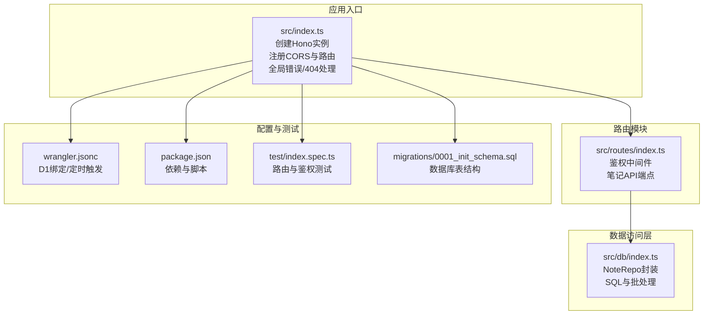
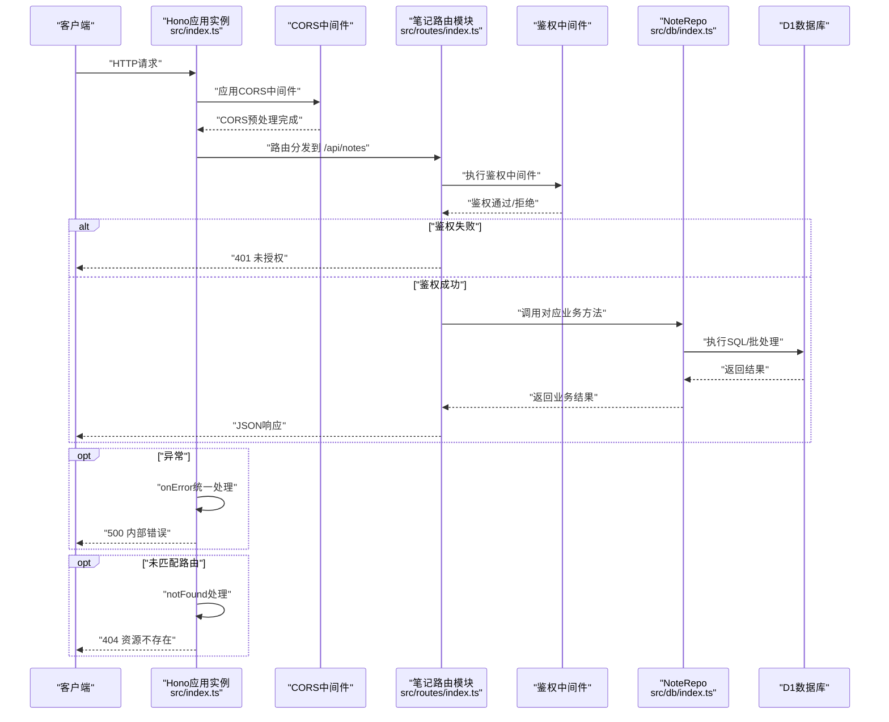
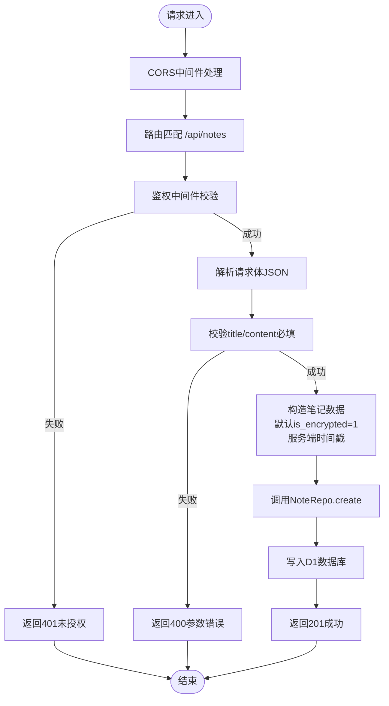
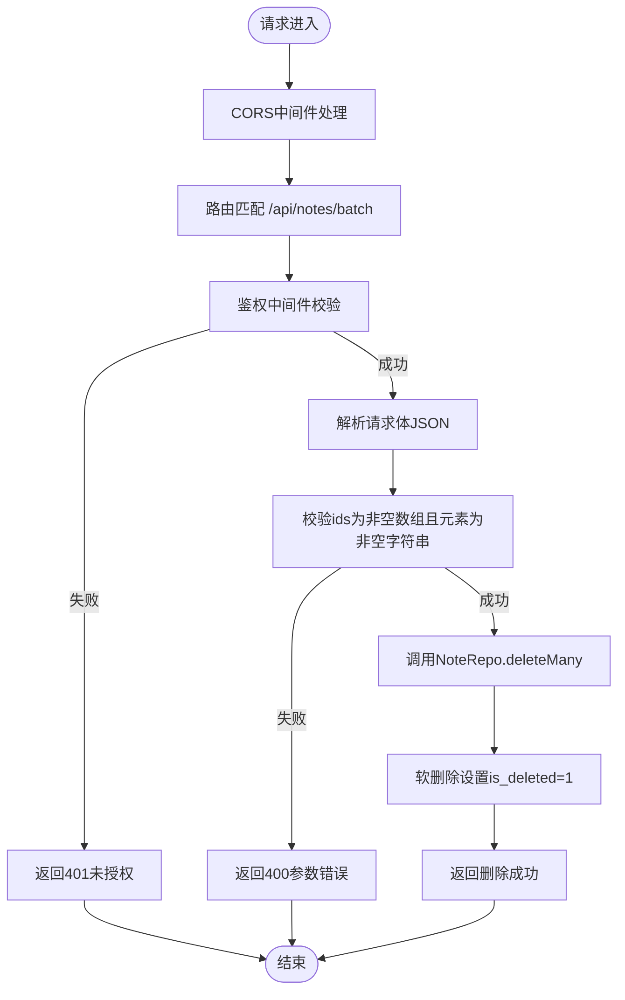
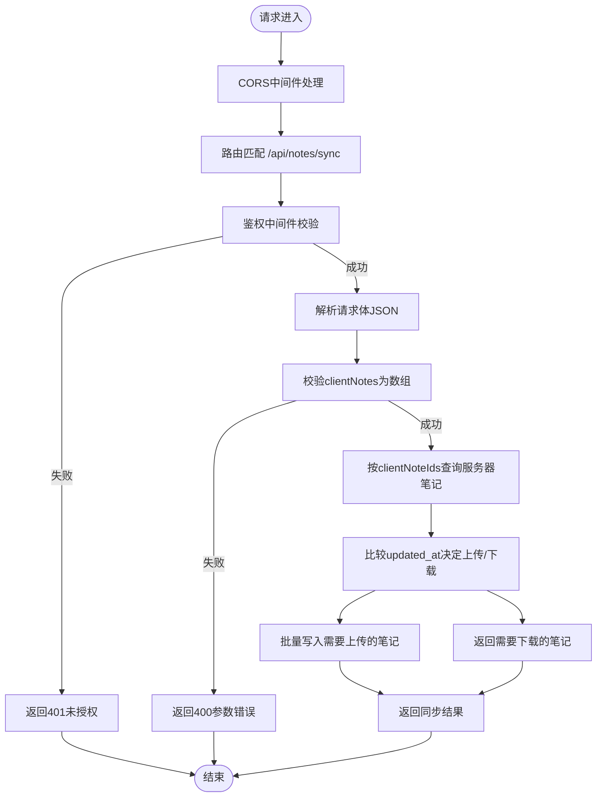
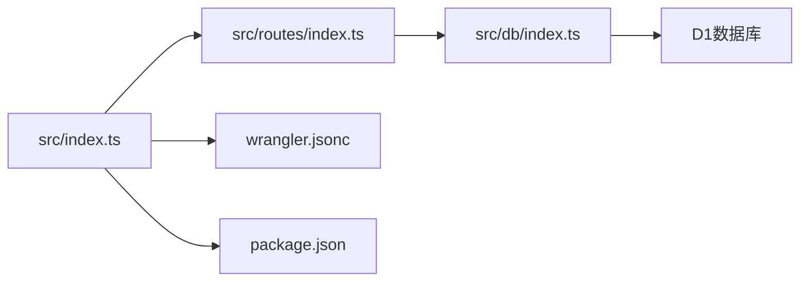

# 路由设计

<cite>
**本文引用的文件**
- [src/index.ts](file://src/index.ts)
- [src/routes/index.ts](file://src/routes/index.ts)
- [src/db/index.ts](file://src/db/index.ts)
- [api-doc.md](file://api-doc.md)
- [wrangler.jsonc](file://wrangler.jsonc)
- [package.json](file://package.json)
- [test/index.spec.ts](file://test/index.spec.ts)
- [migrations/0001_init_schema.sql](file://migrations/0001_init_schema.sql)
</cite>

## 目录

1. [简介](#简介)
2. [项目结构](#项目结构)
3. [核心组件](#核心组件)
4. [架构总览](#架构总览)
5. [详细组件分析](#详细组件分析)
6. [依赖关系分析](#依赖关系分析)
7. [性能考量](#性能考量)
8. [故障排查指南](#故障排查指南)
9. [结论](#结论)
10. [附录](#附录)

## 简介

本文件面向Notes Server的路由设计，围绕基于Hono的路由系统进行深入解析，覆盖路由分发机制、中间件链与请求处理流程；重点阐述笔记相关API的路由设计（CRUD与同步），并解释鉴权中间件、CORS处理与错误拦截的实现方式。文档同时给出路由参数处理、查询参数解析与请求体验证机制，并提供路由表与请求处理流程图，帮助开发者快速理解从HTTP请求到业务逻辑的完整路径。

## 项目结构

- 入口应用位于 src/index.ts，负责创建Hono实例、注册全局CORS、挂载笔记路由模块、配置全局错误与404处理。
- 笔记路由模块位于 src/routes/index.ts，定义鉴权中间件与所有笔记API端点。
- 数据访问层位于 src/db/index.ts，封装NoteRepo，提供分页查询、单条查询、创建、更新、软删除、批量操作、同步等数据库操作。
- 配置与部署相关文件包括 wrangler.jsonc（D1绑定、定时触发）、package.json（依赖与脚本）。
- 测试文件 test/index.spec.ts 用于验证路由存在性与鉴权行为。
- 数据库迁移脚本 migrations/0001_init_schema.sql 定义notes表结构与索引。

图表来源

- [src/index.ts](file://src/index.ts#L38-L63)
- [src/routes/index.ts](file://src/routes/index.ts#L1-L234)
- [src/db/index.ts](file://src/db/index.ts#L43-L250)
- [wrangler.jsonc](file://wrangler.jsonc#L13-L19)
- [package.json](file://package.json#L32-L34)
- [test/index.spec.ts](file://test/index.spec.ts#L1-L104)
- [migrations/0001_init_schema.sql](file://migrations/0001_init_schema.sql#L1-L17)

章节来源

- [src/index.ts](file://src/index.ts#L38-L63)
- [src/routes/index.ts](file://src/routes/index.ts#L1-L234)
- [src/db/index.ts](file://src/db/index.ts#L43-L250)
- [wrangler.jsonc](file://wrangler.jsonc#L13-L19)
- [package.json](file://package.json#L32-L34)
- [test/index.spec.ts](file://test/index.spec.ts#L1-L104)
- [migrations/0001_init_schema.sql](file://migrations/0001_init_schema.sql#L1-L17)

## 核心组件

- Hono应用实例与环境绑定：在入口文件中创建Hono实例并声明Env接口，包含DB与API_KEY绑定，供路由与数据层使用。
- 全局CORS与错误处理：入口文件对所有路径启用CORS中间件，并统一处理未捕获异常与404资源不存在。
- 笔记路由模块：定义鉴权中间件与全部笔记API端点，包括列表、详情、创建、更新、删除、批量删除、导出、同步、批量插入/更新。
- 数据访问层：NoteRepo提供findAll、findById、create、update、delete、deleteMany、getAllFull、upsertMany、findByIds等方法，内部完成Base64与Blob互转、SQL批处理与条件更新。

章节来源

- [src/index.ts](file://src/index.ts#L8-L36)
- [src/index.ts](file://src/index.ts#L38-L63)
- [src/routes/index.ts](file://src/routes/index.ts#L7-L15)
- [src/db/index.ts](file://src/db/index.ts#L43-L250)

## 架构总览

下图展示从HTTP请求进入应用到业务逻辑执行的整体流程，包括中间件链、路由匹配与错误处理。

图表来源

- [src/index.ts](file://src/index.ts#L38-L63)
- [src/routes/index.ts](file://src/routes/index.ts#L7-L15)
- [src/db/index.ts](file://src/db/index.ts#L43-L250)

## 详细组件分析

### 路由分发机制与中间件链

- 全局CORS：入口文件对所有路径启用CORS中间件，确保跨域请求可用。
- 路由挂载：将笔记路由模块挂载到 /api/notes 前缀，后续所有笔记相关请求均在此前缀下处理。
- 中间件链：笔记路由模块内定义鉴权中间件，作用于所有 /api/notes 下的子路由；鉴权通过后才继续执行具体端点逻辑。
- 错误与404：入口文件统一注册onError与notFound处理器，保证异常与未匹配路由的一致化响应。

章节来源

- [src/index.ts](file://src/index.ts#L38-L63)
- [src/routes/index.ts](file://src/routes/index.ts#L7-L15)

### 鉴权中间件

- 实现位置：笔记路由模块的鉴权中间件，检查Authorization头中的Bearer Token是否与环境变量API_KEY一致。
- 行为：鉴权失败时直接返回401未授权；鉴权成功则继续执行下一个中间件或路由处理函数。
- 配置：API_KEY通过Wrangler配置绑定至环境变量，供中间件读取。

章节来源

- [src/routes/index.ts](file://src/routes/index.ts#L7-L15)
- [wrangler.jsonc](file://wrangler.jsonc#L13-L19)

### CORS处理

- 实现位置：入口文件对所有路径启用CORS中间件。
- 影响范围：所有 /api/notes 的请求均可正常跨域访问。

章节来源

- [src/index.ts](file://src/index.ts#L39-L39)

### 错误拦截与404处理

- onError：统一捕获未处理异常，返回标准化错误响应（包含success、error、message、timestamp）。
- notFound：当路由未匹配时返回404资源不存在的标准响应。

章节来源

- [src/index.ts](file://src/index.ts#L41-L63)

### 笔记相关API路由设计

- 基础路径：/api/notes
- 鉴权：所有端点均需Authorization: Bearer {API_KEY}头
- 端点一览与HTTP方法映射：
  - GET /api/notes：获取笔记列表（支持search、page、limit查询参数）
  - GET /api/notes/:id：获取笔记详情
  - POST /api/notes：创建笔记（请求体校验标题与内容）
  - PATCH /api/notes/:id：更新笔记（请求体可选字段）
  - DELETE /api/notes/:id：删除笔记（软删除）
  - DELETE /api/notes/batch：批量删除笔记（请求体ids数组）
  - GET /api/notes/export/all：导出所有笔记（返回JSON附件）
  - POST /api/notes/sync：笔记同步（根据updated_at比较决定上传/下载）
  - POST /api/notes/batch：批量插入或更新笔记（请求体notes数组）

章节来源

- [src/routes/index.ts](file://src/routes/index.ts#L18-L231)
- [api-doc.md](file://api-doc.md#L42-L440)

### 路由参数处理、查询参数解析与请求体验证

- 路由参数：使用c.req.param('id')获取路径参数（如/:id）。
- 查询参数：使用c.req.query('key')获取查询字符串参数（如search、page、limit），并进行数值转换与边界约束。
- 请求体验证：
  - 创建笔记：校验title与content必填；可选created_at、updated_at；默认is_encrypted为1；服务端生成created_at/updated_at。
  - 更新笔记：校验updated_at可选；其余字段按需更新。
  - 批量删除：校验请求体为JSON对象且包含非空ids数组，且每个元素为非空字符串。
  - 同步接口：校验clientNotes为数组；根据服务器已有ID集合与updated_at比较决定上传/下载。
  - 批量插入/更新：校验notes为数组且非空；每条笔记校验id、title、content必填及类型正确。

章节来源

- [src/routes/index.ts](file://src/routes/index.ts#L31-L136)
- [src/routes/index.ts](file://src/routes/index.ts#L139-L231)

### 数据访问层与业务逻辑

- NoteRepo方法概览：
  - findAll：分页查询，支持search模糊匹配；使用db.batch并行执行COUNT与LIMIT/OFFSET查询。
  - findById：按ID查询单条笔记，软删除过滤。
  - create：插入笔记，将Base64内容转换为Blob写入。
  - update：按需更新字段，将Base64内容转换为Blob写入。
  - delete/deleteMany：软删除，设置is_deleted=1并清空content与title。
  - getAllFull：导出所有笔记（排除软删除）。
  - upsertMany：批量插入或更新（ON CONFLICT DO UPDATE）。
  - findByIds：按ID列表查询笔记。
- 数据结构转换：convertNoteFromDb与base64ToArrayBuffer/arrayBufferToBase64在读写时完成Base64与Blob互转。

章节来源

- [src/db/index.ts](file://src/db/index.ts#L43-L250)

### 请求处理流程图（以“创建笔记”为例）

图表来源

- [src/index.ts](file://src/index.ts#L38-L63)
- [src/routes/index.ts](file://src/routes/index.ts#L47-L82)
- [src/db/index.ts](file://src/db/index.ts#L99-L123)

### 请求处理流程图（以“批量删除”为例）

图表来源

- [src/index.ts](file://src/index.ts#L38-L63)
- [src/routes/index.ts](file://src/routes/index.ts#L116-L136)
- [src/db/index.ts](file://src/db/index.ts#L186-L191)

### 请求处理流程图（以“同步接口”为例）

图表来源

- [src/index.ts](file://src/index.ts#L38-L63)
- [src/routes/index.ts](file://src/routes/index.ts#L139-L197)
- [src/db/index.ts](file://src/db/index.ts#L240-L249)

## 依赖关系分析

- 入口文件依赖Hono与CORS，挂载笔记路由模块并注册全局错误与404处理。
- 笔记路由模块依赖NoteRepo与Env接口，实现鉴权与各端点逻辑。
- NoteRepo依赖D1数据库，完成SQL与批处理操作。
- 部署配置通过wrangler.jsonc绑定D1数据库与定时触发器。

图表来源

- [src/index.ts](file://src/index.ts#L1-L11)
- [src/routes/index.ts](file://src/routes/index.ts#L1-L5)
- [src/db/index.ts](file://src/db/index.ts#L1-L1)
- [wrangler.jsonc](file://wrangler.jsonc#L13-L19)
- [package.json](file://package.json#L32-L34)

章节来源

- [src/index.ts](file://src/index.ts#L1-L11)
- [src/routes/index.ts](file://src/routes/index.ts#L1-L5)
- [src/db/index.ts](file://src/db/index.ts#L1-L1)
- [wrangler.jsonc](file://wrangler.jsonc#L13-L19)
- [package.json](file://package.json#L32-L34)

## 性能考量

- 批量查询优化：findAll使用db.batch并行执行COUNT与主查询，减少往返次数，提升分页查询效率。
- 批量写入优化：upsertMany与deleteMany采用db.batch与IN子句，降低网络开销与SQL执行次数。
- 索引策略：数据库迁移脚本包含title、is_deleted、复合索引，有助于全文检索与排序性能。
- Base64/Blob转换：在NoteRepo中集中处理，避免重复转换，减少CPU消耗。

章节来源

- [src/db/index.ts](file://src/db/index.ts#L65-L90)
- [src/db/index.ts](file://src/db/index.ts#L202-L237)
- [migrations/0001_init_schema.sql](file://migrations/0001_init_schema.sql#L14-L16)

## 故障排查指南

- 401 未授权：确认Authorization头格式为Bearer {API_KEY}，且API_KEY已在环境变量中正确配置。
- 400 参数错误：检查请求体格式与必填字段（如创建笔记的title与content、批量删除的ids数组、批量插入/更新的notes数组）。
- 404 资源不存在：确认请求路径是否为 /api/notes 及其子路径，且未被全局notFound拦截。
- 500 内部错误：检查onError统一处理逻辑与日志输出，定位具体异常原因。
- 数据库问题：核对D1绑定名称与数据库ID，确认迁移脚本已应用。

章节来源

- [src/routes/index.ts](file://src/routes/index.ts#L7-L15)
- [src/index.ts](file://src/index.ts#L41-L63)
- [wrangler.jsonc](file://wrangler.jsonc#L13-L19)
- [test/index.spec.ts](file://test/index.spec.ts#L9-L46)

## 结论

本路由设计以Hono为核心，结合全局CORS、鉴权中间件与统一错误处理，形成清晰的请求处理链路。笔记API覆盖CRUD与同步场景，查询参数与请求体验证保障数据一致性。数据访问层通过批处理与索引优化提升性能。整体架构简洁、扩展性强，适合在Cloudflare Workers/D1环境中稳定运行。

## 附录

- 路由表（基于实际实现）
  - GET /api/notes：分页列表（search、page、limit）
  - GET /api/notes/:id：详情
  - POST /api/notes：创建
  - PATCH /api/notes/:id：更新
  - DELETE /api/notes/:id：软删除
  - DELETE /api/notes/batch：批量删除
  - GET /api/notes/export/all：导出
  - POST /api/notes/sync：同步
  - POST /api/notes/batch：批量插入/更新

章节来源

- [src/routes/index.ts](file://src/routes/index.ts#L18-L231)
- [api-doc.md](file://api-doc.md#L42-L440)
