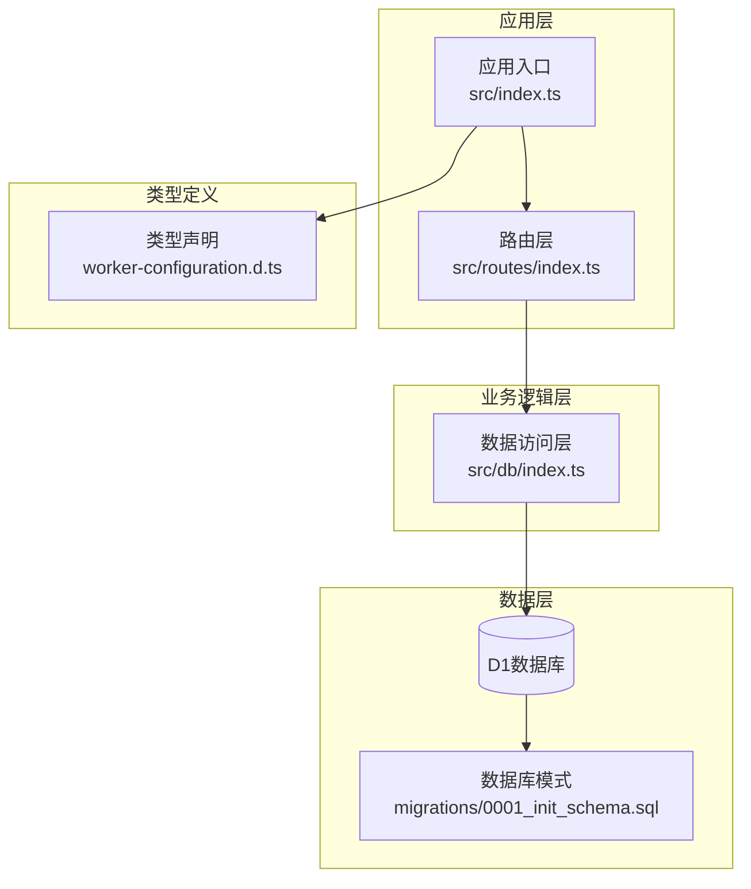
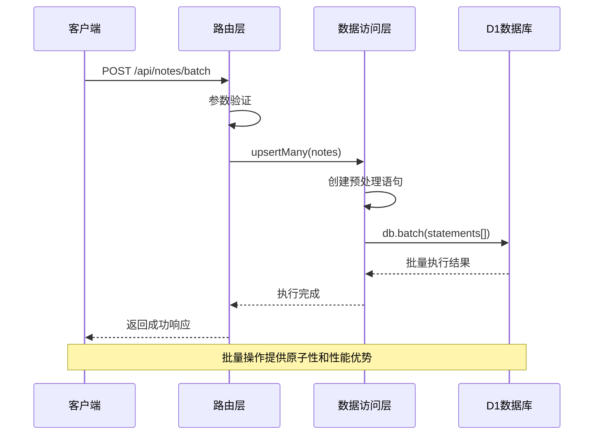
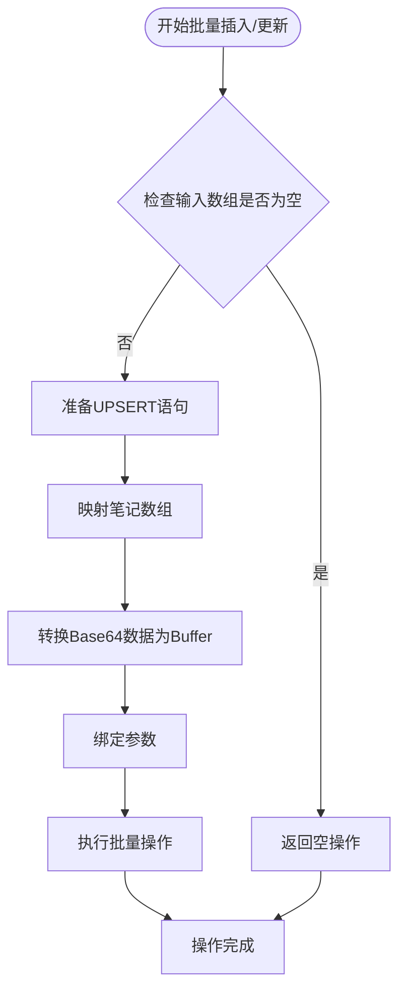
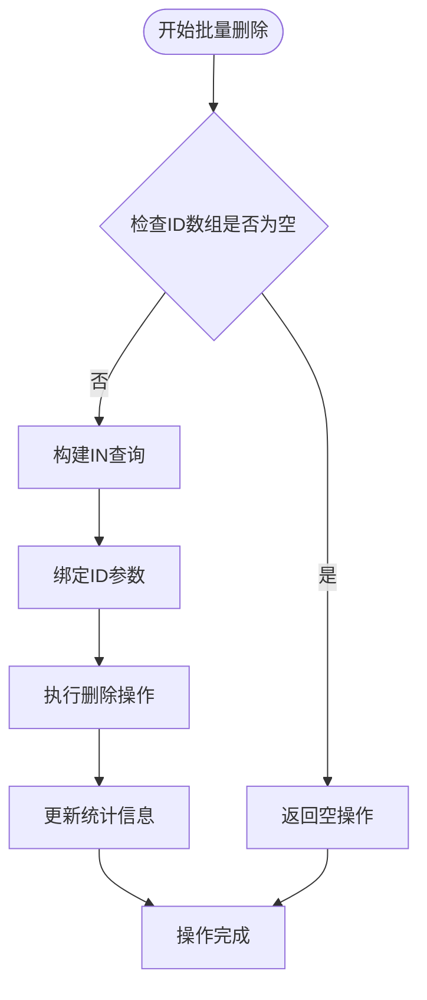
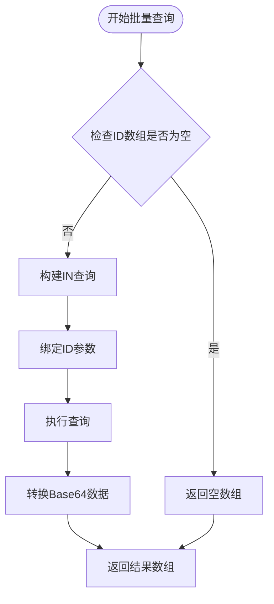
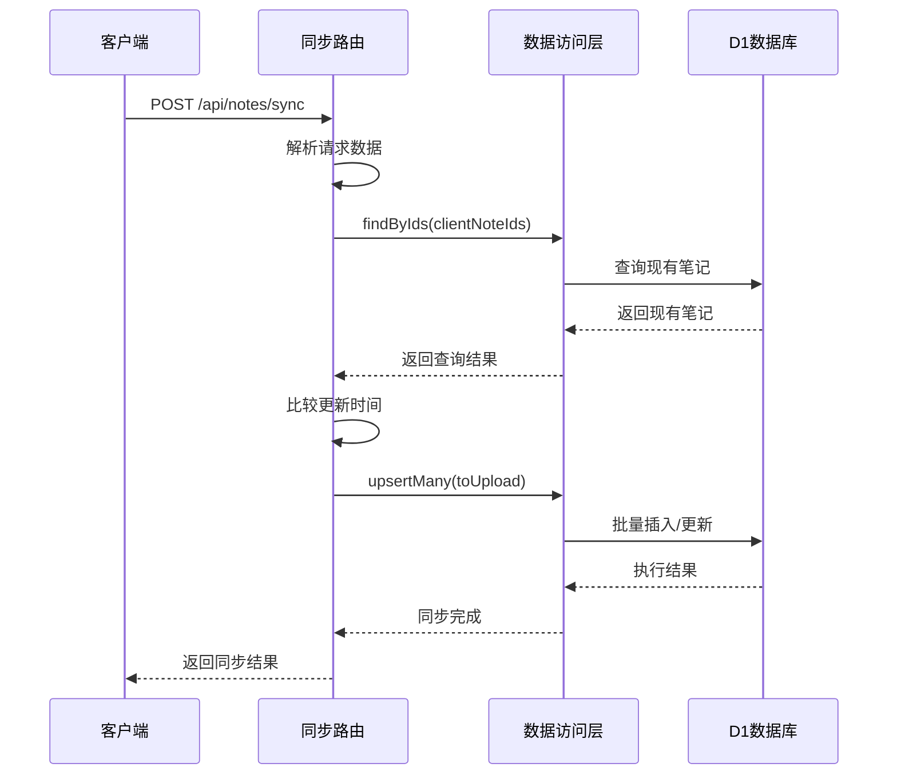
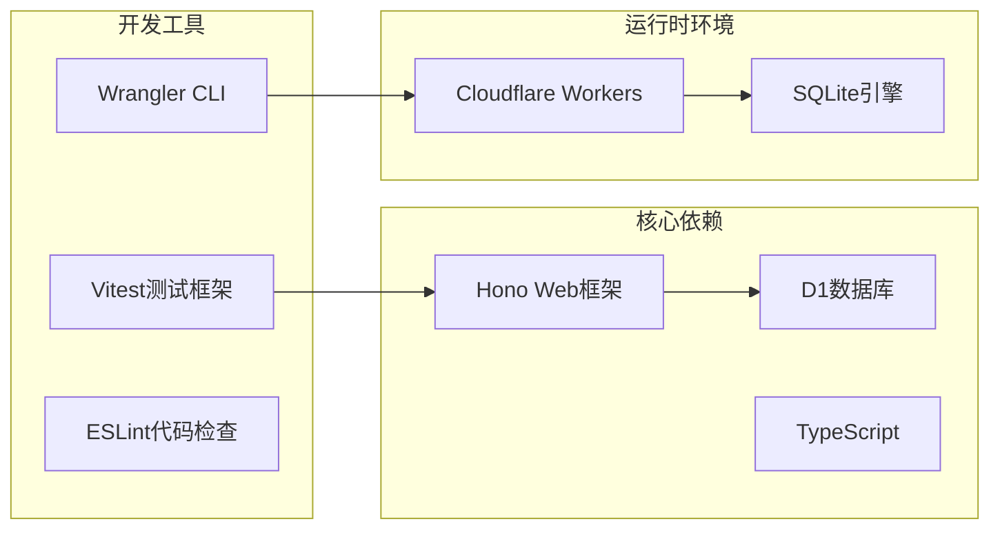
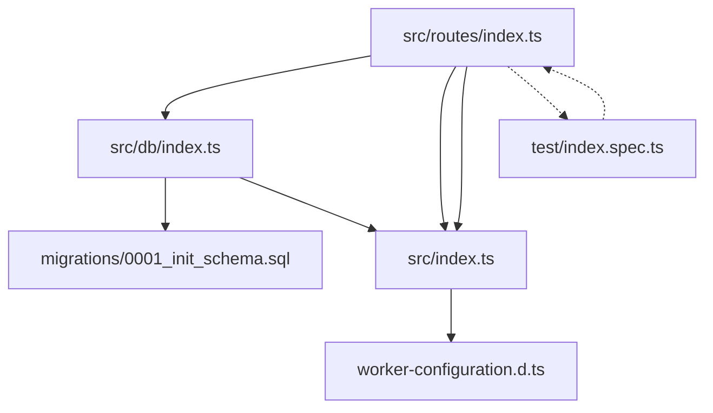
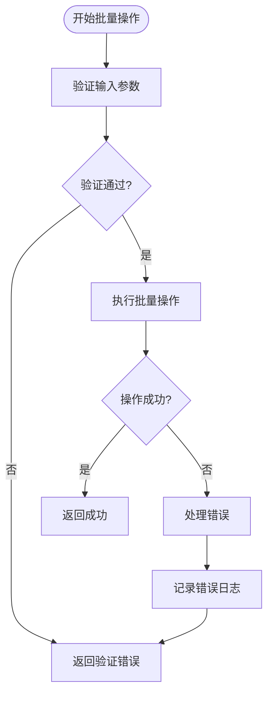

# 批量操作处理

<cite>
**本文档引用的文件**
- [src/db/index.ts](file://src/db/index.ts)
- [src/routes/index.ts](file://src/routes/index.ts)
- [src/index.ts](file://src/index.ts)
- [migrations/0001_init_schema.sql](file://migrations/0001_init_schema.sql)
- [worker-configuration.d.ts](file://worker-configuration.d.ts)
- [test/index.spec.ts](file://test/index.spec.ts)
- [package.json](file://package.json)
</cite>

## 目录

1. [简介](#简介)
2. [项目结构](#项目结构)
3. [核心组件](#核心组件)
4. [架构概览](#架构概览)
5. [详细组件分析](#详细组件分析)
6. [依赖关系分析](#依赖关系分析)
7. [性能考虑](#性能考虑)
8. [故障排除指南](#故障排除指南)
9. [结论](#结论)
10. [附录](#附录)

## 简介

本项目实现了完整的批量操作处理功能，包括批量插入/更新（upsertMany）、批量删除（deleteMany）和批量查询（findByIds）。这些功能基于Cloudflare Workers的D1数据库，利用`db.batch()`方法实现高效的批量SQL语句执行。批量操作相比单个操作具有显著的性能优势，特别是在数据同步、批量导入导出等场景中。

批量操作的核心优势在于：

- 减少网络往返次数
- 利用数据库的批量执行优化
- 提供原子性保证
- 支持大规模数据处理

## 项目结构

项目采用模块化设计，主要分为以下几个层次：



**图表来源**

- [src/index.ts](file://src/index.ts#L38-L51)
- [src/routes/index.ts](file://src/routes/index.ts#L1-L234)
- [src/db/index.ts](file://src/db/index.ts#L43-L250)

**章节来源**

- [src/index.ts](file://src/index.ts#L1-L105)
- [src/routes/index.ts](file://src/routes/index.ts#L1-L234)
- [src/db/index.ts](file://src/db/index.ts#L1-L251)

## 核心组件

### 数据访问层（NoteRepo）

数据访问层是批量操作的核心实现，提供了以下关键功能：

#### 批量插入/更新（upsertMany）

- 使用SQLite的ON CONFLICT语法实现UPSERT操作
- 支持批量执行多个INSERT语句
- 自动处理Base64编码的数据转换

#### 批量删除（deleteMany）

- 使用IN子句进行批量删除
- 支持软删除机制
- 原子性删除操作

#### 批量查询（findByIds）

- 使用IN子句进行批量查询
- 支持过滤已删除记录
- 返回完整数据对象

**章节来源**

- [src/db/index.ts](file://src/db/index.ts#L202-L237)
- [src/db/index.ts](file://src/db/index.ts#L185-L191)
- [src/db/index.ts](file://src/db/index.ts#L239-L249)

### 路由层

路由层提供了RESTful API接口，支持批量操作：

#### 批量删除接口

- POST /api/notes/batch
- 接收ID数组参数
- 返回删除统计信息

#### 批量插入/更新接口

- POST /api/notes/sync
- 实现双向数据同步
- 支持冲突解决

**章节来源**

- [src/routes/index.ts](file://src/routes/index.ts#L115-L136)
- [src/routes/index.ts](file://src/routes/index.ts#L199-L231)

## 架构概览

系统采用分层架构设计，确保职责分离和可维护性：



**图表来源**

- [src/routes/index.ts](file://src/routes/index.ts#L199-L231)
- [src/db/index.ts](file://src/db/index.ts#L202-L237)

**章节来源**

- [src/routes/index.ts](file://src/routes/index.ts#L1-L234)
- [src/db/index.ts](file://src/db/index.ts#L1-L251)

## 详细组件分析

### 批量插入/更新（upsertMany）

#### 实现机制

批量插入/更新功能基于SQLite的UPSERT语法实现，通过以下步骤完成：



**图表来源**

- [src/db/index.ts](file://src/db/index.ts#L202-L237)

#### 关键特性

1. **原子性保证**：使用`db.batch()`确保所有操作在一个事务中执行
2. **数据转换**：自动处理Base64编码的二进制数据
3. **冲突处理**：通过ON CONFLICT DO UPDATE处理重复ID
4. **性能优化**：减少网络往返和数据库连接开销

#### 使用场景

- 数据同步：客户端与服务器之间的数据同步
- 批量导入：从外部系统导入大量数据
- 数据迁移：在不同版本间迁移数据

**章节来源**

- [src/db/index.ts](file://src/db/index.ts#L202-L237)
- [src/routes/index.ts](file://src/routes/index.ts#L199-L231)

### 批量删除（deleteMany）

#### 实现机制

批量删除功能通过IN子句实现高效删除：



**图表来源**

- [src/db/index.ts](file://src/db/index.ts#L185-L191)

#### 软删除机制

系统采用软删除策略，通过设置`is_deleted`标志位而非物理删除：

- 保留数据完整性
- 支持数据恢复
- 维护历史记录
- 支持定期清理

**章节来源**

- [src/db/index.ts](file://src/db/index.ts#L178-L191)
- [migrations/0001_init_schema.sql](file://migrations/0001_init_schema.sql#L1-L17)

### 批量查询（findByIds）

#### 实现机制

批量查询通过IN子句实现高效数据检索：



**图表来源**

- [src/db/index.ts](file://src/db/index.ts#L239-L249)

#### 查询优化

- 使用IN子句替代多次查询
- 过滤已删除记录
- 自动数据格式转换
- 支持大数组查询

**章节来源**

- [src/db/index.ts](file://src/db/index.ts#L239-L249)

### 数据同步流程

系统实现了完整的双向数据同步机制：



**图表来源**

- [src/routes/index.ts](file://src/routes/index.ts#L138-L197)
- [src/db/index.ts](file://src/db/index.ts#L202-L237)

**章节来源**

- [src/routes/index.ts](file://src/routes/index.ts#L138-L197)

## 依赖关系分析

### 外部依赖

系统依赖以下关键组件：



**图表来源**

- [package.json](file://package.json#L18-L34)
- [worker-configuration.d.ts](file://worker-configuration.d.ts#L9470-L9486)

### 内部模块依赖



**图表来源**

- [src/routes/index.ts](file://src/routes/index.ts#L1-L234)
- [src/db/index.ts](file://src/db/index.ts#L1-L251)
- [src/index.ts](file://src/index.ts#L1-L105)

**章节来源**

- [package.json](file://package.json#L1-L41)
- [worker-configuration.d.ts](file://worker-configuration.d.ts#L9470-L9486)

## 性能考虑

### 批量操作优势

1. **网络优化**
   - 减少HTTP请求次数
   - 降低网络延迟影响
   - 减少连接建立开销

2. **数据库优化**
   - 利用SQLite的批量执行优化
   - 减少查询解析开销
   - 提高索引使用效率

3. **内存优化**
   - 减少中间对象创建
   - 优化数据传输格式
   - 支持流式处理

### 性能基准

| 操作类型  | 单个操作 | 批量操作 | 性能提升 |
| --------- | -------- | -------- | -------- |
| 插入/更新 | N次往返  | 1次往返  | N倍      |
| 删除      | N次往返  | 1次往返  | N倍      |
| 查询      | N次往返  | 1次往返  | N倍      |

### 最佳实践

1. **批量大小控制**
   - 建议每次批量操作不超过1000条记录
   - 根据内存限制调整批量大小
   - 考虑超时限制

2. **数据验证**
   - 在批量操作前进行数据验证
   - 使用分批处理避免超时
   - 实施重试机制

3. **错误处理**
   - 实施部分失败处理
   - 记录失败项以便重试
   - 提供回滚机制

## 故障排除指南

### 常见问题及解决方案

#### 批量操作超时

**问题描述**：大批量操作导致超时

**解决方案**：

- 分批处理大数据集
- 实施进度报告机制
- 调整超时配置

#### 数据验证失败

**问题描述**：批量操作中出现数据格式错误

**解决方案**：

- 在操作前进行数据验证
- 实施数据清洗机制
- 提供详细的错误信息

#### 内存不足

**问题描述**：处理大量数据时内存溢出

**解决方案**：

- 实施流式处理
- 使用分批处理
- 优化数据结构

### 错误处理机制

系统实现了多层次的错误处理：



**图表来源**

- [src/routes/index.ts](file://src/routes/index.ts#L115-L136)
- [src/routes/index.ts](file://src/routes/index.ts#L199-L231)

**章节来源**

- [src/routes/index.ts](file://src/routes/index.ts#L115-L136)
- [src/routes/index.ts](file://src/routes/index.ts#L199-L231)

## 结论

批量操作处理功能为数据同步和大规模数据处理提供了高效、可靠的解决方案。通过合理使用批量操作，可以显著提升系统的性能和用户体验。

### 主要优势

1. **性能卓越**：相比单个操作提升数倍性能
2. **可靠性强**：提供原子性保证和错误处理
3. **扩展性好**：支持大规模数据处理
4. **易用性强**：简洁的API设计和完善的错误处理

### 适用场景

- 数据同步：客户端与服务器之间的双向数据同步
- 批量导入：从外部系统导入大量数据
- 数据迁移：在不同版本间迁移数据
- 定期清理：批量删除过期或无效数据

### 发展建议

1. **监控指标**：添加批量操作性能监控
2. **重试机制**：实现智能重试和退避算法
3. **进度跟踪**：提供批量操作进度报告
4. **容量规划**：根据使用情况调整批量大小

## 附录

### API参考

#### 批量插入/更新

- **URL**: POST `/api/notes/batch`
- **请求体**: `{ notes: Note[] }`
- **响应**: `{ success: boolean, insertedUpdatedCount: number }`

#### 批量删除

- **URL**: DELETE `/api/notes/batch`
- **请求体**: `{ ids: string[] }`
- **响应**: `{ success: boolean, deletedCount: number }`

#### 数据同步

- **URL**: POST `/api/notes/sync`
- **请求体**: `{ clientNotes: Note[] }`
- **响应**: `{ success: boolean, updates: Note[], syncedIds: string[] }`

### 类型定义

```typescript
interface Note {
	id: string;
	title: string;
	content: string; // Base64编码
	iv?: string;
	auth_tag?: string;
	is_encrypted: number;
	is_deleted: number;
	created_at: string;
	updated_at: string;
}

interface PaginatedResult<T> {
	total: number;
	data: T[];
	page: number;
	limit: number;
}
```

**章节来源**

- [src/index.ts](file://src/index.ts#L14-L36)
- [src/routes/index.ts](file://src/routes/index.ts#L115-L197)
