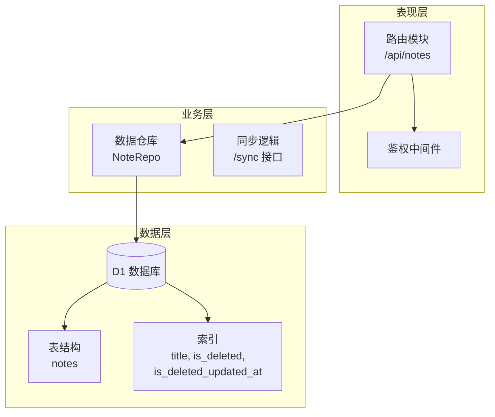
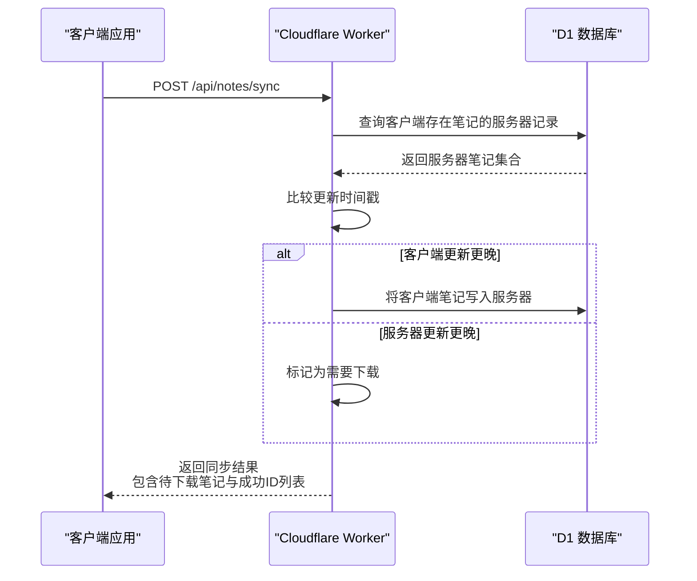
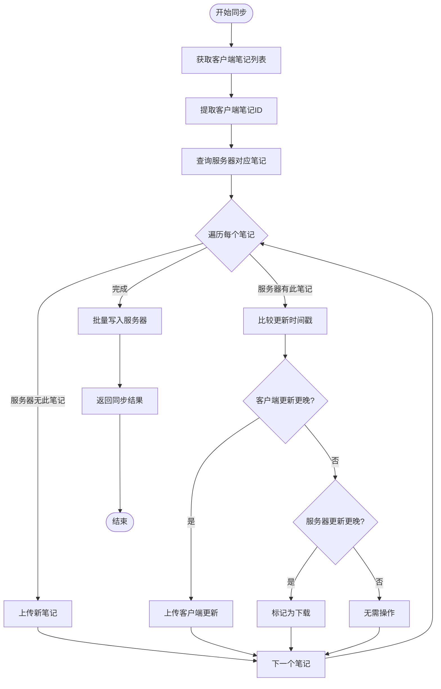
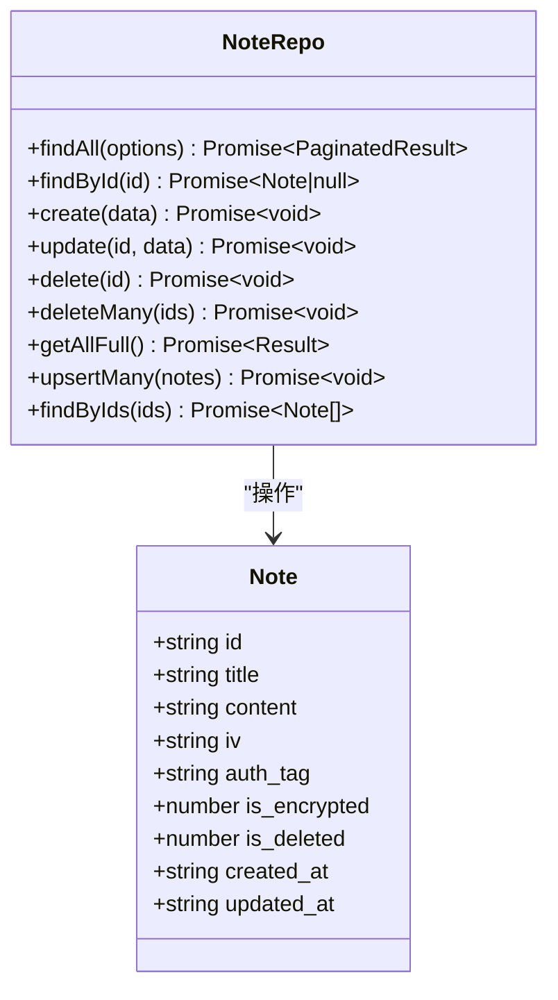
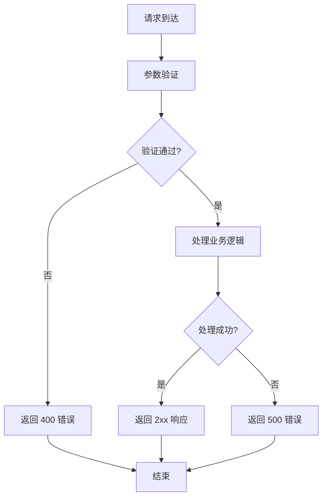
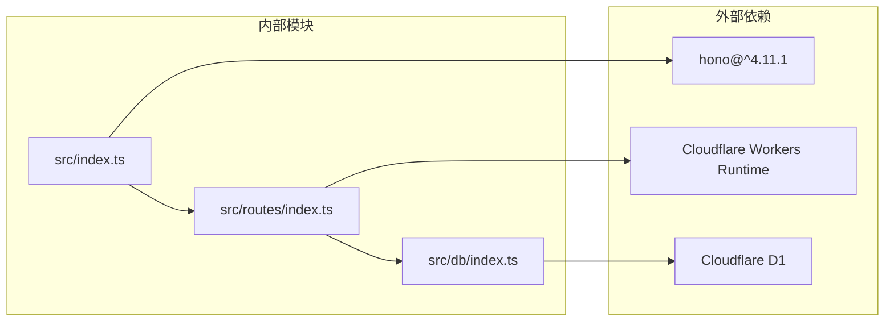

# 数据同步机制

<cite>
**本文引用的文件**
- [src/index.ts](file://src/index.ts)
- [src/db/index.ts](file://src/db/index.ts)
- [src/routes/index.ts](file://src/routes/index.ts)
- [migrations/0001_init_schema.sql](file://migrations/0001_init_schema.sql)
- [api-doc.md](file://api-doc.md)
- [package.json](file://package.json)
- [wrangler.jsonc](file://wrangler.jsonc)
- [test/index.spec.ts](file://test/index.spec.ts)
</cite>

## 目录

1. [简介](#简介)
2. [项目结构](#项目结构)
3. [核心组件](#核心组件)
4. [架构总览](#架构总览)
5. [详细组件分析](#详细组件分析)
6. [依赖关系分析](#依赖关系分析)
7. [性能考量](#性能考量)
8. [故障排除指南](#故障排除指南)
9. [结论](#结论)

## 简介

本项目实现了一个基于 Cloudflare Workers 的笔记同步服务，提供双向数据同步能力。系统采用时间戳驱动的冲突解决策略，通过客户端与服务器的更新时间比较实现一致性保证，并支持批量操作与增量同步。本文档深入解析同步算法设计、冲突解决策略、版本控制机制以及性能优化方案。

## 项目结构

项目采用分层架构，主要由三层组成：

- 表现层：Hono 路由定义与 API 接口
- 业务层：数据访问层封装与同步逻辑
- 数据层：Cloudflare D1 数据库与索引

**图表来源**

- [src/routes/index.ts](file://src/routes/index.ts#L1-L234)
- [src/db/index.ts](file://src/db/index.ts#L43-L251)
- [migrations/0001_init_schema.sql](file://migrations/0001_init_schema.sql#L1-L17)

**章节来源**

- [src/index.ts](file://src/index.ts#L1-L105)
- [src/routes/index.ts](file://src/routes/index.ts#L1-L234)
- [src/db/index.ts](file://src/db/index.ts#L1-L251)
- [migrations/0001_init_schema.sql](file://migrations/0001_init_schema.sql#L1-L17)

## 核心组件

系统的核心组件包括：

- 笔记数据模型：定义完整的笔记结构，包含加密相关的字段
- 数据仓库：提供 CRUD 操作与批量处理能力
- 同步接口：实现双向同步与冲突解决
- 鉴权机制：基于 Bearer Token 的 API Key 验证

**章节来源**

- [src/index.ts](file://src/index.ts#L14-L36)
- [src/db/index.ts](file://src/db/index.ts#L43-L251)
- [src/routes/index.ts](file://src/routes/index.ts#L7-L15)

## 架构总览

系统采用无服务器架构，基于 Cloudflare Workers 运行时，通过 D1 数据库实现数据持久化。整体架构具有以下特点：

- 事件驱动：支持定时任务触发的数据清理
- 无状态：Worker 实例无状态，适合水平扩展
- 低延迟：边缘计算节点就近提供服务
- 强一致：基于时间戳的最终一致性模型

**图表来源**

- [src/routes/index.ts](file://src/routes/index.ts#L138-L197)
- [src/db/index.ts](file://src/db/index.ts#L202-L237)

## 详细组件分析

### 同步算法设计

系统实现了基于时间戳的双向同步算法，核心逻辑如下：

**图表来源**

- [src/routes/index.ts](file://src/routes/index.ts#L138-L197)

#### 冲突解决策略

系统采用时间戳优先的冲突解决策略：

- **时间戳比较**：比较客户端与服务器笔记的 `updated_at` 字段
- **更新方向判断**：根据时间戳差异确定数据流向
- **无冲突场景**：时间戳相等时不进行任何操作
- **幂等性保证**：使用 `ON CONFLICT` 实现重复写入的安全性

#### 版本控制机制

系统通过以下机制实现版本控制：

- **更新时间戳**：每个笔记维护独立的 `updated_at` 字段
- **创建时间戳**：记录笔记的初始创建时间
- **软删除机制**：使用 `is_deleted` 字段实现逻辑删除
- **批量操作**：支持批量插入/更新，确保原子性

**章节来源**

- [src/routes/index.ts](file://src/routes/index.ts#L138-L197)
- [src/db/index.ts](file://src/db/index.ts#L202-L237)

### 数据访问层设计

数据仓库提供了完整的 CRUD 操作和批量处理能力：

**图表来源**

- [src/db/index.ts](file://src/db/index.ts#L43-L251)

#### 加密数据处理

系统支持加密笔记的存储与传输：

- **Base64 编码**：内容、IV 和认证标签均使用 Base64 编码
- **二进制存储**：在数据库中以 BLOB 形式存储二进制数据
- **类型安全**：通过 TypeScript 接口确保数据结构正确性

**章节来源**

- [src/db/index.ts](file://src/db/index.ts#L1-L29)
- [src/db/index.ts](file://src/db/index.ts#L34-L41)

### API 接口设计

系统提供完整的 RESTful API 接口：

| 端点               | 方法   | 功能          | 鉴权要求 |
| ------------------ | ------ | ------------- | -------- |
| `/api/notes`       | GET    | 获取笔记列表  | 是       |
| `/api/notes/:id`   | GET    | 获取笔记详情  | 是       |
| `/api/notes`       | POST   | 创建笔记      | 是       |
| `/api/notes/:id`   | PATCH  | 更新笔记      | 是       |
| `/api/notes/:id`   | DELETE | 删除笔记      | 是       |
| `/api/notes/batch` | DELETE | 批量删除      | 是       |
| `/api/notes/sync`  | POST   | 双向同步      | 是       |
| `/api/notes/batch` | POST   | 批量插入/更新 | 是       |

**章节来源**

- [src/routes/index.ts](file://src/routes/index.ts#L31-L231)
- [api-doc.md](file://api-doc.md#L42-L441)

### 错误处理与状态管理

系统实现了完善的错误处理机制：

**图表来源**

- [src/index.ts](file://src/index.ts#L41-L63)

**章节来源**

- [src/index.ts](file://src/index.ts#L41-L63)
- [src/routes/index.ts](file://src/routes/index.ts#L47-L106)

## 依赖关系分析

系统依赖关系清晰，模块间耦合度低：

**图表来源**

- [package.json](file://package.json#L32-L34)
- [wrangler.jsonc](file://wrangler.jsonc#L1-L54)

**章节来源**

- [package.json](file://package.json#L1-L41)
- [wrangler.jsonc](file://wrangler.jsonc#L1-L54)

## 性能考量

系统在设计上考虑了多种性能优化策略：

### 数据库优化

- **复合索引**：`is_deleted_updated_at` 索引支持高效的时间范围查询
- **批量操作**：使用 `db.batch` 和 `ON CONFLICT` 减少网络往返
- **二进制存储**：BLOB 类型直接存储加密数据，避免额外转换开销

### 网络优化

- **增量同步**：只传输变更数据，减少带宽消耗
- **批量处理**：支持批量插入/更新，提高吞吐量
- **Base64 编码**：统一的数据传输格式，简化客户端处理

### 内存优化

- **流式处理**：大文件通过流式传输，避免内存峰值
- **按需加载**：分页查询支持大数据集的渐进式加载

## 故障排除指南

常见问题及解决方案：

### 同步冲突问题

**症状**：客户端与服务器数据不一致
**原因**：时间戳比较出现异常
**解决方案**：

1. 检查客户端时间设置是否正确
2. 验证 `updated_at` 字段格式（ISO 8601）
3. 确认网络传输过程中数据完整性

### 数据库连接问题

**症状**：同步接口返回数据库错误
**原因**：D1 连接异常或权限不足
**解决方案**：

1. 检查 D1 数据库绑定配置
2. 验证 API Key 设置
3. 确认数据库迁移已正确执行

### 性能问题

**症状**：同步速度慢或超时
**原因**：大量数据同步或网络延迟
**解决方案**：

1. 使用分批同步策略
2. 优化客户端缓存机制
3. 检查网络连接质量

**章节来源**

- [src/routes/index.ts](file://src/routes/index.ts#L138-L197)
- [src/index.ts](file://src/index.ts#L41-L63)

## 结论

本数据同步机制通过简洁而高效的算法设计，实现了可靠的双向数据同步。系统采用时间戳驱动的冲突解决策略，结合批量操作和索引优化，在保证数据一致性的同时兼顾了性能表现。通过合理的错误处理和状态管理，系统具备良好的可维护性和可扩展性。建议在生产环境中配合客户端缓存策略和网络监控，进一步提升用户体验和系统稳定性。
