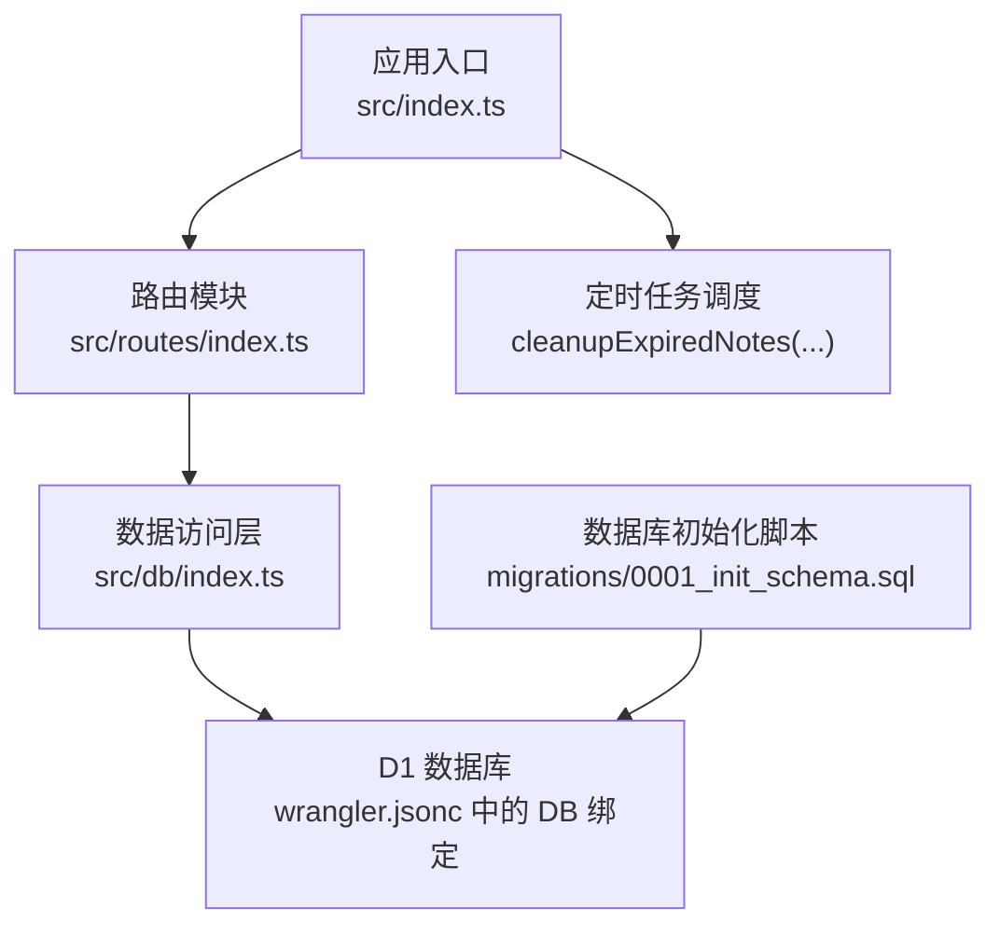
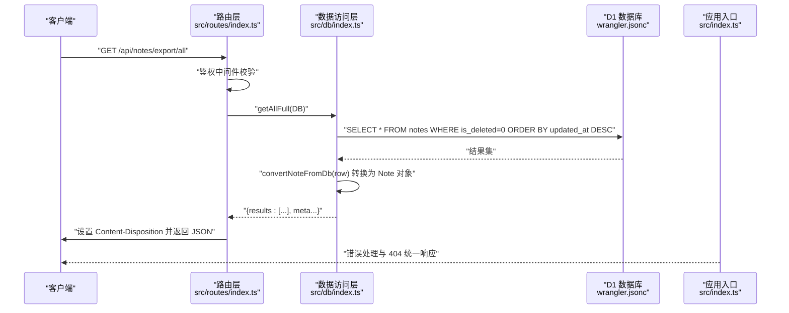
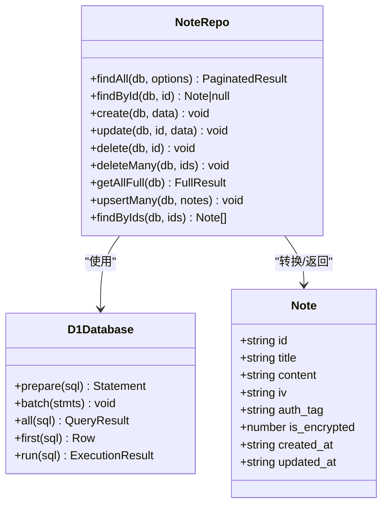
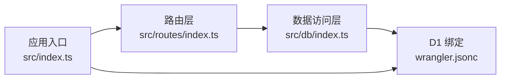

# 数据导出功能

<cite>
**本文引用的文件**
- [src/index.ts](file://src/index.ts)
- [src/routes/index.ts](file://src/routes/index.ts)
- [src/db/index.ts](file://src/db/index.ts)
- [api-doc.md](file://api-doc.md)
- [migrations/0001_init_schema.sql](file://migrations/0001_init_schema.sql)
- [package.json](file://package.json)
- [wrangler.jsonc](file://wrangler.jsonc)
</cite>

## 目录

1. [简介](#简介)
2. [项目结构](#项目结构)
3. [核心组件](#核心组件)
4. [架构总览](#架构总览)
5. [详细组件分析](#详细组件分析)
6. [依赖关系分析](#依赖关系分析)
7. [性能考量](#性能考量)
8. [故障排查指南](#故障排查指南)
9. [结论](#结论)
10. [附录](#附录)

## 简介

本文件围绕“数据导出”功能进行系统化技术文档编写，重点覆盖以下方面：

- 完整数据备份导出的实现机制与控制流
- 文件格式选择与数据完整性保证
- 导出数据的过滤条件、压缩处理、分块传输与进度跟踪
- 具体的代码示例路径与配置选项
- 导出性能优化、大文件处理与内存管理策略
- 导出数据的安全性考虑与隐私保护措施

当前仓库中导出功能以“完整备份导出”的形式提供，即一次性导出所有未删除笔记，并以 JSON 格式返回。该实现具备如下特征：

- 使用 Hono 路由与 D1 数据库交互
- 返回结构包含计数与时间戳，便于审计与追踪
- 内容类型为 JSON，文件名为固定名称，便于客户端识别与保存

后续章节将基于现有代码与配置，给出扩展建议与最佳实践，帮助在不破坏现有架构的前提下，逐步引入更高级的导出能力（如过滤、压缩、分块与进度）。

## 项目结构

项目采用基于层的组织方式，主要目录与职责如下：

- src/index.ts：应用入口与全局环境绑定、错误处理、定时任务调度
- src/routes/index.ts：路由定义与鉴权中间件，包含导出接口
- src/db/index.ts：数据访问层（NoteRepo），负责与 D1 的交互与数据转换
- migrations/0001_init_schema.sql：数据库初始化脚本，定义 notes 表结构
- api-doc.md：API 文档，包含导出接口的请求与响应示例
- package.json：项目依赖与脚本
- wrangler.jsonc：Cloudflare Workers 配置（D1 绑定、触发器等）

图表来源

- [src/index.ts](file://src/index.ts#L38-L75)
- [src/routes/index.ts](file://src/routes/index.ts#L1-L28)
- [src/db/index.ts](file://src/db/index.ts#L43-L250)
- [wrangler.jsonc](file://wrangler.jsonc#L13-L19)
- [migrations/0001_init_schema.sql](file://migrations/0001_init_schema.sql#L1-L17)

章节来源

- [src/index.ts](file://src/index.ts#L1-L105)
- [src/routes/index.ts](file://src/routes/index.ts#L1-L234)
- [src/db/index.ts](file://src/db/index.ts#L1-L251)
- [migrations/0001_init_schema.sql](file://migrations/0001_init_schema.sql#L1-L17)
- [api-doc.md](file://api-doc.md#L333-L365)
- [wrangler.jsonc](file://wrangler.jsonc#L1-L54)

## 核心组件

- 应用入口与环境绑定
  - 定义 Env 接口，包含 D1 数据库绑定与 API Key
  - 提供统一错误处理与 404 处理
  - 提供定时任务调度入口，用于清理软删除笔记
- 路由与鉴权
  - 鉴权中间件：校验 Authorization 头中的 Bearer Token
  - 导出接口：GET /api/notes/export/all，返回 JSON 结构
- 数据访问层（NoteRepo）
  - getAllFull：查询所有未删除笔记并转换为 Note 对象
  - 转换函数：Base64 编解码与 ArrayBuffer 互转
- 数据库结构
  - notes 表包含 id、title、content（BLOB）、iv、auth_tag、is_encrypted、is_deleted、created_at、updated_at
  - 索引覆盖标题、删除状态与删除状态+更新时间排序

章节来源

- [src/index.ts](file://src/index.ts#L8-L11)
- [src/index.ts](file://src/index.ts#L41-L63)
- [src/index.ts](file://src/index.ts#L71-L75)
- [src/routes/index.ts](file://src/routes/index.ts#L7-L15)
- [src/routes/index.ts](file://src/routes/index.ts#L17-L28)
- [src/db/index.ts](file://src/db/index.ts#L34-L41)
- [src/db/index.ts](file://src/db/index.ts#L194-L200)
- [migrations/0001_init_schema.sql](file://migrations/0001_init_schema.sql#L1-L17)

## 架构总览

下图展示了从客户端发起导出请求到数据库查询与响应返回的完整流程。

图表来源

- [src/routes/index.ts](file://src/routes/index.ts#L17-L28)
- [src/db/index.ts](file://src/db/index.ts#L194-L200)
- [src/db/index.ts](file://src/db/index.ts#L34-L41)
- [wrangler.jsonc](file://wrangler.jsonc#L13-L19)
- [src/index.ts](file://src/index.ts#L41-L63)

## 详细组件分析

### 导出接口实现与数据模型

- 接口定义
  - 方法与路径：GET /api/notes/export/all
  - 鉴权：Authorization: Bearer {API_KEY}
  - 响应：JSON，包含 success、timestamp、count、data
  - 文件名：Content-Disposition 设置为 notes_backup.json
- 数据模型
  - Note 对象包含 id、title、content（Base64 编码的二进制数据）、iv、auth_tag、is_encrypted、created_at、updated_at
  - 数据库表 notes 的 content、iv、auth_tag 为 BLOB 字段，is_deleted 控制软删除
- 数据转换
  - convertNoteFromDb：将数据库返回的 BLOB 转换为 Base64 字符串
  - Base64 与 ArrayBuffer 互转工具函数，确保与前端一致的二进制表示

图表来源

- [src/index.ts](file://src/index.ts#L16-L26)
- [src/db/index.ts](file://src/db/index.ts#L43-L250)
- [migrations/0001_init_schema.sql](file://migrations/0001_init_schema.sql#L1-L17)

章节来源

- [src/routes/index.ts](file://src/routes/index.ts#L17-L28)
- [src/db/index.ts](file://src/db/index.ts#L34-L41)
- [src/db/index.ts](file://src/db/index.ts#L194-L200)
- [api-doc.md](file://api-doc.md#L333-L365)

### 过滤条件与数据完整性

- 过滤条件
  - 默认仅导出 is_deleted = 0 的笔记，避免软删除数据被包含
  - 可在 getAllFull 查询基础上扩展 where 条件（例如按时间范围、标题关键字等）
- 数据完整性
  - Base64 编码确保二进制内容在 JSON 中安全传输
  - 转换函数 convertNoteFromDb 保证 content、iv、auth_tag 的一致性
  - 响应包含 count 与 timestamp，便于审计与核对

章节来源

- [src/db/index.ts](file://src/db/index.ts#L194-L200)
- [src/db/index.ts](file://src/db/index.ts#L34-L41)
- [api-doc.md](file://api-doc.md#L345-L365)

### 压缩处理与分块传输

- 现状
  - 当前实现直接返回 JSON，未进行压缩或分块传输
- 建议方案
  - 压缩：在响应前对 JSON 进行 gzip/deflate 压缩，设置 Content-Encoding
  - 分块：将大数据集拆分为多个批次，逐批发送；客户端需支持流式解析
  - 进度：在响应头中加入 Total-Count 与 Current-Index，客户端据此计算进度
- 注意事项
  - 分块传输需谨慎处理 JSON 结构，避免跨块边界截断导致解析失败
  - 压缩与分块会增加 CPU 开销，需结合目标客户端能力评估

[本节为概念性扩展建议，不直接对应具体源码，故无章节来源]

### 进度跟踪

- 现状
  - 响应包含 count 与 timestamp，可用于粗略统计
- 建议
  - 在分块传输场景下，通过自定义响应头或 SSE 流推送实时进度
  - 服务端维护导出任务状态（开始时间、已处理条目、剩余条目），客户端轮询或订阅

[本节为概念性扩展建议，不直接对应具体源码，故无章节来源]

### 代码示例路径

- 导出接口定义与响应
  - [导出路由与响应设置](file://src/routes/index.ts#L17-L28)
  - [API 文档示例](file://api-doc.md#L333-L365)
- 数据访问层与转换
  - [getAllFull 实现](file://src/db/index.ts#L194-L200)
  - [convertNoteFromDb 转换](file://src/db/index.ts#L34-L41)
  - [Base64 与 ArrayBuffer 互转](file://src/db/index.ts#L10-L29)
- 数据库结构
  - [notes 表结构与索引](file://migrations/0001_init_schema.sql#L1-L17)

章节来源

- [src/routes/index.ts](file://src/routes/index.ts#L17-L28)
- [src/db/index.ts](file://src/db/index.ts#L194-L200)
- [src/db/index.ts](file://src/db/index.ts#L34-L41)
- [src/db/index.ts](file://src/db/index.ts#L10-L29)
- [migrations/0001_init_schema.sql](file://migrations/0001_init_schema.sql#L1-L17)
- [api-doc.md](file://api-doc.md#L333-L365)

## 依赖关系分析

- 组件耦合
  - 路由层依赖数据访问层，数据访问层依赖 D1 绑定
  - 应用入口提供统一错误处理与定时任务，与导出功能弱耦合
- 外部依赖
  - Hono 作为 Web 框架
  - Wrangler 用于本地开发与部署，包含 D1 绑定与触发器配置
- 潜在循环依赖
  - 当前结构清晰，无明显循环依赖风险

图表来源

- [src/routes/index.ts](file://src/routes/index.ts#L1-L5)
- [src/db/index.ts](file://src/db/index.ts#L1-L6)
- [src/index.ts](file://src/index.ts#L38-L40)
- [wrangler.jsonc](file://wrangler.jsonc#L13-L19)

章节来源

- [src/routes/index.ts](file://src/routes/index.ts#L1-L5)
- [src/db/index.ts](file://src/db/index.ts#L1-L6)
- [src/index.ts](file://src/index.ts#L38-L40)
- [wrangler.jsonc](file://wrangler.jsonc#L13-L19)

## 性能考量

- 查询与索引
  - 当前查询按 updated_at 降序返回，适合增量导出场景
  - 建议在 is_deleted 与 updated_at 上建立复合索引，提升大规模数据筛选效率
- 内存与序列化
  - 全量导出会将所有结果加载到内存，建议在数据量较大时采用分块与流式输出
  - JSON 序列化成本与数据大小成正比，压缩可显著降低网络传输体积
- 并发与批处理
  - 数据访问层已使用 db.batch 与 db.prepare，有助于减少往返次数
  - 批量写入使用 upsertMany 的批量语句，提高写入吞吐
- 定时清理
  - 定时任务定期清理软删除笔记，释放存储空间，间接提升导出性能

章节来源

- [src/db/index.ts](file://src/db/index.ts#L65-L80)
- [src/db/index.ts](file://src/db/index.ts#L206-L237)
- [src/index.ts](file://src/index.ts#L80-L104)

## 故障排查指南

- 401 未授权
  - 症状：返回 Unauthorized，提示 API Key 无效
  - 排查：确认 Authorization 头格式为 Bearer {API_KEY}，且 API_KEY 正确
  - 参考：[鉴权中间件](file://src/routes/index.ts#L7-L15)
- 404 资源不存在
  - 症状：返回 NOT_FOUND
  - 排查：确认请求路径为 /api/notes/export/all
  - 参考：[应用级 404 处理](file://src/index.ts#L54-L63)
- 导出数据异常
  - 症状：content、iv、auth_tag 为空或乱码
  - 排查：检查 convertNoteFromDb 与 Base64 转换逻辑，确保前后端一致
  - 参考：[转换与转换函数](file://src/db/index.ts#L34-L41), [Base64 转换](file://src/db/index.ts#L10-L29)
- 数据库连接问题
  - 症状：查询失败或超时
  - 排查：确认 D1 绑定正确，数据库存在且可访问
  - 参考：[D1 绑定配置](file://wrangler.jsonc#L13-L19)

章节来源

- [src/routes/index.ts](file://src/routes/index.ts#L7-L15)
- [src/index.ts](file://src/index.ts#L54-L63)
- [src/db/index.ts](file://src/db/index.ts#L34-L41)
- [src/db/index.ts](file://src/db/index.ts#L10-L29)
- [wrangler.jsonc](file://wrangler.jsonc#L13-L19)

## 结论

当前导出功能以“完整备份导出”的形式实现，具备明确的接口、鉴权与响应结构，能够满足基础的备份需求。为进一步提升可用性与性能，建议：

- 引入过滤条件（按时间、标题、加密状态等）
- 支持压缩与分块传输，并提供进度反馈
- 优化索引与查询计划，提升大体量数据导出效率
- 加强安全性与隐私保护（如访问日志、最小权限、数据脱敏）

这些改进可在不破坏现有架构的前提下渐进实施，确保系统的稳定性与可维护性。

## 附录

- 配置与部署
  - 本地开发与部署脚本：参见 [package.json](file://package.json#L6-L16)
  - D1 绑定与触发器配置：参见 [wrangler.jsonc](file://wrangler.jsonc#L13-L24)
- 数据库初始化
  - 初始表结构与索引：参见 [0001_init_schema.sql](file://migrations/0001_init_schema.sql#L1-L17)
- API 示例
  - 导出接口请求与响应示例：参见 [api-doc.md](file://api-doc.md#L333-L365)
