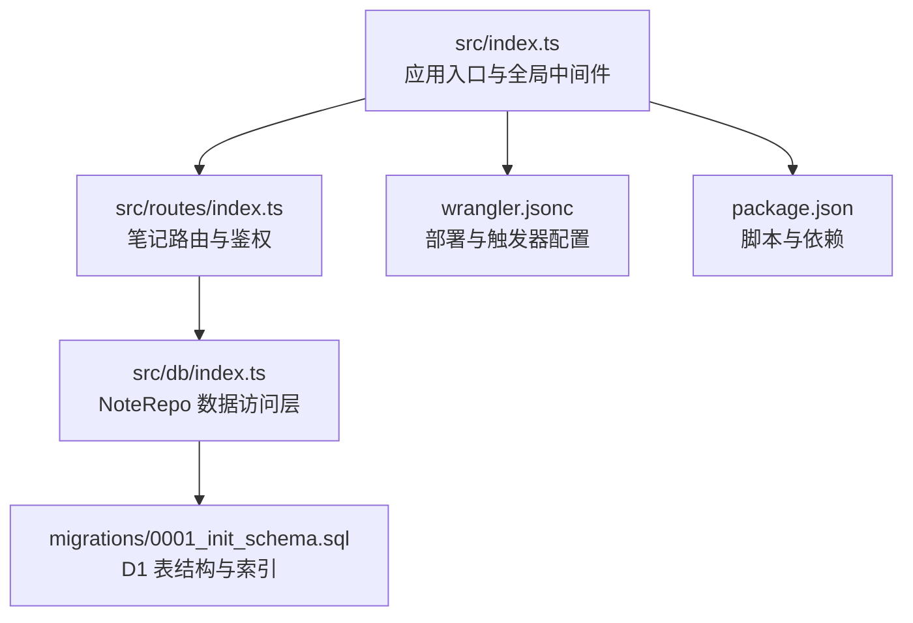
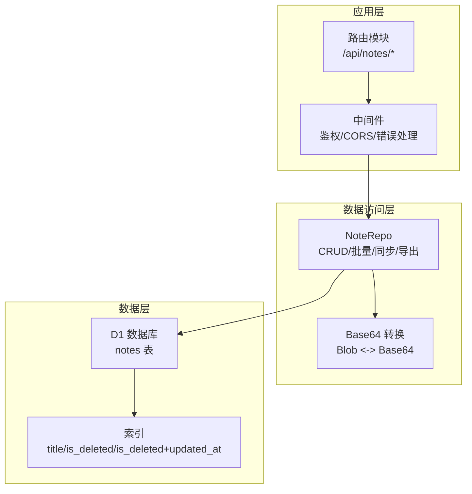
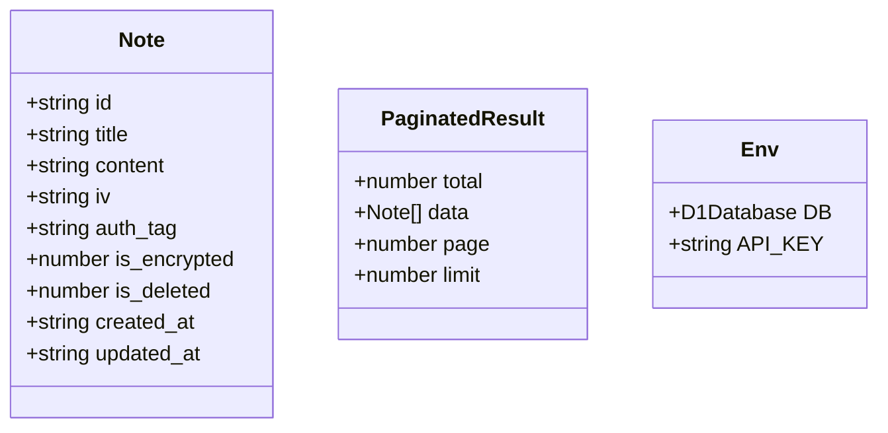
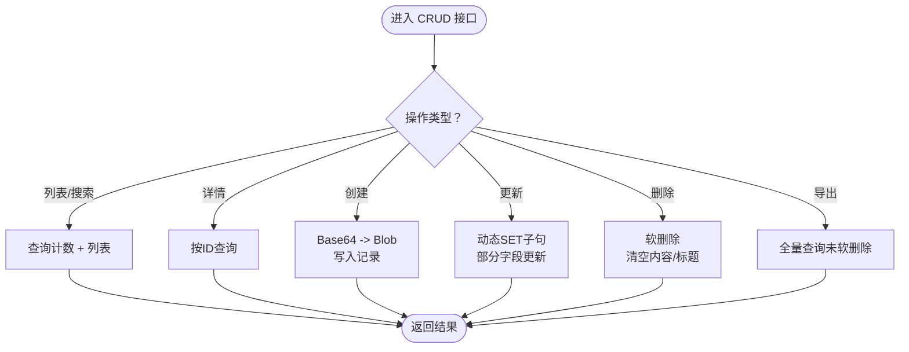
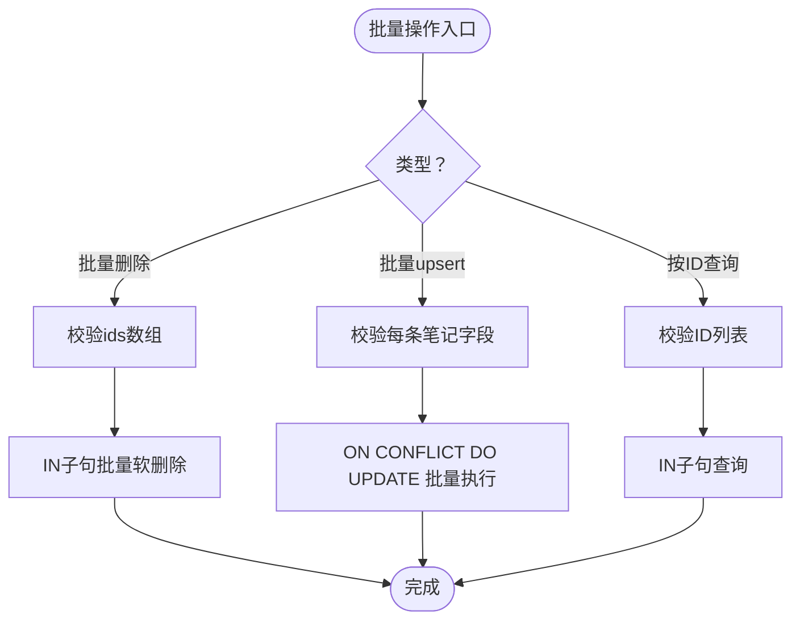
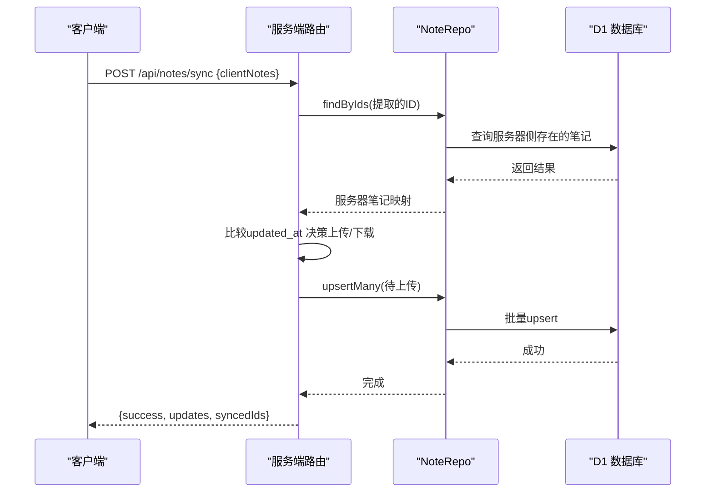
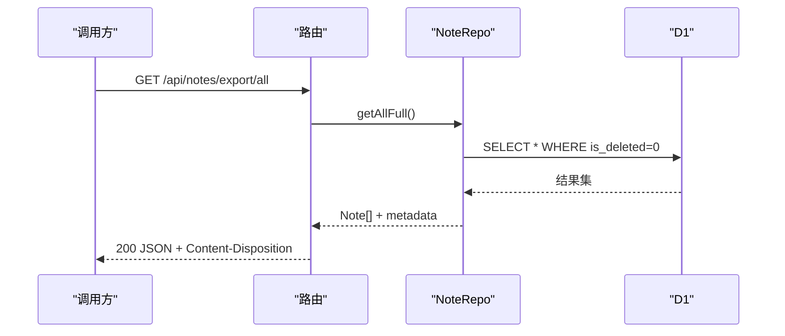
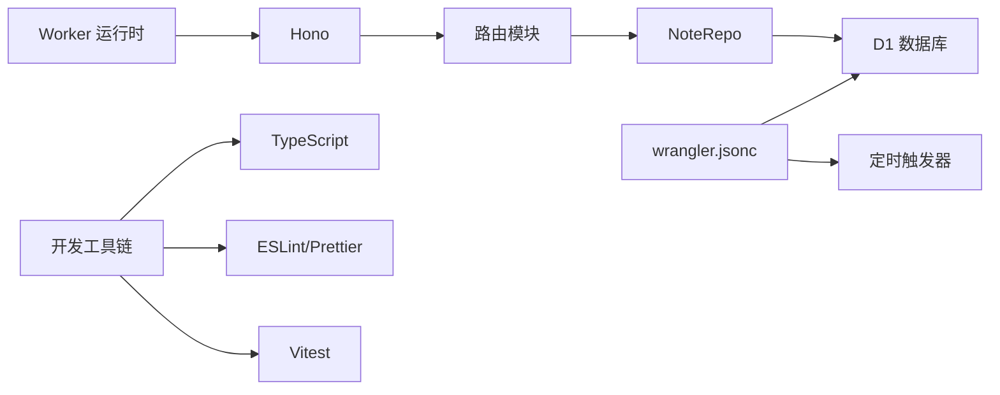

# 核心功能实现

<cite>
**本文引用的文件**
- [src/index.ts](file://src/index.ts)
- [src/db/index.ts](file://src/db/index.ts)
- [src/routes/index.ts](file://src/routes/index.ts)
- [migrations/0001_init_schema.sql](file://migrations/0001_init_schema.sql)
- [wrangler.jsonc](file://wrangler.jsonc)
- [package.json](file://package.json)
- [api-doc.md](file://api-doc.md)
- [test/index.spec.ts](file://test/index.spec.ts)
</cite>

## 目录

1. [简介](#简介)
2. [项目结构](#项目结构)
3. [核心组件](#核心组件)
4. [架构总览](#架构总览)
5. [详细组件分析](#详细组件分析)
6. [依赖分析](#依赖分析)
7. [性能考虑](#性能考虑)
8. [故障排查指南](#故障排查指南)
9. [结论](#结论)
10. [附录](#附录)

## 简介

本文件面向Notes Server的核心功能，系统性阐述笔记CRUD操作、批量操作、数据同步算法与数据导出功能的实现细节。文档从接口设计、领域模型、数据流、错误处理、性能与扩展性等维度进行深入解析，并提供可视化图示与实践建议，帮助初学者快速上手，同时为有经验的开发者提供足够的技术深度。

## 项目结构

项目采用基于文件的分层组织：入口应用负责路由挂载与全局中间件；路由模块承载业务端点；数据访问层封装D1数据库交互；迁移脚本定义表结构与索引；配置文件描述部署与触发器；测试覆盖关键路由行为。

图表来源

- [src/index.ts](file://src/index.ts#L38-L40)
- [src/routes/index.ts](file://src/routes/index.ts#L1-L15)
- [src/db/index.ts](file://src/db/index.ts#L43-L250)
- [migrations/0001_init_schema.sql](file://migrations/0001_init_schema.sql#L1-L17)
- [wrangler.jsonc](file://wrangler.jsonc#L1-L54)
- [package.json](file://package.json#L1-L41)

章节来源

- [src/index.ts](file://src/index.ts#L1-L105)
- [src/routes/index.ts](file://src/routes/index.ts#L1-L234)
- [src/db/index.ts](file://src/db/index.ts#L1-L251)
- [migrations/0001_init_schema.sql](file://migrations/0001_init_schema.sql#L1-L17)
- [wrangler.jsonc](file://wrangler.jsonc#L1-L54)
- [package.json](file://package.json#L1-L41)

## 核心组件

- 应用入口与环境绑定：定义环境变量接口（如D1数据库与API密钥），注册CORS与全局错误处理，暴露定时任务钩子。
- 路由模块：统一鉴权中间件，提供笔记列表、详情、创建、更新、删除、批量删除、同步、导出、批量插入/更新等端点。
- 数据访问层（NoteRepo）：封装D1查询、插入、更新、软删除、批量删除、全量导出、upsert批量写入、按ID集合查询等。
- 数据库迁移：定义notes表结构、主键、字段类型、默认值与多处索引。
- 部署与触发器：通过Wrangler配置D1绑定、定时触发器、可观测性等。

章节来源

- [src/index.ts](file://src/index.ts#L8-L11)
- [src/routes/index.ts](file://src/routes/index.ts#L7-L15)
- [src/db/index.ts](file://src/db/index.ts#L43-L250)
- [migrations/0001_init_schema.sql](file://migrations/0001_init_schema.sql#L1-L17)
- [wrangler.jsonc](file://wrangler.jsonc#L13-L24)

## 架构总览

整体采用“路由-仓库-数据库”的分层架构，路由层负责鉴权与参数校验，仓库层负责数据转换与SQL执行，数据库层为Cloudflare D1。

图表来源

- [src/routes/index.ts](file://src/routes/index.ts#L1-L234)
- [src/db/index.ts](file://src/db/index.ts#L1-L251)
- [migrations/0001_init_schema.sql](file://migrations/0001_init_schema.sql#L1-L17)

## 详细组件分析

### 领域模型与数据结构

- Note对象：包含唯一ID、标题、内容（Base64编码的二进制）、可选的初始化向量与认证标签、加密标记、软删除标记、创建与更新时间。
- 分页结果：包含总数、数据列表、当前页与每页大小。
- 环境绑定：DB（D1数据库）、API_KEY（鉴权令牌）。

图表来源

- [src/index.ts](file://src/index.ts#L16-L36)

章节来源

- [src/index.ts](file://src/index.ts#L16-L36)

### 笔记CRUD实现

- 列表与搜索：支持关键词搜索、分页查询，内部使用COUNT与LIMIT/OFFSET组合，批量执行两条语句以减少往返。
- 详情查询：按ID与软删除过滤条件查询单条记录。
- 创建：接收Base64内容与可选IV/认证标签，转换为二进制后写入，设置加密标记与时间戳。
- 更新：动态拼接SET子句，仅对传入字段更新，支持部分字段更新。
- 删除：软删除策略，更新is_deleted并清空内容与标题，同时更新时间戳。
- 全量导出：导出所有未软删除笔记，返回JSON附件响应。

图表来源

- [src/db/index.ts](file://src/db/index.ts#L45-L91)
- [src/db/index.ts](file://src/db/index.ts#L94-L97)
- [src/db/index.ts](file://src/db/index.ts#L100-L123)
- [src/db/index.ts](file://src/db/index.ts#L125-L176)
- [src/db/index.ts](file://src/db/index.ts#L179-L183)
- [src/db/index.ts](file://src/db/index.ts#L194-L200)

章节来源

- [src/db/index.ts](file://src/db/index.ts#L43-L250)

### 批量操作处理机制

- 批量删除：校验请求体为非空数组且每个元素为非空字符串，构造IN子句批量更新软删除标记。
- 批量插入/更新：校验每条笔记的必要字段，使用ON CONFLICT DO UPDATE实现upsert，批量执行提升吞吐。
- 按ID集合查询：支持按客户端提供的ID列表查询服务器侧存在的笔记，用于同步比对。

图表来源

- [src/routes/index.ts](file://src/routes/index.ts#L116-L136)
- [src/routes/index.ts](file://src/routes/index.ts#L199-L231)
- [src/db/index.ts](file://src/db/index.ts#L186-L191)
- [src/db/index.ts](file://src/db/index.ts#L203-L237)
- [src/db/index.ts](file://src/db/index.ts#L240-L249)

章节来源

- [src/routes/index.ts](file://src/routes/index.ts#L116-L136)
- [src/routes/index.ts](file://src/routes/index.ts#L199-L231)
- [src/db/index.ts](file://src/db/index.ts#L186-L249)

### 数据同步算法

- 输入：客户端提交的clientNotes数组。
- 步骤：
  1. 提取客户端笔记ID，查询服务器侧已存在笔记，构建ID->笔记映射。
  2. 遍历客户端笔记：
     - 若服务器无该ID：加入待上传列表。
     - 若存在：比较客户端与服务器的updated_at，若客户端更旧则加入待下载列表。
  3. 对待上传列表执行批量upsert。
  4. 返回待下载列表与已同步的ID列表。

图表来源

- [src/routes/index.ts](file://src/routes/index.ts#L139-L197)
- [src/db/index.ts](file://src/db/index.ts#L203-L237)
- [src/db/index.ts](file://src/db/index.ts#L240-L249)

章节来源

- [src/routes/index.ts](file://src/routes/index.ts#L139-L197)
- [src/db/index.ts](file://src/db/index.ts#L203-L249)

### 数据导出功能

- 端点：GET /api/notes/export/all
- 行为：查询所有未软删除笔记，设置Content-Disposition为附件，返回JSON结构，包含成功标志、时间戳、数量与数据列表。
- 使用场景：备份、迁移、审计等。

图表来源

- [src/routes/index.ts](file://src/routes/index.ts#L18-L28)
- [src/db/index.ts](file://src/db/index.ts#L194-L200)

章节来源

- [src/routes/index.ts](file://src/routes/index.ts#L18-L28)
- [src/db/index.ts](file://src/db/index.ts#L194-L200)

### 接口设计与参数规范

- 鉴权：所有端点需在Authorization头中携带Bearer API_KEY。
- 查询参数：
  - GET /api/notes?page=整数&limit=整数&search=字符串
  - limit最小为1，最大为100。
- 请求体：
  - POST /api/notes：必填title与content，可选iv、auth_tag、is_encrypted、created_at、updated_at。
  - PATCH /api/notes/:id：可选title/content/iv/auth_tag/is_encrypted/updated_at。
  - DELETE /api/notes/batch：{ids:[string,...]}。
  - POST /api/notes/batch：{notes:[{id,title,content,...},...]}。
  - POST /api/notes/sync：{clientNotes:[{id,title,content,...}]}

章节来源

- [src/routes/index.ts](file://src/routes/index.ts#L31-L37)
- [src/routes/index.ts](file://src/routes/index.ts#L47-L82)
- [src/routes/index.ts](file://src/routes/index.ts#L85-L106)
- [src/routes/index.ts](file://src/routes/index.ts#L116-L136)
- [src/routes/index.ts](file://src/routes/index.ts#L199-L231)
- [src/routes/index.ts](file://src/routes/index.ts#L139-L197)

### 错误处理与返回值

- 统一错误响应：success=false、error、message、timestamp。
- 常见HTTP状态：
  - 401：API Key无效
  - 404：NOT_FOUND
  - 400：BAD_REQUEST（参数缺失/格式错误）
  - 500：InternalError（服务器内部错误）

章节来源

- [src/index.ts](file://src/index.ts#L41-L63)
- [src/routes/index.ts](file://src/routes/index.ts#L8-L15)
- [api-doc.md](file://api-doc.md#L442-L463)

## 依赖分析

- 框架与运行时：Hono作为Web框架，Cloudflare Workers Runtime，D1数据库。
- 配置与部署：Wrangler负责D1绑定、定时触发器、可观测性等。
- 开发工具：TypeScript、ESLint、Prettier、Vitest（Workers Pool）。

图表来源

- [src/index.ts](file://src/index.ts#L1-L3)
- [wrangler.jsonc](file://wrangler.jsonc#L13-L24)
- [package.json](file://package.json#L18-L31)

章节来源

- [package.json](file://package.json#L18-L31)
- [wrangler.jsonc](file://wrangler.jsonc#L1-L54)

## 性能考虑

- 查询优化：
  - 列表查询使用COUNT与LIMIT/OFFSET，配合批量执行两条语句，减少往返。
  - 索引：title、is_deleted、is_deleted+updated_at复合索引，有利于搜索、软删除过滤与排序。
- 写入优化：
  - 批量upsert使用ON CONFLICT DO UPDATE，避免逐条写入。
  - 批量删除使用IN子句，减少SQL语句数量。
- 数据传输：
  - 内容以Base64字符串传输，注意体积与CPU开销；可结合客户端压缩策略。
- 定时任务：
  - 定期清理软删除超过保留期的笔记，释放空间并保持查询效率。

章节来源

- [src/db/index.ts](file://src/db/index.ts#L65-L91)
- [src/db/index.ts](file://src/db/index.ts#L203-L237)
- [migrations/0001_init_schema.sql](file://migrations/0001_init_schema.sql#L14-L17)
- [src/index.ts](file://src/index.ts#L71-L104)

## 故障排查指南

- 鉴权失败（401）：
  - 检查Authorization头是否为Bearer API_KEY，确认API_KEY已在环境变量中正确配置。
- 参数错误（400）：
  - 创建/更新/批量端点需满足字段校验；检查请求体格式与字段类型。
- 资源不存在（404）：
  - 确认路径与端点正确；检查软删除策略导致的记录不可见。
- 同步异常（500）：
  - 检查clientNotes格式与ID一致性；关注upsert过程中的冲突处理。
- 导出为空：
  - 确认数据库中存在未软删除笔记；检查筛选条件与权限。

章节来源

- [src/routes/index.ts](file://src/routes/index.ts#L8-L15)
- [src/routes/index.ts](file://src/routes/index.ts#L49-L51)
- [src/routes/index.ts](file://src/routes/index.ts#L139-L197)
- [src/db/index.ts](file://src/db/index.ts#L194-L200)

## 结论

Notes Server以简洁清晰的分层架构实现了笔记的完整生命周期管理：从CRUD到批量操作、从数据同步到导出备份，均围绕NoteRepo与D1展开。通过合理的索引设计、批量写入与软删除策略，系统在可用性与性能之间取得平衡。建议在生产环境中结合客户端压缩、缓存与监控，进一步优化用户体验与运维效率。

## 附录

- 配置项与环境变量
  - D1数据库绑定：DB（notes-db）
  - API密钥：API_KEY（通过Authorization头传递）
  - 定时触发器：每日固定时间清理软删除笔记
- 关键端点一览
  - GET /api/notes
  - GET /api/notes/:id
  - POST /api/notes
  - PATCH /api/notes/:id
  - DELETE /api/notes/:id
  - DELETE /api/notes/batch
  - POST /api/notes/sync
  - GET /api/notes/export/all
  - POST /api/notes/batch

章节来源

- [wrangler.jsonc](file://wrangler.jsonc#L13-L24)
- [api-doc.md](file://api-doc.md#L42-L440)
