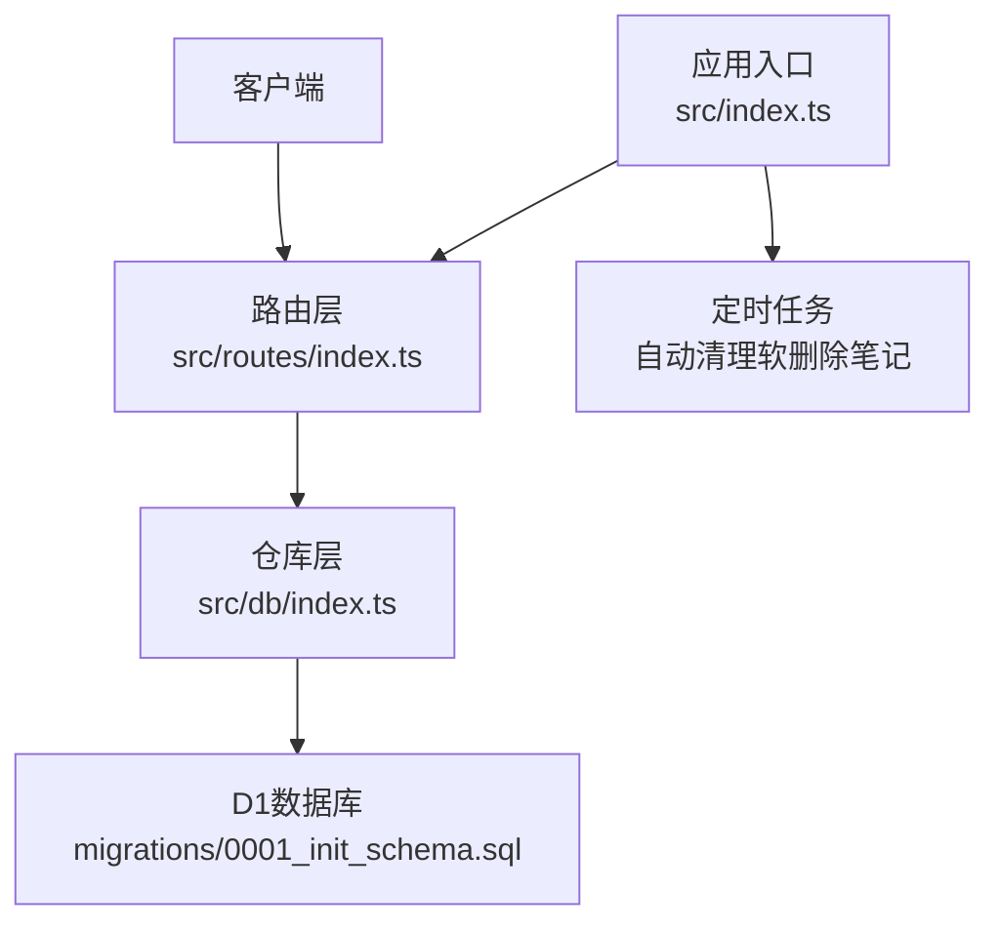
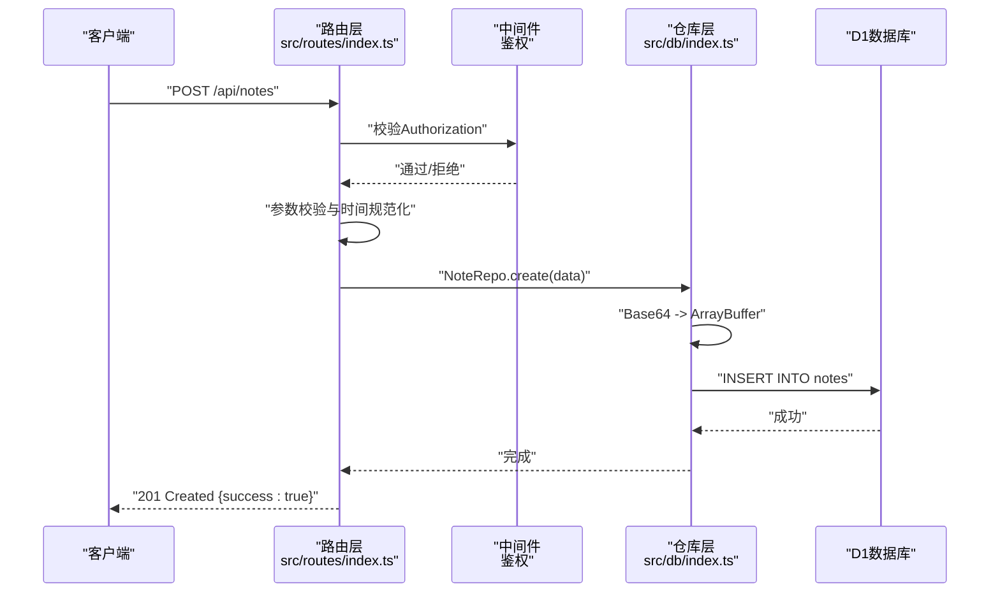
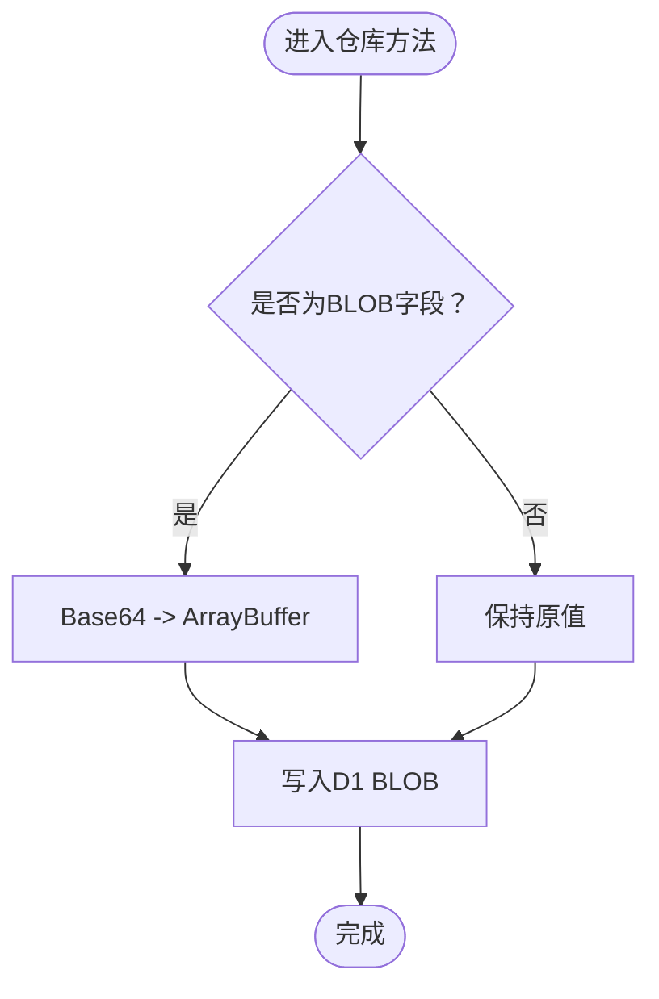
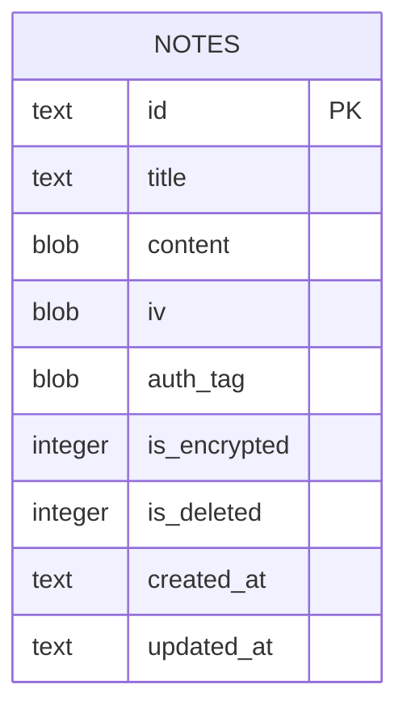
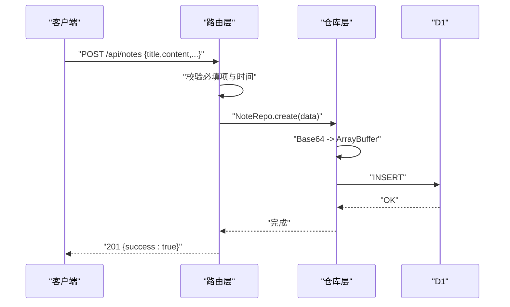
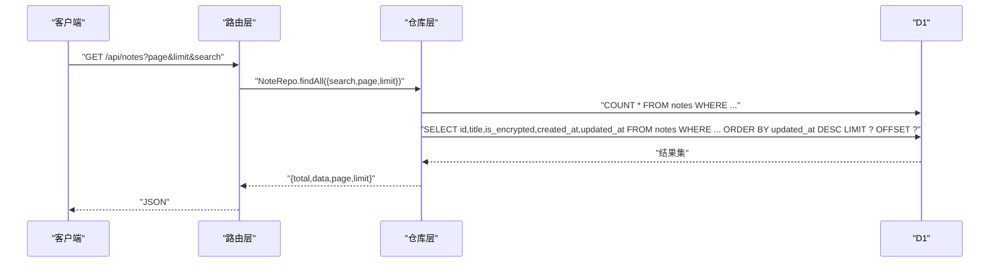
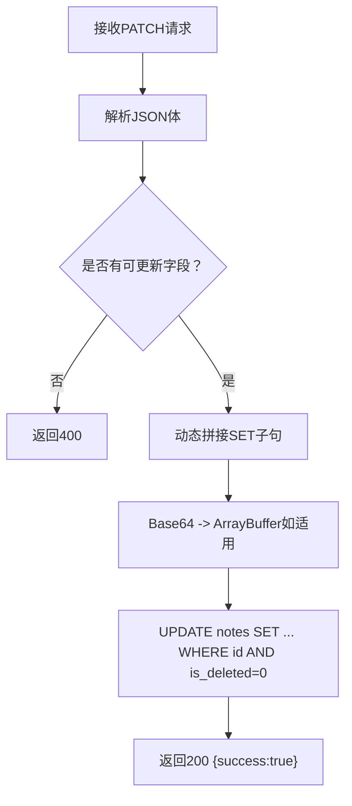
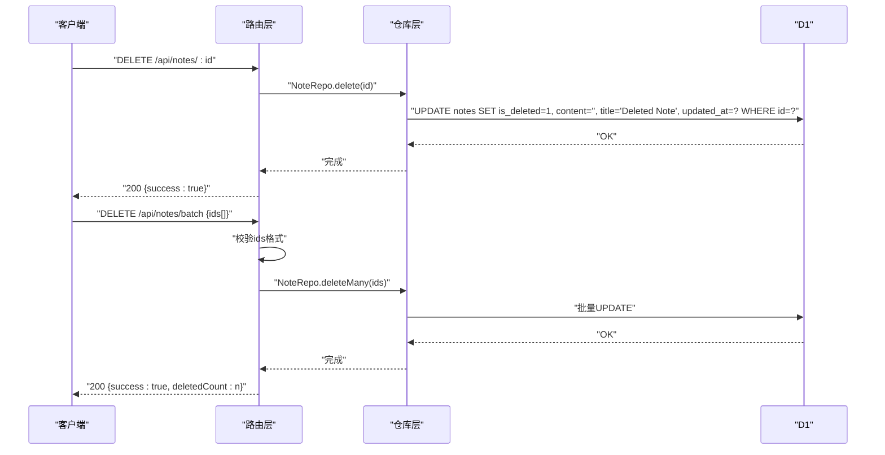
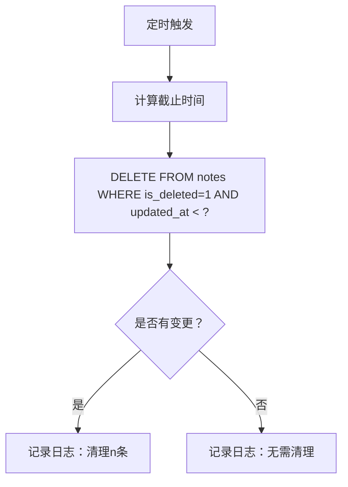
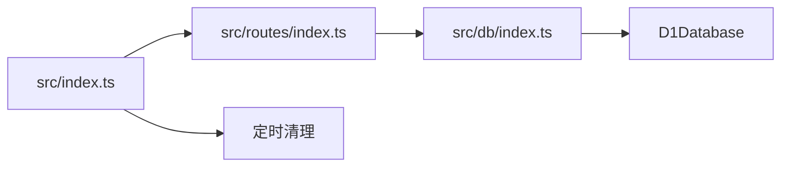

# 笔记CRUD操作

<cite>
**本文引用的文件**
- [src/index.ts](file://src/index.ts)
- [src/db/index.ts](file://src/db/index.ts)
- [src/routes/index.ts](file://src/routes/index.ts)
- [migrations/0001_init_schema.sql](file://migrations/0001_init_schema.sql)
- [api-doc.md](file://api-doc.md)
- [test/index.spec.ts](file://test/index.spec.ts)
- [package.json](file://package.json)
</cite>

## 目录

1. [简介](#简介)
2. [项目结构](#项目结构)
3. [核心组件](#核心组件)
4. [架构总览](#架构总览)
5. [详细组件分析](#详细组件分析)
6. [依赖关系分析](#依赖关系分析)
7. [性能考虑](#性能考虑)
8. [故障排查指南](#故障排查指南)
9. [结论](#结论)
10. [附录](#附录)

## 简介

本文件针对笔记CRUD（创建、读取、更新、删除）操作进行深入实现文档，涵盖：

- Base64编码/解码机制与数据库BLOB字段的双向转换
- 数据库操作封装与事务批处理
- 软删除实现与定时清理策略
- 分页查询与全文检索
- 与路由层的交互关系与数据模型转换
- 具体的参数格式、返回值类型与错误处理机制
- 性能优化策略与最佳实践

## 项目结构

该服务采用Hono框架，按“路由-仓库-数据库”分层组织：

- 路由层负责鉴权、参数校验、请求/响应格式化
- 仓库层封装D1数据库访问与数据转换
- 数据库层使用Cloudflare D1，表结构包含BLOB字段用于存储加密内容

图表来源

- [src/index.ts](file://src/index.ts#L38-L75)
- [src/routes/index.ts](file://src/routes/index.ts#L1-L234)
- [src/db/index.ts](file://src/db/index.ts#L43-L250)
- [migrations/0001_init_schema.sql](file://migrations/0001_init_schema.sql#L1-L17)

章节来源

- [src/index.ts](file://src/index.ts#L1-L105)
- [src/routes/index.ts](file://src/routes/index.ts#L1-L234)
- [src/db/index.ts](file://src/db/index.ts#L1-L251)
- [migrations/0001_init_schema.sql](file://migrations/0001_init_schema.sql#L1-L17)

## 核心组件

- 应用入口与环境绑定：定义Env接口（包含D1数据库与API密钥），全局错误与404处理，定时清理软删除笔记
- 路由层：鉴权中间件、笔记CRUD与批量操作、导出与同步接口
- 仓库层：NoteRepo封装所有数据库操作，含Base64与BLOB互转、软删除、分页查询、批量upsert等
- 数据库层：notes表结构与索引，BLOB字段存储加密内容

章节来源

- [src/index.ts](file://src/index.ts#L8-L36)
- [src/routes/index.ts](file://src/routes/index.ts#L1-L234)
- [src/db/index.ts](file://src/db/index.ts#L43-L250)
- [migrations/0001_init_schema.sql](file://migrations/0001_init_schema.sql#L1-L17)

## 架构总览

下图展示了从HTTP请求到数据库写入的完整流程，以及Base64/BLOB转换的关键节点。

图表来源

- [src/routes/index.ts](file://src/routes/index.ts#L46-L82)
- [src/db/index.ts](file://src/db/index.ts#L99-L123)

## 详细组件分析

### Base64与BLOB转换机制

- 编码方向：前端传入Base64字符串，后端在入库前转换为ArrayBuffer写入D1 BLOB字段
- 解码方向：从D1读取时，将BLOB转换为Base64字符串返回给客户端
- 关键函数：
  - Base64转ArrayBuffer：用于入库前的解码
  - ArrayBuffer转Base64：用于出库时的编码
  - convertNoteFromDb：统一将数据库行转换为Note对象，自动完成BLOB到Base64的转换

图表来源

- [src/db/index.ts](file://src/db/index.ts#L10-L29)
- [src/db/index.ts](file://src/db/index.ts#L34-L41)

章节来源

- [src/db/index.ts](file://src/db/index.ts#L10-L41)

### 数据模型与表结构

- Note对象字段：id、title、content（Base64）、iv（Base64可选）、auth_tag（Base64可选）、is_encrypted、is_deleted、created_at、updated_at
- 表结构要点：content/iv/auth_tag为BLOB；is_deleted默认0；索引覆盖title、is_deleted、(is_deleted, updated_at DESC)

图表来源

- [migrations/0001_init_schema.sql](file://migrations/0001_init_schema.sql#L1-L17)

章节来源

- [src/index.ts](file://src/index.ts#L16-L26)
- [migrations/0001_init_schema.sql](file://migrations/0001_init_schema.sql#L1-L17)

### CRUD实现详解

#### 创建笔记（create）

- 路由：POST /api/notes
- 参数校验：标题与内容必填；可选created_at/updated_at，若提供则进行日期有效性校验并规范化
- 写入逻辑：将Base64内容转换为ArrayBuffer后写入D1，is_deleted固定为0
- 返回：201 Created，{success:true}

图表来源

- [src/routes/index.ts](file://src/routes/index.ts#L46-L82)
- [src/db/index.ts](file://src/db/index.ts#L99-L123)

章节来源

- [src/routes/index.ts](file://src/routes/index.ts#L46-L82)
- [src/db/index.ts](file://src/db/index.ts#L99-L123)

#### 读取笔记（findById/findAll）

- findById：按id查询，仅返回is_deleted=0的记录，自动将BLOB字段转换为Base64
- findAll：分页查询，支持可选search（title/content模糊匹配），同时返回总数与分页信息
- 查询策略：使用COUNT与LIMIT/OFFSET双语句并行批处理，减少往返次数

图表来源

- [src/routes/index.ts](file://src/routes/index.ts#L30-L37)
- [src/db/index.ts](file://src/db/index.ts#L44-L91)

章节来源

- [src/routes/index.ts](file://src/routes/index.ts#L30-L37)
- [src/db/index.ts](file://src/db/index.ts#L44-L91)

#### 更新笔记（update）

- 路由：PATCH /api/notes/:id
- 支持字段增量更新：title/content/iv/auth_tag/is_encrypted/updated_at
- 更新策略：动态拼接SET子句，仅对提供的字段进行更新；若无字段提供则返回400
- 时间处理：updated_at可选，若提供则进行日期有效性校验

图表来源

- [src/routes/index.ts](file://src/routes/index.ts#L84-L106)
- [src/db/index.ts](file://src/db/index.ts#L124-L176)

章节来源

- [src/routes/index.ts](file://src/routes/index.ts#L84-L106)
- [src/db/index.ts](file://src/db/index.ts#L124-L176)

#### 删除笔记（delete）

- 路由：DELETE /api/notes/:id
- 实现：软删除，将is_deleted置为1，清空content与title，更新updated_at
- 批量删除：DELETE /api/notes/batch，支持传入ID数组，进行批量软删除

图表来源

- [src/routes/index.ts](file://src/routes/index.ts#L108-L136)
- [src/db/index.ts](file://src/db/index.ts#L178-L191)

章节来源

- [src/routes/index.ts](file://src/routes/index.ts#L108-L136)
- [src/db/index.ts](file://src/db/index.ts#L178-L191)

### 软删除与定时清理

- 软删除：删除操作不物理移除记录，而是标记is_deleted=1并清空敏感字段
- 定时清理：每30天清理一次超过保留期的软删除笔记，清理逻辑在应用入口的scheduled事件中触发

图表来源

- [src/index.ts](file://src/index.ts#L77-L104)

章节来源

- [src/index.ts](file://src/index.ts#L77-L104)

### 分页查询与搜索

- 分页参数：page（默认1）、limit（默认20，最大100）
- 搜索条件：可选search，模糊匹配title或content
- 查询策略：COUNT与主查询并行批处理，避免多次往返

章节来源

- [src/routes/index.ts](file://src/routes/index.ts#L30-L37)
- [src/db/index.ts](file://src/db/index.ts#L44-L91)

### 与路由层的交互与数据模型转换

- 鉴权中间件：所有路由均需Authorization头携带Bearer API_KEY
- 数据模型转换：路由层负责参数校验与时间规范化，仓库层负责Base64与BLOB互转
- 错误处理：统一的全局onError与notFound处理，返回标准错误结构

章节来源

- [src/routes/index.ts](file://src/routes/index.ts#L7-L15)
- [src/index.ts](file://src/index.ts#L41-L63)
- [src/db/index.ts](file://src/db/index.ts#L34-L41)

## 依赖关系分析

- 路由依赖仓库：所有CRUD操作均由NoteRepo封装
- 仓库依赖D1：所有数据库操作基于D1 prepare/bind/run
- 应用入口依赖路由与定时任务：注册路由与调度清理任务

图表来源

- [src/routes/index.ts](file://src/routes/index.ts#L1-L234)
- [src/db/index.ts](file://src/db/index.ts#L43-L250)
- [src/index.ts](file://src/index.ts#L38-L75)

章节来源

- [src/routes/index.ts](file://src/routes/index.ts#L1-L234)
- [src/db/index.ts](file://src/db/index.ts#L43-L250)
- [src/index.ts](file://src/index.ts#L38-L75)

## 性能考虑

- 批处理查询：分页查询使用db.batch并行执行COUNT与主查询，降低延迟
- 索引优化：为title、is_deleted、(is_deleted, updated_at DESC)建立索引，提升查询效率
- BLOB大小控制：content/iv/auth_tag为BLOB，建议客户端侧合理压缩与分片策略
- 定时清理：定期清理软删除数据，避免表膨胀影响查询性能
- 并发与限流：路由层对limit进行上限控制，防止过大请求导致资源耗尽

章节来源

- [src/db/index.ts](file://src/db/index.ts#L65-L80)
- [migrations/0001_init_schema.sql](file://migrations/0001_init_schema.sql#L14-L17)
- [src/routes/index.ts](file://src/routes/index.ts#L33-L34)

## 故障排查指南

- 401 Unauthorized：检查Authorization头是否为Bearer API_KEY
- 400 BAD_REQUEST：检查请求体字段完整性与格式（如ids数组、笔记对象字段）
- 404 NOT_FOUND：确认路径与资源存在性
- 500 InternalError：查看全局错误处理器返回的标准错误结构
- 测试参考：单元测试覆盖根路径404、鉴权失败、批量删除与批量插入路由可达性

章节来源

- [src/routes/index.ts](file://src/routes/index.ts#L7-L15)
- [src/index.ts](file://src/index.ts#L41-L63)
- [test/index.spec.ts](file://test/index.spec.ts#L9-L103)

## 结论

本实现通过清晰的分层设计与完善的错误处理，提供了完整的笔记CRUD能力。Base64与BLOB的双向转换确保了加密内容的安全存储与传输；软删除与定时清理保障了数据生命周期管理；分页查询与索引优化提升了大规模数据下的性能表现。建议在生产环境中配合客户端侧的加密与压缩策略，进一步提升安全性与性能。

## 附录

### API使用示例与参数说明

- 获取笔记列表：GET /api/notes?page=1&limit=20&search=关键词
- 获取笔记详情：GET /api/notes/{id}
- 创建笔记：POST /api/notes（请求体包含id/title/content/iv/auth_tag/is_encrypted/created_at/updated_at）
- 更新笔记：PATCH /api/notes/{id}（可选字段：title/content/iv/auth_tag/is_encrypted/updated_at）
- 删除笔记：DELETE /api/notes/{id}
- 批量删除：DELETE /api/notes/batch（请求体：{ids:[...]})
- 笔记同步：POST /api/notes/sync（请求体：{clientNotes:[...]})
- 导出所有笔记：GET /api/notes/export/all

章节来源

- [api-doc.md](file://api-doc.md#L42-L482)

### 数据模型与返回值类型

- Note对象：id、title、content(Base64)、iv(Base64可选)、auth_tag(Base64可选)、is_encrypted、is_deleted、created_at、updated_at
- 分页返回：total、data、page、limit

章节来源

- [src/index.ts](file://src/index.ts#L16-L36)
- [api-doc.md](file://api-doc.md#L14-L41)
