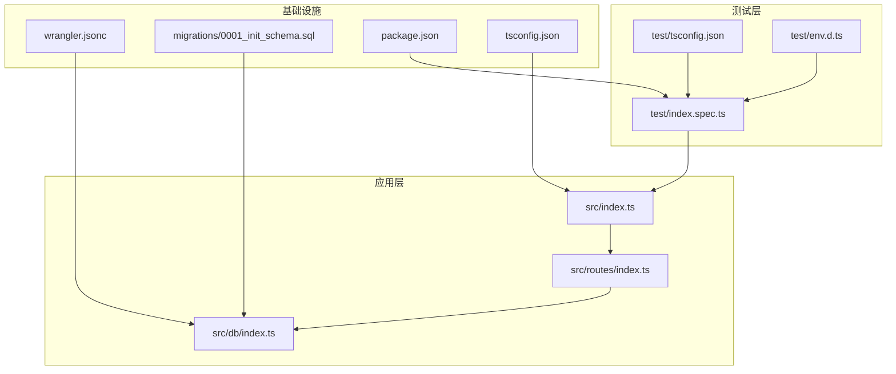
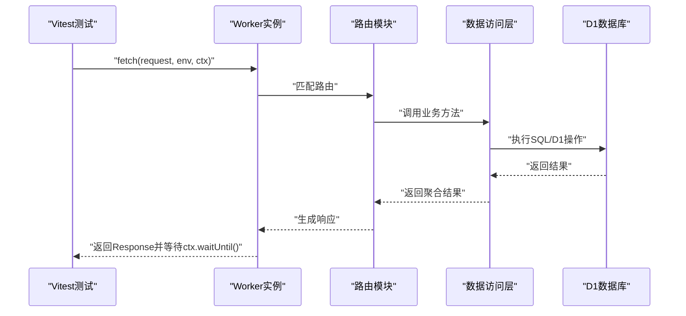
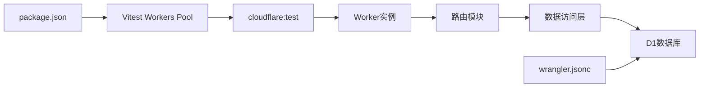

# 测试策略

<cite>
**本文引用的文件**
- [package.json](file://package.json)
- [vitest.config.mts](file://vitest.config.mts)
- [test/index.spec.ts](file://test/index.spec.ts)
- [test/env.d.ts](file://test/env.d.ts)
- [test/tsconfig.json](file://test/tsconfig.json)
- [src/index.ts](file://src/index.ts)
- [src/routes/index.ts](file://src/routes/index.ts)
- [src/db/index.ts](file://src/db/index.ts)
- [migrations/0001_init_schema.sql](file://migrations/0001_init_schema.sql)
- [wrangler.jsonc](file://wrangler.jsonc)
- [tsconfig.json](file://tsconfig.json)
- [.dev.vars](file://.dev.vars)
- [eslint.config.js](file://eslint.config.js)
</cite>

## 目录

1. [引言](#引言)
2. [项目结构](#项目结构)
3. [核心组件](#核心组件)
4. [架构总览](#架构总览)
5. [详细组件分析](#详细组件分析)
6. [依赖关系分析](#依赖关系分析)
7. [性能考量](#性能考量)
8. [故障排查指南](#故障排查指南)
9. [结论](#结论)
10. [附录](#附录)

## 引言

本测试策略文档面向Notes Server项目，目标是建立完善的单元测试与集成测试体系，覆盖路由、业务逻辑、数据库访问层以及定时任务等关键路径。文档涵盖测试环境配置、测试数据管理、模拟策略、测试用例示例、覆盖率要求、测试脚本使用方法与CI/CD集成建议，并提供调试技巧与常见问题解决方案，帮助开发者编写高质量的测试代码。

## 项目结构

项目采用Cloudflare Workers + Hono框架，使用Vitest配合Cloudflare Workers Pool进行端到端测试。测试目录位于test下，核心源码位于src目录，数据库迁移脚本位于migrations目录，部署与D1配置在wrangler.jsonc中。

图表来源

- [test/index.spec.ts](file://test/index.spec.ts#L1-L104)
- [src/index.ts](file://src/index.ts#L1-L105)
- [src/routes/index.ts](file://src/routes/index.ts#L1-L234)
- [src/db/index.ts](file://src/db/index.ts#L1-L251)
- [wrangler.jsonc](file://wrangler.jsonc#L1-L54)
- [migrations/0001_init_schema.sql](file://migrations/0001_init_schema.sql#L1-L17)
- [package.json](file://package.json#L1-L41)
- [test/tsconfig.json](file://test/tsconfig.json#L1-L9)
- [test/env.d.ts](file://test/env.d.ts#L1-L4)
- [tsconfig.json](file://tsconfig.json#L1-L46)

章节来源

- [package.json](file://package.json#L1-L41)
- [vitest.config.mts](file://vitest.config.mts#L1-L12)
- [test/index.spec.ts](file://test/index.spec.ts#L1-L104)
- [src/index.ts](file://src/index.ts#L1-L105)
- [src/routes/index.ts](file://src/routes/index.ts#L1-L234)
- [src/db/index.ts](file://src/db/index.ts#L1-L251)
- [migrations/0001_init_schema.sql](file://migrations/0001_init_schema.sql#L1-L17)
- [wrangler.jsonc](file://wrangler.jsonc#L1-L54)
- [test/tsconfig.json](file://test/tsconfig.json#L1-L9)
- [test/env.d.ts](file://test/env.d.ts#L1-L4)
- [tsconfig.json](file://tsconfig.json#L1-L46)

## 核心组件

- 应用入口与中间件：应用通过Hono实例注册CORS中间件与路由，统一处理404与错误响应；提供定时任务入口以清理软删除笔记。
- 路由模块：实现鉴权中间件、笔记增删改查、批量操作、导出备份、同步接口等。
- 数据访问层：封装NoteRepo，负责分页查询、按ID查询、创建、更新、软删除、批量软删除、全量导出、批量upsert、按ID集合查询等。
- 测试配置：Vitest使用Cloudflare Workers Pool，结合Wrangler配置运行Worker；测试类型声明与编译配置独立于主工程。

章节来源

- [src/index.ts](file://src/index.ts#L1-L105)
- [src/routes/index.ts](file://src/routes/index.ts#L1-L234)
- [src/db/index.ts](file://src/db/index.ts#L1-L251)
- [vitest.config.mts](file://vitest.config.mts#L1-L12)
- [test/tsconfig.json](file://test/tsconfig.json#L1-L9)
- [test/env.d.ts](file://test/env.d.ts#L1-L4)

## 架构总览

测试架构围绕Vitest Workers Pool展开，通过cloudflare:test提供的API构造请求、执行fetch并等待上下文中的异步任务完成，从而验证路由与业务逻辑。数据库通过D1绑定，测试时可使用本地D1实例或远程D1实例，具体取决于部署配置。

图表来源

- [test/index.spec.ts](file://test/index.spec.ts#L1-L104)
- [src/index.ts](file://src/index.ts#L1-L105)
- [src/routes/index.ts](file://src/routes/index.ts#L1-L234)
- [src/db/index.ts](file://src/db/index.ts#L1-L251)

## 详细组件分析

### 单元测试策略

- 目标：验证路由鉴权、参数校验、错误处理、业务逻辑分支与数据转换。
- 方法：
  - 使用cloudflare:test提供的Request构造器与fetch调用，确保类型安全。
  - 使用createExecutionContext与waitOnExecutionContext确保异步任务完成后再断言。
  - 通过fakeEnv注入API密钥，绕过鉴权中间件进行功能测试。
  - 对NoteRepo的关键方法（如findAll、findById、create、update、delete、deleteMany、upsertMany、findByIds）进行纯函数式断言，避免真实数据库副作用。
- 建议用例：
  - 鉴权失败场景（缺失或错误的Authorization头）
  - 参数校验失败（缺少必要字段、非法ID、空数组等）
  - 正常流程（创建、更新、删除、批量操作、同步）
  - 错误处理（数据库异常、解析异常、404）

章节来源

- [test/index.spec.ts](file://test/index.spec.ts#L1-L104)
- [src/routes/index.ts](file://src/routes/index.ts#L1-L234)
- [src/db/index.ts](file://src/db/index.ts#L1-L251)

### 集成测试策略

- 目标：验证端到端流程，包括路由、鉴权、数据库交互、定时任务触发与清理。
- 方法：
  - 使用SELF.fetch发起真实HTTP请求，模拟外部客户端行为。
  - 使用wrangler d1 migrations apply命令在本地/远程应用初始Schema。
  - 在测试前后准备/清理测试数据，确保可重复性。
  - 针对定时任务，通过scheduled事件触发清理逻辑并断言日志与数据库变更。
- 建议用例：
  - 完整的笔记生命周期（创建、查询、更新、批量删除、导出备份）
  - 同步接口（客户端与服务端时间比较、冲突解决）
  - 批量upsert（数据完整性、去重、并发安全）

章节来源

- [test/index.spec.ts](file://test/index.spec.ts#L1-L104)
- [wrangler.jsonc](file://wrangler.jsonc#L1-L54)
- [migrations/0001_init_schema.sql](file://migrations/0001_init_schema.sql#L1-L17)

### 测试环境配置

- 运行时与池：Vitest使用@cloudflare/vitest-pool-workers，通过wrangler.jsonc定位Worker配置。
- 类型与声明：test/tsconfig.json引入Workers类型，test/env.d.ts扩展cloudflare:test的ProvidedEnv。
- 开发变量：.dev.vars提供API_KEY占位，可在本地开发时设置。
- 编译配置：tsconfig.json启用严格模式与类型检查，排除test目录，确保测试独立编译。

章节来源

- [vitest.config.mts](file://vitest.config.mts#L1-L12)
- [test/tsconfig.json](file://test/tsconfig.json#L1-L9)
- [test/env.d.ts](file://test/env.d.ts#L1-L4)
- [tsconfig.json](file://tsconfig.json#L1-L46)
- [.dev.vars](file://.dev.vars#L1-L2)

### 测试数据管理与模拟策略

- Schema准备：使用wrangler d1 migrations apply在本地或远程D1数据库应用初始Schema。
- 数据隔离：每个测试用例使用独立的请求与上下文，必要时在测试前插入测试数据并在结束后清理。
- 模拟策略：
  - 对外部依赖（如数据库）使用真实D1实例，但通过事务或测试专用表隔离。
  - 对第三方服务（如有）使用Mock或Fake实现，确保可预测性。
  - 对时间相关逻辑使用FakeTimers或固定时间戳，避免不确定性。
- 数据转换：NoteRepo包含Base64与ArrayBuffer互转工具，测试时需确保输入输出符合预期格式。

章节来源

- [migrations/0001_init_schema.sql](file://migrations/0001_init_schema.sql#L1-L17)
- [wrangler.jsonc](file://wrangler.jsonc#L1-L54)
- [src/db/index.ts](file://src/db/index.ts#L1-L251)

### 具体测试用例示例

- 路由存在性与鉴权：验证根路径返回404，/api/notes返回401（无API Key），/api/notes/batch支持POST/DELETE。
- 批量操作：构造包含多条笔记的JSON，断言返回状态码不为404；对批量删除断言返回成功与计数。
- 同步接口：构造客户端笔记列表，断言返回updates与syncedIds；验证时间比较逻辑。
- 数据访问层：对NoteRepo的findAll、findById、create、update、delete、deleteMany、upsertMany、findByIds分别编写断言，覆盖边界条件与异常情况。

章节来源

- [test/index.spec.ts](file://test/index.spec.ts#L1-L104)
- [src/routes/index.ts](file://src/routes/index.ts#L1-L234)
- [src/db/index.ts](file://src/db/index.ts#L1-L251)

### 测试覆盖率要求

- 覆盖率目标：语句覆盖率≥80%，分支覆盖率≥70%，函数覆盖率≥80%，行覆盖率≥80%。
- 关注重点：路由鉴权中间件、参数校验、错误处理、NoteRepo关键方法、定时任务清理逻辑。
- 工具：Vitest内置覆盖率报告，可通过配置输出HTML/Coverage.json等格式。

章节来源

- [package.json](file://package.json#L1-L41)
- [vitest.config.mts](file://vitest.config.mts#L1-L12)

### 测试脚本使用方法与CI/CD集成

- 本地测试：npm test运行Vitest；npm run db:setup应用本地D1迁移；npm run db:setup:prod应用远程D1迁移。
- CI/CD建议：
  - 安装依赖后先应用D1迁移，再运行测试。
  - 将API_KEY作为Secret注入，避免硬编码。
  - 并行执行不同测试套件（单元/集成），并收集覆盖率报告。
  - 失败时保留日志与数据库快照以便复盘。

章节来源

- [package.json](file://package.json#L1-L41)
- [wrangler.jsonc](file://wrangler.jsonc#L1-L54)

### 调试技巧与常见问题

- 调试技巧：
  - 使用console.warn/console.error输出中间状态，结合waitOnExecutionContext确保异步任务完成。
  - 对复杂路由（如同步接口）拆分断言点，逐步验证toUpload、toDownload与syncedIds。
  - 使用固定时间戳或FakeTimers稳定化时间相关测试。
- 常见问题：
  - 404未找到：确认路由前缀与路径是否正确，检查路由注册顺序。
  - 401鉴权失败：确认Authorization头格式与API_KEY值，确保fakeEnv正确注入。
  - 数据库迁移失败：检查wrangler.jsonc中的D1绑定与数据库ID，确认网络可达性。
  - 定时任务未触发：确认wrangler.jsonc中的triggers配置与兼容日期。

章节来源

- [test/index.spec.ts](file://test/index.spec.ts#L1-L104)
- [src/index.ts](file://src/index.ts#L1-L105)
- [wrangler.jsonc](file://wrangler.jsonc#L1-L54)

## 依赖关系分析

- 组件耦合：路由模块依赖数据访问层；应用入口依赖路由模块与中间件；测试依赖cloudflare:test与Vitest Workers Pool。
- 外部依赖：Hono用于路由与中间件；Cloudflare Workers Runtime；D1数据库；Vitest与@cloudflare/vitest-pool-workers。
- 可能的循环依赖：当前结构清晰，无明显循环依赖风险。

图表来源

- [vitest.config.mts](file://vitest.config.mts#L1-L12)
- [test/index.spec.ts](file://test/index.spec.ts#L1-L104)
- [src/index.ts](file://src/index.ts#L1-L105)
- [src/routes/index.ts](file://src/routes/index.ts#L1-L234)
- [src/db/index.ts](file://src/db/index.ts#L1-L251)
- [wrangler.jsonc](file://wrangler.jsonc#L1-L54)
- [package.json](file://package.json#L1-L41)

章节来源

- [package.json](file://package.json#L1-L41)
- [vitest.config.mts](file://vitest.config.mts#L1-L12)
- [src/index.ts](file://src/index.ts#L1-L105)
- [src/routes/index.ts](file://src/routes/index.ts#L1-L234)
- [src/db/index.ts](file://src/db/index.ts#L1-L251)
- [wrangler.jsonc](file://wrangler.jsonc#L1-L54)

## 性能考量

- 测试执行速度：优先使用内存中的测试数据与最小化依赖，避免真实网络I/O。
- 数据库压力：批量操作使用D1 batch与upsert，减少往返次数；测试中控制批量大小。
- 异步任务：合理使用waitOnExecutionContext等待后台任务完成，避免竞态条件。
- 并发测试：在CI中并行执行测试套件，缩短整体耗时。

## 故障排查指南

- 路由无法匹配：检查路由前缀与路径，确认Hono路由注册顺序。
- 鉴权失败：核对Authorization头格式与API_KEY值，确保fakeEnv正确传递。
- 数据库连接失败：确认D1绑定名称与数据库ID，检查网络与权限。
- 定时任务异常：查看日志输出，确认触发规则与兼容日期配置。
- 类型错误：确保测试类型声明与编译配置一致，避免类型不匹配导致的断言失败。

章节来源

- [src/routes/index.ts](file://src/routes/index.ts#L1-L234)
- [src/index.ts](file://src/index.ts#L1-L105)
- [wrangler.jsonc](file://wrangler.jsonc#L1-L54)
- [eslint.config.js](file://eslint.config.js#L1-L28)

## 结论

通过单元测试与集成测试相结合，Notes Server能够在开发早期发现路由、鉴权、参数校验与数据库交互等问题。借助Vitest Workers Pool与Cloudflare Workers生态，测试能够贴近真实运行环境。建议持续提升覆盖率，完善模拟策略与数据管理，确保测试稳定性与可维护性。

## 附录

- 快速开始
  - 安装依赖：npm install
  - 应用本地D1迁移：npm run db:setup
  - 运行测试：npm test
  - 应用远程D1迁移：npm run db:setup:prod
- 最佳实践
  - 为每个路由编写鉴权与参数校验测试
  - 对NoteRepo关键方法编写边界与异常测试
  - 使用固定时间戳或FakeTimers稳定化时间相关逻辑
  - 在CI中并行执行测试套件并收集覆盖率报告
