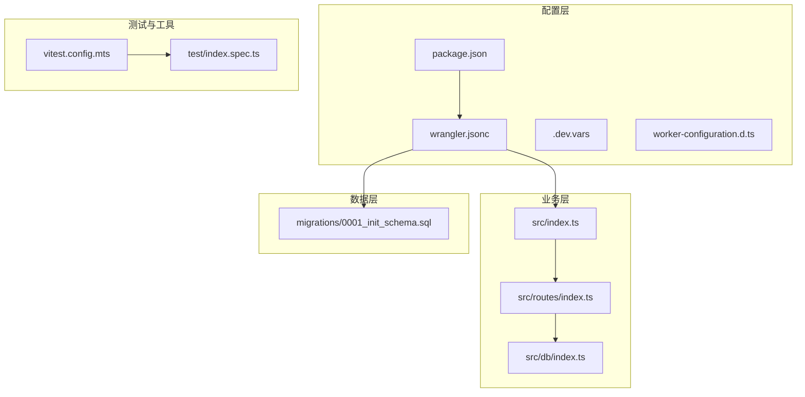
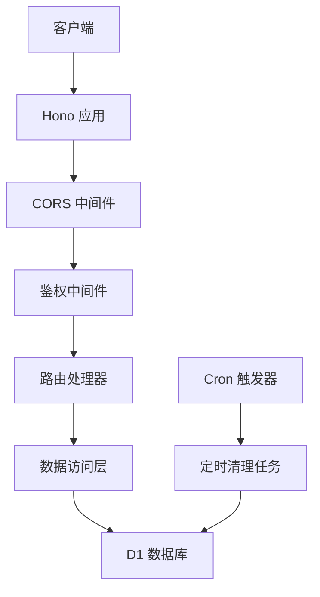
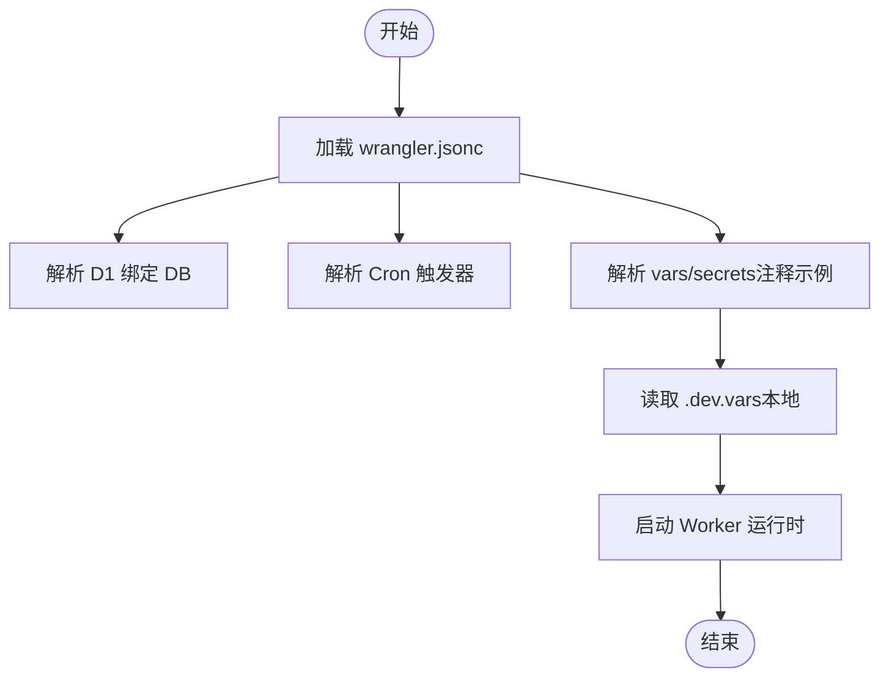
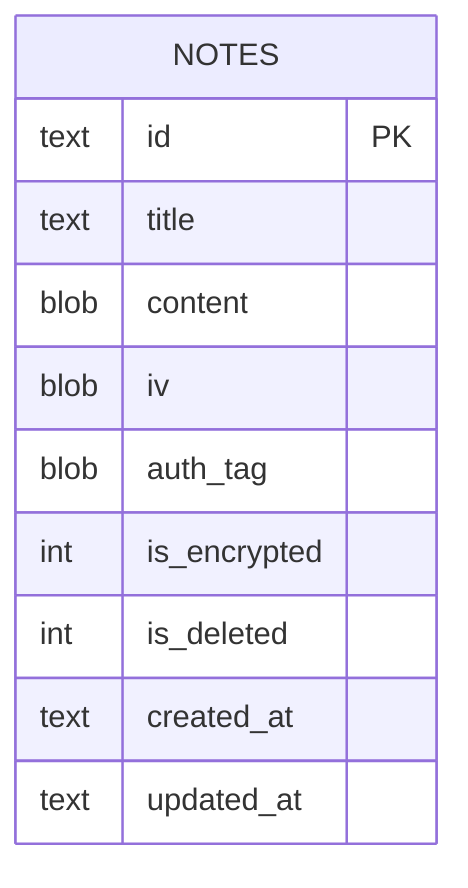
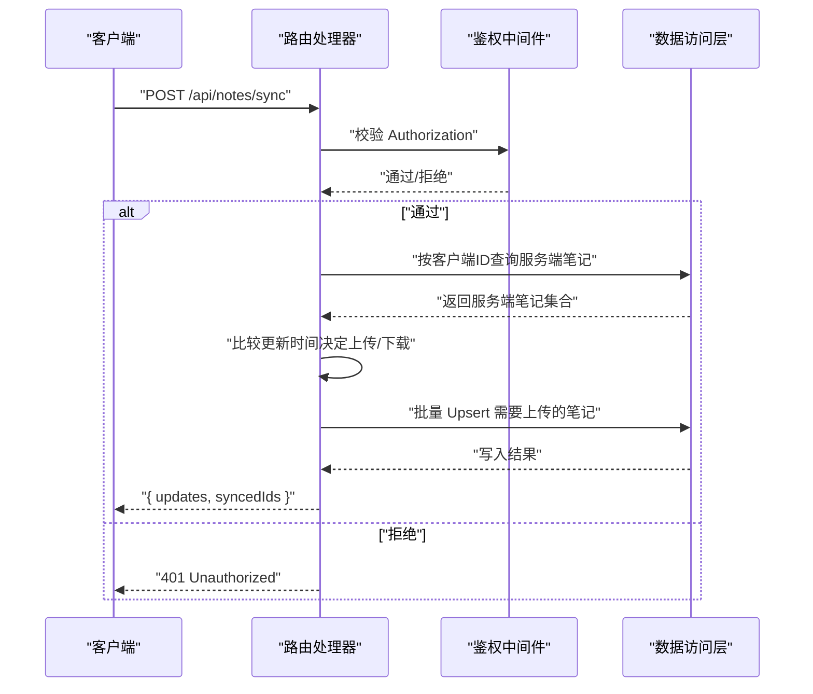
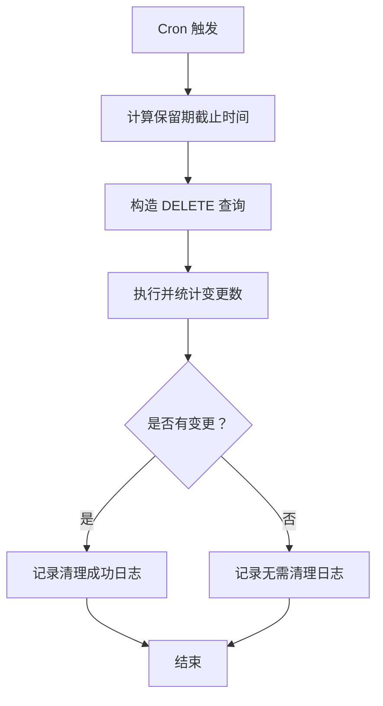
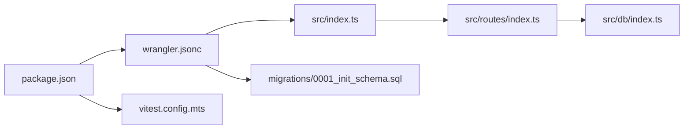

# 部署与运维

<cite>
**本文引用的文件**   
- [wrangler.jsonc](file://wrangler.jsonc)
- [package.json](file://package.json)
- [.dev.vars](file://.dev.vars)
- [worker-configuration.d.ts](file://worker-configuration.d.ts)
- [src/index.ts](file://src/index.ts)
- [src/db/index.ts](file://src/db/index.ts)
- [src/routes/index.ts](file://src/routes/index.ts)
- [migrations/0001_init_schema.sql](file://migrations/0001_init_schema.sql)
- [vitest.config.mts](file://vitest.config.mts)
- [test/index.spec.ts](file://test/index.spec.ts)
</cite>

## 目录

1. [简介](#简介)
2. [项目结构](#项目结构)
3. [核心组件](#核心组件)
4. [架构总览](#架构总览)
5. [详细组件分析](#详细组件分析)
6. [依赖关系分析](#依赖关系分析)
7. [性能考虑](#性能考虑)
8. [运维最佳实践](#运维最佳实践)
9. [故障排除指南](#故障排除指南)
10. [版本管理与回滚策略](#版本管理与回滚策略)
11. [结论](#结论)

## 简介

本文件面向 Notes Server 的部署与运维团队，系统性说明在 Cloudflare Workers 平台上的部署配置、环境变量管理、生产部署流程、监控与日志、数据库迁移、测试与验证、以及版本回滚策略。文档同时提供运维最佳实践与故障排除建议，帮助团队稳定、安全地交付与维护服务。

## 项目结构

Notes Server 基于 Hono 框架构建，采用最小化 Worker 结构，核心入口负责路由与错误处理，并通过 D1 数据库存储笔记数据。关键目录与文件如下：

- 配置层
  - wrangler.jsonc：Wrangler 部署配置，含可观测性、D1 绑定、定时触发器等
  - package.json：脚本与依赖，包含部署、开发、数据库迁移命令
  - .dev.vars：本地开发环境变量模板
  - worker-configuration.d.ts：运行时类型声明（由 Wrangler 生成）
- 业务层
  - src/index.ts：应用入口、全局中间件、错误与 404 处理、定时任务调度
  - src/routes/index.ts：API 路由与鉴权中间件
  - src/db/index.ts：笔记数据访问层（增删改查、批量写入、Base64 编解码）
- 数据层
  - migrations/0001_init_schema.sql：D1 初始化表结构与索引
- 测试与工具
  - vitest.config.mts：Vitest Workers 测试池配置
  - test/index.spec.ts：基础路由与鉴权测试样例

**图表来源**

- [wrangler.jsonc](file://wrangler.jsonc#L1-L54)
- [package.json](file://package.json#L1-L41)
- [src/index.ts](file://src/index.ts#L1-L105)
- [src/routes/index.ts](file://src/routes/index.ts#L1-L234)
- [src/db/index.ts](file://src/db/index.ts#L1-L251)
- [migrations/0001_init_schema.sql](file://migrations/0001_init_schema.sql#L1-L17)
- [vitest.config.mts](file://vitest.config.mts#L1-L12)
- [test/index.spec.ts](file://test/index.spec.ts#L1-L104)

**章节来源**

- [wrangler.jsonc](file://wrangler.jsonc#L1-L54)
- [package.json](file://package.json#L1-L41)
- [src/index.ts](file://src/index.ts#L1-L105)
- [src/routes/index.ts](file://src/routes/index.ts#L1-L234)
- [src/db/index.ts](file://src/db/index.ts#L1-L251)
- [migrations/0001_init_schema.sql](file://migrations/0001_init_schema.sql#L1-L17)
- [vitest.config.mts](file://vitest.config.mts#L1-L12)
- [test/index.spec.ts](file://test/index.spec.ts#L1-L104)

## 核心组件

- 应用入口与中间件
  - 全局 CORS 中间件
  - 统一错误处理与 404 处理
  - 定时任务调度（基于 Cron 触发器）
- 路由与鉴权
  - Bearer Token 鉴权中间件
  - 笔记 CRUD、批量导入、导出备份、同步接口
- 数据访问层
  - D1 访问封装、分页查询、批量 Upsert、软删除
  - Base64 与 ArrayBuffer 的编解码工具
- 配置与可观测性
  - Wrangler 可观测性开关
  - D1 数据库绑定
  - Cron 触发器配置

**章节来源**

- [src/index.ts](file://src/index.ts#L1-L105)
- [src/routes/index.ts](file://src/routes/index.ts#L1-L234)
- [src/db/index.ts](file://src/db/index.ts#L1-L251)
- [wrangler.jsonc](file://wrangler.jsonc#L10-L24)

## 架构总览

Notes Server 在 Cloudflare Workers 上以单体 Worker 运行，通过 D1 提供结构化数据持久化。请求经由 Hono 路由分发至各处理器，数据库操作通过 D1 API 执行；定时任务通过 Cron 触发器定期清理软删除笔记。

**图表来源**

- [src/index.ts](file://src/index.ts#L38-L75)
- [src/routes/index.ts](file://src/routes/index.ts#L7-L15)
- [src/db/index.ts](file://src/db/index.ts#L43-L250)
- [wrangler.jsonc](file://wrangler.jsonc#L20-L24)

## 详细组件分析

### 部署配置与环境变量

- Wrangler 配置要点
  - 应用名称、入口文件、兼容日期
  - 可观测性开启
  - D1 数据库绑定（DB），包含数据库名与 ID
  - Cron 触发器（每日 16:00）
  - 变量与密钥预留位置（注释中给出示例）
- 环境变量管理
  - 生产密钥通过 Wrangler Secrets 管理（API_KEY）
  - 开发阶段使用 .dev.vars 文件进行本地注入
  - 运行时类型通过 worker-configuration.d.ts 提供（由 Wrangler 生成）

**图表来源**

- [wrangler.jsonc](file://wrangler.jsonc#L5-L53)
- [.dev.vars](file://.dev.vars#L1-L2)
- [worker-configuration.d.ts](file://worker-configuration.d.ts#L1-L12)

**章节来源**

- [wrangler.jsonc](file://wrangler.jsonc#L1-L54)
- [.dev.vars](file://.dev.vars#L1-L2)
- [worker-configuration.d.ts](file://worker-configuration.d.ts#L1-L12)

### 数据库与迁移

- 表结构
  - notes 表包含主键、标题、内容（BLOB）、加密相关字段、软删除标记与时间戳
  - 索引覆盖标题、软删除与按更新时间排序的复合索引
- 迁移命令
  - 本地应用：通过脚本调用 Wrangler D1 迁移 apply
  - 远程应用：同上，但目标为远程数据库
- 数据访问层
  - 提供 findAll、findById、create、update、delete、批量删除、全量导出、批量 Upsert、按 ID 列表查询等
  - 内容与加密参数以 Base64 字符串传入，内部转换为 ArrayBuffer 存储

**图表来源**

- [migrations/0001_init_schema.sql](file://migrations/0001_init_schema.sql#L1-L17)

**章节来源**

- [migrations/0001_init_schema.sql](file://migrations/0001_init_schema.sql#L1-L17)
- [src/db/index.ts](file://src/db/index.ts#L43-L250)
- [package.json](file://package.json#L11-L12)

### API 工作流（鉴权与同步）

- 鉴权流程
  - 请求头 Authorization 必须为 Bearer Token，值需与环境变量 API_KEY 匹配
- 同步流程
  - 客户端提交 clientNotes，服务端根据 ID 与更新时间比较决定上传或下载
  - 上传路径：批量 Upsert
  - 下载路径：返回服务端侧更更新的笔记集合

**图表来源**

- [src/routes/index.ts](file://src/routes/index.ts#L7-L15)
- [src/routes/index.ts](file://src/routes/index.ts#L138-L197)
- [src/db/index.ts](file://src/db/index.ts#L202-L237)

**章节来源**

- [src/routes/index.ts](file://src/routes/index.ts#L7-L15)
- [src/routes/index.ts](file://src/routes/index.ts#L138-L197)
- [src/db/index.ts](file://src/db/index.ts#L202-L237)

### 定时任务与清理逻辑

- 触发器
  - Cron 规则：每日 16:00
- 清理策略
  - 删除软删除标记且更新时间早于保留期截止时间的记录
  - 保留期默认 30 天
  - 日志输出清理结果或无需清理信息

**图表来源**

- [src/index.ts](file://src/index.ts#L71-L104)

**章节来源**

- [src/index.ts](file://src/index.ts#L71-L104)

## 依赖关系分析

- 配置与运行时
  - package.json 定义部署、开发、测试、数据库迁移脚本
  - Vitest Workers 测试池指向 wrangler.jsonc
- 应用与数据
  - 路由依赖数据访问层，数据访问层依赖 D1
- 部署与可观测性
  - Wrangler 配置启用可观测性、绑定 D1、配置 Cron

**图表来源**

- [package.json](file://package.json#L6-L16)
- [vitest.config.mts](file://vitest.config.mts#L3-L10)
- [wrangler.jsonc](file://wrangler.jsonc#L5-L24)
- [src/index.ts](file://src/index.ts#L3-L40)
- [src/routes/index.ts](file://src/routes/index.ts#L1-L5)
- [src/db/index.ts](file://src/db/index.ts#L1-L5)
- [migrations/0001_init_schema.sql](file://migrations/0001_init_schema.sql#L1-L17)

**章节来源**

- [package.json](file://package.json#L6-L16)
- [vitest.config.mts](file://vitest.config.mts#L3-L10)
- [wrangler.jsonc](file://wrangler.jsonc#L5-L24)
- [src/index.ts](file://src/index.ts#L3-L40)
- [src/routes/index.ts](file://src/routes/index.ts#L1-L5)
- [src/db/index.ts](file://src/db/index.ts#L1-L5)
- [migrations/0001_init_schema.sql](file://migrations/0001_init_schema.sql#L1-L17)

## 性能考虑

- 数据库访问
  - 使用批量操作（batch、upsert）减少往返次数
  - 合理使用索引（标题、软删除、复合索引）提升查询效率
- 编解码开销
  - Base64 与 ArrayBuffer 的转换在数据量较大时可能带来 CPU 压力，建议控制单次批量大小
- 定时任务
  - Cron 仅执行轻量清理逻辑，避免长时间运行任务阻塞
- 可观测性
  - 启用可观测性后，利用日志与追踪定位热点路径与异常

[本节为通用性能建议，不直接分析具体文件]

## 运维最佳实践

- 环境变量与密钥
  - 生产密钥统一通过 Wrangler Secrets 管理，避免硬编码
  - 本地开发使用 .dev.vars 注入，确保与生产命名一致
- 部署流程
  - 本地开发：使用开发脚本启动本地 Worker 与 D1 本地实例
  - 部署：先应用迁移，再部署 Worker
  - 回滚：通过版本标签与 Wrangler 发布版本进行回滚
- 监控与日志
  - 启用可观测性，关注错误率、P95/P99 延迟与 Cron 任务执行情况
  - 关键路径增加结构化日志（如清理结果、同步差异）
- 数据备份
  - 使用导出接口定期备份笔记数据，结合对象存储或外部归档
- 安全
  - 强制 Bearer Token 鉴权，限制 API Key 作用域与轮换周期
  - 定期审查 Cron 任务权限与影响范围

[本节为通用运维建议，不直接分析具体文件]

## 故障排除指南

- 部署失败
  - 检查 wrangler.jsonc 配置项（D1 绑定、兼容日期、可观测性）
  - 确认数据库迁移已应用（本地/远程）
- 认证失败
  - 核对 Authorization 头与 API_KEY 是否匹配
  - 确认生产密钥已通过 Wrangler Secrets 设置
- 数据库问题
  - 检查 D1 表结构与索引是否正确
  - 关注批量写入的参数数量与大小
- 定时任务异常
  - 查看 Cron 触发日志与清理结果
  - 如清理无变化，确认软删除标记与截止时间计算
- 测试与验证
  - 使用 Vitest Workers 测试池运行集成测试
  - 通过单元测试验证路由存在性与鉴权行为

**章节来源**

- [wrangler.jsonc](file://wrangler.jsonc#L10-L24)
- [package.json](file://package.json#L11-L12)
- [src/routes/index.ts](file://src/routes/index.ts#L7-L15)
- [src/db/index.ts](file://src/db/index.ts#L43-L250)
- [src/index.ts](file://src/index.ts#L71-L104)
- [vitest.config.mts](file://vitest.config.mts#L3-L10)
- [test/index.spec.ts](file://test/index.spec.ts#L9-L103)

## 版本管理与回滚策略

- 版本号
  - 项目版本在 package.json 中定义，可用于发布标记
- 发布与回滚
  - 使用 Wrangler 发布版本，保留多个版本以便回滚
  - 回滚时选择目标版本，确保数据库迁移与代码版本一致
- 数据迁移
  - 迁移脚本独立于代码版本，回滚时需配合迁移状态检查
- 变更记录
  - 通过 Git 标签与提交信息记录每次发布与回滚

**章节来源**

- [package.json](file://package.json#L2-L4)
- [wrangler.jsonc](file://wrangler.jsonc#L5-L9)
- [migrations/0001_init_schema.sql](file://migrations/0001_init_schema.sql#L1-L17)

## 结论

Notes Server 在 Cloudflare Workers 上具备清晰的配置、路由与数据访问边界，配合 D1 与 Cron 实现了稳定的笔记服务。通过规范的环境变量管理、可观测性启用、完善的测试与迁移流程，以及明确的回滚策略，团队可以高效、安全地完成部署与运维工作。建议持续优化批量操作与索引策略，强化日志与告警体系，保障服务的高可用与可维护性。
