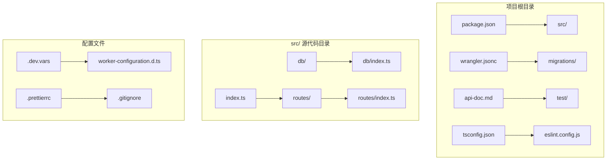
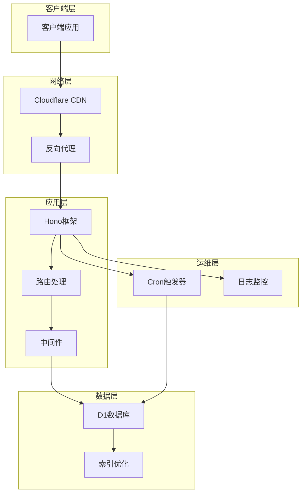
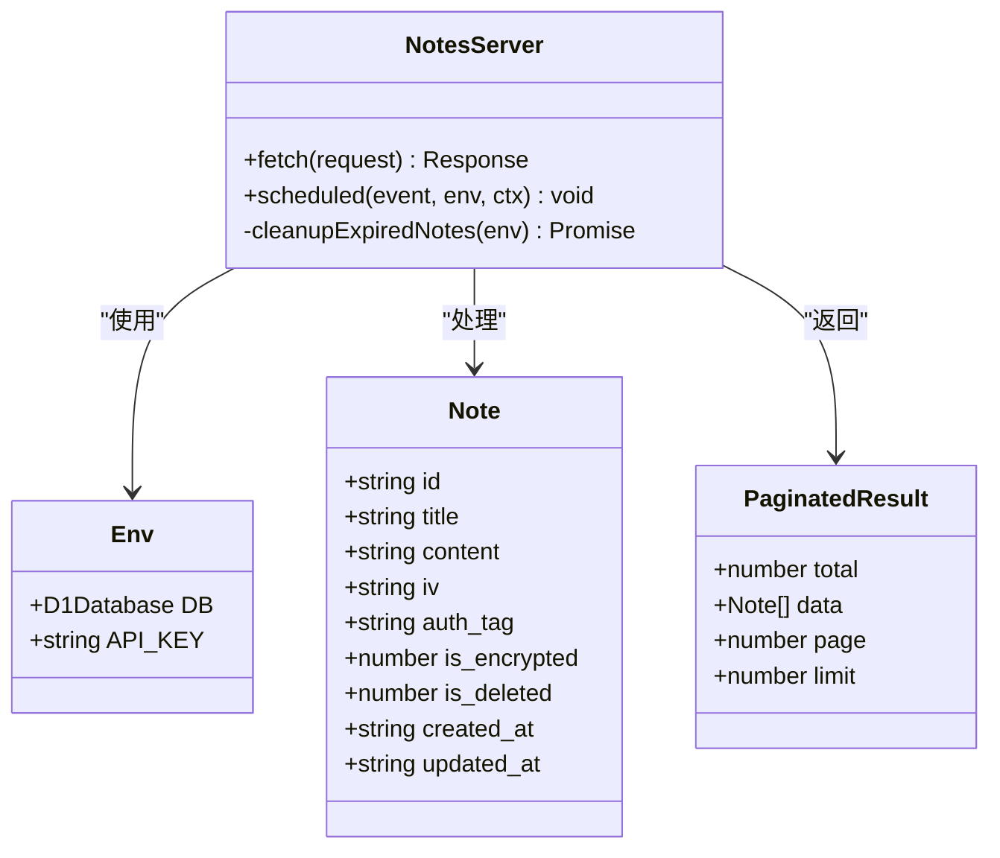
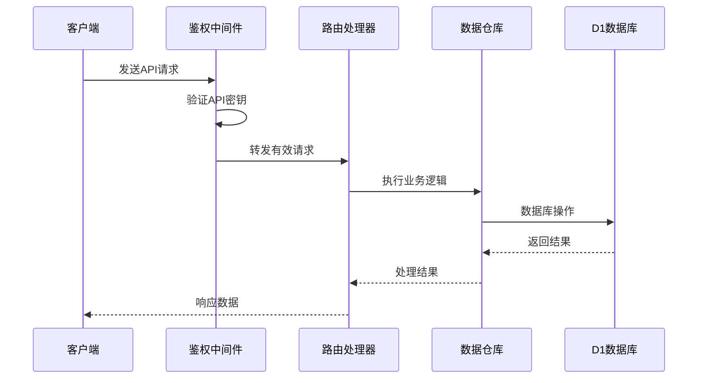
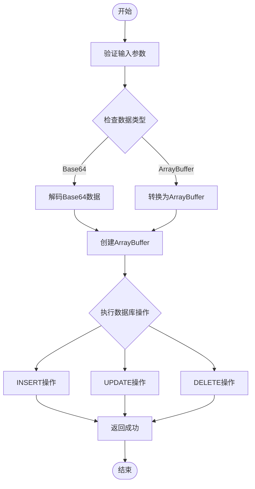

# 项目概述

<cite>
**本文档引用的文件**
- [package.json](file://package.json)
- [src/index.ts](file://src/index.ts)
- [src/routes/index.ts](file://src/routes/index.ts)
- [src/db/index.ts](file://src/db/index.ts)
- [wrangler.jsonc](file://wrangler.jsonc)
- [migrations/0001_init_schema.sql](file://migrations/0001_init_schema.sql)
- [api-doc.md](file://api-doc.md)
- [test/index.spec.ts](file://test/index.spec.ts)
- [.dev.vars](file://.dev.vars)
- [tsconfig.json](file://tsconfig.json)
- [eslint.config.js](file://eslint.config.js)
</cite>

## 目录

1. [简介](#简介)
2. [项目结构](#项目结构)
3. [核心组件](#核心组件)
4. [架构概览](#架构概览)
5. [详细组件分析](#详细组件分析)
6. [依赖关系分析](#依赖关系分析)
7. [性能考虑](#性能考虑)
8. [故障排除指南](#故障排除指南)
9. [结论](#结论)

## 简介

Notes Server是一个基于Cloudflare Workers的轻量级笔记管理服务后端应用。该项目提供RESTful API接口来管理笔记数据，采用无服务器架构设计，具有以下核心特性：

- **笔记CRUD操作**：完整的创建、读取、更新、删除功能
- **批量操作**：支持批量删除和批量插入/更新
- **数据同步**：双向同步机制确保客户端和服务器数据一致性
- **数据导出**：支持导出所有笔记数据
- **定时清理**：自动清理过期的软删除笔记

项目采用现代化的技术栈，包括Hono框架、Cloudflare D1数据库和无服务器部署，为开发者提供了高效、可扩展的笔记管理解决方案。

## 项目结构

项目采用模块化组织结构，主要目录和文件如下：



**图表来源**

- [package.json](file://package.json#L1-L41)
- [src/index.ts](file://src/index.ts#L1-L105)
- [src/routes/index.ts](file://src/routes/index.ts#L1-L234)
- [src/db/index.ts](file://src/db/index.ts#L1-L251)

**章节来源**

- [package.json](file://package.json#L1-L41)
- [tsconfig.json](file://tsconfig.json#L1-L46)

## 核心组件

### 应用入口点

应用的主入口位于`src/index.ts`，负责初始化Hono应用、配置中间件和路由。

### 路由系统

路由系统位于`src/routes/index.ts`，实现了完整的RESTful API接口：

- 笔记列表查询和分页
- 笔记详情获取
- 笔记创建、更新、删除
- 批量操作支持
- 数据同步机制
- 导出功能

### 数据访问层

数据访问层位于`src/db/index.ts`，提供了统一的数据库操作接口：

- 笔记数据的增删改查
- 批量操作支持
- 数据类型转换（Base64 ↔ ArrayBuffer）
- 软删除机制

**章节来源**

- [src/index.ts](file://src/index.ts#L1-L105)
- [src/routes/index.ts](file://src/routes/index.ts#L1-L234)
- [src/db/index.ts](file://src/db/index.ts#L1-L251)

## 架构概览

Notes Server采用了典型的三层架构设计：



**图表来源**

- [src/index.ts](file://src/index.ts#L38-L75)
- [wrangler.jsonc](file://wrangler.jsonc#L20-L24)
- [migrations/0001_init_schema.sql](file://migrations/0001_init_schema.sql#L1-L17)

### 技术栈选择

项目选择了以下核心技术栈：

- **Hono框架**：轻量级Web框架，专为Cloudflare Workers优化
- **Cloudflare D1**：原生支持的SQLite数据库，提供可靠的数据持久化
- **TypeScript**：提供类型安全和更好的开发体验
- **Wrangler**：Cloudflare Workers官方CLI工具
- **Vitest**：现代化的测试框架

**章节来源**

- [package.json](file://package.json#L32-L34)
- [wrangler.jsonc](file://wrangler.jsonc#L1-L54)

## 详细组件分析

### 应用入口组件

应用入口组件负责整体应用的初始化和配置：



**图表来源**

- [src/index.ts](file://src/index.ts#L8-L36)
- [src/index.ts](file://src/index.ts#L65-L105)

### 路由处理组件

路由处理组件实现了完整的RESTful API：



**图表来源**

- [src/routes/index.ts](file://src/routes/index.ts#L7-L15)
- [src/db/index.ts](file://src/db/index.ts#L43-L91)

### 数据访问组件

数据访问组件提供了统一的数据库操作接口：



**图表来源**

- [src/db/index.ts](file://src/db/index.ts#L10-L29)
- [src/db/index.ts](file://src/db/index.ts#L203-L237)

**章节来源**

- [src/index.ts](file://src/index.ts#L1-L105)
- [src/routes/index.ts](file://src/routes/index.ts#L1-L234)
- [src/db/index.ts](file://src/db/index.ts#L1-L251)

## 依赖关系分析

项目依赖关系清晰且模块化：

```mermaid
graph LR
subgraph "运行时依赖"
A[hono ^4.11.1] --> B[应用核心]
C[wrangler ^4.56.0] --> D[部署工具]
end
subgraph "开发时依赖"
E[@typescript-eslint/*] --> F[类型检查]
G[vitest ~3.2.0] --> H[测试框架]
I[eslint] --> J[代码质量]
K[prettier] --> L[代码格式化]
end
subgraph "项目文件"
M[package.json] --> N[依赖声明]
O[src/index.ts] --> P[应用入口]
Q[src/routes/index.ts] --> R[路由定义]
S[src/db/index.ts] --> T[数据访问]
U[migrations/0001_init_schema.sql] --> V[数据库模式]
end
A --> P
C --> D
E --> F
G --> H
I --> J
K --> L
M --> N
O --> P
Q --> R
S --> T
U --> V
```

**图表来源**

- [package.json](file://package.json#L18-L34)
- [src/index.ts](file://src/index.ts#L1-L4)
- [src/routes/index.ts](file://src/routes/index.ts#L1-L4)
- [src/db/index.ts](file://src/db/index.ts#L1-L4)

**章节来源**

- [package.json](file://package.json#L18-L34)
- [tsconfig.json](file://tsconfig.json#L1-L46)
- [eslint.config.js](file://eslint.config.js#L1-L28)

## 性能考虑

### 数据库优化

项目在数据库层面进行了多项优化：

- **索引策略**：为常用查询字段建立索引
- **批量操作**：支持批量插入和更新，减少数据库往返
- **软删除**：避免物理删除带来的性能问题

### 缓存策略

虽然当前版本未实现应用层缓存，但可以考虑：

- **CDN缓存**：利用Cloudflare CDN缓存静态资源
- **数据库连接池**：优化D1连接管理
- **查询优化**：使用预编译语句和参数绑定

### 部署优化

- **冷启动优化**：保持代码包最小化
- **区域部署**：利用Cloudflare全球节点
- **监控告警**：启用应用性能监控

## 故障排除指南

### 常见问题诊断

#### API认证失败

- 检查API密钥是否正确设置
- 验证Authorization头部格式
- 确认环境变量配置

#### 数据库连接问题

- 验证D1数据库绑定配置
- 检查迁移脚本执行状态
- 确认数据库权限设置

#### 调度任务异常

- 查看调度触发器配置
- 检查定时任务日志
- 验证清理逻辑执行情况

**章节来源**

- [src/routes/index.ts](file://src/routes/index.ts#L8-L15)
- [src/index.ts](file://src/index.ts#L71-L104)
- [test/index.spec.ts](file://test/index.spec.ts#L9-L103)

## 结论

Notes Server项目展现了现代无服务器应用的最佳实践：

### 技术优势

1. **架构简洁**：采用分层架构，职责分离明确
2. **性能优异**：利用Cloudflare Workers的边缘计算能力
3. **开发友好**：TypeScript提供类型安全，Hono框架易于使用
4. **运维简单**：无服务器部署，无需服务器管理

### 功能完整性

项目实现了完整的笔记管理功能，包括：

- 标准的CRUD操作
- 批量数据处理
- 双向数据同步
- 自动数据清理
- 数据导出功能

### 扩展潜力

项目具有良好的扩展性：

- 支持添加新的API端点
- 可以集成更多的Cloudflare服务
- 易于添加新的数据模型
- 支持多租户架构

对于初学者来说，这是一个优秀的学习项目，展示了如何构建现代化的无服务器应用；对于有经验的开发者，项目提供了实用的架构参考和最佳实践指导。
